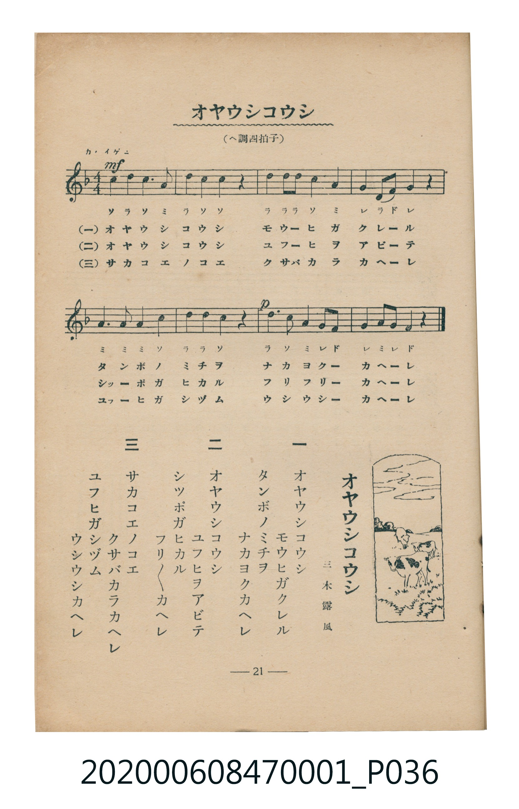

# オヤウシコウシ（母牛與小牛）

> Re:Shōka 使用 AI 協助辨識與重建樂譜，可能會有錯誤。歡迎回報。

- **NEUTRINO 歌聲合成版**：<br><audio controls src="oyaushi_koushi_neutrino.mp3"></audio>
- **鋼琴伴奏版**：<br><audio controls src="oyaushi_koushi.mp3"></audio>


- 詞：三木露風
- 臺灣教育會公認《新定兒童唱歌》尋常科第一學年用（2020.006.0847.0001）

## 說明

曲目說明
中文解釋：描寫母牛和小牛相依相伴的親情。

原書資訊與歌詞全文（對應 P036.jpg，書頁 p. 21，第二學期第 6 首）：
調性與拍號：ヘ調四拍子（F 大調 4/4 拍），「カハイゲニ」


## 歌詞

```text
一
オヤウシコウシ
モウヒガクレル
タンボノミチヲ
ナカヨクカヘレ

二
オヤウシコウシ
ユフヒヲアビテ
シッポガヒカル
フリフリカヘレ

三
サカコエノコエ
クサバカラカヘレ
ユフヒガシヅム
ウシウシカヘレ
```

## ABC

```abc
X:1
T:オヤウシコウシ（母牛與小牛）
M:4/4
L:1/16
Q:1/4=96
K:F
V:V1 name="Piano" snm="Pia"
[V:V1]
c4 d4 c4 A4 | d4 c4 c4 z4 | d4 d2 d2 c4 A4 | G4 D2 F2 G4 z4 |
w: 1.~オ ヤ ウ シ | コ ウ シ | モ ウ _ ヒ ガ | ク レ _ ル
w: 2.~オ ヤ ウ シ | コ ウ シ | ユ フ _ ヒ ヲ | ア ビ _ テ
w: 3.~サ カ コ エ | ノ コ エ | ク サ バ カ ラ | カ ヘ _ レ
A6 A2 A4 c4 | d4 d4 c4 z4 | d6 c2 A4 G2 F2 | G4 A2 G2 F4 z4 |
w: 1.~タ ン ボ ノ | ミ チ ヲ | ナ カ ヨ ク _ | カ ヘ _ レ
w: 2.~シッ _ ポ ガ | ヒ カ ル | フ リ フ リ _ | カ ヘ _ レ
w: 3.~ユフ _ ヒ ガ | シ ヅ ム | ウ シ ウ シ _ | カ ヘ _ レ
```

## TMD 檔案連結

- [主旋律 TMD 檔案](oyaushi_koushi.tmd) [[在 TMD Studio 編輯](https://tmdlang.github.io/Tmd-TS/#tmd=s7IKdvYPcrWy4qpTUCpJTLdSSM7PyUlNLsnMz7MqzsjMK0nNjM_KTMmPL87Iz05Ugisry88pzU21Si9KTEmNN4w3MjAyiDcwMIs3sDAxBzIMDBFKi_NLi5JTrYqTM_Lzc-JLUitKkvLzsxHyBUX5Zal5iXlANQVFIBtTwIoQClLLMlNSQdKpKZkl-UWZiTlI7kgtKga7FWxJfElRYl5xclFmAcgDCFUlGalAx6Yl5mbmVCJEgUalZ-ZZlSRmAj0H8mB5YnxuYmZeTmJeihKXlpbC46ZVj5uXPG5a9rhp--OmzRDG-z0dz9b3Pu-c_aKj_emGfiDj_Z5OBS0tLkVbBUszLntbBTcuGxN9EzuQPS9Wznu_Z9aTHZ3P5qx4OWfTy0UrwNa_aN_1vHHxs6kzXzRtejan-Wnrmhereh83dD2btuHpullPWyc9X7306ZSNz9b2PG7ofrqh--mOHc-XT3y-Zs2THQ1P1-54unPL8ykrgA4BBbseMNj1QMEOZBgYAt2ixKWvpfBs9qbns9e9WLXq2Yw-LgUFhSc71j6b1v5i-eKX7d1AFz3r73-6fjXEH08n9UD88Xz2jif75oLIPVuez2p5sWzVs-bWxw1NXFr6XCAzbakFQA562jf_2ewdLza3v1jRBQxJoFeBYfW0dQXQlUCPPd3Q-6y9UyHAwNhML6sg_f2eHqDilwsaFQr0FIyAnuwBhcWuHmBYPJszH8hWMFN4uWwa0PNAv4FMf7Fq_7OG5SBzu3tfzJwPFH3cPAMo-HT2bKDI07UTgHa4KTxdshwopgCMLAWgKFg3MMB7Hjetftzc_7gJGPObHjd3P27o5YIEYQOIwpoowBLNi0Cc5kmPm9Y8blr_uHnN4-bVEB37Hzdvftw853Fz3-Pm-Y-bGx83b4Lo6ALbtQKkHMSYAdQEsWtXDwG7gBZNBdnVvOlx06LHzZMfN7dBdGx_3Nz8uHkuyBEgpwBNhTgCpBxoGphEtWtHJ0TnVpA4yJYVIIeCGRAJoOO2Pm6eANa2EqEZxR0gPwOtbn3cvACiCeJmCImkg_LUAwUKoFTpX5lYCiymvPNBpFVAZmJevkONQU01yCYFGwstOzADW9pVgOSmFwt7FDRMFEAZYH2DDjzBaWLRALQPZFiNgqmCLjC96YJpYyCugfNA2AAuYgaECDVGIJF4BUMwA6wIbJyPYQ0omoF8YEyDyKZlYHI7WBMwFtDE4iHizYsQ4s2TwOw1UB3rwWIgHjDqYTogdhmRZxfElqkIu5o3QXWAXdE8GUy2odplDJLfCjYL5AqY6SugZvahiUHtgrgeqA-Y3mA6m1dC5SC8GXD_QWzDH8W7esiJYlCUgSIORIOiEBah6FEM4oPUGAHjFRLFxmA2ZgzvB6sGlgNAPAfMAoUAKCTmg3mN8HCFhXoXRAfQ18ASAswChQ3ucEDEMKgIAGsGKZgL1gpNHNCkAjEAnjigkQsSWwWPaFAyIWAZKIrBBQDcMtSUCEpDwCIBTC5AimNQeoKkMfQUiN2yWi4uXTsFlLyuABRQ5gIA)]
- [鋼琴伴奏 TMD 檔案](oyaushi_koushi_piano.tmd) [[在 TMD Studio 編輯](https://tmdlang.github.io/Tmd-TS/#tmd=s7IKdvYPcrWy4tLSUnjctOpx85LHTcseN21_3LQZwni_p-Nl957nE7Y82bPl6dL-550d7_d0KmhpcSnaKliacdnbKrhx2Zjom9hx1SkovVg57_2eWU92dD6bs-LlnE0vF61QAgu373reuPjZ1JkvmjY9m9P8tHXNi1W9jxu6nk3b8HTdrKetk56vXvp0ysZna3seN3Q_3dD9dMeO58snPl-z5smOhqdrdzzdueX5lBVAhxgZGBnoGRiY6RlYmJgDGQaGQLcocXH5VyaWFmdkeueDSKuAzMS8_CAPhxqDmmouBSCwsdCyAzP0tRRs0YECxJoXC3sUNEwUnm7of76-QUchwMDYTC-rIF0TiwYtfbBhNQqmCroKZkAMoo2BuAbOA2EDuIgZECLUGIFE4hUMwQywIrBxPoY1oAgA8oFxACKbloHJ7WBNwOhAE4uHiDcvQog3TwKz10B1rAeLgXiPm1fDdEDsMiLPLogtUxF2NW-C6gC7onkymGxDtcsYJL8VbBbIFTDTV0DN7EMTg9oFcT1Q3-PmCTCdzSuhchDeDLj_ILbhj-JdPeREMSjKQBEHokFRCItQ9CgG8UFqjIDxColiYzAbM4b3g1U_bt4MxHPALFAIgEJiPpjXCA9XWKh3QXQAff24GRRCkLDBHQ6IGN7-uLkZrBmkYC5YKzRxQJMKxAB44oBGLkhsFTyiQcmEgGWgKG5eBtOMmRJBaehxcyuYXIAUx6D0BElj6CkQu2W1WLO6D3JWN4Fm9RoFw3iFaMNYGFWjYALnG0B5JkiyRvFAllF8rIIpkAFUgMcQiDZshoD0RpsCDYHIg9yra6eA4uRoH6BKTEEjbILGYEFlLgA)]

## 分析

```text
================================================================================
📊 TMD Song Profile: [ オヤウシコウシ（母牛與小牛） ]
================================================================================
⏱  Duration:       0:20 (20.0s), 8 measures total
🎼 Key & Tempo:    首調基準 F, != 96.0 BPM, <4/4>
   - 分析範圍：      由實際發聲的音符與和弦推測調性；播放脈絡另行呈現
🎤 人聲音域:    D4 (MIDI 62) – D5 (MIDI 74) [跨度: 12 個半音 / 1.0 個八度, 難度: easy]
   - 最低音:  D4 in [OyaushiKoushi #1 @ m.4, 0:08]
   - 最高音: D5 in [OyaushiKoushi #1 @ m.1, 0:00]
   - 適合: soprano, mezzo-soprano, contralto, tenor, baritone, bass
🏛  結構:      OyaushiKoushi (20.0s)
⚡ 編曲密度:        Peak 1 軌道同時演奏
🗝  調性診斷：       C 調性不明確（純淨自然大調，未偵測到可信轉調）
   - 風格氣質:    純淨自然大調（陽光明朗、易唱易記，無明顯調外色彩）
   - 轉調歷程:    全曲維持單一推測調性（未偵測到可信轉調）
   - 核心骨幹音:  D, C, A, G, F
   - 調性數值:    C 調性不明確 [相關度: 0.65, 穩定度: Ambiguous, 自然音純度: 100.0%]
   - 候選調性 (K-S): C 大調 (0.65), D 小調 (0.64), A 小調 (0.63)
   - 五度圈歷程:   +0
   - 各段落調性細節:
     • [OyaushiKoushi #1]: C 調性不明確 (r: 0.65, 自然音純度: 100.0%)

  [ 五度圈游移軌跡 ]
              [C ]*
         F            G  
      Bb               D  
      Eb               A  
         Ab           E  
            Db       B  
               F# 
     (* = active key center)

  [ 十二半音累積音高分佈 ]
     C  : ███████████████████████   26.8%
     C# :                            0.0%
     D  : ████████████████████████  28.6%
     D# :                            0.0%
     E  :                            0.0%
     F  : ██████                     7.1%
     F# :                            0.0%
     G  : ████████████              14.3%
     G# :                            0.0%
     A  : ████████████████████      23.2%
     A# :                            0.0%
     B  :                            0.0%
--------------------------------------------------------------------------------
Assignment 軌道音域：
  - Piano         : D4 – D5 (12 個半音 / 1.0 個八度, 32 個音符)
================================================================================
```


## 原書掃描頁




