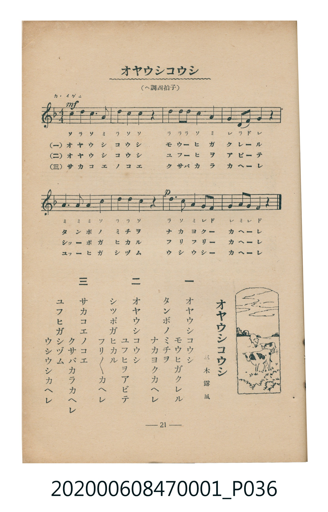

# オヤウシコウシ（母牛與小牛）

> Re:Shōka 使用 AI 協助辨識與重建樂譜，可能會有錯誤。歡迎[回報](https://github.com/TMDLang/reshoka/issues)。

- **鋼琴伴奏版**：<br><audio controls src="oyaushi_koushi.mp3"></audio>
- **NEUTRINO 歌聲合成版**：<br><audio controls src="oyaushi_koushi_neutrino.mp3"></audio>

- 詞：三木露風
- 臺灣教育會公認《新定兒童唱歌》尋常科第一學年用（2020.006.0847.0001）

## 說明

曲目說明
中文解釋：描寫母牛和小牛相依相伴的親情。

原書資訊與歌詞全文（對應 P036.jpg，書頁 p. 21，第二學期第 6 首）：
調性與拍號：ヘ調四拍子（F 大調 4/4 拍），「カハイゲニ」


## 歌詞

```text
一
オヤウシコウシ
モウヒガクレル
タンボノミチヲ
ナカヨクカヘレ

二
オヤウシコウシ
ユフヒヲアビテ
シッポガヒカル
フリフリカヘレ

三
サカコエノコエ
クサバカラカヘレ
ユフヒガシヅム
ウシウシカヘレ
```

## ABC

<div class="abc-score" data-abc-src="oyaushi_koushi.abc" aria-label="五線譜載入中"></div>

[下載 ABC 原始檔](oyaushi_koushi.abc)

## TMD 檔案連結

- [主旋律 TMD 檔案](oyaushi_koushi.tmd) [[在 TMD Studio 編輯](https://tmdlang.github.io/Tmd-TS/#tmd=s7IKdvYPcrWy4qpTUCpJTLdSSM7PyUlNLsnMz7MqzsjMK0nNjM_KTMmPL87Iz05Ugisry88pzU21Si9KTEmNN4w3MjAyiDcwMIs3sDAxBzIMDBFKi_NLi5JTrYqTM_Lzc-JLUitKkvLzsxHyBUX5Zal5iXlANQVFIBtTwIoQClLLMlNSQdKpKZkl-UWZiTlI7kgtKga7FWxJfElRYl5xclFmAcgDCFUlGalAx6Yl5mbmVCJEgUalZ-ZZlSRmAj0H8mB5YnxuYmZeTmJeCrKqkox8oD8LMiqtMjKLQQ5ITsyJz07MQwoOqPUFiempVgEGxmZKXFpaCo-bVj1uXvK4adnjpu2PmzZDGO_3dDxb3_u8c_aLjvanG_qBjPd7OhW0tLgUbRUszbjsbRXcuGxM9E3sQGa_WDnv_Z5ZT3Z0Ppuz4uWcTS8XrQBb-aJ91_PGxc-mznzRtOnZnOanrWterOp93ND1bNqGp-tmPW2d9Hz10qdTNj5b2_O4ofvphu6nO3Y8Xz7x-Zo1T3Y0PF274-nOLc-nrAA6BBRresBY0wPFGpBhYAh0ixKXvpbCs9mbns9e92LVqmcz-rgUFBSe7Fj7bFr7i-WLX7Z3A130rL__6frVEH88ndQD8cfz2Tue7JsLIvdseT6r5cWyVc-aWx83NHFp6XOBzLSlFgA56Gnf_Gezd7zY3P5iRRcwJIFeBYbV09YVQFcCPfZ0Q--z9k4FUEzoZRWkv9_TA1T8ckGjQoGeghHQkz2gsNjVAwyLZ3PmA9kKZgovl00Deh7oN5DpL1btf9awHGRud--LmfOBoo-bZwAFn86eDRR5unYC0A43hadLlgPFFICRpQAUBesGBnjP46bVj5v7HzcBY37T4-buxw29XJAgbABRWBMFWKJ5EYjTPOlx05rHTesfN6953LwaomP_4-bNj5vnPG7ue9w8_3Fz4-PmTRAdXWC7VoCUgxgzgJogdu3qIWAX0KKpILuaNz1uWvS4efLj5jaIju2Pm5sfN88FOQLkFKCpEEeAlANNA5Oodu3ohOjcChIH2bIC5FAwAyIBdNzWx80TwNpWIjSjuAPkZ6DVrY-bF0A0QdwMIZF0UJ56oEABlCr9KxNLgaWcdz6ItArITMzLd6gxqKkG2aRgY6FlB2ZgS7sKkNz0YmGPgoaJAigDrG_QgSc4TSwagPaBDKtRMFXQBaY3XTBtDMQ1cB4IG8BFzIAQocYIJBKvYAhmgBWBjfMxrAFFM5APjGkQ2bQMTG4HawLGAppYPES8eRFCvHkSmL0GqmM9WAzEA0Y9TAfELiPy7ILYMhVhV_MmqA6wK5ong8k2VLuMQfJbwWaBXAEzfQXUzD40MahdENcD9QHTG0xn80qoHIQ3A-4_iG34o3hXDzlRDIoyUMSBaFAUwiIUPYpBfJAaI2C8QqLYGMzGjOH9YNXAcgCI54BZoBAAhcR8MK8RHq6wUO-C6AD6GlhCgFmgsMEdDogYBhUBYM0gBXPBWqGJA5pUIAbAEwc0ckFiq-ARDUomBCwDRTG4AIBbhpoSQWkIWCSAyQVIcQxKT5A0hp4CsVtWy8Wla6eAktcVgALKXAA)]
- [鋼琴伴奏 TMD 檔案](oyaushi_koushi_piano.tmd) [[在 TMD Studio 編輯](https://tmdlang.github.io/Tmd-TS/#tmd=s7IKdvYPcrWy4qpTUCpJTLdSyC8qychPL0osyKi0ysgsLskvykxOzInPTsxLVIIrKs4vLUpOjS9ITE-1CjAwNlPi0tJSeNy06nHzksdNyx43bX_ctBnCeL-n42X3nucTtjzZs-Xp0v7nnR3v93QqaGlxKdoqWJpx2dsquHHZmOib2IHMfrFy3vs9s57s6Hw2Z8XLOZteLloBtvJF-67njYufTZ35omnTsznNT1vXvFjV-7ih69m0DU_XzXraOun56qVPp2x8trbncUP30w3dT3fseL584vM1a57saHi6dsfTnVueT1kBdIiRgZGBnoGBmZ6BhYk5kGFgCHSLEheXf2ViaXFGpnc-iLQKyEzMyw_ycKgxqKnmUgACGwstOzBDX0vBFh0oQKx5sbBHQcNE4emG_ufrG3QUQGGil1WQrolFg5Y-2LAaBVMFXQUzIAbRxkBcA-eBsAFcxAwIEWqMQCLxCoZgBlgR2DgfwxpQBAD5wDgAkU3LwOR2sCZgdKCJxUPEmxchxJsngdlroDrWg8VAvMfNq2E6IHYZkWcXxJapCLuaN0F1gF3RPBlMtqHaZQyS3wo2C-QKmOkroGb2oYlB7YK4HqjvcfMEmM7mlVA5CG8G3H8Q2_BH8a4ecqIYFGWgiAPRoCiERSh6FIP4IDVGwHiFRLExmI0Zw_vBqh83bwbiOWAWKARAITEfzGuEhyss1LsgOoC-ftwMCiFI2OAOB0QMb3_c3AzWDFIwF6wVmjigSQViADxxQCMXJLYKHtGgZELAMlAUNy-DacZMiaA09LhpF1hmAVIcg9ITJI2hp0DsltVizeo-yFndBJrVaxQM4xWiDWNhVI2CCZxvAOWZIMkaxQNZRvGxCqZABlABHkMg2rAZAtIbbQo0BCIPcq-unQKKk6N9gCoxBY2wCRqDBZW5AA)]

## 分析

```text
================================================================================
📊 TMD Song Profile: [ オヤウシコウシ（母牛與小牛） ]
================================================================================
⏱  Duration:       0:20 (20.0s), 8 measures total
🎼 Key & Tempo:    首調基準 F, != 96.0 BPM, <4/4>
   - 分析範圍：      由實際發聲的音符與和弦推測調性；播放脈絡另行呈現
🎤 人聲音域:    D4 (MIDI 62) – D5 (MIDI 74) [跨度: 12 個半音 / 1.0 個八度, 難度: easy]
   - 最低音:  D4 in [OyaushiKoushi #1 @ m.4, 0:08]
   - 最高音: D5 in [OyaushiKoushi #1 @ m.1, 0:00]
   - 適合: soprano, mezzo-soprano, contralto, tenor, baritone, bass
🏛  結構:      OyaushiKoushi (20.0s)
⚡ 編曲密度:        Peak 1 軌道同時演奏
🗝  調性診斷：       C 調性不明確（純淨自然大調，未偵測到可信轉調）
   - 風格氣質:    純淨自然大調（陽光明朗、易唱易記，無明顯調外色彩）
   - 轉調歷程:    全曲維持單一推測調性（未偵測到可信轉調）
   - 核心骨幹音:  D, C, A, G, F
   - 調性數值:    C 調性不明確 [相關度: 0.65, 穩定度: Ambiguous, 自然音純度: 100.0%]
   - 候選調性 (K-S): C 大調 (0.65), D 小調 (0.64), A 小調 (0.63)
   - 五度圈歷程:   +0
   - 各段落調性細節:
     • [OyaushiKoushi #1]: C 調性不明確 (r: 0.65, 自然音純度: 100.0%)

  [ 五度圈游移軌跡 ]
              [C ]*
         F            G  
      Bb               D  
      Eb               A  
         Ab           E  
            Db       B  
               F# 
     (* = active key center)

  [ 十二半音累積音高分佈 ]
     C  : ███████████████████████   26.8%
     C# :                            0.0%
     D  : ████████████████████████  28.6%
     D# :                            0.0%
     E  :                            0.0%
     F  : ██████                     7.1%
     F# :                            0.0%
     G  : ████████████              14.3%
     G# :                            0.0%
     A  : ████████████████████      23.2%
     A# :                            0.0%
     B  :                            0.0%
--------------------------------------------------------------------------------
Assignment 軌道音域：
  - Piano         : D4 – D5 (12 個半音 / 1.0 個八度, 32 個音符)
================================================================================
```


## 原書掃描頁




