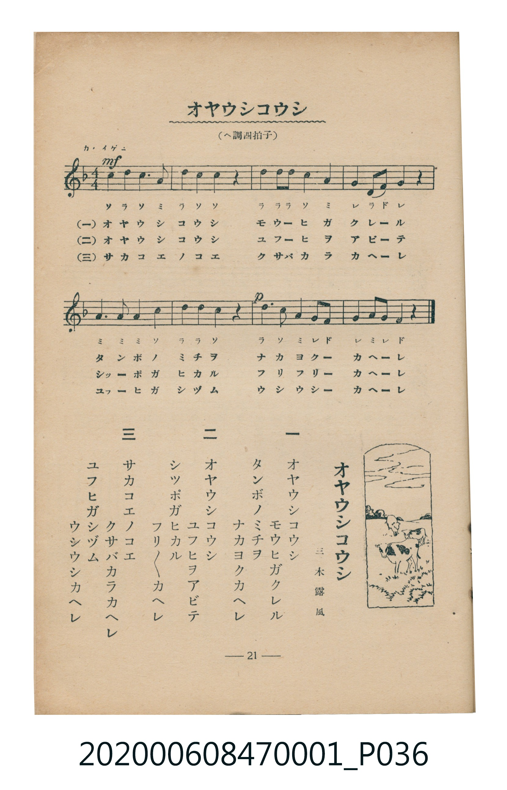

# オヤウシコウシ

<audio controls src="oyaushi_koushi.mp3"></audio>

- 詞：三木露風
- 臺灣教育會公認《新定兒童唱歌》尋常科第一學年用（2020.006.0847.0001）

- note

原書資訊與歌詞全文（對應 P036.jpg，書頁 p. 21，第二學期第 6 首）：
調性與拍號：ヘ調四拍子（F 大調 4/4 拍），「カハイゲニ」

## 歌詞

```text
一
オヤウシコウシ
モウヒガクレル
タンボノミチヲ
ナカヨクカヘレ

二
オヤウシコウシ
ユフヒヲアビテ
シッポガヒカル
フリフリカヘレ

三
サカコエノコエ
クサバカラカヘレ
ユフヒガシヅム
ウシウシカヘレ
```

## 原書掃描頁



## 調性分析

```text
================================================================================
📊 TMD Song Profile: [ オヤウシコウシ ]
================================================================================
⏱  Duration:       0:20 (20.0s), 8 measures total
🎼 Key & Tempo:    首調基準 F, != 96.0 BPM, <4/4>
   - 分析範圍：      由實際發聲的音符與和弦推測調性；播放脈絡另行呈現
🎤 人聲音域:    F4 (MIDI 65) – D5 (MIDI 74) [跨度: 9 個半音 / 0.8 個八度, 難度: easy]
   - 最低音:  F4 in [OyaushiKoushi #1 @ m.4, 0:08]
   - 最高音: D5 in [OyaushiKoushi #1 @ m.1, 0:00]
   - 適合: soprano, mezzo-soprano, contralto, tenor, baritone, bass
🏛  結構:      OyaushiKoushi (20.0s)
⚡ 編曲密度:        Peak 1 軌道同時演奏
🗝  調性診斷：       C 調性不明確（純淨自然大調，未偵測到可信轉調）
   - 風格氣質:    純淨自然大調（陽光明朗、易唱易記，無明顯調外色彩）
   - 轉調歷程:    全曲維持單一推測調性（未偵測到可信轉調）
   - 核心骨幹音:  D, C, A, G, F
   - 調性數值:    C 調性不明確 [相關度: 0.65, 穩定度: Ambiguous, 自然音純度: 100.0%]
   - 候選調性 (K-S): C 大調 (0.65), D 小調 (0.64), A 小調 (0.63)
   - 五度圈歷程:   +0
   - 各段落調性細節:
     • [OyaushiKoushi #1]: C 調性不明確 (r: 0.65, 自然音純度: 100.0%)

  [ 五度圈游移軌跡 ]
              [C ]*
         F            G  
      Bb               D  
      Eb               A  
         Ab           E  
            Db       B  
               F# 
     (* = active key center)

  [ 十二半音累積音高分佈 ]
     C  : ███████████████████████   26.8%
     C# :                            0.0%
     D  : ████████████████████████  28.6%
     D# :                            0.0%
     E  :                            0.0%
     F  : ██████                     7.1%
     F# :                            0.0%
     G  : ████████████              14.3%
     G# :                            0.0%
     A  : ████████████████████      23.2%
     A# :                            0.0%
     B  :                            0.0%
--------------------------------------------------------------------------------
Assignment 軌道音域：
  - Piano         : F4 – D5 (9 個半音 / 0.8 個八度, 32 個音符)
================================================================================
```

## ABC

```abc
X:1
T:オヤウシコウシ
C:TMD (Chen, Chih-Han / aguai)
M:4/4
L:1/16
Q:1/4=96
K:F

V:V1 name="Piano" snm="Pia"

[V:V1]
c4 d4 c4 a4 | d4 c4 c4 z4 | d4 d2 d2 c4 a4 | g4 d2 f2 g4 z4 |
a6 a2 a4 c4 | d4 d4 c4 z4 | d6 c2 a4 g2 f2 | g4 a2 g2 f4 z4 |
```

- [主旋律 TMD 檔案](oyaushi_koushi.tmd)
- [鋼琴伴奏 TMD 檔案](oyaushi_koushi_piano.tmd)
