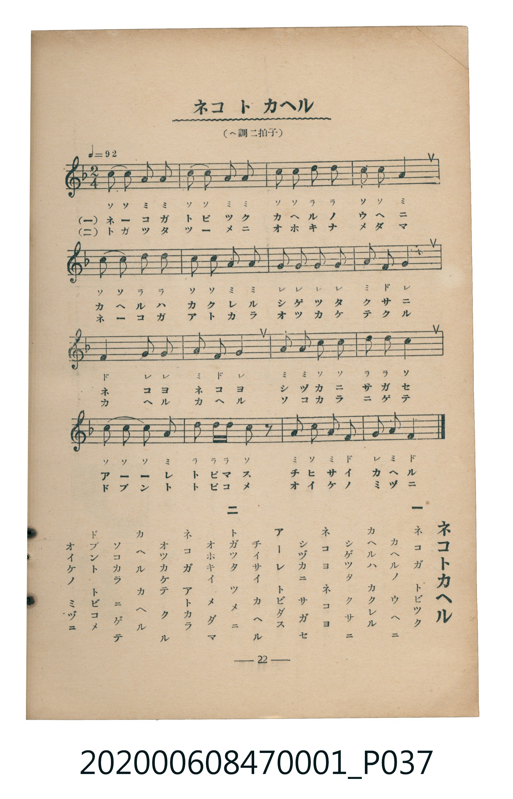

# ネコトカヘル（貓與青蛙）

> Re:Shōka 使用 AI 協助辨識與重建樂譜，可能會有錯誤。歡迎回報。

- **鋼琴伴奏版**：<br><audio controls src="neko_to_kaeru.mp3"></audio>
- **NEUTRINO 歌聲合成版**：<br><audio controls src="neko_to_kaeru_neutrino.mp3"></audio>

- 臺灣教育會公認《新定兒童唱歌》尋常科第一學年用（2020.006.0847.0001）

## 說明

曲目說明
中文解釋：描寫貓和青蛙相遇、嬉戲的童趣情景。


## 歌詞

```text
一
ネコガ　トビツク
カヘルノ　ウヘニ
カヘルハ　カクレル
シゲツタ　クサニ
ネコヨ　ネコヨ
シヅカニ　サガセ
アーレ　トビダス
チイサイ　カヘル

二
トガツタ　ツメニ
オホキイ　メダマ
ネコガ　アトカラ
オツカケテ　クル
カヘル　カヘル
ソコカラ　ニゲテ
ドブント　トビコメ
オイケノ　ミヅニ
```

## ABC

<div class="abc-score" data-abc-src="neko_to_kaeru.abc" aria-label="五線譜載入中"></div>

[下載 ABC 原始檔](neko_to_kaeru.abc)

## TMD 檔案連結

- [主旋律 TMD 檔案](neko_to_kaeru.tmd) [[在 TMD Studio 編輯](https://tmdlang.github.io/Tmd-TS/#tmd=s7IKdvYPcrWy4qpTUCpJTLdSSM7PyUlNLsnMz7MqzsjMK0nNjM_KTMmPL87Iz05Ugisry88pzU21Si9KTEmNN4w3MjAyiDcwMIs3sDAxBzIMDBFKi_NLi5JTrYqTM_Lzc-JLUitKkvLzsxHyBUX5Zal5iXlANQVFIBtTwIoQClLLMlNSQdKpKZkl-UWZiTlI7kgtKga7FWxJfElRYl5xclFmAcgDCFUlGalAxybmZeYi6wUalZ6ZZ1WSmFmemBefn5aWmYxidn5RSUY-0IcFGZVWGZnFIKuTE3PisxPzkAICanFBYnqqVYCBsbkSl5aWwuPm3sdNmx83dzxuWv24ecbj5tXv93S82DT5RUf7y7mTXsye-X5Pp4KWFpeirYKlEZe9rYIbl42RvokdyNQX7bueNy5-NnXmi6ZNz-Y0P21d82JV7-OGrmfTNjxdN-tp66Tnq5c-nbLx2dqexw3dTzd0P92x4_nyic_XrHmyo-Hp2h1Pd255PmUF0DpQlOgBo0QPFCVAhoEh0FIlLn0thWezNz2fve7FqlXPZvRxKSgoPNmx9tm09hfLF79s736_Z9az_v6n61cDXft0Ug_Etc9n73jZ2P64ofHpms5nHZuez2oBuuHFtsXPmlufzVz_uKGJS0ufC2gyF9AJXFC_N6153NAACoHmyY-bWx43reeCh8Xj5j6QXNMyMLcbWaIfLLEaqPxx8xqgCFBu--OmTWAT9oPl1j9u2grWBA3iFWBroGyw8uZWsIHdYOVbQQ5p2g2UWPS4eQ_IUISrgNI7geY0Pm5aAla4BGo52C1cXE929QBlgVEIdAjMeiCjeSHEzaseN89-3LQWqg0kCiTnoXofZCkkDayE6ACaA_TcxsfNbVDPgL0I8z6y9Y-b9oLNAekFW9ANDoc2oAWdj5unPW4GJy-4Z0DeXwi2A-QZoAXgIG6eDwoNoHNB8eObCEzsAZmJefkONQY11aCYV7AxNNOyA7NqFEwVdMHYGIrxiZhBMaoaEKwBm-ZjWAPKBFAxoOvA5BqwDqCLQbzmyWCyBSyzHiLTtBosNgNMQth9UJllSDLdqHYZwc0E2wAzcz_UNhAP7IrmhXDdIBNXgXmzwWrXgsklUB0QdQ1gch7cLrRgwh4EkGAyApLIuAYsbgjloQUTFk_3IwcHOHCAKRcuD5LZDpbZhOldiOqmrTgDCkekNC0C64AEI8QVK1ECCmILxEUboQHVhuQ-kAxKQIG8C4KogQCCsICAiIAwLAhr4MEK4hFIT80roM7AIQ4JpOZWJC_B4h4cPJDU0rQbM5DAqiFpBhEt-MT3IgUoSuCBbYRFFCi4sKYlWOqBed8MLGIADyKYPCjgIKkLxkNPS6BYhEFImkHOcKBEDSz0gLx4qEwj2HmghA8LFGgmwEiV6OmoEywzDUxCgh1kC4ptwACBZCaobZCUBLUNlIbg2bt5PpgHjiqkVFvLxaVrpwAquBSAtDIXAA)]
- [鋼琴伴奏 TMD 檔案](neko_to_kaeru_piano.tmd) [[在 TMD Studio 編輯](https://tmdlang.github.io/Tmd-TS/#tmd=s7IKdvYPcrWy4qpTUCpJTLdSyC8qychPL0osyKi0ysgsLskvykxOzInPTsxLVIIrKs4vLUpOjS9ITE-1CjAwNlfi0tJSeNzc-7hp8-PmjsdNqx83z3jcvPr9no7HzVMeNy163Nz3ZM-Wp0v7n-ye8X5Pp4KWFpeirYKlEZe9rYIbl42RvokdyOwX7bueNy5-NnXmi6ZNz-Y0P21d82JV7-OGrmfTNjxdN-tp66Tnq5c-nbLx2dqexw3dTzd0P92x4_nyic_XrHmyo-Hp2h1Pd255PmUF0FIjAyMDPQMDMz0DCxNzIMPAEGipEheXb2JmnlVAZmJefpCHQ41BTTWXAhDYGJpp2YFZNQqmCrpgbAzF-ETMoBhVDQjWgE3zMawBhQlUDBg0YHINWAcwlEC85slgsgUssx4i07QaLDYDTELYfVCZZUgy3ah2GcHNBNsAM3M_1DYQD-yK5oVw3SATV4F5s8Fq14LJJVAdEHUNYHIe3C60YMIeBJBgMgKSyLgGLG4I5aEFExZP9yMHBzhwHjdDvAYSAclsB8tswvQuRHXTVpwBhSNSmhaBdUCCEeKKlSgBBbEF4qKN0IBqQ3IfSAYloEDeBUHUQABBWEBAREAYFoQ18GAF8Qikp-YVUGfgEIcEUnMrkpdgcQ8OHkhqadqNGUhg1ZA0g4gWfOJ7kQIUJfDANsIiChRcWNMSLPXAvG8GFjGABxFMHhRwkNQF46GnJVAswiAkzSBnOFCifty0E8iLh8o0gp0HSviwQIFmAoxUiZ6OOsEy08AkJNhBtqDYBgwQSGaC2gZJSVDbQGkInr2b54N54KhCSrW1yOWWD3K5ZQEvtqINY4FqISQOngkWOVTd2FQoRBvF54L5UBoubxqPxQioIH73gO3B6gIMFQaYchArYNqBgaNrpwAKn2gfkBCMbQRmK3MBAA)]

## 分析

```text
================================================================================
📊 TMD Song Profile: [ ネコトカヘル（貓與青蛙） ]
================================================================================
⏱  Duration:       0:20 (20.9s), 16 measures total
🎼 Key & Tempo:    首調基準 F, != 92.0 BPM, <2/4>
   - 分析範圍：      由實際發聲的音符與和弦推測調性；播放脈絡另行呈現
🎤 人聲音域:    F4 (MIDI 65) – D5 (MIDI 74) [跨度: 9 個半音 / 0.8 個八度, 難度: easy]
   - 最低音:  F4 in [Main #1 @ m.8, 0:09]
   - 最高音: D5 in [Main #1 @ m.3, 0:03]
   - 適合: soprano, mezzo-soprano, contralto, tenor, baritone, bass
🏛  結構:      Main (20.9s)
⚡ 編曲密度:        Peak 1 軌道同時演奏
🗝  調性診斷：       C 調性不明確（純淨自然大調，未偵測到可信轉調）
   - 風格氣質:    純淨自然大調（陽光明朗、易唱易記，無明顯調外色彩）
   - 轉調歷程:    全曲維持單一推測調性（未偵測到可信轉調）
   - 核心骨幹音:  C, A, G, D, F
   - 調性數值:    C 調性不明確 [相關度: 0.78, 穩定度: Ambiguous, 自然音純度: 100.0%]
   - 候選調性 (K-S): C 大調 (0.78), A 小調 (0.77), F 大調 (0.67)
   - 五度圈歷程:   +0
   - 各段落調性細節:
     • [Main #1]: C 調性不明確 (r: 0.78, 自然音純度: 100.0%)

  [ 五度圈游移軌跡 ]
              [C ]*
         F            G  
      Bb               D  
      Eb               A  
         Ab           E  
            Db       B  
               F# 
     (* = active key center)

  [ 十二半音累積音高分佈 ]
     C  : ████████████████████████  33.3%
     C# :                            0.0%
     D  : █████████                 12.7%
     D# :                            0.0%
     E  :                            0.0%
     F  : ████████                  11.1%
     F# :                            0.0%
     G  : ███████████               15.9%
     G# :                            0.0%
     A  : ███████████████████       27.0%
     A# :                            0.0%
     B  :                            0.0%
--------------------------------------------------------------------------------
Assignment 軌道音域：
  - Piano         : F4 – D5 (9 個半音 / 0.8 個八度, 58 個音符)
================================================================================
```


## 原書掃描頁




