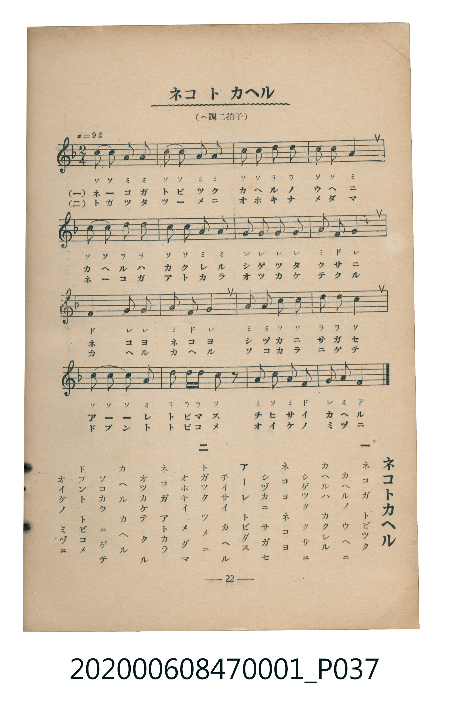

# ネコトカヘル（貓與青蛙）

> Re:Shōka 使用 AI 協助辨識與重建樂譜，可能會有錯誤。歡迎回報。

- **NEUTRINO 歌聲合成版**：<br><audio controls src="neko_to_kaeru_neutrino.mp3"></audio>
- **鋼琴伴奏版**：<br><audio controls src="neko_to_kaeru.mp3"></audio>


- 臺灣教育會公認《新定兒童唱歌》尋常科第一學年用（2020.006.0847.0001）

## 說明

曲目說明
中文解釋：描寫貓和青蛙相遇、嬉戲的童趣情景。


## 跨冊／重複收錄參照

> 同曲（《公學校唱歌集》、《新定兒童唱歌》共同收錄教材）

- **[同曲]** 《公學校唱歌集》（大正4年／1915，國臺圖 0725 26）：[**〈猫と蛙〉**](../../../kogakko_shokashu_1915/1_05_neko_to_kaeru/index.md)（`F` / `2/4` — [原始 TMD](../../../kogakko_shokashu_1915/1_05_neko_to_kaeru/neko_to_kaeru.tmd)）
- 總表：[跨冊重複與同名歌曲總索引](../../../duplicate_songs.md)

## 歌詞

```text
一
ネコガ　トビツク
カヘルノ　ウヘニ
カヘルハ　カクレル
シゲツタ　クサニ
ネコヨ　ネコヨ
シヅカニ　サガセ
アーレ　トビダス
チイサイ　カヘル

二
トガツタ　ツメニ
オホキイ　メダマ
ネコガ　アトカラ
オツカケテ　クル
カヘル　カヘル
ソコカラ　ニゲテ
ドブント　トビコメ
オイケノ　ミヅニ
```

## ABC

```abc
X:1
T:ネコトカヘル（貓與青蛙）
M:2/4
L:1/16
Q:1/4=92
K:F
V:V1 name="Piano" snm="Pia"
[V:V1]
c2 c2 A2 A2 | c2 c2 A2 A2 | c2 c2 d2 d2 | c2 c2 A4 |
w: 1.~ネ _ コ ガ | ト ビ ツ ク | カ ヘ ル ノ | ウ ヘ ニ
w: 2.~ト ガ ツ タ | ツ _ メ ニ | オ ホ キ イ | メ ダ マ
c2 c2 d2 d2 | c2 c2 A2 A2 | G2 G2 G2 G2 | A2 F2 G4 |
w: 1.~カ ヘ ル ハ | カ ク レ ル | シ ゲ ツ タ | ク サ ニ
w: 2.~ネ _ コ ガ | ア ト カ ラ | オ ツ カ ケ | テ ク ル
F4 G2 G2 | A4 F2 G2 | A2 A2 c2 c2 | d2 d2 c4 |
w: 1.~ネ コ ヨ | ネ コ ヨ | シ ヅ カ ニ | サ ガ セ
w: 2.~カ ヘ ル | カ ヘ ル | ソ コ カ ラ | ニ ゲ テ
c2 c2 c2 A2 | d2 d d c2 z2 | A2 c2 A2 F2 | G2 A2 F4 |
w: 1.~ア _ _ レ | ト ビ ダ ス | チ イ サ イ | カ ヘ ル
w: 2.~ド ブ ン ト | ト ビ コ メ | オ イ ケ ノ | ミ ヅ ニ
```

## TMD 檔案連結

- [主旋律 TMD 檔案](neko_to_kaeru.tmd) [[在 TMD Studio 編輯](https://tmdlang.github.io/Tmd-TS/#tmd=s7IKdvYPcrWy4qpTUCpJTLdSSM7PyUlNLsnMz7MqzsjMK0nNjM_KTMmPL87Iz05Ugisry88pzU21Si9KTEmNN4w3MjAyiDcwMIs3sDAxBzIMDBFKi_NLi5JTrYqTM_Lzc-JLUitKkvLzsxHyBUX5Zal5iXlANQVFIBtTwIoQClLLMlNSQdKpKZkl-UWZiTlI7kgtKga7FWxJfElRYl5xclFmAcgDCFUlGalAxybmZeaC9GppKTxu7n3ctPlxc8fjptWPm2c8bl79fk_Hi02TX3S0v5w76cXsme_3dCpoaXEp2ipYGnHZ2yq4cdkY6ZvYgUx80b7reePiZ1Nnvmja9GxO89PWNS9W9T5u6Ho2bcPTdbOetk56vnrp0ykbn63tedzQ_XRD99MdO54vn_h8zZonOxqert3xdOeW51NWAK0DhZkeMMz0QGEGZBgYAi1V4tLXUng2e9Pz2eterFr1bEYfl4KCwpMda59Na3-xfPHL9u73e2Y96-9_un410LVPJ_VAXPt89o6Xje2PGxqfrul81rHp-awWoBtebFv8rLn12cz1jxuauLT0uYAmcwGdwAX1e9Oaxw0NoBBonvy4ueVx03oueFg8bu4DyTUtA3O7kSX6wRKrgcofN68BigDltj9u2gQ2YT9Ybv3jpq1gTdAgXgG2BsoGK29uBRvYDVa-FeSQpt1AiUWPm_eADEW4Cii9E2hO4-OmJWCFS6CWg93CxfVkVw9QFhiFQIfArAcymhdC3LzqcfPsx01rodpAokByHqr3QZZC0sBKiA6gOUDPbXzc3Ab1DNiLMO8jW_-4aS_YHJBesAXd4HBoA1rQ-bh52uNmcPKCewbk_YVgO0CeAVoADuLm-aDQADoXFD--iZl5VgGZiXn5DjUGNdWgmFewMTTTsgOzahRMFXTB2BiK8YmYQTGqGhCsAZvmY1gDygRQMaDrwOQasA6gi0G85slgsgUssx4i07QaLDYDTELYfVCZZUgy3ah2GcHNBNsAM3M_1DYQD-yK5oVw3SATV4F5s8Fq14LJJVAdEHUNYHIe3C60YMIeBJBgMgKSyLgGLG4I5aEFExZP9yMHBzhwgCkXLg-S2Q6W2YTpXYjqpq04AwpHpDQtAuuABCPEFStRAgpiC8RFG6EB1YbkPpAMSkCBvAuCqIEAgrCAgIiAMCwIa-DBCuIRSE_NK6DOwCEOCaTmViQvweIeHDyQ1NK0GzOQwKohaQYRLfjE9yIFKErggW2ERRQouLCmJVjqgXnfDCxiAA8imDwo4CCpC8ZDT0ugWIRBSJpBznCgRA0s9IC8eKhMI9h5oIQPCxRoJsBIlejpqBMsMw1MQoIdZAuKbcAAgWQmqG2QlAS1DZSG4Nm7eT6YB44qpFRby8Wla6cAKrgUgLQyFwA)]
- [鋼琴伴奏 TMD 檔案](neko_to_kaeru_piano.tmd) [[在 TMD Studio 編輯](https://tmdlang.github.io/Tmd-TS/#tmd=s7IKdvYPcrWy4tLSUnjc3Pu4afPj5o7HTasfN8943Lz6_Z6Ox81THjctetzc92TPlqdL-5_snvF-T6eClhaXoq2CpRGXva2CG5eNkb6JHVedgtKL9l3PGxc_mzrzRdOmZ3Oan7auebGq93FD17NpG56um_W0ddLz1UufTtn4bG3P44bupxu6n-7Y8Xz5xOdr1jzZ0fB07Y6nO7c8n7ICaKmRgZGBnoGBmZ6BhYk5kGFgCLRUiYvLNzEzzyogMzEvP8jDocagpppLAQhsDM207MCsGgVTBV0wNoZifCJmUIyqBgRrwKb5GNaAwgQqBgwaMLkGrAMYSiBe82Qw2QKWWQ-RaVoNFpsBJiHsPqjMMiSZblS7jOBmgm2AmbkfahuIB3ZF80K4bpCJq8C82WC1a8HkEqgOiLoGMDkPbhdaMGEPAkgwGQFJZFwDFjeE8tCCCYun-5GDAxw4j5shXgOJgGS2g2U2YXoXorppK86AwhEpTYvAOiDBCHHFSpSAgtgCcdFGaEC1IbkPJIMSUCDvgiBqIIAgLCAgIiAMC8IaeLCCeATSU_MKqDNwiEMCqbkVyUuwuAcHDyS1NO3GDCSwakiaQUQLPvG9SAGKEnhgG2ERBQourGkJlnpg3jcDixjAgwgmDwo4SOqC8dDTEigWYRCSZpAzHChRP27aCeTFQ2Uawc4DJXxYoEAzAUaqRE9HnWCZaWASEuwgW1BsAwYIJDNBbYOkJKhtoDQEz97N88E8cFQhpdpa5HLLB7ncsoAXW9GGsUC1EBIHzwSLHKpubCoUoo3ic8F8KA2XN43HYgRUEL97wPZgdQGGCgNMOYgVMO3AwNG1UwCFT7QPSAjGNgKzlbkA)]

## 分析

```text
================================================================================
📊 TMD Song Profile: [ ネコトカヘル（貓與青蛙） ]
================================================================================
⏱  Duration:       0:20 (20.9s), 16 measures total
🎼 Key & Tempo:    首調基準 F, != 92.0 BPM, <2/4>
   - 分析範圍：      由實際發聲的音符與和弦推測調性；播放脈絡另行呈現
🎤 人聲音域:    F4 (MIDI 65) – D5 (MIDI 74) [跨度: 9 個半音 / 0.8 個八度, 難度: easy]
   - 最低音:  F4 in [Main #1 @ m.8, 0:09]
   - 最高音: D5 in [Main #1 @ m.3, 0:03]
   - 適合: soprano, mezzo-soprano, contralto, tenor, baritone, bass
🏛  結構:      Main (20.9s)
⚡ 編曲密度:        Peak 1 軌道同時演奏
🗝  調性診斷：       C 調性不明確（純淨自然大調，未偵測到可信轉調）
   - 風格氣質:    純淨自然大調（陽光明朗、易唱易記，無明顯調外色彩）
   - 轉調歷程:    全曲維持單一推測調性（未偵測到可信轉調）
   - 核心骨幹音:  C, A, G, D, F
   - 調性數值:    C 調性不明確 [相關度: 0.78, 穩定度: Ambiguous, 自然音純度: 100.0%]
   - 候選調性 (K-S): C 大調 (0.78), A 小調 (0.77), F 大調 (0.67)
   - 五度圈歷程:   +0
   - 各段落調性細節:
     • [Main #1]: C 調性不明確 (r: 0.78, 自然音純度: 100.0%)

  [ 五度圈游移軌跡 ]
              [C ]*
         F            G  
      Bb               D  
      Eb               A  
         Ab           E  
            Db       B  
               F# 
     (* = active key center)

  [ 十二半音累積音高分佈 ]
     C  : ████████████████████████  33.3%
     C# :                            0.0%
     D  : █████████                 12.7%
     D# :                            0.0%
     E  :                            0.0%
     F  : ████████                  11.1%
     F# :                            0.0%
     G  : ███████████               15.9%
     G# :                            0.0%
     A  : ███████████████████       27.0%
     A# :                            0.0%
     B  :                            0.0%
--------------------------------------------------------------------------------
Assignment 軌道音域：
  - Piano         : F4 – D5 (9 個半音 / 0.8 個八度, 58 個音符)
================================================================================
```


## 原書掃描頁




