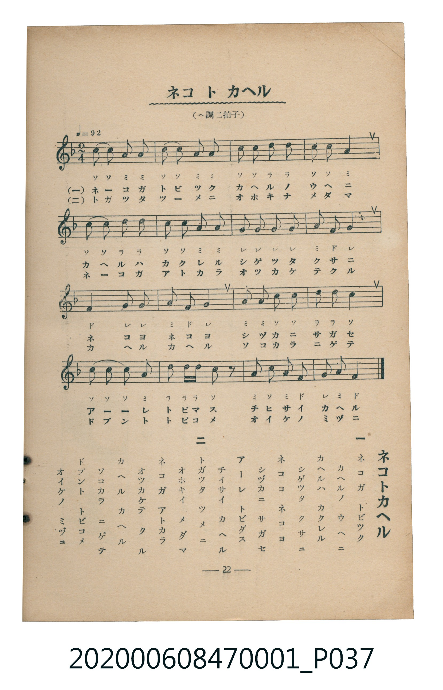

# ネコトカヘル

<audio controls src="neko_to_kaeru.mp3"></audio>

- 臺灣教育會公認《新定兒童唱歌》尋常科第一學年用（2020.006.0847.0001）

## 說明

・出處：臺灣教育會公認《新定兒童唱歌》尋常科第一學年用（2020.006.0847.0001）
・調性與拍號：調號 ?= F，拍號 <2/4>，速度 != 92

## 歌詞

```text
一
ネコガ　トビツク
カヘルノ　ウヘニ
カヘルハ　カクレル
シゲツタ　クサニ
ネコヨ　ネコヨ
シヅカニ　サガセ
アーレ　トビダス
チイサイ　カヘル

二
トガツタ　ツメニ
オホキイ　メダマ
ネコガ　アトカラ
オツカケテ　クル
カヘル　カヘル
ソコカラ　ニゲテ
ドブント　トビコメ
オイケノ　ミヅニ
```

## ABC

```abc
X:1
T:ネコトカヘル
M:2/4
L:1/16
Q:1/4=92
K:F
V:V1 name="Piano" snm="Pia"
[V:V1]
c2 c2 A2 A2 | c2 c2 A2 A2 | c2 c2 d2 d2 | c2 c2 A4 |
c2 c2 d2 d2 | c2 c2 A2 A2 | G2 G2 G2 G2 | A2 F2 G4 |
F4 G2 G2 | A4 F2 G2 | A2 A2 c2 c2 | d2 d2 c4 |
c2 c2 c2 A2 | d2 d d c2 z2 | A2 c2 A2 F2 | G2 A2 F4 |
c2 c2 A2 A2 | c2 c2 A2 A2 | c2 c2 d2 d2 | c2 c2 A4 |
c2 c2 d2 d2 | c2 c2 A2 A2 | G2 G2 G2 G2 | A2 F2 G4 |
F4 G2 G2 | A4 F2 G2 | A2 A2 c2 c2 | d2 d2 c4 |
c2 c2 c2 A2 | d2 d d c2 z2 | A2 c2 A2 F2 | G2 A2 F4 |
```

## TMD 檔案連結

- [主旋律 TMD 檔案](neko_to_kaeru.tmd) [[在 TMD Studio 編輯](https://tmdlang.github.io/Tmd-TS/#tmd=s7IKdvYPcrWy4tLSUnjc3Pu4afPj5o7HTasfN8943LxaQUuLS9FWwdKIy95WwY3LxkjfxI6rTkHpRfuu542Ln02d-aJp07M5zU9b17xY1fu4oevZtA1P18162jrp-eqlT6dsfLa253FD99MN3U937Hi-fOLzNWue7Gh4unbH051bnk9Z8X5Ph5GBkYGegYGZnoGFiTmQYWD4fk-nEheXvhYXUCUX1EFNax43NICc1Tz5cXPL46b1XHAHPm7uA8k1LQNzu5El-sESq4HKHzevAYoA5bY_btoENmE_WG7946atYE1Qf68AWwNlg5U3t4IN7AYr3wpySNNuoMSix817QIYiXAWU3gk0p_Fx0xKwwiVQy8Fu4eJ6sqsHKAsMV6BDYNYDGc0LIW5e9bh59uOmtVBtIFEgOQ_V-yBLIRGzEqIDaA7QcxsfN7dBPQP2Isz7yNY_btoLNgekF2xBNzgc2oAWdD5unva4GRzncM-AvL8QbAfIM0ALwEHcPB8UGkDnaulzcfkmZuZZBWQm5uU71BjUKFRzKSjYGJpp2QHpGgVTBV0wNoZifCJmUIyqBgRrUMzCrg5ilhGQRMY1YHFDKA9hFkgEBFHVgSBMLUQEhGG21MBtBvEw3QVzCUydGVjEAG4WTB5kA8SlMB7ErFouLl07BVBwKiDRylwA)]
- [鋼琴伴奏 TMD 檔案](neko_to_kaeru_piano.tmd) [[在 TMD Studio 編輯](https://tmdlang.github.io/Tmd-TS/#tmd=s7IKdvYPcrWy4tLSUnjc3Pu4afPj5o7HTasfN8943Lz6_Z6Ox81THjctetzc92TPlqdL-5_snvF-T6eClhaXoq2CpRGXva2CG5eNkb6JHVedgtKL9l3PGxc_mzrzRdOmZ3Oan7auebGq93FD17NpG56um_W0ddLz1UufTtn4bG3P44bupxu6n-7Y8Xz5xOdr1jzZ0fB07Y6nO7c8n7ICaKmRgZGBnoGBmZ6BhYk5kGFgCLRUiYvLNzEzzyogMzEvP8jDocagRqGaS0HBxtBMyw5I1yiYKuiCsTEU4xMxg2JUNSBYg2IWdnUQs4yAJDKuAYsbQnkIs0AiIIiqDgRhaiEiIAyzpQZuM4iH6S6YS2DqzMAiBnCzYPIgGyAuhfEgZtUih6YPUmhaQAMz2jAWqBBC4uCZYJFD1otNXiHaKD4XzIfScHnTeAwDoEL43QK2BYvtGPIGmHIQC2CagWGia6cAChYFJFqZCwA)]

## 分析

```text
================================================================================
📊 TMD Song Profile: [ ネコトカヘル ]
================================================================================
⏱  Duration:       0:41 (41.7s), 32 measures total
🎼 Key & Tempo:    首調基準 F, != 92.0 BPM, <2/4>
   - 分析範圍：      由實際發聲的音符與和弦推測調性；播放脈絡另行呈現
🎤 人聲音域:    F4 (MIDI 65) – D5 (MIDI 74) [跨度: 9 個半音 / 0.8 個八度, 難度: easy]
   - 最低音:  F4 in [Main #1 @ m.8, 0:09]
   - 最高音: D5 in [Main #1 @ m.3, 0:03]
   - 適合: soprano, mezzo-soprano, contralto, tenor, baritone, bass
🏛  結構:      Main (20.9s) -> Main (20.9s)
⚡ 編曲密度:        Peak 1 軌道同時演奏
🗝  調性診斷：       C 調性不明確（純淨自然大調，未偵測到可信轉調）
   - 風格氣質:    純淨自然大調（陽光明朗、易唱易記，無明顯調外色彩）
   - 轉調歷程:    全曲維持單一推測調性（未偵測到可信轉調）
   - 核心骨幹音:  C, A, G, D, F
   - 調性數值:    C 調性不明確 [相關度: 0.78, 穩定度: Ambiguous, 自然音純度: 100.0%]
   - 候選調性 (K-S): C 大調 (0.78), A 小調 (0.77), F 大調 (0.67)
   - 五度圈歷程:   +0 -> +0
   - 各段落調性細節:
     • [Main #1]: C 調性不明確 (r: 0.78, 自然音純度: 100.0%)
     • [Main #2]: C 調性不明確 (r: 0.78, 自然音純度: 100.0%)

  [ 五度圈游移軌跡 ]
              [C ]*
         F            G  
      Bb               D  
      Eb               A  
         Ab           E  
            Db       B  
               F# 
     (* = active key center)

  [ 十二半音累積音高分佈 ]
     C  : ████████████████████████  33.3%
     C# :                            0.0%
     D  : █████████                 12.7%
     D# :                            0.0%
     E  :                            0.0%
     F  : ████████                  11.1%
     F# :                            0.0%
     G  : ███████████               15.9%
     G# :                            0.0%
     A  : ███████████████████       27.0%
     A# :                            0.0%
     B  :                            0.0%
--------------------------------------------------------------------------------
Assignment 軌道音域：
  - Piano         : F4 – D5 (9 個半音 / 0.8 個八度, 116 個音符)
================================================================================
```


## 原書掃描頁




