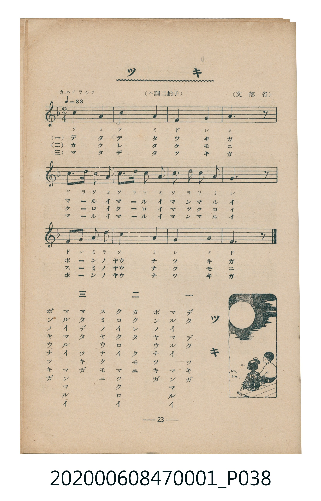

# ツキ（月亮）

> Re:Shoka 使用 AI 協助辨識與重建樂譜，可能會有錯誤。歡迎回報。

<audio controls src="tsuki.mp3"></audio>

- 詞：文部省
- 曲：文部省
- 臺灣教育會公認《新定兒童唱歌》尋常科第一學年用（2020.006.0847.0001）

## 說明

曲目說明
中文解釋：描寫夜空中的月亮，以及月光照耀大地的景色。

## 跨冊／重複收錄參照

> 同名異曲（各冊收錄之不同詞曲版本）

- **[同名異曲]** 楊金土手抄《唱歌帖》第 1 冊（2020.006.0843）：[**〈月〉**](../../../shokacho/vol_01/p155_tsuki/index.md)（`C` / `2/2` — [原始 TMD](../../../shokacho/vol_01/p155_tsuki/tsuki.tmd)）
- 總表：[跨冊重複與同名歌曲總索引](../../../duplicate_songs.md)

## 歌詞

```text
一
デタ　デタ　ツキガ
マルイマルイ　マンマルイ
ボンノヤウナツキガ

二
カクレタ　クモニ
クロイクロイ　マックロイ
スミノヤウナクモニ

三
マタデタ　ツキガ
マルイマルイ　マンマルイ
ボンノヤウナツキガ
```

## ABC

```abc
X:1
T:ツキ（月亮）
C:曲：文部省
M:2/4
L:1/16
Q:1/4=88
K:F
V:V1 name="Piano" snm="Pia"
[V:V1]
c4 A4 | c4 A4 | F4 G4 | A6 z2 |
c3 d c2 A2 | c3 d c2 A2 | c3 d c2 A2 | G6 z2 |
F2 G2 A3 d | c4 A4 | G4 A4 | F6 z2 |
```

## TMD 檔案連結

- [主旋律 TMD 檔案](tsuki.tmd) [[在 TMD Studio 編輯](https://tmdlang.github.io/Tmd-TS/#tmd=s7IKdvYPcrWy4qpTUCpJTLdSSM7PyUlNLsnMz7MqzsjMK0nNjM_KTMmPL87Iz05Ugisry88pzU21Si9KTEmNN4w3MjAyiDcwMIs3sDAxBzIMDBFKi_NLi5JTrYqTM_Lzc-JLUitKkvLzsxHyBUX5Zal5iXlANQVFIBtTwIoQClLLMlNSQdKpKZkl-UWZiTlI7kgtKga7FWxJfElRYl5xclFmAcgDCFUlGalAx-YllpQWpSpxaWkpPG5uedy09v2ejmdzOp7sWvd-T6eClhaXoq2ChQWXva2CG5eNkb6JHUj_i5Xz3u-Z9Wxa-8vmFc_nNILNfDZ7E4bYi_ZdzxsXP5s680XTpmdzmp-2rnmxqvdxQ9ezaRuerpv1tHXS89VLn07Z-Gxtz-OG7qcbup_u2PF8-cTna9Y82dHwdO2Opzu3PJ-yAuggUEjqAUNSDxSSQIaBIdBxSlz6WgpAW5_PXvdi1apnM_q4FBQUnuxYC3TCi-WLX7Z3g5zT3_90_eqnS-Y8X7kLKPV8VgvMbz1Pdi992t8F5D5t7XzeuvxFQ8PTJcufztkAUjNz_YvOTY8bmri09LmAtnABncP1uLn9cdP-xw0NSAxQeD1uWgOUm_e4efXjpiUIBkgayN4MFwEqmgPm9z1uXvK4adnj5i6EAVxPdvVwPW4Cqlv_uHkN1HgQe9Hj5m6gBJAFVAfUBmNAjW-GiwAV7XzcPB_FeLgBQA90gh0JNJgGrgeFkm9iZp5VQGZiXr5DjUGNQjUoMhRsDM207MCsGgVTBV0wNIbS2EQMoSwjuAhMDgQNQCIoppmBaZAa4kRg5qKbBrIXJAexzQyr22B6MV2LMK2Wi0vXTgEUFApAWpkLAA)]
- [鋼琴伴奏 TMD 檔案](tsuki_piano.tmd) [[在 TMD Studio 編輯](https://tmdlang.github.io/Tmd-TS/#tmd=s7IKdvYPcrWy4tLSUnjc3PK4ae37PR2Pm6c8blr0uLnvyZ4tT5f2P9k94_2eTgUtLS5FWwULCy57WwU3LhsjfRM7rjoFpRcr573fM-vZtPaXzSuez2lUAok9m70JQ-xF-67njYufTZ35omnTsznNT1vXvFjV-7ih69m0DU_XzXraOun56qVPp2x8trbncUP30w3dT3fseL584vM1a57saHi6dsfTnVueT1kBdJyRgZGBnoGBmZ6BhYk5kGFgCHScEheXb2JmnlVAZmJefpCHQ41BjUI1lwIQ2BiaadmBWTUKpgq6YGgMpbGJGEJZRnARmBwIGoBEUEwzA9MgNcSJwMxFNw1kL0gOYpsZVrfB9GK6FmFaLXJI-KCEhAU8IKINY4GKISQOnmk8MhdkOsylRGiG8SCGYNFsgkc5VquB3tK1UwD5TAELrczFBQA)]

## 分析

```text
================================================================================
📊 TMD Song Profile: [ ツキ（月亮） ]
================================================================================
⏱  Duration:       0:16 (16.4s), 12 measures total
🎼 Key & Tempo:    首調基準 F, != 88.0 BPM, <2/4>
   - 分析範圍：      由實際發聲的音符與和弦推測調性；播放脈絡另行呈現
🎤 人聲音域:    F4 (MIDI 65) – D5 (MIDI 74) [跨度: 9 個半音 / 0.8 個八度, 難度: easy]
   - 最低音:  F4 in [Main #1 @ m.3, 0:02]
   - 最高音: D5 in [Main #1 @ m.5, 0:05]
   - 適合: soprano, mezzo-soprano, contralto, tenor, baritone, bass
🏛  結構:      Main (16.4s)
⚡ 編曲密度:        Peak 1 軌道同時演奏
🗝  調性診斷：       A 小調（純淨自然小調，未偵測到可信轉調）
   - 風格氣質:    純淨自然小調（陰鬱抒情、旋律集中，無明顯調外色彩）
   - 轉調歷程:    全曲維持單一推測調性（未偵測到可信轉調）
   - 核心骨幹音:  A, C, G, F, D
   - 調性數值:    A 小調 [相關度: 0.81, 穩定度: Moderate, 自然音純度: 100.0%]
   - 候選調性 (K-S): A 小調 (0.81), C 大調 (0.71), F 大調 (0.66)
   - 五度圈歷程:   +3
   - 各段落調性細節:
     • [Main #1]: A 小調 (r: 0.81, 自然音純度: 100.0%)

  [ 五度圈游移軌跡 ]
               C  
         F            G  
      Bb               D  
      Eb              [A ]*
         Ab           E  
            Db       B  
               F# 
     (* = active key center)

  [ 十二半音累積音高分佈 ]
     C  : █████████████████████     30.0%
     C# :                            0.0%
     D  : ███                        4.4%
     D# :                            0.0%
     E  :                            0.0%
     F  : █████████                 13.3%
     F# :                            0.0%
     G  : ████████████              17.8%
     G# :                            0.0%
     A  : ████████████████████████  34.4%
     A# :                            0.0%
     B  :                            0.0%
--------------------------------------------------------------------------------
Assignment 軌道音域：
  - Piano         : F4 – D5 (9 個半音 / 0.8 個八度, 29 個音符)
================================================================================
```


## 原書掃描頁




