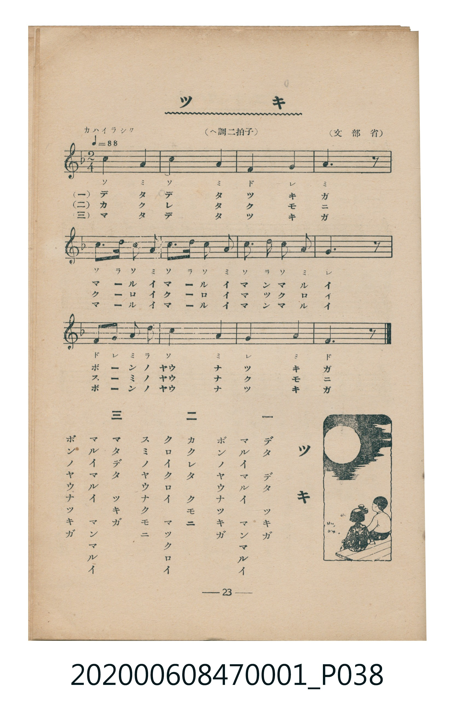

# ツキ（月亮）

> Re:Shōka 使用 AI 協助辨識與重建樂譜，可能會有錯誤。歡迎回報。

- **鋼琴伴奏版**：<br><audio controls src="tsuki.mp3"></audio>
- **NEUTRINO 歌聲合成版**：<br><audio controls src="tsuki_neutrino.mp3"></audio>

- 詞：文部省
- 曲：文部省
- 臺灣教育會公認《新定兒童唱歌》尋常科第一學年用（2020.006.0847.0001）

## 說明

曲目說明
中文解釋：描寫夜空中的月亮，以及月光照耀大地的景色。


## 歌詞

```text
一
デタ　デタ　ツキガ
マルイマルイ　マンマルイ
ボンノヤウナツキガ

二
カクレタ　クモニ
クロイクロイ　マックロイ
スミノヤウナクモニ

三
マタデタ　ツキガ
マルイマルイ　マンマルイ
ボンノヤウナツキガ
```

## ABC

<div class="abc-score" data-abc-src="tsuki.abc" aria-label="五線譜載入中"></div>

[下載 ABC 原始檔](tsuki.abc)

## TMD 檔案連結

- [主旋律 TMD 檔案](tsuki.tmd) [[在 TMD Studio 編輯](https://tmdlang.github.io/Tmd-TS/#tmd=s7IKdvYPcrWy4qpTUCpJTLdSSM7PyUlNLsnMz7MqzsjMK0nNjM_KTMmPL87Iz05Ugisry88pzU21Si9KTEmNN4w3MjAyiDcwMIs3sDAxBzIMDBFKi_NLi5JTrYqTM_Lzc-JLUitKkvLzsxHyBUX5Zal5iXlANQVFIBtTwIoQClLLMlNSQdKpKZkl-UWZiTlI7kgtKga7FWxJfElRYl5xclFmAcgDCFUlGalAx-YllpQWpSJEgUalZ-ZZ5ebnJZUCvafEpaWl8Li55XHT2vd7Op7N6Xiya937PZ0KWlpcirYKFhZc9rYKblw2RvomdiAjXqyc937PrGfT2l82r3g-pxFs7LPZmzDEXrTvet64-NnUmS-aNj2b0_y0dc2LVb2PG7qeTdvwdN2sp62Tnq9e-nTKxmdrex43dD_d0P10x47nyyc-X7PmyY6Gp2t3PN255fmUFUAHgYJYDxjEeqAgBjIMDIGOU-LS11IA2vp89roXq1Y9m9HHpaCg8GTHWqATXixf_LK9G-Sc_v6n61c_XTLn-cpdQKnns1pgfut5snvp0_4uIPdpa-fz1uUvGhqeLln-dM4GkJqZ6190bnrc0MSlpc8FtIUL6Byux83tj5v2P25oQGKAwutx0xqg3LzHzasfNy1BMEDSQPZmuAhQ0Rwwv-9x85LHTcseN3chDOB6squH63ETUN36x81roMaD2IseN3cDJYAsoDqgNhgDanwzXASoaOfj5vkoxsMNAHqgE-xIoME0cD0olHwTgckpIDMxL9-hxqCmGhQXCjaGZlp2YFaNgqmCLhgaQ2lsIoZQlhFcBCYHggYgEbBpPoY1wMTaDhUHegeuHpdoC1x0LUK0aQ2S6fEI041AcqvhOtYjmQPTgWI6XAUwtJHUdmM33RgkN48GbkcJaDMwDQo-4kRgQY4toOGObQYFCjAxQB2GXxyYWqBsiDzI0SAVuAIcEYggb8JNwyUOt6UZqgYij8cW1ICngV-gEQBKxaDgBAWsGVgxZkqHBTdm2scWAXPgjtsMJvugjgNlRLhUF9wocpL7Trg584mygow0TzNf1HJx6dopgAogBSCtzAUA)]
- [鋼琴伴奏 TMD 檔案](tsuki_piano.tmd) [[在 TMD Studio 編輯](https://tmdlang.github.io/Tmd-TS/#tmd=s7IKdvYPcrWy4tLSUnjc3PK4ae37PR2Pm6c8blr0uLnvyZ4tT5f2P9k94_2eTgUtLS5FWwULCy57WwU3LhsjfRM7rjoFpRcr573fM-vZtPaXzSuez2lUAok9m70JQ-xF-67njYufTZ35omnTsznNT1vXvFjV-7ih69m0DU_XzXraOun56qVPp2x8trbncUP30w3dT3fseL584vM1a57saHi6dsfTnVueT1kBdJyRgZGBnoGBmZ6BhYk5kGFgCHScEheXb2JmnlVAZmJefpCHQ41BTTWXAhDYGJpp2YFZNQqmCrpgaAylsYkYQllGcBGYHAgagETApvkY1gDDqx0q_rhpP1w9LtEWuOhahGjTGiTT4xGmG4HkVsN1rEcyB6YDxXS4isfNi5DUdmM33RgkN48GbkcJaDMwDQo-4kRgQY4toOGObQYFyuOmJVCH4Rd_3LwZyobIgxwNUoErwBGBCPIm3DRc4nBbmqFqIPJ4bEENeBr4BRoBoFQMCk5QwJqBFWOmdFhwY6Z9bBEwB-64zWCyD-q4JY-blsGluuBGkZPcd8LNmU-UFWSkeZr5oha5_PFBLn8s4MVPtGEsUC2ExMEzjUfmgmIB4nqiNMN4EEOwaDbBoxyr1UBf6dopgDwW7QMShrGNkNjGYLYyFwA)]

## 分析

```text
================================================================================
📊 TMD Song Profile: [ ツキ（月亮） ]
================================================================================
⏱  Duration:       0:16 (16.4s), 12 measures total
🎼 Key & Tempo:    首調基準 F, != 88.0 BPM, <2/4>
   - 分析範圍：      由實際發聲的音符與和弦推測調性；播放脈絡另行呈現
🎤 人聲音域:    F4 (MIDI 65) – D5 (MIDI 74) [跨度: 9 個半音 / 0.8 個八度, 難度: easy]
   - 最低音:  F4 in [Main #1 @ m.3, 0:02]
   - 最高音: D5 in [Main #1 @ m.5, 0:05]
   - 適合: soprano, mezzo-soprano, contralto, tenor, baritone, bass
🏛  結構:      Main (16.4s)
⚡ 編曲密度:        Peak 1 軌道同時演奏
🗝  調性診斷：       A 小調（純淨自然小調，未偵測到可信轉調）
   - 風格氣質:    純淨自然小調（陰鬱抒情、旋律集中，無明顯調外色彩）
   - 轉調歷程:    全曲維持單一推測調性（未偵測到可信轉調）
   - 核心骨幹音:  A, C, G, F, D
   - 調性數值:    A 小調 [相關度: 0.81, 穩定度: Moderate, 自然音純度: 100.0%]
   - 候選調性 (K-S): A 小調 (0.81), C 大調 (0.72), F 大調 (0.67)
   - 五度圈歷程:   +3
   - 各段落調性細節:
     • [Main #1]: A 小調 (r: 0.81, 自然音純度: 100.0%)

  [ 五度圈游移軌跡 ]
               C  
         F            G  
      Bb               D  
      Eb              [A ]*
         Ab           E  
            Db       B  
               F# 
     (* = active key center)

  [ 十二半音累積音高分佈 ]
     C  : ██████████████████████    30.0%
     C# :                            0.0%
     D  : ████                       5.6%
     D# :                            0.0%
     E  :                            0.0%
     F  : ██████████                13.3%
     F# :                            0.0%
     G  : █████████████             17.8%
     G# :                            0.0%
     A  : ████████████████████████  33.3%
     A# :                            0.0%
     B  :                            0.0%
--------------------------------------------------------------------------------
Assignment 軌道音域：
  - Piano         : F4 – D5 (9 個半音 / 0.8 個八度, 29 個音符)
================================================================================
```


## 原書掃描頁




