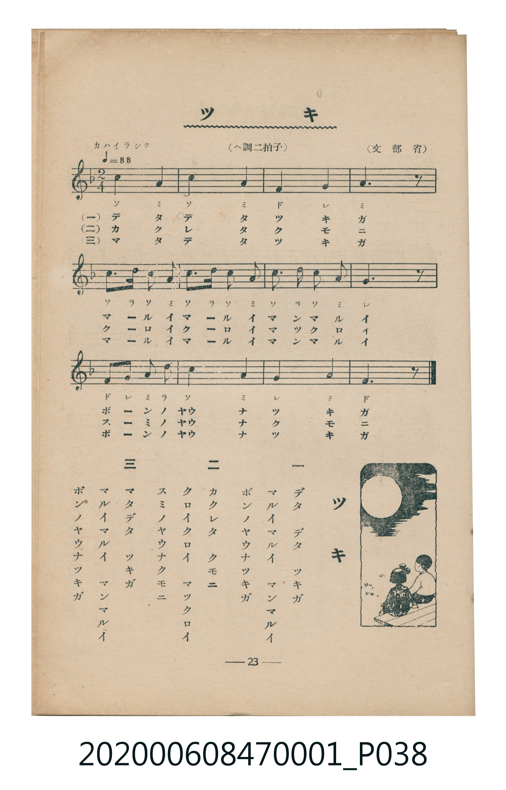

# ツキ（月亮）

> Re:Shōka 使用 AI 協助辨識與重建樂譜，可能會有錯誤。歡迎[回報](https://github.com/TMDLang/reshoka/issues)。

- **鋼琴伴奏版**：<br><audio controls src="tsuki.mp3"></audio>
- **NEUTRINO 歌聲合成版**：<br><audio controls src="tsuki_neutrino.mp3"></audio>

- 詞：文部省
- 曲：文部省
- 臺灣教育會公認《新定兒童唱歌》尋常科第一學年用（2020.006.0847.0001）

## 說明

曲目說明
中文解釋：描寫夜空中的月亮，以及月光照耀大地的景色。


## 歌詞

```text
一
デタ　デタ　ツキガ
マルイマルイ　マンマルイ
ボンノヤウナツキガ

二
カクレタ　クモニ
クロイクロイ　マックロイ
スミノヤウナクモニ

三
マタデタ　ツキガ
マルイマルイ　マンマルイ
ボンノヤウナツキガ
```

## ABC

<div class="abc-score" data-abc-src="tsuki.abc" aria-label="五線譜載入中"></div>

[下載 ABC 原始檔](tsuki.abc)

## TMD 檔案連結

- [主旋律 TMD 檔案](tsuki.tmd) [[在 TMD Studio 編輯](https://tmdlang.github.io/Tmd-TS/#tmd=s7IKdvYPcrWy4qpTUCpJTLdSSM7PyUlNLsnMz7MqzsjMK0nNjM_KTMmPL87Iz05Ugisry88pzU21Si9KTEmNN4w3MjAyiDcwMIs3sDAxBzIMDBFKi_NLi5JTrYqTM_Lzc-JLUitKkvLzsxHyBUX5Zal5iXlANQVFIBtTwIoQClLLMlNSQdKpKZkl-UWZiTlI7kgtKga7FWxJfElRYl5xclFmAcgDCFUlGalAx-YllpQWpSJEgUalZ-ZZ5ebnJZUCvYcsUZKRD_RaQUalVUZmMcjO5MSc-OzEPKQQgNpYkJieahVgYGyhxKWlpfC4ueVx09r3ezqezel4smvd-z2dClpaXIq2ChYWXPa2Cm5cNkb6JnYgM16snPd-z6xn09pfNq94PqcRbO6z2ZswxF6073reuPjZ1JkvmjY9m9P8tHXNi1W9jxu6nk3b8HTdrKetk56vXvp0ysZna3seN3Q_3dD9dMeO58snPl-z5smOhqdrdzzdueX5lBVAB4FiSA8YQ3qgGAIyDAyBjlPi0tdSANr6fPa6F6tWPZvRx6WgoPBkx1qgE14sX_yyvRvknP7-p-tXP10y5_nKXUCp57NaYH7rebJ76dP-LiD3aWvn89blLxoani5Z_nTOBpCametfdG563NDEpaXPBbSFC-gcrsfN7Y-b9j9uaEBigMLrcdMaoNy8x82rHzctQTBA0kD2ZrgIUNEcML_vcfOSx03LHjd3IQzgerKrh-txE1Dd-sfNa6DGg9iLHjd3AyWALKA6oDYYA2p8M1wEqGjn4-b5KMbDDQB6oBPsSKDBNHA9KJR8E4GpMSAzMS_focagphoUFwo2hmZadmBWjYKpgi4YGkNpbCKGUJYRXAQmB4IGIBGwaT6GNcDE2g4VB3oHrh6XaAtcdC1CtGkNkunxCNONQHKr4TrWI5kD04FiOlwFMLSR1HZjN90YJDePBm5HCWgzMA0KPuJEYEGOLaDhjm0GBQowMUAdhl8cmFqgbIg8yNEgFbgCHBGIIG_CTcMlDrelGaoGIo_HFtSAp4FfoBEASsWg4AQFrBlYMWZKhwU3ZtrHFgFz4I7bDCb7oI4DZUS4VBfcKHKS-064OfOJsoKMNE8zX9RycenaKYAKIAUgrcwFAA)]
- [鋼琴伴奏 TMD 檔案](tsuki_piano.tmd) [[在 TMD Studio 編輯](https://tmdlang.github.io/Tmd-TS/#tmd=s7IKdvYPcrWy4qpTUCpJTLdSyC8qychPL0osyKi0ysgsLskvykxOzInPTsxLVIIrKs4vLUpOjS9ITE-1CjAwtlDi0tJSeNzc8rhp7fs9HY-bpzxuWvS4ue_Jni1Pl_Y_2T3j_Z5OBS0tLkVbBQsLLntbBTcuGyN9EzuQeS9Wznu_Z9azae0vm1c8n9MItuPZ7E0YYi_adz1vXPxs6swXTZuezWl-2rrmxarexw1dz6ZteLpu1tPWSc9XL306ZeOztT2PG7qfbuh-umPH8-UTn69Z82RHw9O1O57u3PJ8ygqg44wMjAz0DAzM9AwsTMyBDANDoOOUuLh8EzPzrAIyE_PygzwcagxqqrkUgMDG0EzLDsyqUTBV0AVDYyiNTcQQyjKCi8DkQNAAJAI2zcewBhhe7VDxx0374epxibbARdciRJvWIJkejzDdCCS3Gq5jPZI5MB0opsNVPG5ehKS2G7vpxiC5eTRwO0pAm4FpUPARJwILcmwBDXdsMyhQHjctgToMv_jj5s1QNkQe5GiQClwBjghEkDfhpuESh9vSDFUDkcdjC2rA08Av0AgApWJQcIIC1gysGDOlw4IbM-1ji4A5cMdtBpN9UMctedy0DC7VBTeKnOS-E27OfKKsICPN08wXtcjljw9y-WMBL36iDWOBaiEkDp5pPDIXFAsQ1xOlGcaDGIJFswke5VitBvpK104B5LFoH5AwjG2ExDYGs5W5AA)]

## 分析

```text
================================================================================
📊 TMD Song Profile: [ ツキ（月亮） ]
================================================================================
⏱  Duration:       0:16 (16.4s), 12 measures total
🎼 Key & Tempo:    首調基準 F, != 88.0 BPM, <2/4>
   - 分析範圍：      由實際發聲的音符與和弦推測調性；播放脈絡另行呈現
🎤 人聲音域:    F4 (MIDI 65) – D5 (MIDI 74) [跨度: 9 個半音 / 0.8 個八度, 難度: easy]
   - 最低音:  F4 in [Main #1 @ m.3, 0:02]
   - 最高音: D5 in [Main #1 @ m.5, 0:05]
   - 適合: soprano, mezzo-soprano, contralto, tenor, baritone, bass
🏛  結構:      Main (16.4s)
⚡ 編曲密度:        Peak 1 軌道同時演奏
🗝  調性診斷：       A 小調（純淨自然小調，未偵測到可信轉調）
   - 風格氣質:    純淨自然小調（陰鬱抒情、旋律集中，無明顯調外色彩）
   - 轉調歷程:    全曲維持單一推測調性（未偵測到可信轉調）
   - 核心骨幹音:  A, C, G, F, D
   - 調性數值:    A 小調 [相關度: 0.81, 穩定度: Moderate, 自然音純度: 100.0%]
   - 候選調性 (K-S): A 小調 (0.81), C 大調 (0.72), F 大調 (0.67)
   - 五度圈歷程:   +3
   - 各段落調性細節:
     • [Main #1]: A 小調 (r: 0.81, 自然音純度: 100.0%)

  [ 五度圈游移軌跡 ]
               C  
         F            G  
      Bb               D  
      Eb              [A ]*
         Ab           E  
            Db       B  
               F# 
     (* = active key center)

  [ 十二半音累積音高分佈 ]
     C  : ██████████████████████    30.0%
     C# :                            0.0%
     D  : ████                       5.6%
     D# :                            0.0%
     E  :                            0.0%
     F  : ██████████                13.3%
     F# :                            0.0%
     G  : █████████████             17.8%
     G# :                            0.0%
     A  : ████████████████████████  33.3%
     A# :                            0.0%
     B  :                            0.0%
--------------------------------------------------------------------------------
Assignment 軌道音域：
  - Piano         : F4 – D5 (9 個半音 / 0.8 個八度, 29 個音符)
================================================================================
```


## 原書掃描頁




