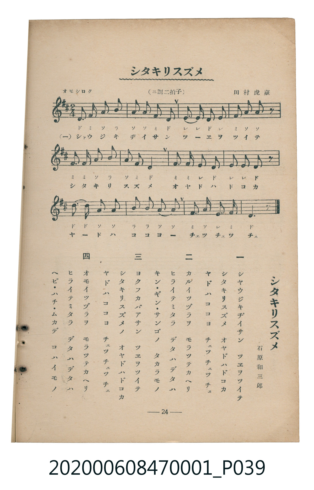

# シタキリスズメ（剪舌麻雀）

> Re:Shōka 使用 AI 協助辨識與重建樂譜，可能會有錯誤。歡迎回報。

- **鋼琴伴奏版**：<br><audio controls src="shitakiri_suzume.mp3"></audio>
- **NEUTRINO 歌聲合成版**：<br><audio controls src="shitakiri_suzume_neutrino.mp3"></audio>

- 詞：石原和三郎
- 曲：田村虎藏
- 臺灣教育會公認《新定兒童唱歌》尋常科第一學年用（2020.006.0847.0001）

## 說明

曲目說明
中文解釋：日本民間故事，描寫善良老人與麻雀，以及貪心者受到教訓。


## 歌詞

```text
一
シヤウジキヂイサン　ツエヲツイテ
シタキリスズメ　オヤドハドコカ
ヤドハココヨ　チヱッチヱッチヱ

二
カルイツヅラヲ　モラツテカヘリ
ヒライテミタラ　デタハデタハ
キン・ギン・サンゴノ　タカラモノ

三
ヨクフカバアサン　ツエヲツイテ
シタキリスズメノ　オヤドハドコカ
ヤドハココヨ　チヱッチヱッチヱ

四
オモイツヅラヲ　モラツテカヘリ
ヒライテミタラ　デタハデタハ
ヘビ・ハチ・ムカデ　コハイモノ
```

## ABC

<div class="abc-score" data-abc-src="shitakiri_suzume.abc" aria-label="五線譜載入中"></div>

[下載 ABC 原始檔](shitakiri_suzume.abc)

## TMD 檔案連結

- [主旋律 TMD 檔案](shitakiri_suzume.tmd) [[在 TMD Studio 編輯](https://tmdlang.github.io/Tmd-TS/#tmd=s7IKdvYPcrWy4qpTUCpJTLdSSM7PyUlNLsnMz7MqzsjMK0nNjM_KTMmPL87Iz05Ugisry88pzU21Si9KTEmNN4w3MjAyiDcwMIs3sDAxBzIMDBFKi_NLi5JTrYqTM_Lzc-JLUitKkvLzsxHyBUX5Zal5iXlANQVFIBtTwIoQClLLMlNSQdKpKZkl-UWZiTlI7kgtKga7FWxJfElRYl5xclFmAcgDCFUlGalAxybmZeYi6wUalZ6ZZ5WbmpmVicVd-UUlGflADxZkVFplZBaDbE5OzInPTsxDCgeovQWJ6alWAQbGlkpcWloKj5u2P27a_7hp7ePmVY-bdj5u2vW4eeH7PR1PO1e96Oh5uWv3y9kN7_d0KmhpcSnaKhgaGHDZ2yq4cNkY6ZvYgUx-sXLe-z2zns_f_LRv_tNJPU92dL5s7gPb-Wz2JpDMlA3P5k58MbPvxfR-sPCL9l3PGxc_mzrzRdOmZ3Oan7auebGq93FD17NpG56um_W0ddLz1UufTtn4bG3P44bupxu6n-7Y8Xz5xOdr1jzZ0fB07Y6nO7c8n7IC6EBQNOoBo1EPFI1AhoEh0JlKXPpaCkCLn89e92LVqmcz-rgUFBSe7Fj7bFr7i-WLX7Z3A130bPrSZ3PWPNsw8eW0yc-mtj7ZBRTsedbf_3T96qfTWl50rn_R0Phk164XHe0w3_c82b30aX_Xi02rnu5vftHQ-rR_-tOODSAvrJj8uKGJS0ufC2gvF9CBXKDgbF7yuGnZ46Yd4EBtetwE5G593Lz5cUPD4-aWx00rHjdvAjOWPG5uA2vACH-Q0qZVIIOaOx8394PIps2Pm1ZzIYRA_M2Pm1eATW183LzxcXMzGoOL68muHqAFqx83rwbb1vK4ufVx80qQ_SBdi8BsoGAbWM0MoAuAFkwCiYLd9rh5PshpQC5IdTuYDXQLlAE0GOhmoBN2P25aB2OA_dm05XFzH9gLQH8BDQZaArSqD-icHZ1AC1Y8blr_uHkqWGrC46ZFpIcO1HQqBNDT2bOBdgANArqC-gEE0jEZFC4gUaCFQMYCsEntYPcDXQd0JtAgcOiAEpFvIjCPB2Qm5uU71BjUVIMSr4KNoZmWHZhVo2CooKtgDMSmQGwGxDVgFgiDREGyNQpGQFIXSIJ4IHYNXAcIG4BEwKb5GNaAM3_zYqAQMMGCyR1gci1YGzDtgnlLwORWENm8GSrTArYEJL4CLL4JSRyqo7kNSMYjrDMCWbcaLAMmwapAEK6vuRVMrkQxcRHEHqAoTBXIXIRZM8DkKlS7jEE6wS5rWg-Wnwpmg3SAZCaAeSCTqeAvE5BbQPZD3Eorf0FTACguQbGNmgJgsQ-xFqYGFPuINAHjYaQAqIf3QyMeYilIZidYfBdYbCHCU2DPgsSWAHEnmNUP9RSY1wQKTIg30KK_eRLC00iBCZKZD3UDLKBgAdiOcB3YFmRxmHqQOFrkE-srYMaj1GOg-Ke5x2D5Pw6sDkjB8nMNOBWAMIgHIhH5HRTjIDak3IBBtPgHehaa5FG9DPUsmARnJZgDQQUnWLAZTKJwkeRhEL0EAEUGJMcBqw0oC2IhIicCaxCoqj6wDDg0oPkCkotAuQdkGSz20GwC53_6eQycBEAZFqR8MtQqoAaoxgVIzodEO5JDIGqhiQa3t2q5uHTtFED1gwKQVuYCAA)]
- [鋼琴伴奏 TMD 檔案](shitakiri_suzume_piano.tmd) [[在 TMD Studio 編輯](https://tmdlang.github.io/Tmd-TS/#tmd=s7IKdvYPcrWy4qpTUCpJTLdSyC8qychPL0osyKi0ysgsLskvykxOzInPTsxLVIIrKs4vLUpOjS9ITE-1CjAwtlTi0tJSeNy0_XHT_sdNax83r3rctPNx067HzQvf7-l43DzlcdOix819T_Zsebq0_8nuGe_3dCpoaXEp2ioYGhhw2dsquHDZGOmb2IHMf7Fy3vs9s57P3_y0b_7TST1PdnS-bO4D2_xs9iaQzJQNz-ZOfDGz78X0frDwi_ZdzxsXP5s680XTpmdzmp-2rnmxqvdxQ9ezaRuerpv1tHXS89VLn07Z-Gxtz-OG7qcbup_u2PF8-cTna9Y82dHwdO2Opzu3PJ-yAuhMIwMjAz0DAzM9AwsTcyDDwBDoTCUuLt_EzDyrgMzEvPwgD4cag5pqLgUgsDE007IDs2oUDBV0FYyB2BSIzYC4BswCYZAoSLZGwQhI6gJJEA_EroHrAGEDkAjYNB_DGnBANi8GCj1uWgYmd4DJtWBtMN4SMLkVRDZvhsg0t4AtAYmvAItvQhKH6mhuA5LxCOuMQCauBsuASbAqEETo2wWWXYli4iKIPUBRqCqwuQizZoDJVah2GYN0gl3WtB4sPxXMBukAyUwA80AmU8FfJiC3gOyHuJVW_oKmAFBcgmIbNQXAYh9iLUwNKPYRaQLGw0gBUA_vh0Y8xFKQzE4kxy9EeArsWZDYEiDuBLP6oZ4C85pAgQnxBlr0N09CeBopMEEy86FugAUULADbEa4D24IsDlMPEkeLfGJ9BSwrKPUYKP5p7jFY_o8DqwNSsPxcA04FIAzigUhEfgfFOIgNKTdgEC3-gZ6FJnlUL0M9CybBWQnmwEZY3mgGkyhcJHkYRC8BQJEByXGPm9ZBWRALETnxcdMWqKo-sAw4NKD5ApKLQLkHZBks9tBsAud_-nkMnARAGRakfDLUKqAGqMYFSM6HRDuSQyBqoYkGt7dqkasHH-TqwQJeO0QbxgLVRpuASDgPTAJ5pvFgLoRCljWA-oKAfggPrh1qHDb9MB1gc3DpB3NBiRHsNV07BZDvon1AwjC2ERLbGIkNMtdOQZkLAA)]

## 分析

```text
================================================================================
📊 TMD Song Profile: [ シタキリスズメ（剪舌麻雀） ]
================================================================================
⏱  Duration:       0:14 (14.4s), 12 measures total
🎼 Key & Tempo:    首調基準 D, != 100.0 BPM, <2/4>
   - 分析範圍：      由實際發聲的音符與和弦推測調性；播放脈絡另行呈現
🎤 人聲音域:    D4 (MIDI 62) – D5 (MIDI 74) [跨度: 12 個半音 / 1.0 個八度, 難度: easy]
   - 最低音:  D4 in [Main #1 @ m.1, 0:00]
   - 最高音: D5 in [Main #1 @ m.9, 0:09]
   - 適合: soprano, mezzo-soprano, contralto, tenor, baritone, bass
🏛  結構:      Main (14.4s)
⚡ 編曲密度:        Peak 1 軌道同時演奏
🗝  調性診斷：       D 大調（純淨自然大調，未偵測到可信轉調）
   - 風格氣質:    純淨自然大調（陽光明朗、易唱易記，無明顯調外色彩）
   - 轉調歷程:    全曲維持單一推測調性（未偵測到可信轉調）
   - 核心骨幹音:  D, A, F#, E, B
   - 調性數值:    D 大調 [相關度: 0.88, 穩定度: High, 自然音純度: 100.0%]
   - 候選調性 (K-S): D 大調 (0.88), A 大調 (0.75), F# 小調 (0.69)
   - 五度圈歷程:   +2
   - 各段落調性細節:
     • [Main #1]: D 大調 (r: 0.88, 自然音純度: 100.0%)

  [ 五度圈游移軌跡 ]
               C  
         F            G  
      Bb              [D ]*
      Eb               A  
         Ab           E  
            Db       B  
               F# 
     (* = active key center)

  [ 十二半音累積音高分佈 ]
     C  :                            0.0%
     C# :                            0.0%
     D  : ████████████████████████  26.7%
     D# :                            0.0%
     E  : ██████████████            15.6%
     F  :                            0.0%
     F# : ████████████████████      22.2%
     G  :                            0.0%
     G# :                            0.0%
     A  : ████████████████████████  26.7%
     A# :                            0.0%
     B  : ████████                   8.9%
--------------------------------------------------------------------------------
Assignment 軌道音域：
  - Piano         : D4 – D5 (12 個半音 / 1.0 個八度, 42 個音符)
================================================================================
```


## 原書掃描頁




