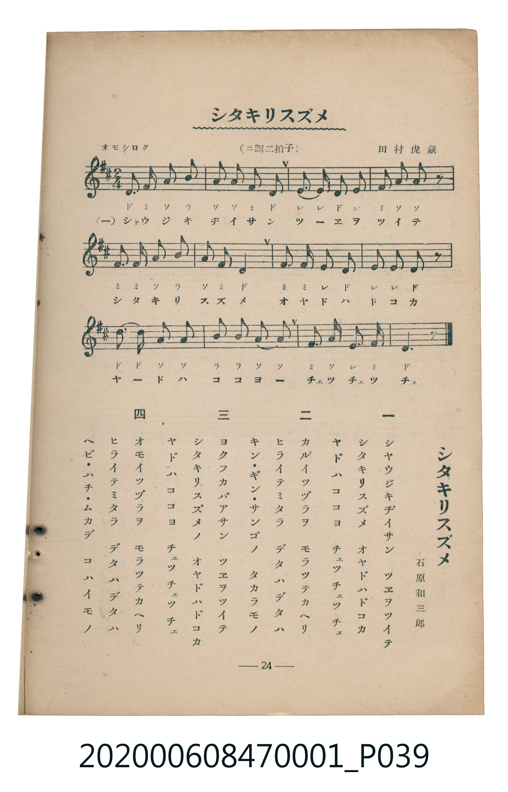

# シタキリスズメ

<audio controls src="shitakiri_suzume.mp3"></audio>

- 詞：石原和三郎
- 曲：田村虎藏
- 臺灣教育會公認《新定兒童唱歌》尋常科第一學年用（2020.006.0847.0001）

## 說明

・出處：臺灣教育會公認《新定兒童唱歌》尋常科第一學年用（2020.006.0847.0001）
・調性與拍號：調號 ?= D，拍號 <2/4>，速度 != 100

## 歌詞

```text
一
シヤウジキヂイサン　ツエヲツイテ
シタキリスズメ　オヤドハドコカ
ヤドハココヨ　チヱッチヱッチヱ

二
カルイツヅラヲ　モラツテカヘリ
ヒライテミタラ　デタハデタハ
キン・ギン・サンゴノ　タカラモノ

三
ヨクフカバアサン　ツエヲツイテ
シタキリスズメノ　オヤドハドコカ
ヤドハココヨ　チヱッチヱッチヱ

四
オモイツヅラヲ　モラツテカヘリ
ヒライテミタラ　デタハデタハ
ヘビ・ハチ・ムカデ　コハイモノ
```

## ABC

```abc
X:1
T:シタキリスズメ
C:曲：田村虎藏
M:2/4
L:1/16
Q:1/4=100
K:D
V:V1 name="Piano" snm="Pia"
[V:V1]
D2 F2 A2 B2 | A2 A2 F2 D2 | E3 E D2 E2 | F2 A2 A2 z2 |
F3 F A2 B2 | A2 F2 D4 | F3 F E2 D2 | E2 E2 D2 z2 |
d3 d A2 A2 | B2 B2 A3 A | F2 A2 E2 F2 | D6 z2 |
D2 F2 A2 B2 | A2 A2 F2 D2 | E3 E D2 E2 | F2 A2 A2 z2 |
F3 F A2 B2 | A2 F2 D4 | F3 F E2 D2 | E2 E2 D2 z2 |
d3 d A2 A2 | B2 B2 A3 A | F2 A2 E2 F2 | D6 z2 |
D2 F2 A2 B2 | A2 A2 F2 D2 | E3 E D2 E2 | F2 A2 A2 z2 |
F3 F A2 B2 | A2 F2 D4 | F3 F E2 D2 | E2 E2 D2 z2 |
d3 d A2 A2 | B2 B2 A3 A | F2 A2 E2 F2 | D6 z2 |
D2 F2 A2 B2 | A2 A2 F2 D2 | E3 E D2 E2 | F2 A2 A2 z2 |
F3 F A2 B2 | A2 F2 D4 | F3 F E2 D2 | E2 E2 D2 z2 |
d3 d A2 A2 | B2 B2 A3 A | F2 A2 E2 F2 | D6 z2 |
```

## TMD 檔案連結

- [主旋律 TMD 檔案](shitakiri_suzume.tmd) [[在 TMD Studio 編輯](https://tmdlang.github.io/Tmd-TS/#tmd=s7IKdvYPcrWy4tLSUnjctP1x0_7HTWsfN6963LTzcdOux80LFbS0uBRtFQwNDLjsbRVcuGyM9E3suOoUlF6snPd-z6zn8zc_7Zv_dFLPkx2dL5v7lEAyz2ZvAslM2fBs7sQXM_teTO8HC79o3_W8cfGzqTNfNG16Nqf5aeuaF6t6Hzd0PZu24em6WU9bJz1fvfTplI3P1vY8buh-uqH76Y4dz5dPfL5mzZMdDU_X7ni6c8vzKSve7-kwMjAy0DMwMNMzsDAxBzIMDN_v6VTi4tLX4gKq5AL5onnJ46Zlj5t2gP3S9LgJyN36uHnz44aGx80tj5tWPG7eBGYsedzcBtaA4W2Q0qZVIIOaOx8394PIps2Pm1ZzIYRA_M2Pm1eATW183LzxcXMzGoOL68muHqAFqx83rwbb1vK4ufVx80qQ_SBdi8BsoGAbWM0MoAuAFkwCiYLd9rh5PshpQC5IdTuYDXQLlAE0GOhmoBN2P25aB2OA_dm05XFzH9gLQH8BDQZaArSqD-icHZ1AC1Y8blr_uHkqWGrC46ZFpIcO1HQqBNDT2bOBdgANArqC-gEE0jEZFC4gUaCFQMYCsEntYPcDXQd0JtAgcOho6XNx-SZm5lkFZCbm5TvUGNQoVHMpKNgYmmnZAekaBUMFXQVjIDYFYjMgrgGzQBgkCpKtUTACkrpAEsQDsWvgOkDYACQCNgskCtKHahbMHBBEqAGZgzAdxkOYZRgHVgikYPbUgM0EYRAPRCLcAdIPYkP8A4MQ02q5uHTtFECBoICHVuYCAA)]
- [鋼琴伴奏 TMD 檔案](shitakiri_suzume_piano.tmd) [[在 TMD Studio 編輯](https://tmdlang.github.io/Tmd-TS/#tmd=s7IKdvYPcrWy4tLSUnjctP1x0_7HTWsfN6963LTzcdOux80L3-_peNw85XHTosfNfU_2bHm6tP_J7hnv93QqaGlxKdoqGBoYcNnbKrhw2Rjpm9hx1SkovVg57_2eWc_nb37aN__ppJ4nOzpfNvcpgWSezd4Ekpmy4dnciS9m9r2Y3g8WftG-63nj4mdTZ75o2vRsTvPT1jUvVvU-buh6Nm3D03WznrZOer566dMpG5-t7Xnc0P10Q_fTHTueL5_4fM2aJzsanq7d8XTnludTVgCdaWRgZKBnYGCmZ2BhYg5kGBgCnanExeWbmJlnFZCZmJcf5OFQY1CjUM2loGBjaKZlB6RrFAwVdBWMgdgUiM2AuAbMAmGQKEi2RsEISOoCSRAPxK6B6wBhA5AI2CyQKEgfqlkwc0AQoQZkDsJ0GA9hlmEcWCGQgtlTAzYThEE8EIlwB0g_iA3xDwxCTKtFDgMfpDCwgAZBtGEsUGG0CYiE88AkkGcaD-ZCKGRZA6hD8eqG8OCaoYZh6oapB5uCSzeYC_IV2E-6dgogbyngoZW5AA)]

## 分析

```text
================================================================================
📊 TMD Song Profile: [ シタキリスズメ ]
================================================================================
⏱  Duration:       0:57 (57.6s), 48 measures total
🎼 Key & Tempo:    首調基準 D, != 100.0 BPM, <2/4>
   - 分析範圍：      由實際發聲的音符與和弦推測調性；播放脈絡另行呈現
🎤 人聲音域:    D4 (MIDI 62) – D5 (MIDI 74) [跨度: 12 個半音 / 1.0 個八度, 難度: easy]
   - 最低音:  D4 in [Main #1 @ m.1, 0:00]
   - 最高音: D5 in [Main #1 @ m.9, 0:09]
   - 適合: soprano, mezzo-soprano, contralto, tenor, baritone, bass
🏛  結構:      Main (14.4s) -> Main (14.4s) -> Main (14.4s) -> Main (14.4s)
⚡ 編曲密度:        Peak 1 軌道同時演奏
🗝  調性診斷：       D 大調（純淨自然大調，未偵測到可信轉調）
   - 風格氣質:    純淨自然大調（陽光明朗、易唱易記，無明顯調外色彩）
   - 轉調歷程:    全曲維持單一推測調性（未偵測到可信轉調）
   - 核心骨幹音:  D, A, F#, E, B
   - 調性數值:    D 大調 [相關度: 0.88, 穩定度: High, 自然音純度: 100.0%]
   - 候選調性 (K-S): D 大調 (0.88), A 大調 (0.75), F# 小調 (0.69)
   - 五度圈歷程:   +2 -> +2 -> +2 -> +2
   - 各段落調性細節:
     • [Main #1]: D 大調 (r: 0.88, 自然音純度: 100.0%)
     • [Main #2]: D 大調 (r: 0.88, 自然音純度: 100.0%)
     • [Main #3]: D 大調 (r: 0.88, 自然音純度: 100.0%)
     • [Main #4]: D 大調 (r: 0.88, 自然音純度: 100.0%)

  [ 五度圈游移軌跡 ]
               C  
         F            G  
      Bb              [D ]*
      Eb               A  
         Ab           E  
            Db       B  
               F# 
     (* = active key center)

  [ 十二半音累積音高分佈 ]
     C  :                            0.0%
     C# :                            0.0%
     D  : ████████████████████████  26.7%
     D# :                            0.0%
     E  : ██████████████            15.6%
     F  :                            0.0%
     F# : ████████████████████      22.2%
     G  :                            0.0%
     G# :                            0.0%
     A  : ████████████████████████  26.7%
     A# :                            0.0%
     B  : ████████                   8.9%
--------------------------------------------------------------------------------
Assignment 軌道音域：
  - Piano         : D4 – D5 (12 個半音 / 1.0 個八度, 168 個音符)
================================================================================
```


## 原書掃描頁




