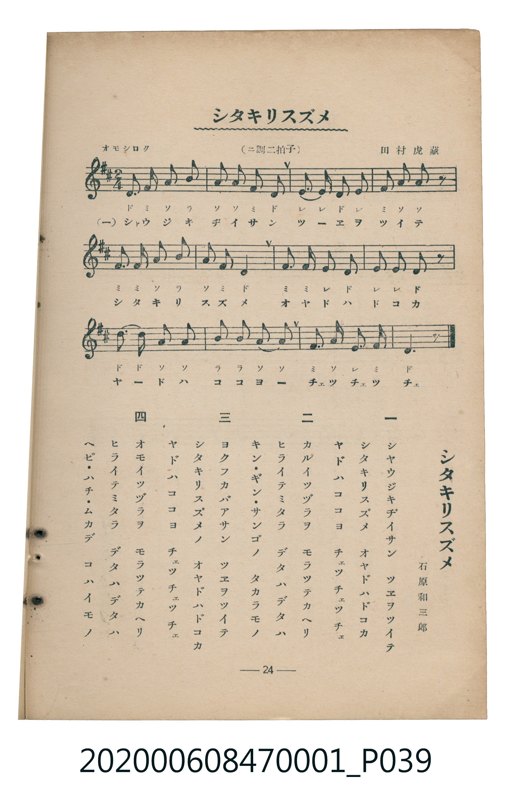

# シタキリスズメ（剪舌麻雀）

> Re:Shōka 使用 AI 協助辨識與重建樂譜，可能會有錯誤。歡迎回報。

- **鋼琴伴奏版**：<br><audio controls src="shitakiri_suzume.mp3"></audio>
- **NEUTRINO 歌聲合成版**：<br><audio controls src="shitakiri_suzume_neutrino.mp3"></audio>

- 詞：石原和三郎
- 曲：田村虎藏
- 臺灣教育會公認《新定兒童唱歌》尋常科第一學年用（2020.006.0847.0001）

## 說明

曲目說明
中文解釋：日本民間故事，描寫善良老人與麻雀，以及貪心者受到教訓。


## 歌詞

```text
一
シヤウジキヂイサン　ツエヲツイテ
シタキリスズメ　オヤドハドコカ
ヤドハココヨ　チヱッチヱッチヱ

二
カルイツヅラヲ　モラツテカヘリ
ヒライテミタラ　デタハデタハ
キン・ギン・サンゴノ　タカラモノ

三
ヨクフカバアサン　ツエヲツイテ
シタキリスズメノ　オヤドハドコカ
ヤドハココヨ　チヱッチヱッチヱ

四
オモイツヅラヲ　モラツテカヘリ
ヒライテミタラ　デタハデタハ
ヘビ・ハチ・ムカデ　コハイモノ
```

## ABC

<div class="abc-score" data-abc-src="shitakiri_suzume.abc" aria-label="五線譜載入中"></div>

[下載 ABC 原始檔](shitakiri_suzume.abc)

## TMD 檔案連結

- [主旋律 TMD 檔案](shitakiri_suzume.tmd) [[在 TMD Studio 編輯](https://tmdlang.github.io/Tmd-TS/#tmd=s7IKdvYPcrWy4qpTUCpJTLdSSM7PyUlNLsnMz7MqzsjMK0nNjM_KTMmPL87Iz05Ugisry88pzU21Si9KTEmNN4w3MjAyiDcwMIs3sDAxBzIMDBFKi_NLi5JTrYqTM_Lzc-JLUitKkvLzsxHyBUX5Zal5iXlANQVFIBtTwIoQClLLMlNSQdKpKZkl-UWZiTlI7kgtKga7FWxJfElRYl5xclFmAcgDCFUlGalAxybmZeYi6wUalZ6ZZ5WbmpmVieQuLS2Fx03bHzftf9y09nHzqsdNOx837XrcvPD9no6nnatedPS83LX75eyG93s6FbS0uBRtFQwNDLjsbRVcuGyM9E3sQMa_WDnv_Z5Zz-dvfto3_-mknic7Ol8294EtfjZ7E0hmyoZncye-mNn3Yno_WPhF-67njYufTZ35omnTsznNT1vXvFjV-7ih69m0DU_XzXraOun56qVPp2x8trbncUP30w3dT3fseL584vM1a57saHi6dsfTnVueT1kBdCAoHvSA8aAHigcgw8AQ6EwlLn0tBaDFz2eve7Fq1bMZfVwKCgpPdqx9Nq39xfLFL9u7gS56Nn3pszlrnm2Y-HLa5GdTW5_sAgr2POvvf7p-9dNpLS86179oaHyya9eLjnaY73ue7F76tL_rxaZVT_c3v2hofdo__WnHBpAXVkx-3NDEpaXPBbSXC-hALlBwNi953LTscdMOcKA2PW4Ccrc-bt78uKHhcXPL46YVj5s3gRlLHje3gTVghD9IadMqkEHNnY-b-0Fk0-bHTau5EEIg_ubHzSvApjY-bt74uLkZjcHF9WRXD9CC1Y-bV4Nta3nc3Pq4eSXIfpCuRWA2ULANrGYG0AVACyaBRMFue9w8H-Q0IBekuh3MBroFygAaDHQz0Am7HzetgzHA_mza8ri5D-wFoL-ABgMtAVrVB3TOjk6gBSseN61_3DwVLDXhcdMi0kMHajoVAujp7NlAO4AGAV1B_QAC6ZgMCheQKNBCIGMB2KR2sPuBrgM6E2gQOHRAicg3EZhJAzIT8_IdagxqqkGJV8HG0EzLDsyqUTBU0FUwBmJTIDYD4howC4RBoiDZGgUjIKkLJEE8ELsGrgOEDUAiYNN8DGvAmb95MVAImGDB5A4wuRasDZh2wbwlYHIriGzeDJVpAVsCEl8BFt-EJA7V0dwGJOMR1hmBrFsNlgGTYFUgCNfX3AomV6KYuAhiD1AUpgpkLsKsGWByFapdxiCdYJc1rQfLTwWzQTpAMhPAPJDJVPCXCcgtIPshbqWVv6ApABSXoNhGTQGw2IdYC1MDin1EmoDxMFIA1MP7oREPsRQksxMsvgssthDhKbBnQWJLgLgTzOqHegrMawIFJsQbaNHfPAnhaaTABMnMh7oBFlCwAGxHuA5sC7I4TD1IHC3yifUVMONR6jFQ_NPcY7D8HwdWB6Rg-bkGnApAGMQDkYj8DopxEBtSbsAgWvwDPQtN8qhehnoWTIKzEsyBoIITLNgMJlG4SPIwiF4CgCIDkuOA1QaUBbEQkROBNQhUVR9YBhwa0HwByUWg3AOyDBZ7aDaB8z_9PAZOAqAMC1I-GWoVUANU4wIk50OiHckhELXQRIPbW7VcXLp2CqD6QQFIK3MBAA)]
- [鋼琴伴奏 TMD 檔案](shitakiri_suzume_piano.tmd) [[在 TMD Studio 編輯](https://tmdlang.github.io/Tmd-TS/#tmd=s7IKdvYPcrWy4tLSUnjctP1x0_7HTWsfN6963LTzcdOux80L3-_peNw85XHTosfNfU_2bHm6tP_J7hnv93QqaGlxKdoqGBoYcNnbKrhw2Rjpm9hx1SkovVg57_2eWc_nb37aN__ppJ4nOzpfNvcpgWSezd4Ekpmy4dnciS9m9r2Y3g8WftG-63nj4mdTZ75o2vRsTvPT1jUvVvU-buh6Nm3D03WznrZOer566dMpG5-t7Xnc0P10Q_fTHTueL5_4fM2aJzsanq7d8XTnludTVgCdaWRgZKBnYGCmZ2BhYg5kGBgCnanExeWbmJlnFZCZmJcf5OFQY1BTzaUABDaGZlp2YFaNgqGCroIxEJsCsRkQ14BZIAwSBcnWKBgBSV0gCeKB2DVwHSBsABIBm-ZjWAMOyObFQKHHTcvA5A4wuRas7XFzE5i3BExuBZHNm6EyLWBLQOIrwOKbkMShOprbgGQ8wjojkHWrwTJgEqwKBOH6mlvB5EoUExdB7AGKwlSBzEWYNQNMrkK1yxikE-yypvVg-algNkgHSGYCmAcymQr-MgG5BWQ_xK208hc0BYDiEhTbqCkAFvsQa2FqQLGPSBMwHkYKgHp4PzTiIZaCZHaCxXeBxRYiPAX2LEhsCRB3gln9UE-BeU2gwIR4Ay36mychPI0UmCCZ-VA3wAIKFoDtCNeBbUEWh6kHiaNFPrG-ApYVlHoMFP809xgs_8eB1QEpWH6uAacCEAbxQCQiv4NiHMSGlBswiBb_QM9Ckzyql6GeBZPgrARzYOPj5o1gwWYwicJFkodB9BIAFBmQHPe4aR2UBbEQkRMfN22BquoDy4BDA5ovILkIlHtAlsFiD80mcP6nn8fASQCUYUHKJ0OtAmqAalyA5HxItCM5BKIWmmhwe6sWuXrwQa4eLOC1Q7RhLFBttAmIhPPAJJBnGg_mQihkWQOoLwjoh_Dg2qHGYdMP0wE2B5d-MBeUGMFe07VTAPku2gckDGMbIbGNkdggc-0UlLkA)]

## 分析

```text
================================================================================
📊 TMD Song Profile: [ シタキリスズメ（剪舌麻雀） ]
================================================================================
⏱  Duration:       0:14 (14.4s), 12 measures total
🎼 Key & Tempo:    首調基準 D, != 100.0 BPM, <2/4>
   - 分析範圍：      由實際發聲的音符與和弦推測調性；播放脈絡另行呈現
🎤 人聲音域:    D4 (MIDI 62) – D5 (MIDI 74) [跨度: 12 個半音 / 1.0 個八度, 難度: easy]
   - 最低音:  D4 in [Main #1 @ m.1, 0:00]
   - 最高音: D5 in [Main #1 @ m.9, 0:09]
   - 適合: soprano, mezzo-soprano, contralto, tenor, baritone, bass
🏛  結構:      Main (14.4s)
⚡ 編曲密度:        Peak 1 軌道同時演奏
🗝  調性診斷：       D 大調（純淨自然大調，未偵測到可信轉調）
   - 風格氣質:    純淨自然大調（陽光明朗、易唱易記，無明顯調外色彩）
   - 轉調歷程:    全曲維持單一推測調性（未偵測到可信轉調）
   - 核心骨幹音:  D, A, F#, E, B
   - 調性數值:    D 大調 [相關度: 0.88, 穩定度: High, 自然音純度: 100.0%]
   - 候選調性 (K-S): D 大調 (0.88), A 大調 (0.75), F# 小調 (0.69)
   - 五度圈歷程:   +2
   - 各段落調性細節:
     • [Main #1]: D 大調 (r: 0.88, 自然音純度: 100.0%)

  [ 五度圈游移軌跡 ]
               C  
         F            G  
      Bb              [D ]*
      Eb               A  
         Ab           E  
            Db       B  
               F# 
     (* = active key center)

  [ 十二半音累積音高分佈 ]
     C  :                            0.0%
     C# :                            0.0%
     D  : ████████████████████████  26.7%
     D# :                            0.0%
     E  : ██████████████            15.6%
     F  :                            0.0%
     F# : ████████████████████      22.2%
     G  :                            0.0%
     G# :                            0.0%
     A  : ████████████████████████  26.7%
     A# :                            0.0%
     B  : ████████                   8.9%
--------------------------------------------------------------------------------
Assignment 軌道音域：
  - Piano         : D4 – D5 (12 個半音 / 1.0 個八度, 42 個音符)
================================================================================
```


## 原書掃描頁




