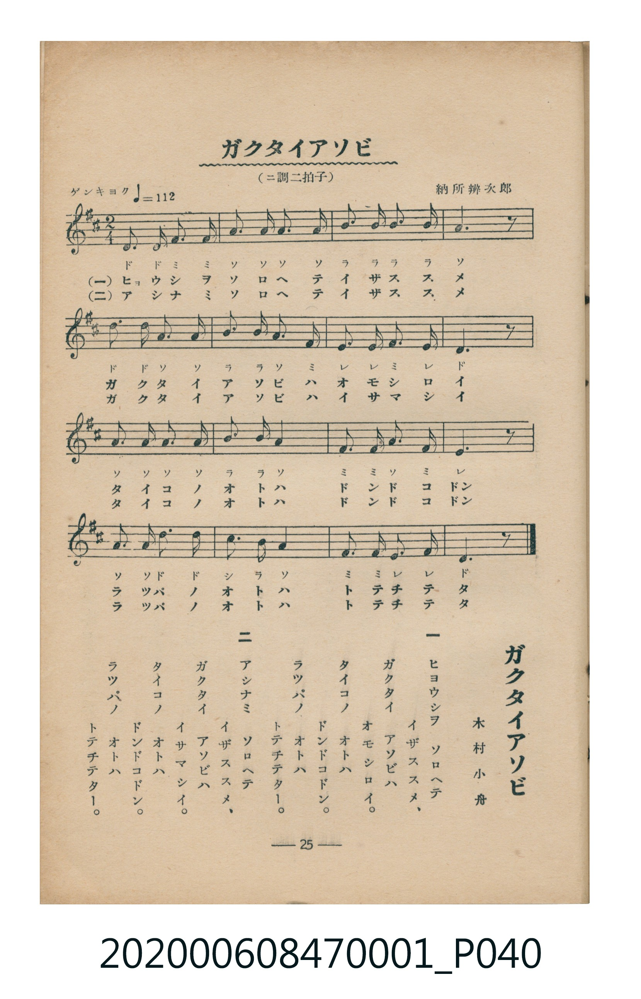

# ガクタイアソビ（樂隊遊戲）

> Re:Shōka 使用 AI 協助辨識與重建樂譜，可能會有錯誤。歡迎回報。

- **鋼琴伴奏版**：<br><audio controls src="gakutai_asobi.mp3"></audio>
- **NEUTRINO 歌聲合成版**：<br><audio controls src="gakutai_asobi_neutrino.mp3"></audio>

- 詞：木村小舟
- 曲：納所辨次郎
- 臺灣教育會公認《新定兒童唱歌》尋常科第一學年用（2020.006.0847.0001）

## 說明

曲目說明
中文解釋：孩子模仿樂隊演奏，在遊戲中吹奏、行進與歡唱。


## 歌詞

```text
一
ヒヨウシヲ　ソロヘテ
イザススメ、
ガクタイ　アソビハ
オモシロイ。
タイコノ　オトハ
ドンドコドン。
ラツパノ　オトハ
トテチテター。

二
アシナミ　ソロヘテ
イザススメ、
ガクタイ　アソビハ
イサマシイ。
タイコノ　オトハ
ドンドコドン。
ラツパノ　オトハ
トテチテター。
```

## ABC

<div class="abc-score" data-abc-src="gakutai_asobi.abc" aria-label="五線譜載入中"></div>

[下載 ABC 原始檔](gakutai_asobi.abc)

## TMD 檔案連結

- [主旋律 TMD 檔案](gakutai_asobi.tmd) [[在 TMD Studio 編輯](https://tmdlang.github.io/Tmd-TS/#tmd=s7IKdvYPcrWy4qpTUCpJTLdSSM7PyUlNLsnMz7MqzsjMK0nNjM_KTMmPL87Iz05Ugisry88pzU21Si9KTEmNN4w3MjAyiDcwMIs3sDAxBzIMDBFKi_NLi5JTrYqTM_Lzc-JLUitKkvLzsxHyBUX5Zal5iXlANQVFIBtTwIoQClLLMlNSQdKpKZkl-UWZiTlI7kgtKga7FWxJfElRYl5xclFmAcgDCFUlGalAx0JdkJOZloqQApqXnplnlZuamZWJ5DgtLYXHTWseN61_3LT_cdOSx02LHjftfdw8-f2ejmcrml7O6nrZ2PWsY9P7PZ0KWlpcirYKhoZGXPa2Ci5cNkb6JnYg41-snPd-z6xnc1Y8mzvx6Yb-Fx3zwbY-mw3UNev5lt5nnQ0v9q14tmbhy-Y-sMyL9l3PGxc_mzrzRdOmZ3Oan7auebGq93FD17NpG56um_W0ddLz1UufTtn4bG3P44bupxu6n-7Y8Xz5xOdr1jzZ0fB07Y6nO7c8n7IC6EBQZOgBI0MPFBlAhoEh0JlKXPpaCkC7n89e92LVqmcz-rgUFBSe7Fj7bFr7i-WLX7Z3Ax31dO3Kp2snPFux8Mnu_RBfPtsz5enS_vd7ep7OWQHxMVDL0wk7gYKPGxpfLOx52bDpRUf7s7ULgQ573NDEpaXPBbSIC-girsfNkx43r3jctOxx0_bHzZseNzSAg3Dt4-YZj5vbuMChuu1x004Qal4INA4ohBTiIOXQQH_c3A-UW_W4GcgHGrUWLN0EFIJEzebHzX1g5UAVHWC1zZ2Pm4GinWA5MBukvHnl4-aWx80TMZUDqbbHzY0gEmhm8x6Qcq4nu3qAVkCs7HrcPJ9iDwCVb33cPA9kID08AIoK30Rg2g7ITMzLd6gxqKkGxbmCjaGZlh2YVaNgqKALhIYKxmDaGChiCqSRcY2CGVjODEyDMEQNDBqARMCm-RjWKIDjfDlYAhjxQLwdwm7eBNQGDAswey2YnAEm28AGAkMBqmcbEO8Es0AkyMCFSJbFIywzAulaBNW1HaiuC2rTfCraBAulOEgwxaGFCgiDeKDQq1EwApIgDOKBaFjoYg2npjVQZ6wH4v1gFshhME_BPDAZTPZDZVaBeRB5UMBCPIjwFPZAIscmkApgagWLzYPbh90maCBBEoUpjiACwRp4MkMNNFxBBHIsxLnAbAB2Sh9KQHTAnQwxHZhTIDqaN0PZEH1gGZAg7jCiuVVogQROUWCiRsEcZzDBUhPelNS8EuqSFiCeSJTbQSKQLAEsM6AsiA5IOGANIxrbU8vFpWunACqvFIC0MhcA)]
- [鋼琴伴奏 TMD 檔案](gakutai_asobi_piano.tmd) [[在 TMD Studio 編輯](https://tmdlang.github.io/Tmd-TS/#tmd=s7IKdvYPcrWy4tLSUnjctOZx0_rHTfsfNy153LTocdPex82T3-_peNw8BcRt7nuyZ8vTpf1Pds94v6dTQUuLS9FWwdDQiMveVsGFy8ZI38SOq05B6cXKee_3zHo2Z8WzuROfbuh_0TFfCST8bPYmoPDzLb3POhte7FvxbM3Cl819YJkX7bueNy5-NnXmi6ZNz-Y0P21d82JV7-OGrmfTNjxdN-tp66Tnq5c-nbLx2dqexw3dTzd0P92x4_nyic_XrHmyo-Hp2h1Pd255PmUF0JlGBkYGegYGZnoGFibmQIaBIdCZSlxcvomZeVYBmYl5-UEeDjUGNdVcCkBgY2imZQdm1SgYKugCoaGCMZg2BoqYAmlkXKNgBpYzA9MgDFEDgwYgEbBpPoY1Co-bJz1uXg6WeNy0DIi3Q9jNm4DagMEKZq8FkzPAZBvYQGCwQ_VsA-KdYBaIBBm4EMmyeIRlRiBdi6C6tgPVdUFtmk9Fm2ChFAcJpji0UAFhEA8UejUKRkAShEE8EA0LXazh1LQG6oz1QLwfzAI5DOYpmAcmg8l-qMwqMA8iDwpYiAcRnsIeSOTYBFLxuGkrWGwe3D7sNkEDCZIoTHEEEQjWwJMZaqDhCiKQYyHOfdy0GeyUPpSA6IA7GWL64-ZOiI7mzVA2RB9YBiSIO4xobhVaIIFTFJioUTDHGUyw1IQ3JTWvhLqkBYgnEuV2kAgkSzxuboSyIDog4YA1jGhsTy1yceWDXFxZwEuraMNYoFoIicEzAfPAJEwOFFYQH-BQDeOZxoO5EIpk3ahyEEPwaIZahqobm9XAING1UwCFSrQPSBjGNgKzlbkA)]

## 分析

```text
================================================================================
📊 TMD Song Profile: [ ガクタイアソビ（樂隊遊戲） ]
================================================================================
⏱  Duration:       0:17 (17.1s), 16 measures total
🎼 Key & Tempo:    首調基準 D, != 112.0 BPM, <2/4>
   - 分析範圍：      由實際發聲的音符與和弦推測調性；播放脈絡另行呈現
🎤 人聲音域:    D4 (MIDI 62) – D5 (MIDI 74) [跨度: 12 個半音 / 1.0 個八度, 難度: easy]
   - 最低音:  D4 in [Main #1 @ m.1, 0:00]
   - 最高音: D5 in [Main #1 @ m.5, 0:04]
   - 適合: soprano, mezzo-soprano, contralto, tenor, baritone, bass
🏛  結構:      Main (17.1s)
⚡ 編曲密度:        Peak 1 軌道同時演奏
🗝  調性診斷：       A 調性不明確（純淨自然大調，未偵測到可信轉調）
   - 風格氣質:    純淨自然大調（陽光明朗、易唱易記，無明顯調外色彩）
   - 轉調歷程:    全曲維持單一推測調性（未偵測到可信轉調）
   - 核心骨幹音:  A, D, F#, B, E
   - 調性數值:    A 調性不明確 [相關度: 0.83, 穩定度: Ambiguous, 自然音純度: 100.0%]
   - 候選調性 (K-S): A 大調 (0.83), D 大調 (0.81), F# 小調 (0.68)
   - 五度圈歷程:   +3
   - 各段落調性細節:
     • [Main #1]: A 調性不明確 (r: 0.83, 自然音純度: 100.0%)

  [ 五度圈游移軌跡 ]
               C  
         F            G  
      Bb               D  
      Eb              [A ]*
         Ab           E  
            Db       B  
               F# 
     (* = active key center)

  [ 十二半音累積音高分佈 ]
     C  :                            0.0%
     C# : █                          1.7%
     D  : ██████████████            20.0%
     D# :                            0.0%
     E  : ████████                  11.7%
     F  :                            0.0%
     F# : ███████████               16.7%
     G  :                            0.0%
     G# :                            0.0%
     A  : ████████████████████████  35.0%
     A# :                            0.0%
     B  : ██████████                15.0%
--------------------------------------------------------------------------------
Assignment 軌道音域：
  - Piano         : D4 – D5 (12 個半音 / 1.0 個八度, 50 個音符)
================================================================================
```


## 原書掃描頁




