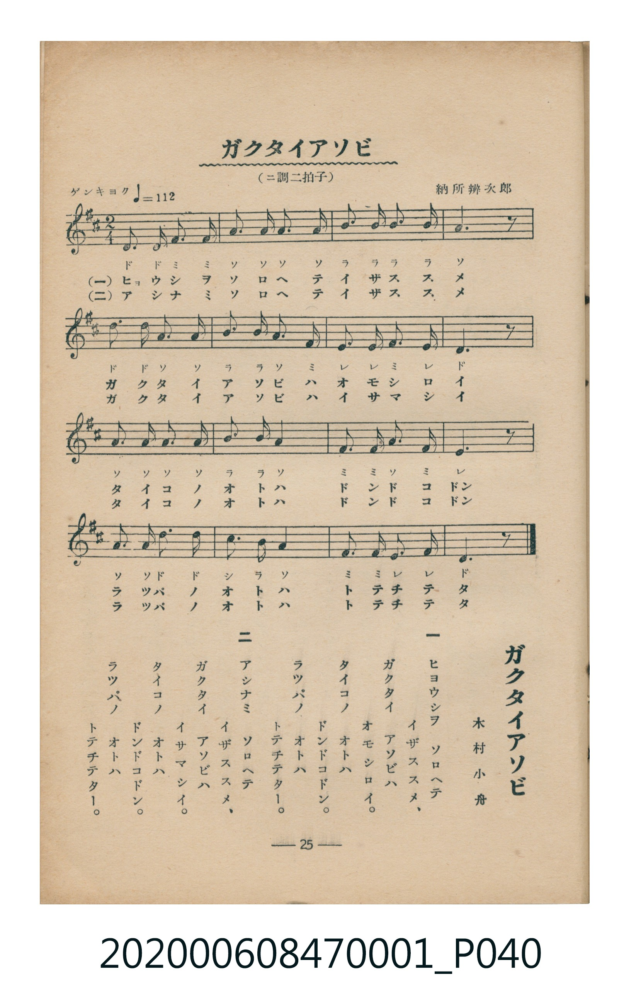

# ガクタイアソビ

<audio controls src="gakutai_asobi.mp3"></audio>

- 詞：木村小舟
- 曲：納所辨次郎
- 臺灣教育會公認《新定兒童唱歌》尋常科第一學年用（2020.006.0847.0001）

## 說明

・出處：臺灣教育會公認《新定兒童唱歌》尋常科第一學年用（2020.006.0847.0001）
・調性與拍號：調號 ?= D，拍號 <2/4>，速度 != 112

## 歌詞

```text
一
ヒヨウシヲ　ソロヘテ
イザススメ、
ガクタイ　アソビハ
オモシロイ。
タイコノ　オトハ
ドンドコドン。
ラツパノ　オトハ
トテチテター。

二
アシナミ　ソロヘテ
イザススメ、
ガクタイ　アソビハ
イサマシイ。
タイコノ　オトハ
ドンドコドン。
ラツパノ　オトハ
トテチテター。
```

## ABC

```abc
X:1
T:ガクタイアソビ
C:曲：納所辨次郎
M:2/4
L:1/16
Q:1/4=112
K:D
V:V1 name="Piano" snm="Pia"
[V:V1]
D3 D F3 F | A2 A2 A2 A2 | B3 B B2 B2 | A6 z2 |
d3 d A2 A2 | B2 B2 A2 F2 | E2 E2 F2 E2 | D6 z2 |
A3 A A2 A2 | B2 B2 A4 | F3 F A2 F2 | E6 z2 |
A3 A d2 d2 | c2 B2 A4 | F3 F E2 E2 | D6 z2 |
D3 D F3 F | A2 A2 A2 A2 | B3 B B2 B2 | A6 z2 |
d3 d A2 A2 | B2 B2 A2 F2 | E2 E2 F2 E2 | D6 z2 |
A3 A A2 A2 | B2 B2 A4 | F3 F A2 F2 | E6 z2 |
A3 A d2 d2 | c2 B2 A4 | F3 F E2 E2 | D6 z2 |
```

## TMD 檔案連結

- [主旋律 TMD 檔案](gakutai_asobi.tmd) [[在 TMD Studio 編輯](https://tmdlang.github.io/Tmd-TS/#tmd=s7IKdvYPcrWy4tLSUnjctOZx0_rHTfsfNy153LTocdPex82TFbS0uBRtFQwNjbjsbRVcuGyM9E3suOoUlF6snPd-z6xnc1Y8mzvx6Yb-Fx3zlUDCz2ZvAgo_39L7rLPhxb4Vz9YsfNncB5Z50b7reePiZ1Nnvmja9GxO89PWNS9W9T5u6Ho2bcPTdbOetk56vnrp0ykbn63tedzQ_XRD99MdO54vn_h8zZonOxqert3xdOeW51NWvN_TYWRgZKBnYGCmZ2BhYg5kGBi-39OpxMWlr8UFVMn1uHnS4-YVj5uWPW7a_rh50-OGBrBH1j5unvG4uY0L7Ldtj5t2glDzwscNjUAhJH-DlEO9_ri5Hyi36nEzkA80ai1YugkoBAmgzY-b-8DKgSo6wGqbOx83A0U7wXJgNkh588rHzS2PmydiKgdSbY-bG0Ek0MzmPSDlXE929QCtgFjZ9bh5PsUeACrf-rh5HshAenhAS5-LyzcxM88qIDMxL9-hxqBGoZpLQcHG0EzLDkjXKBgq6AKhoYIxmDYGipgCaWRco2AGljMD0yAMUQODBiARiFlxEMPi0PSCMIgHsqNGwQhIgjCIB6JhbkA3DWKHKQ6zQLAG7mpU03GbBXYhmKhRMMdpGsyF2FxWy8Wla6cAClIFJFqZCwA)]
- [鋼琴伴奏 TMD 檔案](gakutai_asobi_piano.tmd) [[在 TMD Studio 編輯](https://tmdlang.github.io/Tmd-TS/#tmd=s7IKdvYPcrWy4tLSUnjctOZx0_rHTfsfNy153LTocdPex82T3-_peNw8BcRt7nuyZ8vTpf1Pds94v6dTQUuLS9FWwdDQiMveVsGFy8ZI38SOq05B6cXKee_3zHo2Z8WzuROfbuh_0TFfCST8bPYmoPDzLb3POhte7FvxbM3Cl819YJkX7bueNy5-NnXmi6ZNz-Y0P21d82JV7-OGrmfTNjxdN-tp66Tnq5c-nbLx2dqexw3dTzd0P92x4_nyic_XrHmyo-Hp2h1Pd255PmUF0JlGBkYGegYGZnoGFibmQIaBIdCZSlxcvomZeVYBmYl5-UEeDjUGNQrVXAoKNoZmWnZAukbBUEEXCA0VjMG0MVDEFEgj4xoFM7CcGZgGYYgaGDQAiUDMioMYFoemF4RBPJAdNQpGQBKEQTwQDXMDumkQO0xxmAWCNXBXo5qO2yywC8FEjYI5TtNgLsTmslrkEPVBClELaIBGG8YCFUJIDJ4JmAcmYXIggyGOxKoWxjONB3MhFIl6UeUgRuDUCrUIVS82a4EhoWunAAoMBSRamQsA)]

## 分析

```text
================================================================================
📊 TMD Song Profile: [ ガクタイアソビ ]
================================================================================
⏱  Duration:       0:34 (34.3s), 32 measures total
🎼 Key & Tempo:    首調基準 D, != 112.0 BPM, <2/4>
   - 分析範圍：      由實際發聲的音符與和弦推測調性；播放脈絡另行呈現
🎤 人聲音域:    D4 (MIDI 62) – D5 (MIDI 74) [跨度: 12 個半音 / 1.0 個八度, 難度: easy]
   - 最低音:  D4 in [Main #1 @ m.1, 0:00]
   - 最高音: D5 in [Main #1 @ m.5, 0:04]
   - 適合: soprano, mezzo-soprano, contralto, tenor, baritone, bass
🏛  結構:      Main (17.1s) -> Main (17.1s)
⚡ 編曲密度:        Peak 1 軌道同時演奏
🗝  調性診斷：       A 大調（純淨自然大調，未偵測到可信轉調）
   - 風格氣質:    純淨自然大調（陽光明朗、易唱易記，無明顯調外色彩）
   - 轉調歷程:    全曲維持單一推測調性（未偵測到可信轉調）
   - 核心骨幹音:  A, D, F#, B, E
   - 調性數值:    A 大調 [相關度: 0.84, 穩定度: Moderate, 自然音純度: 100.0%]
   - 候選調性 (K-S): A 大調 (0.84), D 大調 (0.80), F# 小調 (0.65)
   - 五度圈歷程:   +3 -> +3
   - 各段落調性細節:
     • [Main #1]: A 大調 (r: 0.84, 自然音純度: 100.0%)
     • [Main #2]: A 大調 (r: 0.84, 自然音純度: 100.0%)

  [ 五度圈游移軌跡 ]
               C  
         F            G  
      Bb               D  
      Eb              [A ]*
         Ab           E  
            Db       B  
               F# 
     (* = active key center)

  [ 十二半音累積音高分佈 ]
     C  :                            0.0%
     C# : █                          1.7%
     D  : ██████████████            20.0%
     D# :                            0.0%
     E  : █████████                 13.3%
     F  :                            0.0%
     F# : ██████████                15.0%
     G  :                            0.0%
     G# :                            0.0%
     A  : ████████████████████████  35.0%
     A# :                            0.0%
     B  : ██████████                15.0%
--------------------------------------------------------------------------------
Assignment 軌道音域：
  - Piano         : D4 – D5 (12 個半音 / 1.0 個八度, 100 個音符)
================================================================================
```


## 原書掃描頁




