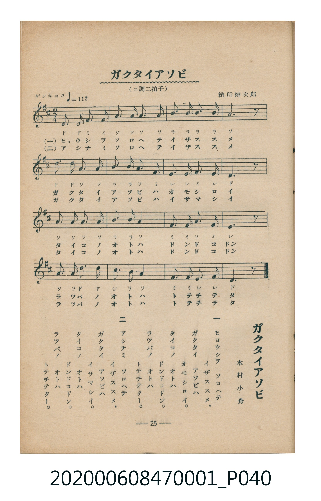

# ガクタイアソビ（樂隊遊戲）

> Re:Shōka 使用 AI 協助辨識與重建樂譜，可能會有錯誤。歡迎[回報](https://github.com/TMDLang/reshoka/issues)。

- **鋼琴伴奏版**：<br><audio controls src="gakutai_asobi.mp3"></audio>
- **NEUTRINO 歌聲合成版**：<br><audio controls src="gakutai_asobi_neutrino.mp3"></audio>

- 詞：木村小舟
- 曲：納所辨次郎
- 臺灣教育會公認《新定兒童唱歌》尋常科第一學年用（2020.006.0847.0001）

## 說明

曲目說明
中文解釋：孩子模仿樂隊演奏，在遊戲中吹奏、行進與歡唱。


## 歌詞

```text
一
ヒヨウシヲ　ソロヘテ
イザススメ、
ガクタイ　アソビハ
オモシロイ。
タイコノ　オトハ
ドンドコドン。
ラツパノ　オトハ
トテチテター。

二
アシナミ　ソロヘテ
イザススメ、
ガクタイ　アソビハ
イサマシイ。
タイコノ　オトハ
ドンドコドン。
ラツパノ　オトハ
トテチテター。
```

## ABC

<div class="abc-score" data-abc-src="gakutai_asobi.abc" aria-label="五線譜載入中"></div>

[下載 ABC 原始檔](gakutai_asobi.abc)

## TMD 檔案連結

- [主旋律 TMD 檔案](gakutai_asobi.tmd) [[在 TMD Studio 編輯](https://tmdlang.github.io/Tmd-TS/#tmd=s7IKdvYPcrWy4qpTUCpJTLdSSM7PyUlNLsnMz7MqzsjMK0nNjM_KTMmPL87Iz05Ugisry88pzU21Si9KTEmNN4w3MjAyiDcwMIs3sDAxBzIMDBFKi_NLi5JTrYqTM_Lzc-JLUitKkvLzsxHyBUX5Zal5iXlANQVFIBtTwIoQClLLMlNSQdKpKZkl-UWZiTlI7kgtKga7FWxJfElRYl5xclFmAcgDCFUlGalAx0JdkJOZloqQApqXnplnlZuamZWJxXH5RSUZ-UBfFmRUWmVkFoOsT07Mic9OzEMKDKjlBYnpqVYBBiYGSlxaWgqPm9Y8blr_uGn_46Ylj5sWPW7a-7h58vs9Hc9WNL2c1fWysetZx6b3ezoVtLS4FG0VDA2NuOxtFVy4bIz0TexAJr9YOe_9nlnP5qx4Nnfi0w39Lzrmgy18Nhuoa9bzLb3POhte7FvxbM3Cl819YJkX7bueNy5-NnXmi6ZNz-Y0P21d82JV7-OGrmfTNjxdN-tp66Tnq5c-nbLx2dqexw3dTzd0P92x4_nyic_XrHmyo-Hp2h1Pd255PmUF0IGguNQDxqUeKC6BDANDoDOVuPS1FIB2P5-97sWqVc9m9HEpKCg82bH22bT2F8sXv2zvBjrq6dqVT9dOeLZi4ZPd-yG-fLZnytOl_e_39DydswLiY6CWpxN2AgUfNzS-WNjzsmHTi472Z2sXAh32uKGJS0ufC2gRF9BFXI-bJz1uXvG4adnjpu2Pmzc9bmgAB-Hax80zHje3cYFDddvjpp0g1LwQaBxQCCnEQcqhgf64uR8ot-pxM5APNGotWLoJKASJms2Pm_vAyoEqOsBqmzsfNwNFO8FyYDZIefPKx80tj5snYioHUm2PmxtBJNDM5j0g5VxPdvUArYBY2fW4eT7FHgAq3_q4eR7IQHp4ABQVvonArBGQmZiX71BjUFMNinMFG0MzLTswq0bBUEEXCA0VjMG0MVDEFEgj4xoFM7CcGZgGYYgaGDQAiYBN8zGsUQDH-XKwBDDigXg7hN28CagNGBZg9lowOQNMtoENBIYCVM82IN4JZoFIkIELkSyLR1hmBNK1CKprO1BdF9Sm-VS0CRZKcZBgikMLFRAG8UChV6NgBCRBGMQD0bDQxRpOTWugzlgPxPvBLJDDYJ6CeWAymOyHyqwC8yDyoICFeBDhKeyBRI5NIBXA1AoWmwe3D7tN0ECCJApTHEEEgjXwZIYaaLiCCORYiHOB2QDslD6UgOiAOxliOjCnQHQ0b4ayIfrAMiBB3GFEc6vQAgmcosBEjYI5zmCCpSa8Kal5JdQlLUA8kSi3g0QgWQJYZkBZEB2QcMAaRjS2p5aLS9dOAVReKQBpZS4A)]
- [鋼琴伴奏 TMD 檔案](gakutai_asobi_piano.tmd) [[在 TMD Studio 編輯](https://tmdlang.github.io/Tmd-TS/#tmd=s7IKdvYPcrWy4qpTUCpJTLdSyC8qychPL0osyKi0ysgsLskvykxOzInPTsxLVIIrKs4vLUpOjS9ITE-1CjAwMVDi0tJSeNy05nHT-sdN-x83LXnctOhx097HzZPf7-l43DwFxG3ue7Jny9Ol_U92z3i_p1NBS4tL0VbB0NCIy95WwYXLxkjfxA5k_ouV897vmfVszopncyc-3dD_omM-2NpnszcBhZ9v6X3W2fBi34pnaxa-bO4Dy7xo3_W8cfGzqTNfNG16Nqf5aeuaF6t6Hzd0PZu24em6WU9bJz1fvfTplI3P1vY8buh-uqH76Y4dz5dPfL5mzZMdDU_X7ni6c8vzKSuAzjQyMDLQMzAw0zOwMDEHMgwMgc5U4uLyTczMswrITMzLD_JwqDGoqeZSAAIbQzMtOzCrRsFQQRcIDRWMwbQxUMQUSCPjGgUzsJwZmAZhiBoYNACJgE3zMaxReNw86XHzcrDE46ZlQLwdwm7eBNQGDFYwey2YnAEm28AGAoMdqmcbEO8Es0AkyMCFSJbFIywzAulaBNW1HaiuC2rTfCraBAulOEgwxaGFCgiDeKDQq1EwApIgDOKBaFjoYg2npjVQZ6wH4v1gFshhME_BPDAZTPZDZVaBeRB5UMBCPIjwFPZAIscmkIrHTVvBYvPg9mG3CRpIkERhiiOIQLAGnsxQAw1XEIEcC3Hu46bNYKf0oQREB9zJENMfN3dCdDRvhrIh-sAyIEHcYURzq9ACCZyiwESNgjnOYIKlJrwpqXkl1CUtQDyRKLeDRCBZ4nFzI5QF0QEJB6xhRGN7apGLKx_k4soCXlpFG8YC1UJIDJ4JmAcmYXKgsIL4AIdqGM80HsyFUCTrRpWDGIJHM9QyVN3YrAYGia6dAihUon1AwjC2EZitzAUA)]

## 分析

```text
================================================================================
📊 TMD Song Profile: [ ガクタイアソビ（樂隊遊戲） ]
================================================================================
⏱  Duration:       0:17 (17.1s), 16 measures total
🎼 Key & Tempo:    首調基準 D, != 112.0 BPM, <2/4>
   - 分析範圍：      由實際發聲的音符與和弦推測調性；播放脈絡另行呈現
🎤 人聲音域:    D4 (MIDI 62) – D5 (MIDI 74) [跨度: 12 個半音 / 1.0 個八度, 難度: easy]
   - 最低音:  D4 in [Main #1 @ m.1, 0:00]
   - 最高音: D5 in [Main #1 @ m.5, 0:04]
   - 適合: soprano, mezzo-soprano, contralto, tenor, baritone, bass
🏛  結構:      Main (17.1s)
⚡ 編曲密度:        Peak 1 軌道同時演奏
🗝  調性診斷：       A 調性不明確（純淨自然大調，未偵測到可信轉調）
   - 風格氣質:    純淨自然大調（陽光明朗、易唱易記，無明顯調外色彩）
   - 轉調歷程:    全曲維持單一推測調性（未偵測到可信轉調）
   - 核心骨幹音:  A, D, F#, B, E
   - 調性數值:    A 調性不明確 [相關度: 0.83, 穩定度: Ambiguous, 自然音純度: 100.0%]
   - 候選調性 (K-S): A 大調 (0.83), D 大調 (0.81), F# 小調 (0.68)
   - 五度圈歷程:   +3
   - 各段落調性細節:
     • [Main #1]: A 調性不明確 (r: 0.83, 自然音純度: 100.0%)

  [ 五度圈游移軌跡 ]
               C  
         F            G  
      Bb               D  
      Eb              [A ]*
         Ab           E  
            Db       B  
               F# 
     (* = active key center)

  [ 十二半音累積音高分佈 ]
     C  :                            0.0%
     C# : █                          1.7%
     D  : ██████████████            20.0%
     D# :                            0.0%
     E  : ████████                  11.7%
     F  :                            0.0%
     F# : ███████████               16.7%
     G  :                            0.0%
     G# :                            0.0%
     A  : ████████████████████████  35.0%
     A# :                            0.0%
     B  : ██████████                15.0%
--------------------------------------------------------------------------------
Assignment 軌道音域：
  - Piano         : D4 – D5 (12 個半音 / 1.0 個八度, 50 個音符)
================================================================================
```


## 原書掃描頁




