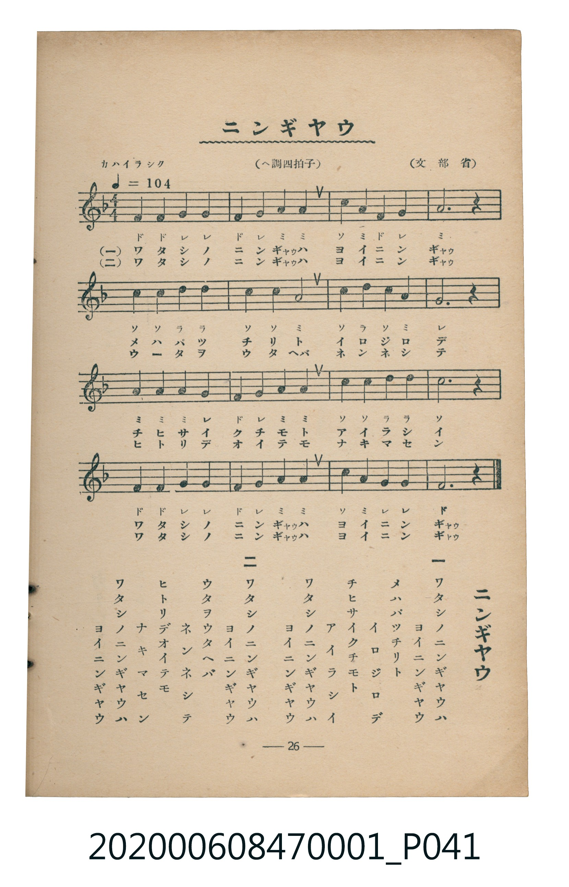

# ニンギヤウ（人偶）

> Re:Shōka 使用 AI 協助辨識與重建樂譜，可能會有錯誤。歡迎回報。

- **鋼琴伴奏版**：<br><audio controls src="ningyo.mp3"></audio>
- **NEUTRINO 歌聲合成版**：<br><audio controls src="ningyo_neutrino.mp3"></audio>

- 詞：文部省
- 曲：文部省
- 臺灣教育會公認《新定兒童唱歌》尋常科第一學年用（2020.006.0847.0001）

## 說明

曲目說明
中文解釋：描寫可愛的人偶，以及孩子與人偶遊玩的情景。


## 歌詞

```text
一
ワタシノニンギヤウハ
ヨイニンギヤウ
メハバッチリト
イロジロデ
チヒサイクチモト
アイラシイ
ワタシノニンギヤウハ
ヨイニンギヤウ

二
ワタシノニンギヤウハ
ヨイニンギヤウ
ウタヲウタヘバ
ネンネシテ
ヒトリデオイテモ
ナキマセン
ワタシノニンギヤウハ
ヨイニンギヤウ
```

## ABC

<div class="abc-score" data-abc-src="ningyo.abc" aria-label="五線譜載入中"></div>

[下載 ABC 原始檔](ningyo.abc)

## TMD 檔案連結

- [主旋律 TMD 檔案](ningyo.tmd) [[在 TMD Studio 編輯](https://tmdlang.github.io/Tmd-TS/#tmd=s7IKdvYPcrWy4qpTUCpJTLdSSM7PyUlNLsnMz7MqzsjMK0nNjM_KTMmPL87Iz05Ugisry88pzU21Si9KTEmNN4w3MjAyiDcwMIs3sDAxBzIMDBFKi_NLi5JTrYqTM_Lzc-JLUitKkvLzsxHyBUX5Zal5iXlANQVFIBtTwIoQClLLMlNSQdKpKZkl-UWZiTlI7kgtKga7FWxJfElRYl5xclFmAcgDCFUlGalAx5bmJeckFhdnpmWmpiDkgAamZ-ZZ5ebnJZUCPanEpaWl8Li5-3Hz5sdN6x43L3nctOz9no4nu3Y9bdz2fk-ngpYWl6KtgqGBCZe9rYIbl42JvokdyLAXK-e93zPr2bT2l80rns9pBFvwbPYmDLEX7bueNy5-NnXmi6ZNz-Y0P21d82JV7-OGrmfTNjxdN-tp66Tnq5c-nbLx2dqexw3dTzd0P92x4_nyic_XrHmyo-Hp2h1Pd255PmUF0EWgINcDBrkeKMiBDANDoOuUuPS1FIC2Pp-97sWqVc9m9HEpKCg82bEW6IQXyxe_bO8GOae__-n61U_71z9rmf18VgvMZz1Pdi992t_1dO3Kp2snvOhoh4i_bOx63rcSqOxZc-uzmesfNzRxaelzAW3hAjqH63Hz-sdN-x83bX_c3IcWZo-b-4HSKx43LUGTAIouBEo-bp7wuLn5cXPj4-ZVj5s7uMAK1z5u2gEim9uBqoAykx43bQVJNK0HcxdBFC4Cq10JsrZpCXlu4Hqyq4dM1wMlgZqaN8EYM4A-AartBakCkiDT2oD8SUC3gr3W_rhpFdicNqAHgBJdj5uAHpz3uGk3UAd5bgDFgG8iMNEGZCbm5TvUGNRUg-JZwcZEyw7MqFEwBEIjIASxjBSMgbBGwRRIgng1QFoXCA0UasCqfQxrgCl-vQLQIUC8HcjuA6oBWgrEm4EiQGsXA60F8vrB4iuAYkvg8kARuAqQqfEwU42obSrUa6ZAaAaEEBbIKyCWGZhdA_QeptcWgi153DwRiFvAljUC8Sog7gDrhli8FkjvANMgFe2YngE7Beyd5k1gXUDHg3mgJAAxqLkX4jsQDfQzSKQN3f2gyDDGiBqEnzDdD3LtJKCBW8EuBdkMDFaw6CKwH0AiQBbYFythFgN5mNEBNAWoHuL3drAqIAusrw1sGkhNF1AEGBbN84D0brDIZnQv4EpdMLGhmLpqubh07RRA2UoBSCtzAQA)]
- [鋼琴伴奏 TMD 檔案](ningyo_piano.tmd) [[在 TMD Studio 編輯](https://tmdlang.github.io/Tmd-TS/#tmd=s7IKdvYPcrWy4tLSUnjc3P24efPjpnWPm5c8blr2fk_H4-Ypj5sWPW7ue7Jny9Ol_U92z3i_p1NBS4tL0VbB0MCEy95WwY3LxkTfxI6rTkHpxcp57_fMejat_WXziudzGpVAYs9mb8IQe9G-63nj4mdTZ75o2vRsTvPT1jUvVvU-buh6Nm3D03WznrZOer566dMpG5-t7Xnc0P10Q_fTHTueL5_4fM2aJzsanq7d8XTnludTVgBdZ2RgZKBnYGCmZ2BhYg5kGBgCXafExeWbmJlnFZCZmJcf5OFQY1BTzaUABDYmWnZgRo2CIRAaASGIZaRgDIQ1CqZAEsSrAdK6QGigUANW7WNYAwyY9QqPm_YD8XYguw-oBhhUQLwZKAIMrMXAwALy-sHiK4BiS-DyQBG4CpCp8TBTjahtKtRrpkBoBoQQFsgrIJYZmF0D9B6m1xaCLXncPBGIW8CWNQLxKiDuAOuGWLwWSO8A0yAV7ZieATsF7J3mTWBdQMeDeTMeN0-AGNTcC_EdiAb6GSTShu5-UGQYY0QNwk-Y7ge5dhLQwK1gl4JsBgYrWHQR2A8gESAL7IuVMIuBPMzoAJoCVA_xeztYFZAF1tcGNg2kpgsoAgyL5nlAejdYZDO6F3ClLpjYUExdtci5ygd7roo2jAWqjjaNB1FwLpjEIYkIB7gCEzyaYTyIIVg047UaxWRSNWNzNzBMdO0UQMES7QMShrGNwGxlLgA)]

## 分析

```text
================================================================================
📊 TMD Song Profile: [ ニンギヤウ（人偶） ]
================================================================================
⏱  Duration:       0:36 (36.9s), 16 measures total
🎼 Key & Tempo:    首調基準 F, != 104.0 BPM, <4/4>
   - 分析範圍：      由實際發聲的音符與和弦推測調性；播放脈絡另行呈現
🎤 人聲音域:    F4 (MIDI 65) – D5 (MIDI 74) [跨度: 9 個半音 / 0.8 個八度, 難度: easy]
   - 最低音:  F4 in [Main #1 @ m.1, 0:00]
   - 最高音: D5 in [Main #1 @ m.5, 0:10]
   - 適合: soprano, mezzo-soprano, contralto, tenor, baritone, bass
🏛  結構:      Main (36.9s)
⚡ 編曲密度:        Peak 1 軌道同時演奏
🗝  調性診斷：       C 調性不明確（純淨自然大調，未偵測到可信轉調）
   - 風格氣質:    純淨自然大調（陽光明朗、易唱易記，無明顯調外色彩）
   - 轉調歷程:    全曲維持單一推測調性（未偵測到可信轉調）
   - 核心骨幹音:  A, G, C, F, D
   - 調性數值:    C 調性不明確 [相關度: 0.72, 穩定度: Ambiguous, 自然音純度: 100.0%]
   - 候選調性 (K-S): C 大調 (0.72), F 大調 (0.71), A 小調 (0.71)
   - 五度圈歷程:   +0
   - 各段落調性細節:
     • [Main #1]: C 調性不明確 (r: 0.72, 自然音純度: 100.0%)

  [ 五度圈游移軌跡 ]
              [C ]*
         F            G  
      Bb               D  
      Eb               A  
         Ab           E  
            Db       B  
               F# 
     (* = active key center)

  [ 十二半音累積音高分佈 ]
     C  : ██████████████████        21.7%
     C# :                            0.0%
     D  : ███████                    8.3%
     D# :                            0.0%
     E  :                            0.0%
     F  : ████████████████          18.3%
     F# :                            0.0%
     G  : ████████████████████      23.3%
     G# :                            0.0%
     A  : ████████████████████████  28.3%
     A# :                            0.0%
     B  :                            0.0%
--------------------------------------------------------------------------------
Assignment 軌道音域：
  - Piano         : F4 – D5 (9 個半音 / 0.8 個八度, 51 個音符)
================================================================================
```


## 原書掃描頁




