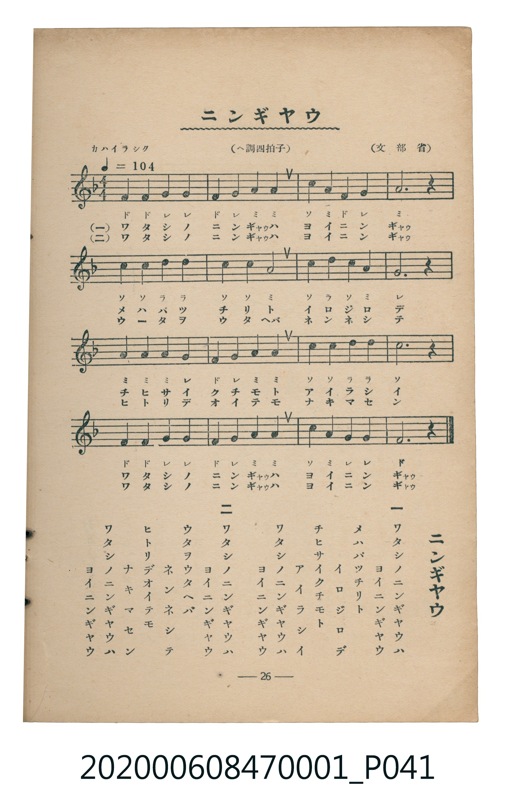

# ニンギヤウ（人偶）

> Re:Shōka 使用 AI 協助辨識與重建樂譜，可能會有錯誤。歡迎[回報](https://github.com/TMDLang/reshoka/issues)。

- **鋼琴伴奏版**：<br><audio controls src="ningyo.mp3"></audio>
- **NEUTRINO 歌聲合成版**：<br><audio controls src="ningyo_neutrino.mp3"></audio>

- 詞：文部省
- 曲：文部省
- 臺灣教育會公認《新定兒童唱歌》尋常科第一學年用（2020.006.0847.0001）

## 說明

曲目說明
中文解釋：描寫可愛的人偶，以及孩子與人偶遊玩的情景。


## 歌詞

```text
一
ワタシノニンギヤウハ
ヨイニンギヤウ
メハバッチリト
イロジロデ
チヒサイクチモト
アイラシイ
ワタシノニンギヤウハ
ヨイニンギヤウ

二
ワタシノニンギヤウハ
ヨイニンギヤウ
ウタヲウタヘバ
ネンネシテ
ヒトリデオイテモ
ナキマセン
ワタシノニンギヤウハ
ヨイニンギヤウ
```

## ABC

<div class="abc-score" data-abc-src="ningyo.abc" aria-label="五線譜載入中"></div>

[下載 ABC 原始檔](ningyo.abc)

## TMD 檔案連結

- [主旋律 TMD 檔案](ningyo.tmd) [[在 TMD Studio 編輯](https://tmdlang.github.io/Tmd-TS/#tmd=s7IKdvYPcrWy4qpTUCpJTLdSSM7PyUlNLsnMz7MqzsjMK0nNjM_KTMmPL87Iz05Ugisry88pzU21Si9KTEmNN4w3MjAyiDcwMIs3sDAxBzIMDBFKi_NLi5JTrYqTM_Lzc-JLUitKkvLzsxHyBUX5Zal5iXlANQVFIBtTwIoQClLLMlNSQdKpKZkl-UWZiTlI7kgtKga7FWxJfElRYl5xclFmAcgDCFUlGalAx5bmJeckFhdnpmWmpiDkgAamZ-ZZ5ebnJZUCPYksUZKRD_RgQUalVUZmMcjm5MSc-OzEPKRwgNpbkJieahVgYAL0tpaWwuPm7sfNmx83rXvcvORx07L3ezqe7Nr1tHHb-z2dClpaXIq2CoYGJlz2tgpuXDYm-iZ2INNerJz3fs-sZ9PaXzaveD6nEWzDs9mbMMRetO963rj42dSZL5o2PZvT_LR1zYtVvY8bup5N2_B03aynrZOer176dMrGZ2t7Hjd0P93Q_XTHjufLJz5fs-bJjoana3c83bnl-ZQVQBeBYkwPGGN6oBgDMgwMga5T4tLXUgDa-nz2uherVj2b0celoKDwZMdaoBNeLF_8sr0b5Jz-_qfrVz_tX_-sZfbzWS0wn_U82b30aX_X07Urn66d8KKjHSL-srHred9KoLJnza3PZq5_3NDEpaXPBbSFC-gcrsfN6x837X_ctP1xcx9amD1u7gdKr3jctARNAii6ECj5uHnC4-bmx82Nj5tXPW7u4AIrXPu4aQeIbG4HqgLKTHrctBUk0bQezF0EUbgIrHYlyNqmJeS5gevJrh4yXQ-UBGpq3gRjzAD6BKi2F6QKSIJMawPyJwHdCvZa--OmVWBz2oAeAEp0PW4CenDe46bdQB3kuQEUA76JwDQfkJmYl-9QY1BTDYpnBRsTLTswo0bBEAiNgBDEMlIwBsIaBVMgCeLVAGldIDRQqAGr9jGsAab49QpAhwDxdiC7D6gGaCkQbwaKAK1dDLQWyOsHi68Aii2BywNF4CpApsbDTDWitqlQr5kCoRkQQlggr4BYZmB2DdB7mF5bCLbkcfNEIG4BW9YIxKuAuAOsG2LxWiC9A0yDVLRjegbsFLB3mjeBdQEdD-aBkgDEoOZeiO9ANNDPIJE2dPeDIsMYI2oQfsJ0P8i1k4AGbgW7FGQzMFjBoovAfgCJAFlgX6yEWQzkYUYH0BSgeojf28GqgCywvjawaSA1XUARYFg0zwPSu8Eim9G9gCt1wcSGYuqq5eLStVMAZSsFIK3MBQA)]
- [鋼琴伴奏 TMD 檔案](ningyo_piano.tmd) [[在 TMD Studio 編輯](https://tmdlang.github.io/Tmd-TS/#tmd=s7IKdvYPcrWy4qpTUCpJTLdSyC8qychPL0osyKi0ysgsLskvykxOzInPTsxLVIIrKs4vLUpOjS9ITE-1CjAwMVTi0tJSeNzc_bh58-OmdY-blzxuWvZ-T8fj5imPmxY9bu57smfL06X9T3bPeL-nU0FLi0vRVsHQwITL3lbBjcvGRN_EDmTyi5Xz3u-Z9Wxa-8vmFc_nNIJtezZ7E4bYi_ZdzxsXP5s680XTpmdzmp-2rnmxqvdxQ9ezaRuerpv1tHXS89VLn07Z-Gxtz-OG7qcbup_u2PF8-cTna9Y82dHwdO2Opzu3PJ-yAug6IwMjAz0DAzM9AwsTcyDDwBDoOiUuLt_EzDyrgMzEvPwgD4cag5pqLgUgsDHRsgMzahQMgdAICEEsIwVjIKxRMAWSIF4NkNYFQgOFGrBqH8MaYMCsV3jctB-ItwPZfUA1wKAC4s1AEWBgLQYGFpDXDxZfARRbApcHisBVgEyNh5lqRG1ToV4zBUIzIISwQF4BsczA7Bqg9zC9thBsyePmiUDcArasEYhXAXEHWDfE4rVAegeYBqlox_QM2Clg7zRvAusCOh7Mm_G4eQLEoOZeiO9ANNDPIJE2dPeDIsMYI2oQfsJ0P8i1k4AGbgW7FGQzMFjBoovAfgCJAFlgX6yEWQzkYUYH0BSgeojf28GqgCywvjawaSA1XUARYFg0zwPSu8Eim9G9gCt1wcSGYuqqRc5VPthzVbRhLFB1tGk8iIJzwSQOSUQ4wBWY4NEM40EMwaIZr9UoJpOqGZu7gWGia6cACpZoH5AwjG0EZitzAQA)]

## 分析

```text
================================================================================
📊 TMD Song Profile: [ ニンギヤウ（人偶） ]
================================================================================
⏱  Duration:       0:36 (36.9s), 16 measures total
🎼 Key & Tempo:    首調基準 F, != 104.0 BPM, <4/4>
   - 分析範圍：      由實際發聲的音符與和弦推測調性；播放脈絡另行呈現
🎤 人聲音域:    F4 (MIDI 65) – D5 (MIDI 74) [跨度: 9 個半音 / 0.8 個八度, 難度: easy]
   - 最低音:  F4 in [Main #1 @ m.1, 0:00]
   - 最高音: D5 in [Main #1 @ m.5, 0:10]
   - 適合: soprano, mezzo-soprano, contralto, tenor, baritone, bass
🏛  結構:      Main (36.9s)
⚡ 編曲密度:        Peak 1 軌道同時演奏
🗝  調性診斷：       C 調性不明確（純淨自然大調，未偵測到可信轉調）
   - 風格氣質:    純淨自然大調（陽光明朗、易唱易記，無明顯調外色彩）
   - 轉調歷程:    全曲維持單一推測調性（未偵測到可信轉調）
   - 核心骨幹音:  A, G, C, F, D
   - 調性數值:    C 調性不明確 [相關度: 0.72, 穩定度: Ambiguous, 自然音純度: 100.0%]
   - 候選調性 (K-S): C 大調 (0.72), F 大調 (0.71), A 小調 (0.71)
   - 五度圈歷程:   +0
   - 各段落調性細節:
     • [Main #1]: C 調性不明確 (r: 0.72, 自然音純度: 100.0%)

  [ 五度圈游移軌跡 ]
              [C ]*
         F            G  
      Bb               D  
      Eb               A  
         Ab           E  
            Db       B  
               F# 
     (* = active key center)

  [ 十二半音累積音高分佈 ]
     C  : ██████████████████        21.7%
     C# :                            0.0%
     D  : ███████                    8.3%
     D# :                            0.0%
     E  :                            0.0%
     F  : ████████████████          18.3%
     F# :                            0.0%
     G  : ████████████████████      23.3%
     G# :                            0.0%
     A  : ████████████████████████  28.3%
     A# :                            0.0%
     B  :                            0.0%
--------------------------------------------------------------------------------
Assignment 軌道音域：
  - Piano         : F4 – D5 (9 個半音 / 0.8 個八度, 51 個音符)
================================================================================
```


## 原書掃描頁




