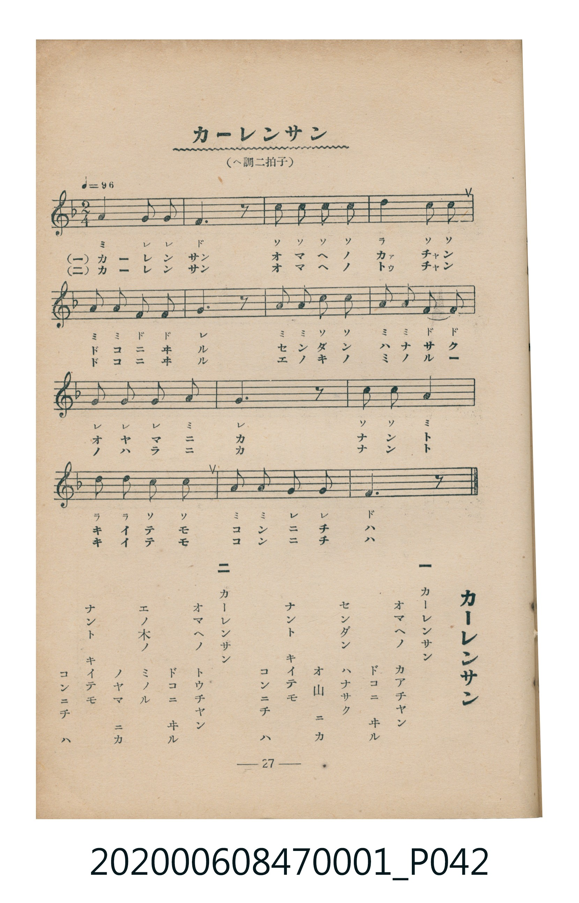

# カーレンサン

<audio controls src="karensan.mp3"></audio>

- 臺灣教育會公認《新定兒童唱歌》尋常科第一學年用（2020.006.0847.0001）

## 說明

原書資訊與歌詞全文（對應 P042.jpg，書頁 p. 27，第三學期第 3 首）：
調性與拍號：ヘ調二拍子（F 大調 2/4 拍）

## 歌詞

```text
一　カーレンサン
オマヘノ　カアチヤン
ドコニ　ヰル
センダン　ハナサク
オ山　ニカ
ナント　キイテモ
コンニチ　ハ

二　カーレンサン
オマヘノ　トウチヤン
ドコニ　ヰル
エノ木ノ　ミノル
ノヤマ　ニカ
ナント　キイテモ
コンニチ　ハ
```

## ABC

```abc
X:1
T:カーレンサン
M:2/4
L:1/16
Q:1/4=96
K:F
V:V1 name="Piano" snm="Pia"
[V:V1]
A4 G2 G2 | F6 z2 | c2 c2 c2 c2 | d4 c2 c2 |
A2 A2 F2 F2 | G6 z2 | A2 A2 c2 c2 | A2 A2 F2 F2 |
G2 G2 G2 A2 | G6 z2 | c2 c2 A4 | d2 d2 c2 c2 |
A2 A2 G2 G2 | F6 z2 |
```

## TMD 檔案連結

- [主旋律 TMD 檔案](karensan.tmd) [[在 TMD Studio 編輯](https://tmdlang.github.io/Tmd-TS/#tmd=s7IKdvYPcrWy4qpTUCpJTLdSSM7PyUlNLsnMz7MqzsjMK0nNjM_KTMmPL87Iz05Ugisry88pzU21Si9KTEmNN4w3MjAyiDcwMIs3sDAxBzIMDBFKi_NLi5JTrYqTM_Lzc-JLUitKkvLzsxHyBUX5Zal5iXlANQVFIBtTwIoQClLLMlNSQdKpKZkl-UWZiTlI7kgtKga7FWxJfElRYl5xclFmAcgDCFUlGalAxxbkJCanKnFpaSk8blr9uHnP4-Y1j5s3P27aCiQVtLS4FG0VLM247G0V3LhsjPRN7EDaX7Tvet64-NnUmS-aNj2b0_y0dc2LVb2PG7qeTdvwdN2sp62Tnq9e-nTKxmdrex43dD_d0P10x47nyyc-X7PmyY6Gp2t3PN255fmUFe_3dIACSA8YQHqgAAIyDAzf7-lU4uLS11KwpRbgUlBQeNo3_9nsHS82t79Y0fWiox3orhcr5z1tXfFsWjvQFU839D5r71QIMDAx0ssqSH-_pweo-OWCRoUCPQUjcyAX7PBOoMOfzZkPZCsYK7xcNg3o0vd7ZoFMf7Fq_7OG5SBzu3tfzJwPFH3cPAMo-GRXD1Dk6doJQDvcFJ4uWQ4UUwAGoQJQFKibC6QXGCCPGxowQx4k97hp1ePmeUCzHjf3QRU1LXrc3Pi4eQlMRXPn46bNj5u7QdLNGx43r4bo2w0ypxkotBks0f-4uQtkbNN6qLFPN24ES3QDzYSY0wXW0QG2Zu3jJqAFbY-bF0GUAyXAdgBtBpsGcfguYNwS6XCguU3LiHL4CqCOZ3NAJFhiPogBlQOxgNrnUeJwoCjlCQoKFLT0ubi8E4tS84oT86wCMhPz8h1qDGoUqkG2KNhYaNmBGdiSsgIkJ7xY2KOgYaLwdEP_8_UNOvD0p4lFA9AuqGEvZ_U9ndBrBfT5fJAIkF4DJ2tA4QoWhQGgSNNecFigkyC1KyEmIIki7NEAOlATaE3Taqg1e1Cs2QzWAi4j4BatAquYByZnQKIMKgNMuAvBAsAksBiqG9mqXT3UsgqU1JbisKoGmHF1FYyAsEbBEMjSVTAAskyhsEbBDCgCZoETOO6Y29VDhZiDkaD4gpAg14P8jAAgESS1aLGH3RTMGIRINoGDsbkbTG6AGgEJcCTrmnaD5SFqG-BskNp-MK8LEhlgcj2adZBYJMm6FWB5UNwBcy-cjfAdWAasD5IqkGLSGBiHhkCWETwmQWKQmITLEojJHZ3gmDQmOyYReQ9GgtyNNSaRcyA072LJbZCEvQRMQpI3KAjBeQjdQEhcQOOqA8NAaGxAQpBCA0GhDILGKOENCmtQjiIQyk9nz6YwlEHlFJTEkwfwlYNYQhqc3JogAdMGJhdBAwYSAMgJuBFqKCgPYDcUWoJRzVBQaWSGlJrRSi2uWi4uXTsFWPWjAGQrc3EBAA)]
- [鋼琴伴奏 TMD 檔案](karensan_piano.tmd) [[在 TMD Studio 編輯](https://tmdlang.github.io/Tmd-TS/#tmd=s7IKdvYPcrWy4tLSUnjctPpx857HzWseN29-3LQVSL7f0_Gye8_zCVue7NnydGn_886O93s6FbS0uBRtFSzNuOxtFdy4bIz0Tey46hSUXrTvet64-NnUmS-aNj2b0_y0dc2LVb2PG7qeTdvwdN2sp62Tnq9e-nTKxmdrex43dD_d0P10x47nyyc-X7PmyY6Gp2t3PN255fmUFUAbjQyMDPQMDMz0DCxMzIEMA0OgpUpcXN6JRal5xYl5VgGZiXn5QR4ONQY1CtVcCkBgY6FlB2boaynYogMFiBUvFvYoaJgoPN3Q_3x9g45CgIGJkV5WQbomFg1a-mDDahSMFXQVjICwRsEQyNJVMACyTKGwRsEMKAJmceG3e1cPeXYbA201BLKM4HaDxCB2w2UJ2L2jE2y3MWl2g_xsBLQB2W6QvaDwIGDj09mzybHRDAgRPkMLc65a9Nj3QYl9E0Tsv9gz9en-1cAgf9bd-3TthKfblz3r7IakXoRlhvEK0YaxEAbIa3C-CZBhAmSgqzONR1MIY0AVguSjTeOxKYWqgJmMrBRiO8hzunYKMP8poLGVubgA)]

## 分析

```text
================================================================================
📊 TMD Song Profile: [ カーレンサン ]
================================================================================
⏱  Duration:       0:17 (17.5s), 14 measures total
🎼 Key & Tempo:    首調基準 F, != 96.0 BPM, <2/4>
   - 分析範圍：      由實際發聲的音符與和弦推測調性；播放脈絡另行呈現
🎤 人聲音域:    F4 (MIDI 65) – D5 (MIDI 74) [跨度: 9 個半音 / 0.8 個八度, 難度: easy]
   - 最低音:  F4 in [Karensan #1 @ m.2, 0:01]
   - 最高音: D5 in [Karensan #1 @ m.4, 0:03]
   - 適合: soprano, mezzo-soprano, contralto, tenor, baritone, bass
🏛  結構:      Karensan (17.5s)
⚡ 編曲密度:        Peak 1 軌道同時演奏
🗝  調性診斷：       C 大調（純淨自然大調，未偵測到可信轉調）
   - 風格氣質:    純淨自然大調（陽光明朗、易唱易記，無明顯調外色彩）
   - 轉調歷程:    全曲維持單一推測調性（未偵測到可信轉調）
   - 核心骨幹音:  G, A, C, F, D
   - 調性數值:    C 大調 [相關度: 0.77, 穩定度: Moderate, 自然音純度: 100.0%]
   - 候選調性 (K-S): C 大調 (0.77), F 大調 (0.73), A 小調 (0.66)
   - 五度圈歷程:   +0
   - 各段落調性細節:
     • [Karensan #1]: C 大調 (r: 0.77, 自然音純度: 100.0%)

  [ 五度圈游移軌跡 ]
              [C ]*
         F            G  
      Bb               D  
      Eb               A  
         Ab           E  
            Db       B  
               F# 
     (* = active key center)

  [ 十二半音累積音高分佈 ]
     C  : ██████████████████████    23.1%
     C# :                            0.0%
     D  : ███████                    7.7%
     D# :                            0.0%
     E  :                            0.0%
     F  : ██████████████████        19.2%
     F# :                            0.0%
     G  : ████████████████████████  25.0%
     G# :                            0.0%
     A  : ████████████████████████  25.0%
     A# :                            0.0%
     B  :                            0.0%
--------------------------------------------------------------------------------
Assignment 軌道音域：
  - Piano         : F4 – D5 (9 個半音 / 0.8 個八度, 41 個音符)
================================================================================
```


## 原書掃描頁




