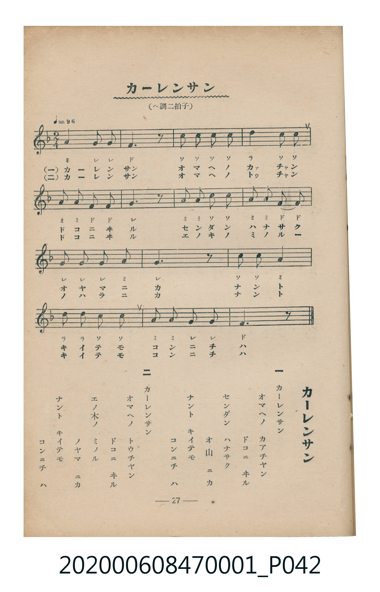

# カーレンサン（花蓮港）

> Re:Shōka 使用 AI 協助辨識與重建樂譜，可能會有錯誤。歡迎回報。

- **鋼琴伴奏版**：<br><audio controls src="karensan.mp3"></audio>
- **NEUTRINO 歌聲合成版**：<br><audio controls src="karensan_neutrino.mp3"></audio>

- 臺灣教育會公認《新定兒童唱歌》尋常科第一學年用（2020.006.0847.0001）

## 說明

曲目說明
中文解釋：歌唱臺灣花蓮港的地方風景與熱鬧景象。

原書資訊與歌詞全文（對應 P042.jpg，書頁 p. 27，第三學期第 3 首）：
調性與拍號：ヘ調二拍子（F 大調 2/4 拍）


## 歌詞

```text
一　カーレンサン
オマヘノ　カアチヤン
ドコニ　ヰル
センダン　ハナサク
オ山　ニカ
ナント　キイテモ
コンニチ　ハ

二　カーレンサン
オマヘノ　トウチヤン
ドコニ　ヰル
エノ木ノ　ミノル
ノヤマ　ニカ
ナント　キイテモ
コンニチ　ハ
```

## ABC

<div class="abc-score" data-abc-src="karensan.abc" aria-label="五線譜載入中"></div>

[下載 ABC 原始檔](karensan.abc)

## TMD 檔案連結

- [主旋律 TMD 檔案](karensan.tmd) [[在 TMD Studio 編輯](https://tmdlang.github.io/Tmd-TS/#tmd=s7IKdvYPcrWy4qpTUCpJTLdSSM7PyUlNLsnMz7MqzsjMK0nNjM_KTMmPL87Iz05Ugisry88pzU21Si9KTEmNN4w3MjAyiDcwMIs3sDAxBzIMDBFKi_NLi5JTrYqTM_Lzc-JLUitKkvLzsxHyBUX5Zal5iXlANQVFIBtTwIoQClLLMlNSQdKpKZkl-UWZiTlI7kgtKga7FWxJfElRYl5xclFmAcgDCFUlGalAxxbkJCanIgSBJqVn5lmVJGaWJ-bF56elZSajGJ1fVJKRD_RgQUalVUZmMcjm5MSc-OzEPKRwgNpbkJieahVgYGKkxKWlpfC4afXj5j2Pm9c8bt78uGkrkHy_p-NF18YXk9c927H-_Z5OBS0tLkVbBUszLntbBTcuGyN9EzuQkS_adz1vXPxs6swXTZuezWl-2rrmxarexw1dz6ZteLpu1tPWSc9XL306ZeOztT2PG7qfbuh-umPH8-UTn69Z82RHw9O1O57u3PJ8ygqgXaDo0ANGhx4oOoAMA0OgpUpc-loKz2Zvej573YtVq57N6ONSUFB4smPts2ntL5Yvftne_X7PLKDJQPMhzoA7-PmslqdzNjybtvPlohXPZq5_0dH-vG3jyzXLQeyNCx83NHFp6XOBDLelFgC57Gnf_Gezd7zY3P5iRRfQSqDLXqyc97R1BdC5QB8-3dD7rL1TARTkelkF6e_39AAVv1zQqFCgp2BkDuSCA6UTGCjP5swHshWMFV4umwYMBaAnQaa_WLX_WcNykLndvS9mzgeKPm6eARR8sqsHKPJ07QSgHW4KT5csB4opAKNHASgK1M0FCbOGxw0NmJEMknvctOpx8zygWY-b-6CKmhY9bm583LwEpqK583HT5sfN3SDp5g2Pm1dD9O0GmdMMFNoMluh_3NwFMrZpPdTYpxs3giW6gWZCzOkC6-gAW7P2cRPQgrbHzYsgyoESYDuANoNNgzh8FzDdEOlwoLlNy4hy-AqgjmdzQCRYYj6IAZUDsYDa51HicKAo5QkKChRACdU7sSg1rzgxzyogMzEv36HGoKYaZImCjYWWHZiBLSUrQDLZi4U9ChomCk839D9f36ADT36aWDQArYIa9nJW39MJvVZAj88HiQDpNXCyBhSsYFEYAIo07QUHBToJUrsSYgKSKMIeDaADNYHWNK2GWrMHxZrNYC2g-EZYtAqsYh6YnAGJMagMMN0uBAsAU8BiqG5kq3b1UMsqUEpbisOqGmC-1VUwAsIaBUMgS1fBAMgyhcIaBTOgCJgFVu1jCHY5UAzkFJBBID7YGSCt8VB3gFwBcgPIBXCvgvTA7YcaZ0SOcRDvoBmHP13t6qFCuoKRoNQEIUGOAcUIAoBEkNSipS3spmCmL4hkEziSm7vB5AaoEZDkgGRd026wPERtA5wNUtsP5nWBzdoKJtejWQdJYyRZtwIsD0pZwKIFzkb4DiwD1gdJs0jpzBiYwgyBLCN4OgOJQdIZXBaRzoDOAjkK5CSQgyDOQaSL3WCfgvwMTThA_4J8C_IryKdISYyASSvAzgZ5B5bC5kNEwKoIpa0dneC0ZUx22kKUVTASFJJY0xZyiQUt67CUTpCCYAmYhBQHoEiFZDU0AyGpA5p6OjAMhKYPSJxSaCAo3kHQGCUFgGIfVAIhly-gHL8EbBXIIlgRAY0tUAyD470DoQscx6D4IlYX3hh9Ons2hTEKqkOgJJ4SAF8dhSVWwZmtCRIJbWByETQSIIGNnH0boYaCSgDshkJrF6oZCqopzJDyMlqNghS7wFwGtBBkHcgyiFWQuAHlzkaoFdCYQ6omSNNXy8Wla6cAa4koANnKXAA)]
- [鋼琴伴奏 TMD 檔案](karensan_piano.tmd) [[在 TMD Studio 編輯](https://tmdlang.github.io/Tmd-TS/#tmd=s7IKdvYPcrWy4qpTUCpJTLdSyC8qychPL0osyKi0ysgsLskvykxOzInPTsxLVIIrKs4vLUpOjS9ITE-1CjAwMVLi0tJSeNy0-nHznsfNax43b37ctBVIvt_T8bJ7z_MJW57s2fJ0af_zzo73ezoVtLS4FG0VLM247G0V3LhsjPRN7EAGv2jf9bxx8bOpM180bXo2p_lp65oXq3ofN3Q9m7bh6bpZT1snPV-99OmUjc_W9jxu6H66ofvpjh3Pl098vmbNkx0NT9fueLpzy_MpK4A2GhkYGegZGJjpGViYmAMZBoZAS5W4uLwTi1LzihPzrAIyE_PygzwcagxqqrkUgMDGQssOzNDXUrBFBwoQG14s7FHQMFF4uqH_-foGHQWQp_WyCtI1sWjQ0gcbVqNgrKCrYASENQqGQJauggGQZQqFNQpmQBEwC6zax7AGFIBAMWAAAvFmoApIIIK1xoO5q4AS84B4BhD3gUVWP25aCNbT-Lh5MUQbxDgjcoxr7njctBTdOPwhs6uHvJAxBoaJIZBlBA8ZkBgkZOCyiJBp7gS6dzOQ7gbiDWC3gjwH88lusFsfNzfAvNrcD8RdIC8D8XrkQCFg0gpwWDxuWgsPk_kQEbAqQqGxoxMcGsakhQYojRgB_YwcGqCQAKUf5NQBiq8l0DjrhkQ_wuUg34LDoAOhC-xfkNuJ1YXXd09nzybHd2ZAiIhXtPyA5DtgiDeB3NkGxIvA7gS5CxZTjdBYhbocKZGTpq8WvSDwQS4ITBAFwYs9U5_uXw1M38-6e5-unfB0-7Jnnd2QcgzhN8N4hWjDWAgDFGtwvgmQYQJkoKszjUdTCGNAFYLko03jsSmFqoCZjKwUYjvIb7p2CjDvRfsAdaHwjcB8ZS4A)]

## 分析

```text
================================================================================
📊 TMD Song Profile: [ カーレンサン（花蓮港） ]
================================================================================
⏱  Duration:       0:17 (17.5s), 14 measures total
🎼 Key & Tempo:    首調基準 F, != 96.0 BPM, <2/4>
   - 分析範圍：      由實際發聲的音符與和弦推測調性；播放脈絡另行呈現
🎤 人聲音域:    F4 (MIDI 65) – D5 (MIDI 74) [跨度: 9 個半音 / 0.8 個八度, 難度: easy]
   - 最低音:  F4 in [Karensan #1 @ m.2, 0:01]
   - 最高音: D5 in [Karensan #1 @ m.4, 0:03]
   - 適合: soprano, mezzo-soprano, contralto, tenor, baritone, bass
🏛  結構:      Karensan (17.5s)
⚡ 編曲密度:        Peak 1 軌道同時演奏
🗝  調性診斷：       C 大調（純淨自然大調，未偵測到可信轉調）
   - 風格氣質:    純淨自然大調（陽光明朗、易唱易記，無明顯調外色彩）
   - 轉調歷程:    全曲維持單一推測調性（未偵測到可信轉調）
   - 核心骨幹音:  G, A, C, F, D
   - 調性數值:    C 大調 [相關度: 0.77, 穩定度: Moderate, 自然音純度: 100.0%]
   - 候選調性 (K-S): C 大調 (0.77), F 大調 (0.73), A 小調 (0.66)
   - 五度圈歷程:   +0
   - 各段落調性細節:
     • [Karensan #1]: C 大調 (r: 0.77, 自然音純度: 100.0%)

  [ 五度圈游移軌跡 ]
              [C ]*
         F            G  
      Bb               D  
      Eb               A  
         Ab           E  
            Db       B  
               F# 
     (* = active key center)

  [ 十二半音累積音高分佈 ]
     C  : ██████████████████████    23.1%
     C# :                            0.0%
     D  : ███████                    7.7%
     D# :                            0.0%
     E  :                            0.0%
     F  : ██████████████████        19.2%
     F# :                            0.0%
     G  : ████████████████████████  25.0%
     G# :                            0.0%
     A  : ████████████████████████  25.0%
     A# :                            0.0%
     B  :                            0.0%
--------------------------------------------------------------------------------
Assignment 軌道音域：
  - Piano         : F4 – D5 (9 個半音 / 0.8 個八度, 41 個音符)
================================================================================
```


## 原書掃描頁




