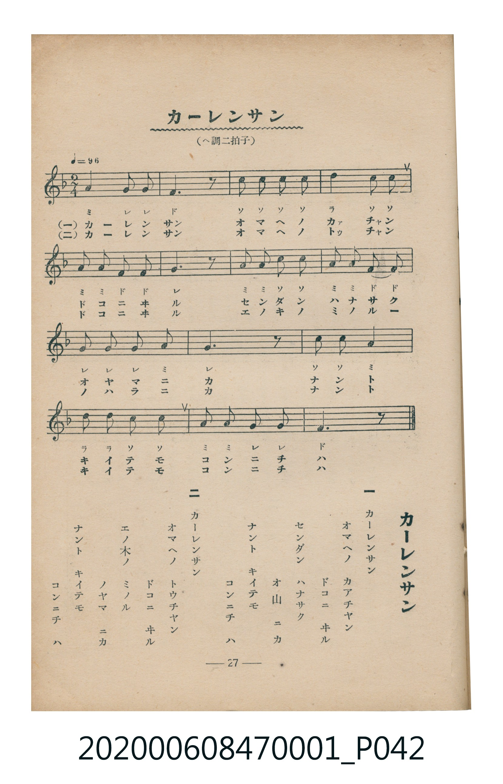

# カーレンサン（花蓮港）

> Re:Shōka 使用 AI 協助辨識與重建樂譜，可能會有錯誤。歡迎回報。

- **鋼琴伴奏版**：<br><audio controls src="karensan.mp3"></audio>
- **NEUTRINO 歌聲合成版**：<br><audio controls src="karensan_neutrino.mp3"></audio>

- 臺灣教育會公認《新定兒童唱歌》尋常科第一學年用（2020.006.0847.0001）

## 說明

曲目說明
中文解釋：歌唱臺灣花蓮港的地方風景與熱鬧景象。

原書資訊與歌詞全文（對應 P042.jpg，書頁 p. 27，第三學期第 3 首）：
調性與拍號：ヘ調二拍子（F 大調 2/4 拍）


## 歌詞

```text
一　カーレンサン
オマヘノ　カアチヤン
ドコニ　ヰル
センダン　ハナサク
オ山　ニカ
ナント　キイテモ
コンニチ　ハ

二　カーレンサン
オマヘノ　トウチヤン
ドコニ　ヰル
エノ木ノ　ミノル
ノヤマ　ニカ
ナント　キイテモ
コンニチ　ハ
```

## ABC

<div class="abc-score" data-abc-src="karensan.abc" aria-label="五線譜載入中"></div>

[下載 ABC 原始檔](karensan.abc)

## TMD 檔案連結

- [主旋律 TMD 檔案](karensan.tmd) [[在 TMD Studio 編輯](https://tmdlang.github.io/Tmd-TS/#tmd=s7IKdvYPcrWy4qpTUCpJTLdSSM7PyUlNLsnMz7MqzsjMK0nNjM_KTMmPL87Iz05Ugisry88pzU21Si9KTEmNN4w3MjAyiDcwMIs3sDAxBzIMDBFKi_NLi5JTrYqTM_Lzc-JLUitKkvLzsxHyBUX5Zal5iXlANQVFIBtTwIoQClLLMlNSQdKpKZkl-UWZiTlI7kgtKga7FWxJfElRYl5xclFmAcgDCFUlGalAxxbkJCanIgSBJqVn5lmVJGaWJ-bF56elZSaDjdbSUnjctPpx857HzWseN29-3LQVSL7f0_Gia-OLyeue7Vj_fk-ngpYWl6KtgqUZl72tghuXjZG-iR3I4Bftu543Ln42deaLpk3P5jQ_bV3zYlXv44auZ9M2PF0362nrpOerlz6dsvHZ2p7HDd1PN3Q_3bHj-fKJz9esebKj4enaHU93bnk-ZQXQLlB46gHDUw8UnkCGgSHQUiUufS2FZ7M3PZ-97sWqVc9m9HEpKCg82bH22bT2F8sXv2zvfr9nFtBkoPkQZ8Ad_HxWy9M5G55N2_ly0YpnM9e_6Gh_3rbx5ZrlIPbGhY8bmri09LlAhttSC4Bc9rRv_rPZO15sbn-xogtoJdBlL1bOe9q6AuhcoA-fbuh91t6pEGBgYqSXVZD-fk8PUPHLBY0KBXoKRuZALjhQOoGB8mzOfCBbwVjh5bJpwFAAehJk-otV-581LAeZ2937YuZ8oOjj5hlAwSe7eoAiT9dOANrhpvB0yXKgmAIwehSAokDdXJAwa3jc0IAZySC5x02rHjfPA5r1uLkPqqhp0ePmxsfNS2AqmjsfN21-3NwNkm7e8Lh5NUTfbpA5zUChzWCJ_sfNXSBjm9ZDjX26cSNYohtoJsScLrCODrA1ax83AS1oe9y8CKIcKAG2A2gz2DSIw3cB0w2RDgea27SMKIevAOp4NgdEgiXmgxhQORALqH0eJQ4HilKeoKBAAZRQvROLUvOKE_OsAjIT8_IdagxqqkGWKNhYaNmBGdhSsgIkk71Y2KOgYaLwdEP_8_UNOvDkp4lFA9AqqGEvZ_U9ndBrBfT4fJAIkF4DJ2tAwQoWhQGgSNNecFCgkyC1KyEmIIki7NEAOlATaE3Taqg1e1Cs2QzWAopvhEWrwCrmgckZkBiDygDT7UKwADAFLIbqRrZqVw-1rAKltKU4rKoB5ltdBSMgrFEwBLJ0FQyALFMorFEwA4qAWWDVPoZglwPFQE4BGQTig50B0hoPdQfIFSA3gFwA9ypID9x-qHFG5BgH8Q6acfjT1a4eKqQrGAlKTRAS5BhQjCAASARJLVrawm4KZvqCSDaBI7m5G0xugBoBSQ5I1jXtBstD1DbA2SC1_WBeF9isrWByPZp1kDRGknUrwPKglAUsWuBshO_AMmB9kDSLlM6MgSnMEMgygqczkBgkncFlEekM6CyQo0BOAjkI4hxEutgN9inIz9CEA_QvyLcgv4J8ipTECJi0AuxskHdgKWw-RASsilDa2tEJTlvGZKctRFkFI0EhiTVtIZdY0LIOS-kEKQiWgElIcQCKVEhWQzMQkjqgqacDw0Bo-oDEKYUGguIdBI1RUgAo9kElEHL5AsrxS8BWgSyCFRHQ2ALFMDjeOxC6wHEMii9ideGN0aezZ1MYo6A6BEriKQHw1VFYYhWc2ZogkdAGJhdBIwES2MjZtxFqKKgEwG4otHahmqGgmsIMKS-j1ShIsQvMZUALQdaBLINYBYkbUO5shFoBjTmkaoI0fbVcXLp2CrCWiAKQrcwFAA)]
- [鋼琴伴奏 TMD 檔案](karensan_piano.tmd) [[在 TMD Studio 編輯](https://tmdlang.github.io/Tmd-TS/#tmd=s7IKdvYPcrWy4tLSUnjctPpx857HzWseN29-3LQVSL7f0_Gye8_zCVue7NnydGn_886O93s6FbS0uBRtFSzNuOxtFdy4bIz0Tey46hSUXrTvet64-NnUmS-aNj2b0_y0dc2LVb2PG7qeTdvwdN2sp62Tnq9e-nTKxmdrex43dD_d0P10x47nyyc-X7PmyY6Gp2t3PN255fmUFUAbjQyMDPQMDMz0DCxMzIEMA0OgpUpcXN6JRal5xYl5VgGZiXn5QR4ONQY11VwKQGBjoWUHZuhrKdiiAwWIDS8W9ihomCg83dD_fH2DjkKAgYmRXlZBuiYWDVr6YMNqFIwVdBWMgLBGwRDI0lUwALJMobBGwQwoAmaBVfsY1oACECgGDEAg3gxUAQlEsNZ4MHcVUGIeEM8A4j6wyOrHTQvBehofNy-GaIMYZ0SOcc0dj5uWohuHP2R29ZAXMsbAMDEEsozgIQMSg4QMXBYRMs2dQPduBtLdQLwB7FaQ52A-2Q126-PmBphXm_uBuAvkZSBejxwoBExaAQ6Lx01r4WEyHyICVkUoNHZ0gkPDmLTQAKURI6CfkUMDFBKg9IOcOkDxtQQaZ92Q6Ee4HORbcBh0IHSB_QtyO7G68Pru6ezZ5PjODAgR8YqWH5B8BwzxJpA724B4EdidIHfBYqoRGqtQlyMlctL01aIXBD7IBYEJoiB4sWfq0_2rgen7WXfv07UTnm5f9qyzG1KOIfxmGK8QbRgLYYBiDc43ATJMgAx0dabxaAphDKhCkHy0aTw2pVAVMJORlUJsB_lN104B5r1oH6AuFL4RmK_MBQA)]

## 分析

```text
================================================================================
📊 TMD Song Profile: [ カーレンサン（花蓮港） ]
================================================================================
⏱  Duration:       0:17 (17.5s), 14 measures total
🎼 Key & Tempo:    首調基準 F, != 96.0 BPM, <2/4>
   - 分析範圍：      由實際發聲的音符與和弦推測調性；播放脈絡另行呈現
🎤 人聲音域:    F4 (MIDI 65) – D5 (MIDI 74) [跨度: 9 個半音 / 0.8 個八度, 難度: easy]
   - 最低音:  F4 in [Karensan #1 @ m.2, 0:01]
   - 最高音: D5 in [Karensan #1 @ m.4, 0:03]
   - 適合: soprano, mezzo-soprano, contralto, tenor, baritone, bass
🏛  結構:      Karensan (17.5s)
⚡ 編曲密度:        Peak 1 軌道同時演奏
🗝  調性診斷：       C 大調（純淨自然大調，未偵測到可信轉調）
   - 風格氣質:    純淨自然大調（陽光明朗、易唱易記，無明顯調外色彩）
   - 轉調歷程:    全曲維持單一推測調性（未偵測到可信轉調）
   - 核心骨幹音:  G, A, C, F, D
   - 調性數值:    C 大調 [相關度: 0.77, 穩定度: Moderate, 自然音純度: 100.0%]
   - 候選調性 (K-S): C 大調 (0.77), F 大調 (0.73), A 小調 (0.66)
   - 五度圈歷程:   +0
   - 各段落調性細節:
     • [Karensan #1]: C 大調 (r: 0.77, 自然音純度: 100.0%)

  [ 五度圈游移軌跡 ]
              [C ]*
         F            G  
      Bb               D  
      Eb               A  
         Ab           E  
            Db       B  
               F# 
     (* = active key center)

  [ 十二半音累積音高分佈 ]
     C  : ██████████████████████    23.1%
     C# :                            0.0%
     D  : ███████                    7.7%
     D# :                            0.0%
     E  :                            0.0%
     F  : ██████████████████        19.2%
     F# :                            0.0%
     G  : ████████████████████████  25.0%
     G# :                            0.0%
     A  : ████████████████████████  25.0%
     A# :                            0.0%
     B  :                            0.0%
--------------------------------------------------------------------------------
Assignment 軌道音域：
  - Piano         : F4 – D5 (9 個半音 / 0.8 個八度, 41 個音符)
================================================================================
```


## 原書掃描頁




