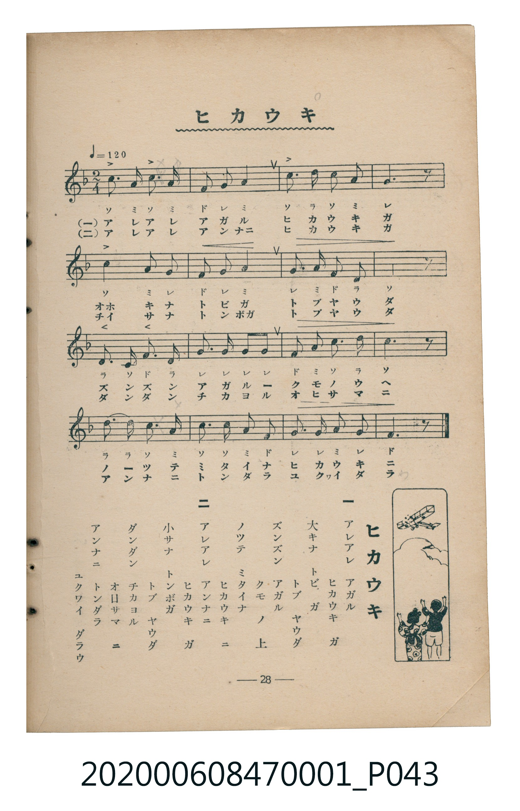

# ヒカウキ（飛機）

> Re:Shōka 使用 AI 協助辨識與重建樂譜，可能會有錯誤。歡迎回報。

- **NEUTRINO 歌聲合成版**：<br><audio controls src="hikoki_neutrino.mp3"></audio>
- **鋼琴伴奏版**：<br><audio controls src="hikoki.mp3"></audio>


- 臺灣教育會公認《新定兒童唱歌》尋常科第一學年用（2020.006.0847.0001）

## 說明

曲目說明
中文解釋：描寫飛機飛上天空、越過雲端的想像與興奮。


## 跨冊／重複收錄參照

> 同曲＋同名異曲（《公學校唱歌》與《新定兒童唱歌》第一學年〈ヒカウキ〉為同曲；《うたのほん》下卷〈ひかうき〉與《新定兒童唱歌》第五學年〈飛行機〉為同名異曲）

- **[同曲]** 《公學校唱歌》第一學年用（昭和10年／1935）：[**〈ヒカウキ（飛機）〉**](../../../kogakko_shoka/grade_1/12_hikoki/index.md)（`F` / `2/4` — [原始 TMD](../../../kogakko_shoka/grade_1/12_hikoki/hikoki.tmd)）
- **[同名異曲]** 《新定兒童唱歌》尋常科第五學年用（2020.006.0847.0005）：[**〈飛行機〉**](../../grade_5_2020.006.0847.0005/2_04_hikoki/index.md)（`G` / `2/4` — [原始 TMD](../../grade_5_2020.006.0847.0005/2_04_hikoki/hikoki.tmd)）
- **[同名異曲]** 《うたのほん》（唱歌課本）下卷（2006.006.0878）：[**〈ひかうき（飛機）〉**](../../../utanohon/ge_2006.006.0878/10_hikoki/index.md)（`C` / `2/4` — [原始 TMD](../../../utanohon/ge_2006.006.0878/10_hikoki/hikoki.tmd)）
- 總表：[跨冊重複與同名歌曲總索引](../../../duplicate_songs.md)

## 歌詞

```text
一
アレアレ　アガル
ヒカウキ　ガ
大キナ　トビ　ガ
トブ　ヤウダ
ズンズン　アガル
クモ　ノ　上
ノツテ　ミタイナ
ヒカウキ　ニ

二
アレアレ　アンナニ
ヒカウキ　ガ
小サナ　トンボガ
トブ　ヤウダ
ダンダン　チカヨル
オ日サマ　ニ
アンナニ　トンダラ
ユクワイ　ダラウ
```

## ABC

```abc
X:1
T:ヒカウキ（飛機）
M:2/4
L:1/16
Q:1/4=120
K:F
V:V1 name="Piano" snm="Pia"
[V:V1]
c3 A c3 A | F2 G2 A4 | c3 d c2 A2 | G6 z2 |
w: 1.~ア レ ア レ | ア ガ ル | ヒ カ ウ キ | ガ
w: 2.~ア レ ア レ | ア ン ナニ | ヒ カ ウ キ | ガ
c4 A2 G2 | F2 G2 A4 | G3 A F2 D2 | C6 z2 |
w: 1.~オホ キ ナ | ト ビ ガ | ト ブ ヤ ウ | ダ
w: 2.~チイ サ ナ | ト ン ボガ | ト ブ ヤ ウ | ダ
D3 C F3 D | G3 G G2 G2 | F2 A2 c3 d | c6 z2 |
w: 1.~ズ ン ズ ン | ア ガ ル _ | ク モ ノ ウ | ヘ
w: 2.~ダ ン ダ ン | チ カ ヨ ル | オ ヒ サ マ | ニ
d3 d c3 A | c3 c A2 F2 | G3 G A2 G2 | F6 z2 |
w: 1.~ノ _ ツ テ | ミ タ イ ナ | ヒ カ ウ キ | ニ
w: 2.~ア ン ナ ニ | ト ン ダ ラ | ユ クヮ イ ダ | ラウ
```

## TMD 檔案連結

- [主旋律 TMD 檔案](hikoki.tmd) [[在 TMD Studio 編輯](https://tmdlang.github.io/Tmd-TS/#tmd=s7IKdvYPcrWy4qpTUCpJTLdSSM7PyUlNLsnMz7MqzsjMK0nNjM_KTMmPL87Iz05Ugisry88pzU21Si9KTEmNN4w3MjAyiDcwMIs3sDAxBzIMDBFKi_NLi5JTrYqTM_Lzc-JLUitKkvLzsxHyBUX5Zal5iXlANQVFIBtTwIoQClLLMlNSQdKpKZkl-UWZiTlI7kgtKga7FWxJfElRYl5xclFmAcgDCFUlGalAx4IlC_KLgEZraSk8bp70uGn146Zlj5vWvt_T8XLx7Gcr57_f06mgpcWlaKtgaGTAZW-r4MZlY6RvYgcy6UX7rueNi59NnfmiadOzOc1PW9e8WNX7uKHr2bQNT9fNeto66fnqpU-nbHy2tudxQ_fTDd1Pd-x4vnzi8zVrnuxoeLp2x9OdW55PWQG0CRRWesCw0gOFFZBhYAi0VYlLX0vh2exNz2eve7Fq1bMZfVwKCgpPdqx9Nq39xfLFL9u73--Z9ay__-n61RCHAsknO7qeLln5fOWuxw2NL7Z1vWzsewnUv3r981ktz5o3P23uf9HR_qKj4-nSdY8bmri09LmAVnAB3cL1uGnR4-Y1ULKhAcRoWvO4eTUXcpCAJdZwPV2yHMRp7gLxmzseN0-GSoA508CiS0A6mkHm7nrcvBlKopjbtP5x8yKw2j4gCXQ4UHvf4-aWx81tYNH5j5v2P25aArQGww3N3VxcT3b1YHM00Bagu4AKsLl7Q__jpq1I7gaqnYPL3c1ADlAeTIIkGkGmNa-AOH3Vs-lLwUbNgzoH2Wok04GMlUCjgG4AenY9yDcgOZAo0Bpw8PsmZuZZBWQm5uU71BjUVINiWMHG0EzLDsyqUTBV0AVCYzhdo2AIpI3AbJCILlyNGZgGidaA5WHQACQCNs3HsEYB6FCwKDDEUNgwGWBwgEVWw00HBiREVdNqIF4GZq2FyIDVwmA8wh4jIuxp3gwmQQFGplUoIQTxOcjf2EIIEh7GYBkzsG4FUxCFK4xWPW6eDZWCuADoUKgLO8C8yfCggrkcJA6SmQbES8CyIPeDZBpwBxIoVYEUQyzaisUiSCiBUimZdkFDCexrXZCvQWEADgVYsBiBaUTQgYINlqQQwYstmHZB3bEZhY0U-UBXoySlpvVgNZAE0AdVswzs8hl4QgniK7A9SGxw-EHNAKaX5hVgcZBt4CgE80DpCRKwIN48sB5YesMMI6inEXkNwjIFBwkoaBBBhpracAQQ1Isgq1ugdBvYCfOhzt4PxOAIhMc6zgyAxdmYeQ0UQCCTQOxulKQCCzpg0QM1D2Q6yHxgybQO7gyQEpAkqHzCsK-Wi0vXTgFUYikAaWUuAA)]
- [鋼琴伴奏 TMD 檔案](hikoki_piano.tmd) [[在 TMD Studio 編輯](https://tmdlang.github.io/Tmd-TS/#tmd=s7IKdvYPcrWy4tLSUnjcPOlx0-rHTcseN619v6fjcfOUx02LHjf3Pdmz5enS_ie7Z7zf06mgpcWlaKtgaGTAZW-r4MZlY6RvYsdVp6D0on3X88bFz6bOfNG06dmc5qeta16s6n3c0PVs2oan62Y9bZ30fPXSp1M2Plvb87ih--mG7qc7djxfPvH5mjVPdjQ8Xbvj6c4tz6esANpqZGBkoGdgYKZnYGFiDmQYGAJtVeLi8k3MzLMKyEzMyw_ycKgxqKnmUgACG0MzLTswq0bBVEEXCI3hdI2CIZA2ArNBIrpwNWZgGiRaA5aHQQOQCNg0H8MaBaDnwaKPm9egsGEyj5vWgEVWw00HBiBEVdNqIF4GZq2FyIDVwmA8wh4jIuxp3gwmux43d5NpFUoIQXwO8je2EIKEhzFYxgysW8EUROEKo1WPm2dDpSAuADoU6sIOMG8yPKhgLgeJg2SmAfESsCzI_SCZBtyB1Nz4uAmkGGLRViwWQUJpDvl2QUMJ7GtdkK9BYQAOBViwGIFpRNCBgg2WpBDBiy2YdkHdsRmFjRT5QFejJKWm9WA1kATQB1WzDOzyGXhCCeIrsD1IbHD4Qc0AppfmFWBxkG3gKATzQOkJErAg3jywHlh6wwwjqKcReQ3CMgUHCShoEEGGmtpwBBDUiyCrW6B0G9gJ86HO3g_E4AiExzrODIDF2Zh5DRRAIJNA7G6UpAILusfNK6HmgUwHmb_-cfM6uDNASkCSKyG2o9pXi1xg-SAXWBbw8iraMBaoFkIS4JnGgxigQIN4Ba4AIoFDfbQJTBaLfogcuhJ0A02Qeaj6CToXzSyIbmDA6NopgMIm2gckDGMbgdnKXAA)]

## 分析

```text
================================================================================
📊 TMD Song Profile: [ ヒカウキ（飛機） ]
================================================================================
⏱  Duration:       0:16 (16.0s), 16 measures total
🎼 Key & Tempo:    首調基準 F, != 120.0 BPM, <2/4>
   - 分析範圍：      由實際發聲的音符與和弦推測調性；播放脈絡另行呈現
🎤 人聲音域:    C4 (MIDI 60) – D5 (MIDI 74) [跨度: 14 個半音 / 1.2 個八度, 難度: moderate]
   - 最低音:  C4 in [Main #1 @ m.8, 0:07]
   - 最高音: D5 in [Main #1 @ m.3, 0:02]
   - 適合: soprano, mezzo-soprano, contralto, tenor, baritone, bass
🏛  結構:      Main (16.0s)
⚡ 編曲密度:        Peak 1 軌道同時演奏
🗝  調性診斷：       C 大調（純淨自然大調，未偵測到可信轉調）
   - 風格氣質:    純淨自然大調（陽光明朗、易唱易記，無明顯調外色彩）
   - 轉調歷程:    全曲維持單一推測調性（未偵測到可信轉調）
   - 核心骨幹音:  C, G, A, F, D
   - 調性數值:    C 大調 [相關度: 0.87, 穩定度: High, 自然音純度: 100.0%]
   - 候選調性 (K-S): C 大調 (0.87), F 大調 (0.71), A 小調 (0.62)
   - 五度圈歷程:   +0
   - 各段落調性細節:
     • [Main #1]: C 大調 (r: 0.87, 自然音純度: 100.0%)

  [ 五度圈游移軌跡 ]
              [C ]*
         F            G  
      Bb               D  
      Eb               A  
         Ab           E  
            Db       B  
               F# 
     (* = active key center)

  [ 十二半音累積音高分佈 ]
     C  : ████████████████████████  31.7%
     C# :                            0.0%
     D  : ████████                  10.0%
     D# :                            0.0%
     E  :                            0.0%
     F  : ████████████              15.8%
     F# :                            0.0%
     G  : ██████████████████        24.2%
     G# :                            0.0%
     A  : ██████████████            18.3%
     A# :                            0.0%
     B  :                            0.0%
--------------------------------------------------------------------------------
Assignment 軌道音域：
  - Piano         : C4 – D5 (14 個半音 / 1.2 個八度, 49 個音符)
================================================================================
```


## 原書掃描頁




