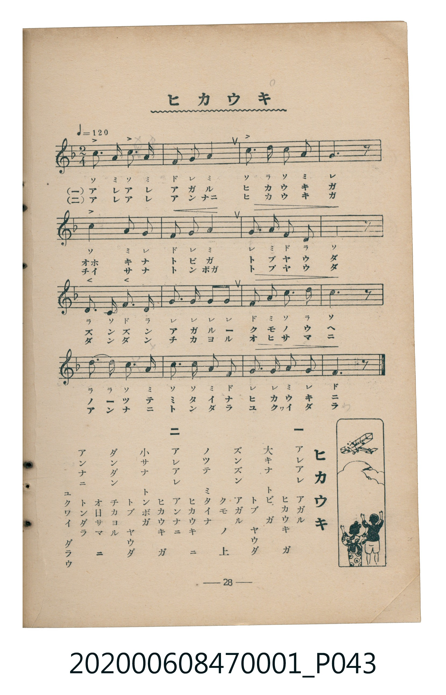

# ヒカウキ

<audio controls src="hikoki.mp3"></audio>

- 臺灣教育會公認《新定兒童唱歌》尋常科第一學年用（2020.006.0847.0001）

## 說明

・出處：臺灣教育會公認《新定兒童唱歌》尋常科第一學年用（2020.006.0847.0001）
・調性與拍號：調號 ?= F，拍號 <2/4>，速度 != 120

## 跨冊／重複收錄參照

> 同名異曲（各冊收錄之不同詞曲版本）

- **[同名異曲]** 《新定兒童唱歌》尋常科第五學年用（2020.006.0847.0005）：[**〈飛行機〉**](../../grade_5_2020.006.0847.0005/2_04_hikoki/index.md)（`G` / `2/4` — [原始 TMD](../../grade_5_2020.006.0847.0005/2_04_hikoki/hikoki.tmd)）
- 總表：[跨冊重複與同名歌曲總索引](../../../duplicate_songs.md)

## 歌詞

```text
一
アレアレ　アガル
ヒカウキ　ガ
大キナ　トビ　ガ
トブ　ヤウダ
ズンズン　アガル
クモ　ノ　上
ノツテ　ミタイナ
ヒカウキ　ニ

二
アレアレ　アンナニ
ヒカウキ　ガ
小サナ　トンボガ
トブ　ヤウダ
ダンダン　チカヨル
オ日サマ　ニ
アンナニ　トンダラ
ユクワイ　ダラウ
```

## ABC

```abc
X:1
T:ヒカウキ
M:2/4
L:1/16
Q:1/4=120
K:F
V:V1 name="Piano" snm="Pia"
[V:V1]
C3 A, C3 A, | F2 G2 A4 | c2 d2 c2 A2 | G6 z2 |
C4 A,2 G,2 | F2 G2 A4 | G2 A2 F2 D2 | C6 z2 |
D3 C F2 D2 | G2 G2 G2 G2 | F2 A2 c2 d2 | c6 z2 |
d2 d2 c2 A2 | c4 A2 F2 | G2 G2 A2 G2 | F6 z2 |
C3 A, C3 A, | F2 G2 A4 | c2 d2 c2 A2 | G6 z2 |
C4 A,2 G,2 | F2 G2 A4 | G2 A2 F2 D2 | C6 z2 |
D3 C F2 D2 | G2 G2 G2 G2 | F2 A2 c2 d2 | c6 z2 |
d2 d2 c2 A2 | c4 A2 F2 | G2 G2 A2 G2 | F6 z2 |
```

## TMD 檔案連結

- [主旋律 TMD 檔案](hikoki.tmd) [[在 TMD Studio 編輯](https://tmdlang.github.io/Tmd-TS/#tmd=s7IKdvYPcrWy4tLSUnjcPOlx0-rHTcseN61V0NLiUrRVMDQy4LK3VXDjsjHSN7HjqlNQetG-63nj4mdTZ75o2vRsTvPT1jUvVvU-buh6Nm3D03WznrZOer566dMpG5-t7Xnc0P10Q_fTHTueL5_4fM2aJzsanq7d8XTnludTVrzf02FkYGSgZ2BgpmdgYWIOZBgYvt_TqcTFpa_FBVTJ9bhp0ePmNVCyoQHEaFrzuHk1F7IjwRJruJ4uWQ7iNHeB-M0dj5snQyXAnGlg0SUgHc0gc3c9bt4MJVHMbVr_uHkRWG0fkHyyowuove9xc8vj5jaw6PzHTfsfNy0BWoPhhuZuLq4nu3qwORpoC9BdQAXY3L2h_3HTViR3A9XOweXuZiAHKA8mQRKNINOaV0CcvurZ9KVgo-ZBnYNsNZLpQMZKoFFANwA9ux7kG5AcSBRoDZeWPheXb2JmnlVAZmJevkONQY1CNZeCgo2hmZYdkK5RMI1X0AVC43gkVo2CIZBhBOKAhXRB6oCkGRCDaJBoDVgeBg1AIsjmgc0BmgEisBkH44FkzCCK4DpRDQTLAu2NR1YL0o6MIVaADIS5E-JiLMZh-AOmDuYchOkgEYTpqGbVcnHp2imAglYBiVbmAgA)]
- [鋼琴伴奏 TMD 檔案](hikoki_piano.tmd) [[在 TMD Studio 編輯](https://tmdlang.github.io/Tmd-TS/#tmd=s7IKdvYPcrWy4tLSUnjcPOlx0-rHTcseN619v6fjcfOUx02LHjf3Pdmz5enS_ie7Z7zf06mgpcWlaKtgaGTAZW-r4MZlY6RvYsdVp6D0on3X88bFz6bOfNG06dmc5qeta16s6n3c0PVs2oan62Y9bZ30fPXSp1M2Plvb87ih--mG7qc7djxfPvH5mjVPdjQ8Xbvj6c4tz6esANpqZGBkoGdgYKZnYGFiDmQYGAJtVeLi8k3MzLMKyEzMyw_ycKgxqFGo5lJQsDE007ID0jUKpvEKukBoHI_EqlEwBDKMQBywkC5IHZA0A2IQDRKtAcvDoAFIBNk8sDlAM0AENuNgPJCMGUQRXCeqgWBZoL3xyGpB2pExxAqQgTB3QlyMxTgMf8DUwZyDMB0kgjAd1axa5JD1QQpZC2jARhvGAhVCSAI803gQA2QyxI1QaYgwDtXRJjBZDN0QGXQF6MaZIPOQdRN0KJpJEL3A8NC1UwAFiQISrcwFAA)]

## 分析

```text
================================================================================
📊 TMD Song Profile: [ ヒカウキ ]
================================================================================
⏱  Duration:       0:32 (32.0s), 32 measures total
🎼 Key & Tempo:    首調基準 F, != 120.0 BPM, <2/4>
   - 分析範圍：      由實際發聲的音符與和弦推測調性；播放脈絡另行呈現
🎤 人聲音域:    G3 (MIDI 55) – D5 (MIDI 74) [跨度: 19 個半音 / 1.6 個八度, 難度: challenging]
   - 最低音:  G3 in [Main #1 @ m.5, 0:04]
   - 最高音: D5 in [Main #1 @ m.3, 0:02]
   - 適合: mezzo-soprano, contralto, tenor, baritone, bass
🏛  結構:      Main (16.0s) -> Main (16.0s)
⚡ 編曲密度:        Peak 1 軌道同時演奏
🗝  調性診斷：       C 大調（純淨自然大調，未偵測到可信轉調）
   - 風格氣質:    純淨自然大調（陽光明朗、易唱易記，無明顯調外色彩）
   - 轉調歷程:    全曲維持單一推測調性（未偵測到可信轉調）
   - 核心骨幹音:  C, G, A, F, D
   - 調性數值:    C 大調 [相關度: 0.85, 穩定度: High, 自然音純度: 100.0%]
   - 候選調性 (K-S): C 大調 (0.85), F 大調 (0.70), A 小調 (0.64)
   - 五度圈歷程:   +0 -> +0
   - 各段落調性細節:
     • [Main #1]: C 大調 (r: 0.85, 自然音純度: 100.0%)
     • [Main #2]: C 大調 (r: 0.85, 自然音純度: 100.0%)

  [ 五度圈游移軌跡 ]
              [C ]*
         F            G  
      Bb               D  
      Eb               A  
         Ab           E  
            Db       B  
               F# 
     (* = active key center)

  [ 十二半音累積音高分佈 ]
     C  : ████████████████████████  29.2%
     C# :                            0.0%
     D  : ██████████                12.5%
     D# :                            0.0%
     E  :                            0.0%
     F  : ████████████              15.0%
     F# :                            0.0%
     G  : ███████████████████       23.3%
     G# :                            0.0%
     A  : ████████████████          20.0%
     A# :                            0.0%
     B  :                            0.0%
--------------------------------------------------------------------------------
Assignment 軌道音域：
  - Piano         : G3 – D5 (19 個半音 / 1.6 個八度, 96 個音符)
================================================================================
```


## 原書掃描頁




