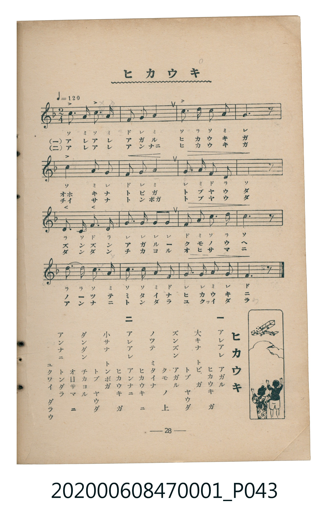

# ヒカウキ（飛機）

> Re:Shōka 使用 AI 協助辨識與重建樂譜，可能會有錯誤。歡迎[回報](https://github.com/TMDLang/reshoka/issues)。

- **鋼琴伴奏版**：<br><audio controls src="hikoki.mp3"></audio>
- **NEUTRINO 歌聲合成版**：<br><audio controls src="hikoki_neutrino.mp3"></audio>

- 臺灣教育會公認《新定兒童唱歌》尋常科第一學年用（2020.006.0847.0001）

## 說明

曲目說明
中文解釋：描寫飛機飛上天空、越過雲端的想像與興奮。


## 歌詞

```text
一
アレアレ　アガル
ヒカウキ　ガ
大キナ　トビ　ガ
トブ　ヤウダ
ズンズン　アガル
クモ　ノ　上
ノツテ　ミタイナ
ヒカウキ　ニ

二
アレアレ　アンナニ
ヒカウキ　ガ
小サナ　トンボガ
トブ　ヤウダ
ダンダン　チカヨル
オ日サマ　ニ
アンナニ　トンダラ
ユクワイ　ダラウ
```

## ABC

<div class="abc-score" data-abc-src="hikoki.abc" aria-label="五線譜載入中"></div>

[下載 ABC 原始檔](hikoki.abc)

## TMD 檔案連結

- [主旋律 TMD 檔案](hikoki.tmd) [[在 TMD Studio 編輯](https://tmdlang.github.io/Tmd-TS/#tmd=s7IKdvYPcrWy4qpTUCpJTLdSSM7PyUlNLsnMz7MqzsjMK0nNjM_KTMmPL87Iz05Ugisry88pzU21Si9KTEmNN4w3MjAyiDcwMIs3sDAxBzIMDBFKi_NLi5JTrYqTM_Lzc-JLUitKkvLzsxHyBUX5Zal5iXlANQVFIBtTwIoQClLLMlNSQdKpKZkl-UWZiTlI7kgtKga7FWxJfElRYl5xclFmAcgDCFUlGalAx4IlC_KLkIwGmpaemWdVkphZnpgXn5-WlpmMYjxQcUY-0JMFGZVWGZnFINuTE3PisxPzkMICandBYnqqVYCBibESl5aWwuPmSY-bVj9uWva4ae37PR0vF89-tnL--z2dClpaXIq2CoZGBlz2tgpuXDZG-iZ2IKNetO963rj42dSZL5o2PZvT_LR1zYtVvY8bup5N2_B03aynrZOer176dMrGZ2t7Hjd0P93Q_XTHjufLJz5fs-bJjoana3c83bnl-ZQVQJtAUaEHjAo9UFQAGQaGQFuVuPS1FJ7N3vR89roXq1Y9m9HHpaCg8GTH2mfT2l8sX_yyvfv9nlnP-vufrl8NcSiQfLKj6-mSlc9X7nrc0PhiW9fLxr6XQP2r1z-f1fKsefPT5v4XHe0vOjqeLl33uKGJS0ufC2gFF9AtXI-bFj1uXgMlGxpAjKY1j5tXcyEHCVhiDdfTJctBnOYuEL-543HzZKgEmDMNLLoEpKMZZO6ux82boSSKuU3rHzcvAqvtA5JAhwO19z1ubnnc3AYWnf-4af_jpiVAazDc0NzNxfVkVw82RwNtAboLqACbuzf0P27aiuRuoNo5uNzdDOQA5cEkSKIRZFrzCojTVz2bvhRs1Dyoc5CtRjIdyFgJNAroBqBn14N8A5IDiQKtAQe_byIwJQdkJublO9QY1FSDYljBxtBMyw7MqlEwVdAFQmM4XaNgCKSNwGyQiC5cjRmYBonWgOVh0AAkAjbNx7BGAehQsCgwxFDYMBlgcIBFVsNNBwYkRFXTaiBeBmathciA1cJgPMIeIyLsad4MJkEBRqZVKCEE8TnI39hCCBIexmAZM7BuBVMQhSuMVj1ung2VgrgA6FCoCzvAvMnwoIK5HCQOkpkGxEvAsiD3g2QacAcSKFWBFEMs2orFIkgogVIpmXZBQwnsa12Qr0FhAA4FWLAYgWlE0IGCDZakEMGLLZh2Qd2xGYWNFPlAV6Mkpab1YDWQBNAHVbMM7PIZeEIJ4iuwPUhscPhBzQCml-YVYHGQbeAoBPNA6QkSsCDePLAeWHrDDCOopxF5DcIyBQcJKGgQQYaa2nAEENSLIKtboHQb2Anzoc7eD8TgCITHOs4MgMXZmHkNFEAgk0DsbpSkAgs6YNEDNQ9kOsh8YMm0Du4MkBKQJKh8wrCvlotL104BVGIpAGllLgA)]
- [鋼琴伴奏 TMD 檔案](hikoki_piano.tmd) [[在 TMD Studio 編輯](https://tmdlang.github.io/Tmd-TS/#tmd=s7IKdvYPcrWy4qpTUCpJTLdSyC8qychPL0osyKi0ysgsLskvykxOzInPTsxLVIIrKs4vLUpOjS9ITE-1CjAwMVbi0tJSeNw86XHT6sdNyx43rX2_p-Nx85THTYseN_c92bPl6dL-J7tnvN_TqaClxaVoq2BoZMBlb6vgxmVjpG9iBzL2Rfuu542Ln02d-aJp07M5zU9b17xY1fu4oevZtA1P18162jrp-eqlT6dsfLa253FD99MN3U937Hi-fOLzNWue7Gh4unbH051bnk9ZAbTVyMDIQM_AwEzPwMLEHMgwMATaqsTF5ZuYmWcVkJmYlx_k4VBjUFPNpQAENoZmWnZgVo2CqYIuEBrD6RoFQyBtBGaDRHThaszANEi0BiwPgwYgEbBpPoY1CkDPg0UfN69BYcNkHjetAYushpsODECIqqbVQLwMzFoLkQGrhcF4hD1GRNjTvBlMdj1u7ibTKpQQgvgc5G9sIQQJD2OwjBlYt4IpiMIVRqseN8-GSkFcAHQo1IUdYN5keFDBXA4SB8lMA-IlYFmQ-0EyDbgDqbnxcRNIMcSirVgsgoTSHPLtgoYS2Ne6IF-DwgAcCrBgMQLTiKADBRssSSGCF1sw7YK6YzMKGynyga5GSUpN68FqIAmgD6pmGdjlM_CEEsRXYHuQ2ODwg5oBTC_NK8DiINvAUQjmgdITJGBBvHlgPbD0hhlGUE8j8hqEZQoOElDQIIIMNbXhCCCoF0FWt0DpNrAT5kOdvR-IwREIj3WcGQCLszHzGiiAQCaB2N0oSQUWdI-bV0LNA5kOMn_94-Z1cGeAlIAkV0JsR7WvFrnA8kEusCzg5VW0YSxQLYQkwDONBzFAgQbxClwBRAKH-mgTmCwW_RA5dCXoBpog81D1E3QumlkQ3cCA0bVTAIVNtA9IGMY2ArOVuQA)]

## 分析

```text
================================================================================
📊 TMD Song Profile: [ ヒカウキ（飛機） ]
================================================================================
⏱  Duration:       0:16 (16.0s), 16 measures total
🎼 Key & Tempo:    首調基準 F, != 120.0 BPM, <2/4>
   - 分析範圍：      由實際發聲的音符與和弦推測調性；播放脈絡另行呈現
🎤 人聲音域:    C4 (MIDI 60) – D5 (MIDI 74) [跨度: 14 個半音 / 1.2 個八度, 難度: moderate]
   - 最低音:  C4 in [Main #1 @ m.8, 0:07]
   - 最高音: D5 in [Main #1 @ m.3, 0:02]
   - 適合: soprano, mezzo-soprano, contralto, tenor, baritone, bass
🏛  結構:      Main (16.0s)
⚡ 編曲密度:        Peak 1 軌道同時演奏
🗝  調性診斷：       C 大調（純淨自然大調，未偵測到可信轉調）
   - 風格氣質:    純淨自然大調（陽光明朗、易唱易記，無明顯調外色彩）
   - 轉調歷程:    全曲維持單一推測調性（未偵測到可信轉調）
   - 核心骨幹音:  C, G, A, F, D
   - 調性數值:    C 大調 [相關度: 0.87, 穩定度: High, 自然音純度: 100.0%]
   - 候選調性 (K-S): C 大調 (0.87), F 大調 (0.71), A 小調 (0.62)
   - 五度圈歷程:   +0
   - 各段落調性細節:
     • [Main #1]: C 大調 (r: 0.87, 自然音純度: 100.0%)

  [ 五度圈游移軌跡 ]
              [C ]*
         F            G  
      Bb               D  
      Eb               A  
         Ab           E  
            Db       B  
               F# 
     (* = active key center)

  [ 十二半音累積音高分佈 ]
     C  : ████████████████████████  31.7%
     C# :                            0.0%
     D  : ████████                  10.0%
     D# :                            0.0%
     E  :                            0.0%
     F  : ████████████              15.8%
     F# :                            0.0%
     G  : ██████████████████        24.2%
     G# :                            0.0%
     A  : ██████████████            18.3%
     A# :                            0.0%
     B  :                            0.0%
--------------------------------------------------------------------------------
Assignment 軌道音域：
  - Piano         : C4 – D5 (14 個半音 / 1.2 個八度, 49 個音符)
================================================================================
```


## 原書掃描頁




