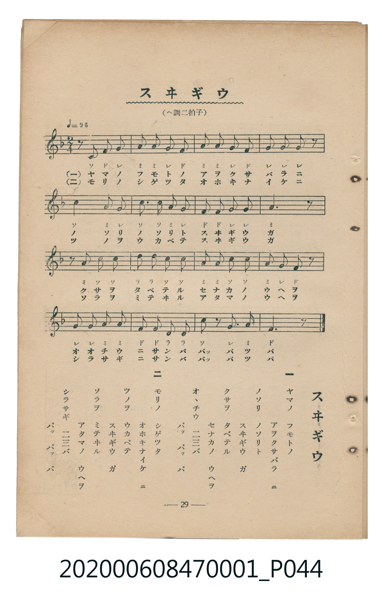

# スヰギウ（水牛）

> Re:Shōka 使用 AI 協助辨識與重建樂譜，可能會有錯誤。歡迎回報。

- **鋼琴伴奏版**：<br><audio controls src="suigyu.mp3"></audio>
- **NEUTRINO 歌聲合成版**：<br><audio controls src="suigyu_neutrino.mp3"></audio>

- 臺灣教育會公認《新定兒童唱歌》尋常科第一學年用（2020.006.0847.0001）

## 說明

曲目說明
中文解釋：描寫臺灣水牛在田間工作、休息與生活的情景。

原書資訊與歌詞全文（對應 P044.jpg，書頁 p. 29，第三學期第 5 首）：
調性與拍號：ヘ調二拍子（F 大調 2/4 拍）


## 歌詞

```text
一　ヤマノ　フモトノ
アヲクサバラ　ニ
ノソリ　ノソリト
スヰギウ　ガ
クサヲ　タベテル
セナカノ　ウヘヲ
オヽチウ　二三バ
パッパッパ

二　モリノ　シゲツタ
オホキナイケ　ニ
ツノヲ　ウカベテ
スヰギウ　ガ
ソラヲ　ミテヰル
アタマノ　ウヘヲ
シラサギ　二三バ
パッパッパ
```

## ABC

<div class="abc-score" data-abc-src="suigyu.abc" aria-label="五線譜載入中"></div>

[下載 ABC 原始檔](suigyu.abc)

## TMD 檔案連結

- [主旋律 TMD 檔案](suigyu.tmd) [[在 TMD Studio 編輯](https://tmdlang.github.io/Tmd-TS/#tmd=s7IKdvYPcrWy4qpTUCpJTLdSSM7PyUlNLsnMz7MqzsjMK0nNjM_KTMmPL87Iz05Ugisry88pzU21Si9KTEmNN4w3MjAyiDcwMIs3sDAxBzIMDBFKi_NLi5JTrYqTM_Lzc-JLUitKkvLzsxHyBUX5Zal5iXlANQVFIBtTwIoQClLLMlNSQdKpKZkl-UWZiTlI7kgtKga7FWxJfElRYl5xclFmAcgDCFUlGalAxybmZeYi64WI5iWWlBalIkSBFqRn5lmVJGaWJ-bF56elZSaDbdTSUnjctPNx84bHTeseNy17v6fj2YYtzztnv9_TqaClxaVoq2BpxmVvq-DGZWOkb2IHMu9F-67njYufTZ35omnTsznNT1vXvFjV-7ih69m0DU_XzXraOun56qVPp2x8trbncUP30w3dT3fseL584vM1a57saHi6dsfTnVueT1kBtAgUunrA0NUDhS6QYWAItFSJS19L4dnsTc9nr3uxatWzGX1cCgoKT3asfTat_cXyxS_bu9_vmfWsv__p-tVQZ4Bd-3TOiudTNrycNvnp9qVP9s553ND4ZM_EZ43rX3S0P58y_9mW3c9ntTxrbn02c_3jhiYuLX0ukC221AIgJz7tm_9s9o4Xm9tfrOgC2gr0_IuV8562rgC6G-jVpxt6n7V3KgQYmJjoZRWkv9_TA1T8ckGjQoGegpElkAsOnU5g6DybMx_IVjBVeLlsGjA4gL4Fmf5i1f5nDctB5nb3vpg5Hyj6uHkGUPDJrh6gyNO1E4B2uCk8XbIcKKYAjCcFoChQNxck8BoeNzQ8bl7yuHne4-Y-MHvq4-ZFj5s7gFyQisdNQM6mx03rHzdtfdw84XHzSrCibrAcUEfT3sfNq8BCMHZzB0QfIuGApJvWQEQh5mwCC-1_3DzzcXPb4-bVELndj5u7HjethjoEqK95BlApRA5oLtD0RohpQK8BQwToHIgrJj5uboaTEH_tAqYvoJuAbgdqhBi3_XHTpsfNLUBr4SbOfty0FmznksdNG5H91QLSBHXlMrCTQA7F5y-g41ZCdTTPB3tqA9xfi8BehQUwqr-2g_QBgwRoIAF_AYUoT45QoABK5sGlmemVpVYBmYl5-Q41BjXVICsUbAzNtOzALGzZQAGSVV8s7FHQMFF4uqH_-foGHXja1cSiAWgT1LCXs_qeTui1UjCABBjYi51gcg2QrAHS88E8CAkSg8jjl4HwECTIdISdGkDHalqBOEDpJWByHiTlQrVPBfMWgckOZJkmiNgmSKoFk1uheiaAZVaCyW6w2ahW7uqBWwkxZBWKwdvBhoENbm4Bs_dDZSDqZoPF1oLZXVAZsNObNmKzsgboZV0F03ggYQjERkBco2AMJEEYxAOJYhMBsWAYZEQN2DgfwxoFkFmg4AKR88BkH1gHKLhAvEVgsgNZBhhcIN4mEAkMLhC5FapnAlhmJZjsBpIg06F2GcHsguhehWLidrApYBOB4QRi74fKQNTNBoutBbO7oDJgNwPDCdUu_Ml5Vw9FyRmSlGEAlEhBCRHkGIg4iEZOuqAggSR7ROJHzQIIgDUxQ1IS3EKw8avAmiHiMBFYkgY5ZSeYtwEsuw5MLoPKgCxGBRhJGZJM4RYCrQFFNEgzyBCQYauBIjPBcm3kW1gDrNl0wRCWTmEipkgioLQLS-eItA6DqOkYkpZAEBQmsBSGEIeFFCw1QxwO4m0Ay64Dk8ugMmuQ7EFNw5D0CTYRbDIkH0ACCGIPJIBAMm1k2EOgOO6kvDiGpE9IoQwmQZ6ClHBgEk0GqTjGKoMoonEXx0iFKqSYBfkdVBIiJyVgHQqV2Q3mgcpDUGgil6eghAWsUuHmICUptOIYWulA_AW1EupiiGXg9Aq3Elx4Q52EUmvgsxJSHIPSJCjtgnCNghmQBGGECKw0RhWBlc1YSmOkMhWRukDlIXK6AjkdIrMbzAOViqDQQi5VQakM5HSYOVhKY2hegZTYULuAwYSwBZxq4XaBy26oW1BqCxx24U3NT2fPpqw0RmkQINIpeqmLSNuwkhqSDxD6YDoQAHtpDK61n-zYBtbYCE4y0KIOXFPDUvhmMAlqOoBkQI06sJlAJpgE8cASKDYipSuk4hjSgoBmTLDp4CKW2jYiWgiw1Ioofc1AUQkmIGU0KMXCVEJU4SiRoXU3JIU1glMOtNwD19ewFL4ZTIJaDnC3Q5IPyL2wBgHE9TgLZUgDApKMIcaCC1oqWlXLxaVrpwBpRysAWcpcAA)]
- [鋼琴伴奏 TMD 檔案](suigyu_piano.tmd) [[在 TMD Studio 編輯](https://tmdlang.github.io/Tmd-TS/#tmd=s7IKdvYPcrWy4tLSUnjctPNx84bHTeseNy17v6fjZfee5xO2PNmz5enS_uedHe_3dCpoaXEp2ipYmnHZ2yq4cdkY6ZvYcdUpKL1o3_W8cfGzqTNfNG16Nqf5aeuaF6t6Hzd0PZu24em6WU9bJz1fvfTplI3P1vY8buh-uqH76Y4dz5dPfL5mzZMdDU_X7ni6c8vzKSuANhoZGBnoGRiY6RlYmJgDGQaGQEuVuLiCSzPTK0utAjIT8_KDPBxqDGqquRSAwMbQTMsOzNLXUrBFBwoQC14s7FHQMFF4uqH_-foGHYUAAxMTvayCdE0sGrT0wYbVKBgo6CqYxgMJQyA2AuIaBWMgCcIgHkgUmwiIBcMgI2rAxvkY1iiAzHrcvARMzgOTfWAdj5ungnmLwGQHskwTRGwTiGxaDya3QvVMAMusBJPdQBJkOtQuI5hdEN2rUEzcDjYFbGJzC5i9HyoDUTcbLLYWzO6CyoDd3LQRzS78gb6rh5xANwWaDIKwMIWJmCKJgMIZFieIeIFB1DCH-BsEHzfthYcGQhwkCgshUMiDfLsTzNsAll0HJpdBZdYg2YMa3pCwBJsINhkSZyA9IL0gM1YDxWaCZdrIsIdAAu8kN4GDQg4UwiBco2AGJEEYIQJL36gisNSOJX0jpVJEGIBSGLLvHzevhsrsBvNA6QwUQsjpFBQWj5tnwM3Bkr6hMQrJA1C7mucj2QIOW7hd4NwAdQtK_sNhF94wfzp7NjlhDkuzsHBFpGYzkKVgApLmQWELUwlRhSOFQ_MtJCwawX6EpiNwXoXFxWYwCSo1QDITHzc3Qz0K5IBJUAIGSyFZhZbIIYUHJMAhxoITLhWtqkUt6H2QC3oTRDn_rGnBy2mTnk_Z8HTOJGBJ86y79-naCZBaChHWhvEK0YaxWBmm8fHAYIT4DJu8CZBhAhXBog5ZGq4ToQ5kerRpPEjcDMQ0i8-FWQoVhioH-lbXTgHi4WgfoEFIPCMwT5kLAA)]

## 分析

```text
================================================================================
📊 TMD Song Profile: [ スヰギウ（水牛） ]
================================================================================
⏱  Duration:       0:20 (20.0s), 16 measures total
🎼 Key & Tempo:    首調基準 F, != 96.0 BPM, <2/4>
   - 分析範圍：      由實際發聲的音符與和弦推測調性；播放脈絡另行呈現
🎤 人聲音域:    C4 (MIDI 60) – D5 (MIDI 74) [跨度: 14 個半音 / 1.2 個八度, 難度: moderate]
   - 最低音:  C4 in [Suigyu #1 @ m.1, 0:00]
   - 最高音: D5 in [Suigyu #1 @ m.10, 0:11]
   - 適合: soprano, mezzo-soprano, contralto, tenor, baritone, bass
🏛  結構:      Suigyu (20.0s)
⚡ 編曲密度:        Peak 1 軌道同時演奏
🗝  調性診斷：       C 調性不明確（純淨自然大調，未偵測到可信轉調）
   - 風格氣質:    純淨自然大調（陽光明朗、易唱易記，無明顯調外色彩）
   - 轉調歷程:    全曲維持單一推測調性（未偵測到可信轉調）
   - 核心骨幹音:  A, G, C, F, D
   - 調性數值:    C 調性不明確 [相關度: 0.72, 穩定度: Ambiguous, 自然音純度: 100.0%]
   - 候選調性 (K-S): C 大調 (0.72), F 大調 (0.71), A 小調 (0.69)
   - 五度圈歷程:   +0
   - 各段落調性細節:
     • [Suigyu #1]: C 調性不明確 (r: 0.72, 自然音純度: 100.0%)

  [ 五度圈游移軌跡 ]
              [C ]*
         F            G  
      Bb               D  
      Eb               A  
         Ab           E  
            Db       B  
               F# 
     (* = active key center)

  [ 十二半音累積音高分佈 ]
     C  : ██████████████████        21.1%
     C# :                            0.0%
     D  : ██████                     7.0%
     D# :                            0.0%
     E  :                            0.0%
     F  : █████████████████         19.3%
     F# :                            0.0%
     G  : █████████████████████     24.6%
     G# :                            0.0%
     A  : ████████████████████████  28.1%
     A# :                            0.0%
     B  :                            0.0%
--------------------------------------------------------------------------------
Assignment 軌道音域：
  - Piano         : C4 – D5 (14 個半音 / 1.2 個八度, 52 個音符)
================================================================================
```


## 原書掃描頁




