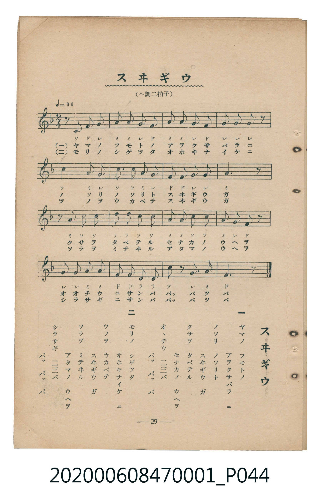

# スヰギウ（水牛）

> Re:Shōka 使用 AI 協助辨識與重建樂譜，可能會有錯誤。歡迎[回報](https://github.com/TMDLang/reshoka/issues)。

- **鋼琴伴奏版**：<br><audio controls src="suigyu.mp3"></audio>
- **NEUTRINO 歌聲合成版**：<br><audio controls src="suigyu_neutrino.mp3"></audio>

- 臺灣教育會公認《新定兒童唱歌》尋常科第一學年用（2020.006.0847.0001）

## 說明

曲目說明
中文解釋：描寫臺灣水牛在田間工作、休息與生活的情景。

原書資訊與歌詞全文（對應 P044.jpg，書頁 p. 29，第三學期第 5 首）：
調性與拍號：ヘ調二拍子（F 大調 2/4 拍）


## 歌詞

```text
一　ヤマノ　フモトノ
アヲクサバラ　ニ
ノソリ　ノソリト
スヰギウ　ガ
クサヲ　タベテル
セナカノ　ウヘヲ
オヽチウ　二三バ
パッパッパ

二　モリノ　シゲツタ
オホキナイケ　ニ
ツノヲ　ウカベテ
スヰギウ　ガ
ソラヲ　ミテヰル
アタマノ　ウヘヲ
シラサギ　二三バ
パッパッパ
```

## ABC

<div class="abc-score" data-abc-src="suigyu.abc" aria-label="五線譜載入中"></div>

[下載 ABC 原始檔](suigyu.abc)

## TMD 檔案連結

- [主旋律 TMD 檔案](suigyu.tmd) [[在 TMD Studio 編輯](https://tmdlang.github.io/Tmd-TS/#tmd=s7IKdvYPcrWy4qpTUCpJTLdSSM7PyUlNLsnMz7MqzsjMK0nNjM_KTMmPL87Iz05Ugisry88pzU21Si9KTEmNN4w3MjAyiDcwMIs3sDAxBzIMDBFKi_NLi5JTrYqTM_Lzc-JLUitKkvLzsxHyBUX5Zal5iXlANQVFIBtTwIoQClLLMlNSQdKpKZkl-UWZiTlI7kgtKga7FWxJfElRYl5xclFmAcgDCFUlGalAxybmZeYi64WI5iWWlBalIkSBFqRn5lmVJGaWJ-bF56elZSaj2JhfVJKRD_R3QUalVUZmMchByYk58dmJeUjBA3VOQWJ6qlWAgYmJEpeWlsLjpp2Pmzc8blr3uGnZ-z0dzzZsed45-_2eTgUtLS5FWwVLMy57WwU3LhsjfRM7kEkv2nc9b1z8bOrMF02bns1pftq65sWq3scNXc-mbXi6btbT1knPVy99OmXjs7U9jxu6n27ofrpjx_PlE5-vWfNkR8PTtTue7tzyfMoKoEWgyNEDRo4eKHKADANDoKVKXPpaCs9mb3o-e92LVauezejjUlBQeLJj7bNp7S-WL37Z3v1-z6xn_f1P16-GOgPs2qdzVjyfsuHltMlPty99snfO44bGJ3smPmtc_6Kj_fmU-c-27H4-q-VZc-uzmesfNzRxaelzgWyxpRYAOfFp3_xns3e82Nz-YkUX0Fag51-snPe0dQXQ3UCvPt3Q-6y9UwEU5HpZBenv9_QAFb9c0KhQoKdgZAnkgkOnExg6z-bMB7IVTBVeLpsGDA6gb0Gmv1i1_1nDcpC53b0vZs4Hij5ungEUfLKrByjydO0EoB1uCk-XLAeKKQDjSQEoCtTNBQm8hscNDY-blzxunve4uQ_Mnvq4edHj5g4gF6TicROQs-lx0_rHTVsfN0943LwSrKgbLAfU0bT3cfMqsBCM3dwB0YdIOCDppjUQUYg5m8BC-x83z3zc3Pa4eTVEbvfj5q7HTauhDgHqa54BVAqRA5oLNL0RYhrQa8AQAToH4oqJj5ub4STEX7uA6QvoJqDbgRohxm1_3LTpcXML0Fq4ibMfN60F27nkcdNGZH-1gDRBXbkM7CSQQ_H5C-i4lVAdzfPBntoA99cisFdhAYzqr-0gfcAgARpIwF9AIcqTIxQogJJ5cGlmemWpVUBmYl6-Q41BTTXICgUbQzMtOzALWzZQgGTVFwt7FDRMFJ5u6H--vkEHnnY1sWgA2gQ17OWsvqcTeq0UDCABBvZiJ5hcAyRrgPR8MA9CgsQg8vhlIDwECTIdYacG0LGaViAOUHoJmJwHSblQ7VPBvEVgsgNZpgkitgmSasHkVqieCWCZlWCyG2w2qpW7euBWQgxZhWLwdrBhYIObW8Ds_VAZiLrZYLG1YHYXVAbs9KaN2KysAXpZV8E0HkgYArERENcoGANJEAbxQKLYREAsGAYZUQM2zsewRgFkFii4QOQ8MNkH1gEKLhBvEZjsQJYBBheItwlEAoMLRG6F6pkAllkJJruBJMh0qF1GMLsgulehmLgdbArYRGA4gdj7oTIQdbPBYmvB7C6oDNjNwHBCtQt_ct7VQ1FyhiRlGAAlUlBCBDkGIg6ikZMuKEggyR6R-FGzAAJgTcyQlAS3EGz8KrBmiDhMBJakQU7ZCeZtAMuuA5PLoDIgi1EBRlKGJFO4hUBrQBEN0gwyBGTYaqDITLBcG_kW1gBrNl0whKVTmIgpkggo7cLSOSKtwyBqOoakJRAEhQkshSHEYSEFS80Qh4N4G8Cy68DkMqjMGiR7UNMwJH2CTQSbDMkHkACC2AMJIJBMGxn2ECiOOykvjiHpE1Iog0mQpyAlHJhEk0EqjrHKIIpo3MUxUqEKKWZBfgeVhMhJCViHQmV2g3mg8hAUmsjlKShhAatUuDlISQqtOIZWOhB_Qa2EuhhiGTi9wq0EF95QJ6HUGvishBTHoDQJSrsgXKNgBiRBGCECK41RRWBlM5bSGKlMRaQuUHmInK5ATofI7AbzQKUiKLSQS1VQKgM5HWYOltIYmlcgJTbULmAwIWwBp1q4XeCyG-oWlNoCh114U_PT2bMpK41RGgSIdIpe6iLSNqykhuQDhD6YDgTAXhqDa-0nO7aBNTaCkwy0qAPX1LAUvhlMgpoOIBlQow5sJpAJJkE8sASKjUjpCqk4hrQgoBkTbDq4iKW2jYgWAiy1IkpfM1BUgglIGQ1KsTCVEFU4SmRo3Q1JYY3glAMt98D1NSyFbwaToJYD3O2Q5ANyL6xBAHE9zkIZ0oCAJGOIseCClopW1XJx6dopQNrRCkCWMhcA)]
- [鋼琴伴奏 TMD 檔案](suigyu_piano.tmd) [[在 TMD Studio 編輯](https://tmdlang.github.io/Tmd-TS/#tmd=s7IKdvYPcrWy4qpTUCpJTLdSyC8qychPL0osyKi0ysgsLskvykxOzInPTsxLVIIrKs4vLUpOjS9ITE-1CjAwMVHi0tJSeNy083HzhsdN6x43LXu_p-Nl957nE7Y82bPl6dL-550d7_d0KmhpcSnaKliacdnbKrhx2Rjpm9iBjHzRvut54-JnU2e-aNr0bE7z09Y1L1b1Pm7oejZtw9N1s562Tnq-eunTKRufre153ND9dEP30x07ni-f-HzNmic7Gp6u3fF055bnU1YAbTQyMDLQMzAw0zOwMDEHMgwMgZYqcXEFl2amV5ZaBWQm5uUHeTjUGNRUcykAgY2hmZYdmKWvpWCLDhQgFrxY2KOgYaLwdEP_8_UNOgog3-plFaRrYtGgpQ82rEbBQEFXwTQeSBgCsREQ1ygYA0kQBvFAothEQCwYBhlRAzbOx7BGAWTW4-YlYHIemOwD63jcPBXMWwQmO5BlmiBim0Bk03owuRWqZwJYZiWY7AaSINOhdhnB7ILoXoVi4nawKWATm1vA7P1QGYi62WCxtWB2F1QG7OamjWh24Q_0XT3kBLop0GQQhIUpTMQUSQQUzrA4QcQLDKKGOcTfIPi4aS88NBDiIFFYCIFCHuTbnWBxiJ_XgcllUJk1SPaghjckLMEmgk2GxBlID0gvyIzVQLGZYJk2MuwhkMA7yU3goJADhTAI1yiYAUkQRojA0jeqCCy1Y0nfSKkUEQagFIbs-8fNq6Eyu8E8UDoDhRByOgWFxePmGXBzsKRvaIxC8gDUrub5CFsgYQu3C5wboG5ByX847MIb5k9nzyYnzGFpFhauiNRsBrIUTEDSPChsYSohqnCkcEi-hebeRjAbmo7AeRUWF5vBJKjUAMlMfNzcDPUokAMmQQkYLIVkFVoihxQekACHGAtOuFS0qha1oPdBLuhNEOX8s6YFL6dNej5lw9M5k4AlzbPu3qdrJ0BqKURYG8YrRBvGYmWYxscDgxHiM2zyJkCGCVQEizpkabhOhDqQ6dGm8SBxMxDTLD4XZilUGKoc6FtdOwWIh6N9gAYh8YzAPGUuAA)]

## 分析

```text
================================================================================
📊 TMD Song Profile: [ スヰギウ（水牛） ]
================================================================================
⏱  Duration:       0:20 (20.0s), 16 measures total
🎼 Key & Tempo:    首調基準 F, != 96.0 BPM, <2/4>
   - 分析範圍：      由實際發聲的音符與和弦推測調性；播放脈絡另行呈現
🎤 人聲音域:    C4 (MIDI 60) – D5 (MIDI 74) [跨度: 14 個半音 / 1.2 個八度, 難度: moderate]
   - 最低音:  C4 in [Suigyu #1 @ m.1, 0:00]
   - 最高音: D5 in [Suigyu #1 @ m.10, 0:11]
   - 適合: soprano, mezzo-soprano, contralto, tenor, baritone, bass
🏛  結構:      Suigyu (20.0s)
⚡ 編曲密度:        Peak 1 軌道同時演奏
🗝  調性診斷：       C 調性不明確（純淨自然大調，未偵測到可信轉調）
   - 風格氣質:    純淨自然大調（陽光明朗、易唱易記，無明顯調外色彩）
   - 轉調歷程:    全曲維持單一推測調性（未偵測到可信轉調）
   - 核心骨幹音:  A, G, C, F, D
   - 調性數值:    C 調性不明確 [相關度: 0.72, 穩定度: Ambiguous, 自然音純度: 100.0%]
   - 候選調性 (K-S): C 大調 (0.72), F 大調 (0.71), A 小調 (0.69)
   - 五度圈歷程:   +0
   - 各段落調性細節:
     • [Suigyu #1]: C 調性不明確 (r: 0.72, 自然音純度: 100.0%)

  [ 五度圈游移軌跡 ]
              [C ]*
         F            G  
      Bb               D  
      Eb               A  
         Ab           E  
            Db       B  
               F# 
     (* = active key center)

  [ 十二半音累積音高分佈 ]
     C  : ██████████████████        21.1%
     C# :                            0.0%
     D  : ██████                     7.0%
     D# :                            0.0%
     E  :                            0.0%
     F  : █████████████████         19.3%
     F# :                            0.0%
     G  : █████████████████████     24.6%
     G# :                            0.0%
     A  : ████████████████████████  28.1%
     A# :                            0.0%
     B  :                            0.0%
--------------------------------------------------------------------------------
Assignment 軌道音域：
  - Piano         : C4 – D5 (14 個半音 / 1.2 個八度, 52 個音符)
================================================================================
```


## 原書掃描頁




