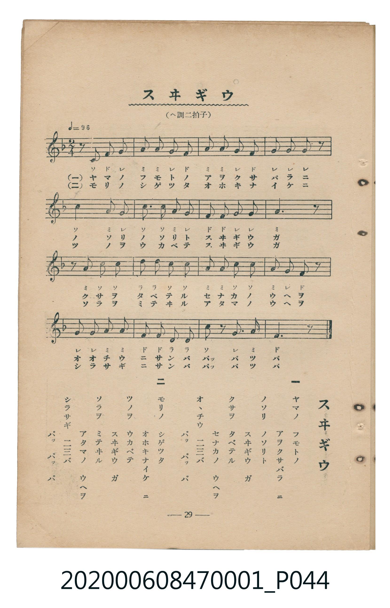

# スヰギウ

<audio controls src="suigyu.mp3"></audio>

- 臺灣教育會公認《新定兒童唱歌》尋常科第一學年用（2020.006.0847.0001）

## 說明

原書資訊與歌詞全文（對應 P044.jpg，書頁 p. 29，第三學期第 5 首）：
調性與拍號：ヘ調二拍子（F 大調 2/4 拍）

## 歌詞

```text
一　ヤマノ　フモトノ
アヲクサバラ　ニ
ノソリ　ノソリト
スヰギウ　ガ
クサヲ　タベテル
セナカノ　ウヘヲ
オヽチウ　二三バ
パッパッパ

二　モリノ　シゲツタ
オホキナイケ　ニ
ツノヲ　ウカベテ
スヰギウ　ガ
ソラヲ　ミテヰル
アタマノ　ウヘヲ
シラサギ　二三バ
パッパッパ
```

## ABC

```abc
X:1
T:スヰギウ
C:TMD (Chen, Chih-Han / aguai)
M:2/4
L:1/16
Q:1/4=96
K:F
V:V1 name="Piano" snm="Pia"
[V:V1]
z2 C2 F2 G2 | A2 A2 G2 F2 | A2 A2 G2 F2 | G2 G2 G2 z2 |
c6 A G | c3 c A2 G2 | F2 F2 G2 G2 | A6 z2 |
z2 A2 c2 c2 | d2 d2 c2 c2 | A2 A2 c2 c2 | A2 G2 F2 z2 |
G2 G2 A2 A2 | F2 F2 D2 D2 | c2 z2 G2 A2 | F6 z2 |
```

## TMD 檔案連結

- [主旋律 TMD 檔案](suigyu.tmd) [[在 TMD Studio 編輯](https://tmdlang.github.io/Tmd-TS/#tmd=s7IKdvYPcrWy4tLSUnjctPNx84bHTeseNy1T0NLiUrRVsDTjsrdVcOOyMdI3seOqU1B60b7reePiZ1Nnvmja9GxO89PWNS9W9T5u6Ho2bcPTdbOetk56vnrp0ykbn63tedzQ_XRD99MdO54vn_h8zZonOxqert3xdOeW51NWvN_TYWRgZKBnYGCmZ2BhYg5kGBi-39OpxMWlr6VgSy3ApaCg8LRv_rPZO15sbn-xoutFRzvQXS9WznvauuLZtHagK55u6H3W3qkQYGBiopdVkP5-Tw9Q8csFjQoFegpGlkAu2OGdQIc_mzMfyFYwVXi5bBrQpe_3zAKZ_mLV_mcNy0Hmdve-mDkfKPq4eQZQ8MmuHqDI07UTgHa4KTxdshwopgAMQgWgKFA3F0gvMEAeNzQ8bl7yuHne4-Y-MHvq4-ZFj5s7gFyQisdNQM6mx03rHzdtfdw84XHzSrCibrAcUEfT3sfNq8BCMHZzB0QfIh5B0k1rIKIQczaBhfY_bp75uLntcfNqiNzux81dj5tWQx0C1Nc8A6gUIgc0F2h6I8Q0oNeAIQJ0DsQVEx83N8NJiL92AaMe6Cag24EaIcZtf9y06XFzC9BauImzHzetBdu55HHTRmR_tYA0QV25DOwkkEPx-QvouJVQHc3zwZ7aAPfXIrBXYQGM6q_tIH3AIAEaSMBfQCHKkyMUKGjpc3EFl2amV5ZaBWQm5uU71BjUKFSD7FCwMTTTsgOzsOUDBUg2erGwR0HDROHphv7n6xt04IlXE4sGoFVQw17O6ns6oddKwQASYmA_doLJNUCyBkjPB_MgJEgMIo9fBsJDkCDTEXZqAB2raQXiAKWXgMl5kKQL1T4VzFsEJjuQZZogYpsgyRZMboXqmQCWWQkmu8Fmo1q5qwduJcSQVSgGbwcbBja4uQXM3g-VgaibDRZbC2Z3QWXATm_aiM3KGqCXdRVM44GEIRAbAXGNgjGQBGEQDySKTQTEgmGQETXgvIM72nf1UBTtkCiHAVBkgiIM5DmIOIhGjmJQSEOSByKRoCYVBMAa6ZAQh1sINn4VWDNEHCYCi3qQU3aCeRvAsuvA5DKoDMhiVIAR5ZDohFsItAaUfkCaQYaADFsNFJkJlmsj38IaYBWgC4fGwPiDiZjCY7gGHMew9IBIEzBITHzv6KQ8m0PiE5LZwSQo-CE5B0yiySBlc6wyiKyPO5sjZVZI9gUFJiiHIQc9sHCGyuwG80D5DBQ9yPkUFBHAshpuDlIUoGVzaGEG8RfUSqiLIZaB4xduJbhQgDoJpTTCZyUkm4PiEBTXIFyjYAYkQRghAsvlqCKwPE9ErD-dPZuyXI5SICPiEz03I9IArASApBeEPpgOBMCey8Gl5pMd28AaG8FBC81C4JISlhI2g0lQ0Q2SAdWqkLhrnggmQTywBIqNSOGPlM0hJTg0AYNNB2ddatuIKKFhsYrI1Wag4h5MQPI-KGZhKiGqUHN6LReXrp0CpMpXALKUubgA)]
- [鋼琴伴奏 TMD 檔案](suigyu_piano.tmd) [[在 TMD Studio 編輯](https://tmdlang.github.io/Tmd-TS/#tmd=s7IKdvYPcrWy4tLSUnjctPNx84bHTeseNy17v6fjZfee5xO2PNmz5enS_uedHe_3dCpoaXEp2ipYmnHZ2yq4cdkY6ZvYcdUpKL1o3_W8cfGzqTNfNG16Nqf5aeuaF6t6Hzd0PZu24em6WU9bJz1fvfTplI3P1vY8buh-uqH76Y4dz5dPfL5mzZMdDU_X7ni6c8vzKSuANhoZGBnoGRiY6RlYmJgDGQaGQEuVuLiCSzPTK0utAjIT8_KDPBxqDGoUqrkUgMDG0EzLDszS11KwRQcKEBteLOxR0DBReLqh__n6Bh2FAAMTE72sgnRNLBq09MGG1SgYKOgqmMYDCUMgNgLiGgVjIAnCIB5IFJsIiAXDICNquPA7blcPOY4zBZoMg8ZAu2AipnDX1IDdA3M7wv0wSIzbdnSSG3Agm0AuAuEaBTMgCcIIEVi4oYrAQpEItz2dPZsct8HCAmY_IpTMQFENJiBhCXIDTCVEFWrI1aKmSR-UNGmCSJLPmha8nDbp-ZQNT-dMAkb2s-7ep2snQHIUwlmG8QrRhrFYGabx8UAba3AqNAEyTKAiWNQhS8N1ItSBTI82jQeJm4GYZvG5MEuhwlDlQO_q2ilAfKyAwlLm4gIA)]

## 分析

```text
================================================================================
📊 TMD Song Profile: [ スヰギウ ]
================================================================================
⏱  Duration:       0:20 (20.0s), 16 measures total
🎼 Key & Tempo:    首調基準 F, != 96.0 BPM, <2/4>
   - 分析範圍：      由實際發聲的音符與和弦推測調性；播放脈絡另行呈現
🎤 人聲音域:    C4 (MIDI 60) – D5 (MIDI 74) [跨度: 14 個半音 / 1.2 個八度, 難度: moderate]
   - 最低音:  C4 in [Suigyu #1 @ m.1, 0:00]
   - 最高音: D5 in [Suigyu #1 @ m.10, 0:11]
   - 適合: soprano, mezzo-soprano, contralto, tenor, baritone, bass
🏛  結構:      Suigyu (20.0s)
⚡ 編曲密度:        Peak 1 軌道同時演奏
🗝  調性診斷：       C 調性不明確（純淨自然大調，未偵測到可信轉調）
   - 風格氣質:    純淨自然大調（陽光明朗、易唱易記，無明顯調外色彩）
   - 轉調歷程:    全曲維持單一推測調性（未偵測到可信轉調）
   - 核心骨幹音:  A, G, C, F, D
   - 調性數值:    C 調性不明確 [相關度: 0.75, 穩定度: Ambiguous, 自然音純度: 100.0%]
   - 候選調性 (K-S): C 大調 (0.75), F 大調 (0.73), A 小調 (0.70)
   - 五度圈歷程:   +0
   - 各段落調性細節:
     • [Suigyu #1]: C 調性不明確 (r: 0.75, 自然音純度: 100.0%)

  [ 五度圈游移軌跡 ]
              [C ]*
         F            G  
      Bb               D  
      Eb               A  
         Ab           E  
            Db       B  
               F# 
     (* = active key center)

  [ 十二半音累積音高分佈 ]
     C  : ████████████████████      22.8%
     C# :                            0.0%
     D  : ██████                     7.0%
     D# :                            0.0%
     E  :                            0.0%
     F  : █████████████████         19.3%
     F# :                            0.0%
     G  : █████████████████████     23.7%
     G# :                            0.0%
     A  : ████████████████████████  27.2%
     A# :                            0.0%
     B  :                            0.0%
--------------------------------------------------------------------------------
Assignment 軌道音域：
  - Piano         : C4 – D5 (14 個半音 / 1.2 個八度, 52 個音符)
================================================================================
```


## 原書掃描頁




