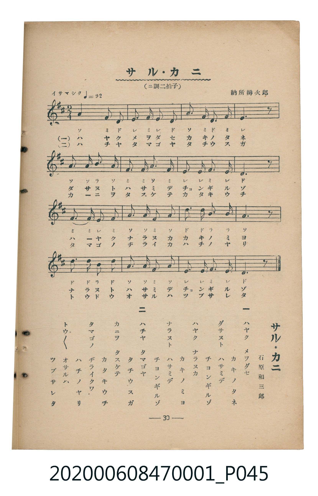

# サル・カニ

<audio controls src="sarukani.mp3"></audio>

- 詞：石原和三郎
- 曲：納所辨次郎
- 臺灣教育會公認《新定兒童唱歌》尋常科第一學年用（2020.006.0847.0001）

## 說明

・出處：臺灣教育會公認《新定兒童唱歌》尋常科第一學年用（2020.006.0847.0001）
・調性與拍號：調號 ?= D，拍號 <2/4>，速度 != 92

## 歌詞

```text
一
ハヤク　メヲダセ
カキノタネ
ダサヌト　ハサミデ
チヨンギルゾ
ハヤク　ナラヌカ
カキノミヨ
ナラヌト　ハサミデ
チヨンギルゾ

二
ハチヤ　タマゴヤ
タチウスガ
カニヲ　タスケテ
カタキウチ
タマゴノ　ヂライクワ
ハチノヤリ
トウトウ　オサルハ
ツブサレタ
```

## ABC

```abc
X:1
T:サル・カニ
C:曲：納所辨次郎
M:2/4
L:1/16
Q:1/4=92
K:D
V:V1 name="Piano" snm="Pia"
[V:V1]
A4 F2 D2 | E2 F2 E2 D2 | A4 F2 D2 | F4 E3 z |
A3 A B2 A2 | F2 F2 A2 F2 | E3 E F2 E2 | D6 z2 |
F3 F E2 F2 | A2 A2 F2 A2 | d2 d2 B2 B2 | A6 z2 |
d3 d B2 d2 | A2 A2 F2 A2 | E3 E F2 E2 | D6 z2 |
A4 F2 D2 | E2 F2 E2 D2 | A4 F2 D2 | F4 E3 z |
A3 A B2 A2 | F2 F2 A2 F2 | E3 E F2 E2 | D6 z2 |
F3 F E2 F2 | A2 A2 F2 A2 | d2 d2 B2 B2 | A6 z2 |
d3 d B2 d2 | A2 A2 F2 A2 | E3 E F2 E2 | D6 z2 |
```

## TMD 檔案連結

- [主旋律 TMD 檔案](sarukani.tmd) [[在 TMD Studio 編輯](https://tmdlang.github.io/Tmd-TS/#tmd=s7IKdvYPcrWy4tLSUnjctPVx8-rHzbsfNwHJbgUtLS5FWwVLIy57WwUXLhsjfRM7rjoFpRcr573fM-v5_M1P--Y_ndTzZEfny-Y-JZDMs9mbQDJbep91NrzYt-LZmoUwmRftu543Ln42deaLpk3P5jQ_bV3zYlXv44auZ9M2PF0362nrpOerlz6dsvHZ2p7HDd1PN3Q_3bHj-fKJz9esebKj4enaHU93bnk-ZcX7PR1GBkYGegYGZnoGFibmQIaB4fs9nUpcXPpaXECVXI-b-x83L3nctP5xQ8Pj5oWPmzc9bm543LSbC-SjprWPm_seN-1_3NwLVAgUBvq253FzB1htP5g7_3FzO1Cu8XHzisfNmx83rQOFR9M-NHO7HjevBGltWo1kLkjvCqBCmCRR5nI92dUDMRwotQSkAeS8eY-btgC5QMOBnMbHTcseN-183LQGbFlzN8hTEIUg0Y2Pm9sgrgDy14LUNjdCNEJM6QO7ognkqCawB5rXwy0EOnrJ4-ZVQH4HWCOYBBm9CpYS-oFyLY-bp4H5a4DGcmnpc3H5JmbmWQVkJublO9QY1ChUcyko2BiaadkB6RoFUwVdMDQGYkMgrlEwgvJANEQEUw2IBYIgNboKBgo1SGaZKpiBSZg6EAbxQDTEdJA-mA01YBNh0AAkAjYLYoMx3DUQ02HmQEw3jAM5CESAbARhhFtRTQMrAqsFqQLzsBlIjONqubh07RRAYaqARCtzAQA)]
- [鋼琴伴奏 TMD 檔案](sarukani_piano.tmd) [[在 TMD Studio 編輯](https://tmdlang.github.io/Tmd-TS/#tmd=s7IKdvYPcrWy4tLSUnjctPVx8-rHzbsfNwHJ7vd7Oh43T3nctOhxc9-TPVueLu1_snvG-z2dClpaXIq2CpZGXPa2Ci5cNkb6JnZcdQpKL1bOe79n1vP5m5_2zX86qefJjs6XzX1KIJlnszeBZLb0PutseLFvxbM1C2EyL9p3PW9c_GzqzBdNm57NaX7auubFqt7HDV3Ppm14um7W09ZJz1cvfTpl47O1PY8bup9u6H66Y8fz5ROfr1nzZEfD07U7nu7c8nzKCqBDjQyMDPQMDMz0DCxMzIEMA0OgQ5W4uHwTM_OsAjIT8_KDPBxqDGoUqrkUFGwMzbTsgHSNgqmCLhgaA7EhENcoGEF5IBoigqkGxAJBkBpdBQOFGiSzTBXMwCRMHQiDeCAaYjpIH8yGGrCJMGgAEgGbBbHBGO4aiOkwcyCmG8aBHAQiQDaCMMKtqKaBFYHVglSBedgMJMZxtchB6oMUpBbQEI02jAUqhJBAnmk8ChdVEsKDKIG4FCpkglU51Cyoeqg4IvxRjcNuF4rBGFpJthYYGrp2CqAAUUCilbkA)]

## 分析

```text
================================================================================
📊 TMD Song Profile: [ サル・カニ ]
================================================================================
⏱  Duration:       0:41 (41.7s), 32 measures total
🎼 Key & Tempo:    首調基準 D, != 92.0 BPM, <2/4>
   - 分析範圍：      由實際發聲的音符與和弦推測調性；播放脈絡另行呈現
🎤 人聲音域:    D4 (MIDI 62) – D5 (MIDI 74) [跨度: 12 個半音 / 1.0 個八度, 難度: easy]
   - 最低音:  D4 in [Main #1 @ m.1, 0:00]
   - 最高音: D5 in [Main #1 @ m.11, 0:13]
   - 適合: soprano, mezzo-soprano, contralto, tenor, baritone, bass
🏛  結構:      Main (20.9s) -> Main (20.9s)
⚡ 編曲密度:        Peak 1 軌道同時演奏
🗝  調性診斷：       D 大調（純淨自然大調，未偵測到可信轉調）
   - 風格氣質:    純淨自然大調（陽光明朗、易唱易記，無明顯調外色彩）
   - 轉調歷程:    全曲維持單一推測調性（未偵測到可信轉調）
   - 核心骨幹音:  A, F#, D, E, B
   - 調性數值:    D 大調 [相關度: 0.83, 穩定度: Moderate, 自然音純度: 100.0%]
   - 候選調性 (K-S): D 大調 (0.83), A 大調 (0.77), F# 小調 (0.73)
   - 五度圈歷程:   +2 -> +2
   - 各段落調性細節:
     • [Main #1]: D 大調 (r: 0.83, 自然音純度: 100.0%)
     • [Main #2]: D 大調 (r: 0.83, 自然音純度: 100.0%)

  [ 五度圈游移軌跡 ]
               C  
         F            G  
      Bb              [D ]*
      Eb               A  
         Ab           E  
            Db       B  
               F# 
     (* = active key center)

  [ 十二半音累積音高分佈 ]
     C  :                            0.0%
     C# :                            0.0%
     D  : ████████████████████      23.1%
     D# :                            0.0%
     E  : ███████████████           17.4%
     F  :                            0.0%
     F# : █████████████████████     24.8%
     G  :                            0.0%
     G# :                            0.0%
     A  : ████████████████████████  28.1%
     A# :                            0.0%
     B  : ██████                     6.6%
--------------------------------------------------------------------------------
Assignment 軌道音域：
  - Piano         : D4 – D5 (12 個半音 / 1.0 個八度, 102 個音符)
================================================================================
```


## 原書掃描頁




