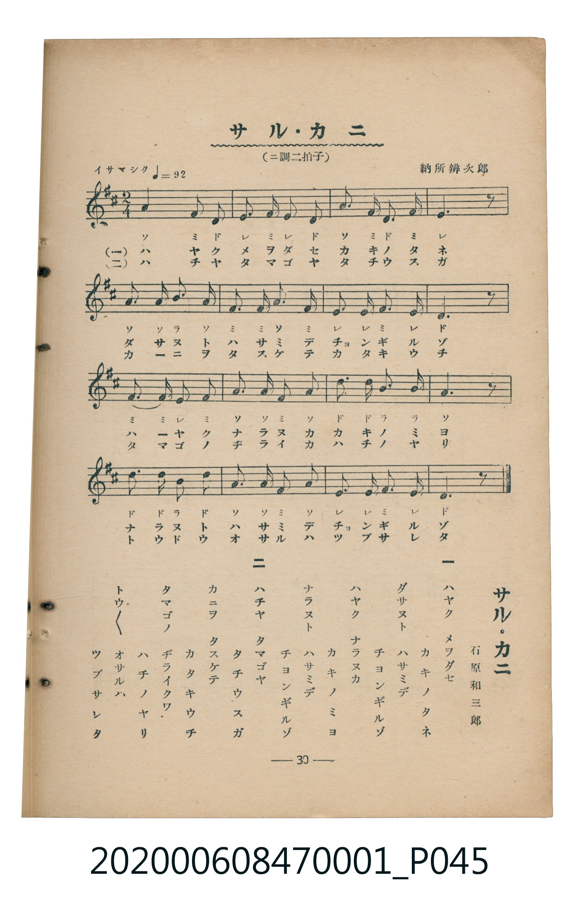

# サル・カニ（猴子與螃蟹）

> Re:Shōka 使用 AI 協助辨識與重建樂譜，可能會有錯誤。歡迎回報。

- **NEUTRINO 歌聲合成版**：<br><audio controls src="sarukani_neutrino.mp3"></audio>
- **鋼琴伴奏版**：<br><audio controls src="sarukani.mp3"></audio>


- 詞：石原和三郎
- 曲：納所辨次郎
- 臺灣教育會公認《新定兒童唱歌》尋常科第一學年用（2020.006.0847.0001）

## 說明

曲目說明
中文解釋：日本民間故事，描寫猴子與螃蟹的衝突和因果報應。


## 歌詞

```text
一
ハヤク　メヲダセ
カキノタネ
ダサヌト　ハサミデ
チヨンギルゾ
ハヤク　ナラヌカ
カキノミヨ
ナラヌト　ハサミデ
チヨンギルゾ

二
ハチヤ　タマゴヤ
タチウスガ
カニヲ　タスケテ
カタキウチ
タマゴノ　ヂライクワ
ハチノヤリ
トウトウ　オサルハ
ツブサレタ
```

## ABC

```abc
X:1
T:サル・カニ（猴子與螃蟹）
C:曲：納所辨次郎
M:2/4
L:1/16
Q:1/4=92
K:D
V:V1 name="Piano" snm="Pia"
[V:V1]
A4 F2 D2 | E3 F E2 D2 | A3 F D3 F | E6 z2 |
w: 1.~ハ ヤ ク | メ ヲ ダ セ | カ キ ノ タ | ネ
w: 2.~ハ チ ヤ | タ マ ゴ ヤ | タ チ ウ ス | ガ
A3 A B2 A2 | F3 F A3 F | E3 E F2 E2 | D6 z2 |
w: 1.~ダ サ ヌ ト | ハ サ ミ デ | チョ ン ギ ル | ゾ
w: 2.~カ _ ニ ヲ | タ ス ケ テ | カ タ キ ウ | チ
F3 F E2 F2 | A2 A2 F2 A2 | d3 d B3 B | A6 z2 |
w: 1.~ハ _ ヤ ク | ナ ラ ヌ カ | カ キ ノ ミ | ヨ
w: 2.~タ マ ゴ ノ | ヂ ラ イ クヮ | ハ チ ノ ヤ | リ
d3 d B2 d2 | A3 A F2 A2 | E3 E F2 E2 | D6 z2 |
w: 1.~ナ ラ ヌ ト | ハ サ ミ デ | チョ ン ギ ル | ゾ
w: 2.~ト ウ ト ウ | オ サ ル ハ | ツ ブ サ レ | タ
```

## TMD 檔案連結

- [主旋律 TMD 檔案](sarukani.tmd) [[在 TMD Studio 編輯](https://tmdlang.github.io/Tmd-TS/#tmd=s7IKdvYPcrWy4qpTUCpJTLdSSM7PyUlNLsnMz7MqzsjMK0nNjM_KTMmPL87Iz05Ugisry88pzU21Si9KTEmNN4w3MjAyiDcwMIs3sDAxBzIMDBFKi_NLi5JTrYqTM_Lzc-JLUitKkvLzsxHyBUX5Zal5iXlANQVFIBtTwIoQClLLMlNSQdKpKZkl-UWZiTlI7kgtKga7FWxJfElRYl5xclFmAcgDCFUlGalAxybmZeYi64WIpuXnZOfkF6UixIFWpGfmWeWmZmZlIrlXS0vhcdPWx82rHzfvftwEJLvf7-l43rPl6doJLzraX8xrfjF_5_s9nQpaWlyKtgqWRlz2tgouXDZG-iZ2IKNfrJz3fs-s5_M3P-2b_3RSz5MdnS-b-8CWPpu9CSSzpfdZZ8OLfSuerVkIk3nRvut54-JnU2e-aNr0bE7z09Y1L1b1Pm7oejZtw9N1s562Tnq-eunTKRufre153ND9dEP30x07ni-f-HzNmic7Gp6u3fF055bnU1YAXQmKHj1g9OiBogfIMDAEOlSJS19LAWj389nrXqxa9WxGH5eCgsKTHWufTWt_sXzxy3ag92Y9m7702Zw1zzZMfDlt8rOprU92AQV7nvX3P12_Gs3nz2e1vFg49_mqRqDfns5e8GzenKcLNj5r73zc0MSlpc8FtIsL6Ciux839j5uXPG5a_7ih4XHzwsfNmx43Nzxu2s0FCtGmtY-b-x437X_c3AtUCBQGhnbP4-YOsNp-MHf-4-Z2oFzj4-YVj5s3P25aB4qPpn1o5nY9bl4J0tq0GslckN4VQIUwSaLM5XqyqwdiOFBqCUgDyHnzHjdtAXKBhgM5jY-blj1u2vm4aQ3YsuZukKcgCkGiGx83t0FcAeSvBaltboRohJjSB3ZFE8hRTWAPNK-HWwh09JLHzauA_A6wRjAJMnoVLCX2A-VaHjdPA_PXAI0FB7ZvIjD9BmQm5uU71BjUVIMiVsHG0EzLDsyqUTBV0AVDYyA2BOIaBSMoH0RDRCBqjME8EA1TA4EGIDVg03wMaxSA7oCKAx0MIpvWg80AxjBUdBMQN4BldkNkmlZDZJrWAmX6oOz9YD29SPbEI-wxQrWnEW4byLT9UNF5QPYWrDKNQPYyqD07wTJrMOxBCR5TBTMwCTIGFFCgQIAFCiwwjMAyIHYNNKCwBw_I6yCLtwLZPWDndEADCOIhiMx8qFPbwTLA-F8OFdgMVLAOzAKFGsjt-3CHETRkQaq7weQm1JAA-h6YKqEq2lDiYj84PkAsUEiBHYErjGAhAvI7iA0JNRAG8SChZhgHVgSkQCGpCyQRSY-URNQFFlsJJsGhB3YwjkQEDEWQnhV4AggzsYD0gnQ1IWxqgrrhcTMo5JGiCpSS4JYtAcuswhVKqCEA5iGSFyKgSEtMoOCAOJNQYgIlJWg8kpmYwEZDEgSEDU8aTRBPQywDmQSxHqSnBWrTNLAsiAXKaoiQR7aplotL104BVGApAGllLgA)]
- [鋼琴伴奏 TMD 檔案](sarukani_piano.tmd) [[在 TMD Studio 編輯](https://tmdlang.github.io/Tmd-TS/#tmd=s7IKdvYPcrWy4tLSUnjctPVx8-rHzbsfNwHJ7vd7Oh43T3nctOhxc9-TPVueLu1_snvG-z2dClpaXIq2CpZGXPa2Ci5cNkb6JnZcdQpKL1bOe79n1vP5m5_2zX86qefJjs6XzX1KIJlnszeBZLb0PutseLFvxbM1C2EyL9p3PW9c_GzqzBdNm57NaX7auubFqt7HDV3Ppm14um7W09ZJz1cvfTpl47O1PY8bup9u6H66Y8fz5ROfr1nzZEfD07U7nu7c8nzKCqBDjQyMDPQMDMz0DCxMzIEMA0OgQ5W4uHwTM_OsAjIT8_KDPBxqDGqquRSAwMbQTMsOzKpRMFXQBUNjIDYE4hoFIygfRENEIGqMwTwQDVMDgQYgNWDTfAxrFB4390PFHzcvAZFN68FmPG5eCBXdBMQNYJndEJmm1RCZprVAmT4oez9YTy-SPfEIe4xQ7WmE2wYybT9UdB6QvQWrTCOQvQxqz06wzBoMe1CCx1TBDEyCjAEFFCgQYIECCwwjsAyIXQMNKOzBA_I6yOKtQHYP2Dkd0ACCeAgiMx_q1HawTOPj5uVQgc1ABevALFCogdy-D3cYQUMWpLobTG5CDQmg7x83bYSqaEOJi_3g-ACxQCEFdgSuMIKFCMjvIDYk1EAYxIOEmmEcWBGQAoWkLpBEJD1SElEXWGwlmASHHtjBOBIRMBRBelbgCSDMxALSC9LVhLCpCeqGx82gkEeKKlBKglu2BCyzClcooYYAmIdIXoiAIi0xgYID4kxCiQmUlKDxSGZiAhsNSRAQNjxpNEE8DbEMZBLEepCeFqhN08CyIBYoqyFCHtmmWuTyyge5vLKAF1fRhrFAtRASyDONR-GiSkJ4ECUQf8AFTbBqgJoG1QEVBwU6mm5UBWj2oRiNRTPJVgODRddOARQy0T4gYRjbCMxW5gIA)]

## 分析

```text
================================================================================
📊 TMD Song Profile: [ サル・カニ（猴子與螃蟹） ]
================================================================================
⏱  Duration:       0:20 (20.9s), 16 measures total
🎼 Key & Tempo:    首調基準 D, != 92.0 BPM, <2/4>
   - 分析範圍：      由實際發聲的音符與和弦推測調性；播放脈絡另行呈現
🎤 人聲音域:    D4 (MIDI 62) – D5 (MIDI 74) [跨度: 12 個半音 / 1.0 個八度, 難度: easy]
   - 最低音:  D4 in [Main #1 @ m.1, 0:00]
   - 最高音: D5 in [Main #1 @ m.11, 0:13]
   - 適合: soprano, mezzo-soprano, contralto, tenor, baritone, bass
🏛  結構:      Main (20.9s)
⚡ 編曲密度:        Peak 1 軌道同時演奏
🗝  調性診斷：       D 調性不明確（純淨自然大調，未偵測到可信轉調）
   - 風格氣質:    純淨自然大調（陽光明朗、易唱易記，無明顯調外色彩）
   - 轉調歷程:    全曲維持單一推測調性（未偵測到可信轉調）
   - 核心骨幹音:  A, D, E, F#, B
   - 調性數值:    D 調性不明確 [相關度: 0.83, 穩定度: Ambiguous, 自然音純度: 100.0%]
   - 候選調性 (K-S): D 大調 (0.83), A 大調 (0.82), F# 小調 (0.64)
   - 五度圈歷程:   +2
   - 各段落調性細節:
     • [Main #1]: D 調性不明確 (r: 0.83, 自然音純度: 100.0%)

  [ 五度圈游移軌跡 ]
               C  
         F            G  
      Bb              [D ]*
      Eb               A  
         Ab           E  
            Db       B  
               F# 
     (* = active key center)

  [ 十二半音累積音高分佈 ]
     C  :                            0.0%
     C# :                            0.0%
     D  : ████████████████████      24.2%
     D# :                            0.0%
     E  : ██████████████████        20.8%
     F  :                            0.0%
     F# : █████████████████         20.0%
     G  :                            0.0%
     G# :                            0.0%
     A  : ████████████████████████  28.3%
     A# :                            0.0%
     B  : ██████                     6.7%
--------------------------------------------------------------------------------
Assignment 軌道音域：
  - Piano         : D4 – D5 (12 個半音 / 1.0 個八度, 51 個音符)
================================================================================
```


## 原書掃描頁




