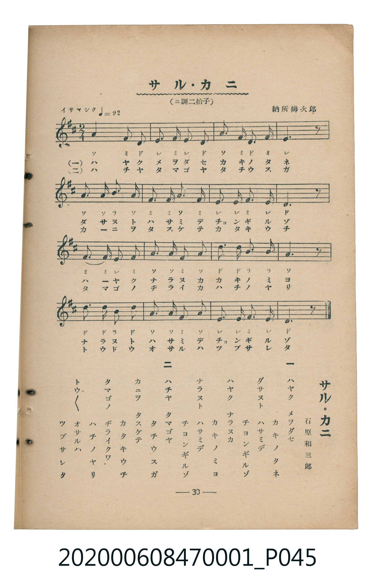

# サル・カニ（猴子與螃蟹）

> Re:Shōka 使用 AI 協助辨識與重建樂譜，可能會有錯誤。歡迎[回報](https://github.com/TMDLang/reshoka/issues)。

- **鋼琴伴奏版**：<br><audio controls src="sarukani.mp3"></audio>
- **NEUTRINO 歌聲合成版**：<br><audio controls src="sarukani_neutrino.mp3"></audio>

- 詞：石原和三郎
- 曲：納所辨次郎
- 臺灣教育會公認《新定兒童唱歌》尋常科第一學年用（2020.006.0847.0001）

## 說明

曲目說明
中文解釋：日本民間故事，描寫猴子與螃蟹的衝突和因果報應。


## 歌詞

```text
一
ハヤク　メヲダセ
カキノタネ
ダサヌト　ハサミデ
チヨンギルゾ
ハヤク　ナラヌカ
カキノミヨ
ナラヌト　ハサミデ
チヨンギルゾ

二
ハチヤ　タマゴヤ
タチウスガ
カニヲ　タスケテ
カタキウチ
タマゴノ　ヂライクワ
ハチノヤリ
トウトウ　オサルハ
ツブサレタ
```

## ABC

<div class="abc-score" data-abc-src="sarukani.abc" aria-label="五線譜載入中"></div>

[下載 ABC 原始檔](sarukani.abc)

## TMD 檔案連結

- [主旋律 TMD 檔案](sarukani.tmd) [[在 TMD Studio 編輯](https://tmdlang.github.io/Tmd-TS/#tmd=s7IKdvYPcrWy4qpTUCpJTLdSSM7PyUlNLsnMz7MqzsjMK0nNjM_KTMmPL87Iz05Ugisry88pzU21Si9KTEmNN4w3MjAyiDcwMIs3sDAxBzIMDBFKi_NLi5JTrYqTM_Lzc-JLUitKkvLzsxHyBUX5Zal5iXlANQVFIBtTwIoQClLLMlNSQdKpKZkl-UWZiTlI7kgtKga7FWxJfElRYl5xclFmAcgDCFUlGalAxybmZeYi64WIpuXnZOfkF6UixIFWpGfmWeWmZmZlYnFvflFJRj7Q4wUZlVYZmcUgFyUn5sRnJ-YhhQ_UPQWJ6alWAQYmpkpcWloKj5u2Pm5e_bh59-MmINn9fk_H854tT9dOeNHR_mJe84v5O9_v6VTQ0uJStFWwNOKyt1Vw4bIx0jexA5n6YuW893tmPZ-_-Wnf_KeTep7s6HzZ3Ae279nsTSCZLb3POhte7FvxbM1CmMyL9l3PGxc_mzrzRdOmZ3Oan7auebGq93FD17NpG56um_W0ddLz1UufTtn4bG3P44bupxu6n-7Y8Xz5xOdr1jzZ0fB07Y6nO7c8n7IC6EpQ7OoBY1cPFLtAhoEh0KFKXPpaCkC7n89e92LVqmcz-rgUFBSe7Fj7bFr7i-WLX7YDvTfr2fSlz-asebZh4stpk59NbX2yCyjY86y__-n61Wg-fz6r5cXCuc9XNQL99nT2gmfz5jxdsPFZe-fjhiYuLX0uoF1cQEdxPW7uf9y85HHT-scNDY-bFz5u3vS4ueFx024uUIg2rX3c3Pe4af_j5l6gQqAwMLR7Hjd3gNX2g7nzHze3A-UaHzeveNy8-XHTOlB8NO1DM7frcfNKkNam1UjmgvSuACqESRJlLteTXT0Qw4FSS0AaQM6b97hpC5ALNBzIaXzctOxx087HTWvAljV3gzwFUQgS3fi4uQ3iCiB_LUhtcyNEI8SUPrArmkCOagJ7oHk93EKgo5c8bl4F5HeANYJJkNGrYCmxHyjX8rh5Gpi_BmgsOLB9E4HJPyAzMS_focagphoUsQo2hmZadmBWjYKpgi4YGgOxIRDXKBhB-SAaIgJRYwzmgWiYGgg0AKkBm-ZjWKMAdAdUHOhgENm0HmwGMIahopuAuAEssxsi07QaItO0FijTB2XvB-vpRbInHmGPEao9jXDbQKbth4rOA7K3YJVpBLKXQe3ZCZZZg2EPSvCYKpiBSZAxoIACBQIsUGCBYQSWAbFroAGFPXhAXgdZvBXI7gE7pwMaQBAPQWTmQ53aDpYBxv9yqMBmoIJ1YBYo1EBu34c7jKAhC1LdDSY3oYYE0PfAVAlV0YYSF_vB8QFigUIK7AhcYQQLEZDfQWxIqIEwiAcJNcM4sCIgBQpJXSCJSHqkJKIusNhKMAkOPbCDcSQiYCiC9KzAE0CYiQWkF6SrCWFTE9QNj5tBIY8UVaCUBLdsCVhmFa5QQg0BMA-RvBABRVpiAgUHxJmEEhMoKUHjkczEBDYakiAgbHjSaIJ4GmIZyCSI9SA9LVCbpoFlQSxQVkOEPLJNtVxcunYKoAJLAUgrcwEA)]
- [鋼琴伴奏 TMD 檔案](sarukani_piano.tmd) [[在 TMD Studio 編輯](https://tmdlang.github.io/Tmd-TS/#tmd=s7IKdvYPcrWy4qpTUCpJTLdSyC8qychPL0osyKi0ysgsLskvykxOzInPTsxLVIIrKs4vLUpOjS9ITE-1CjAwMVXi0tJSeNy09XHz6sfNux83Acnu93s6HjdPedy06HFz35M9W54u7X-ye8b7PZ0KWlpcirYKlkZc9rYKLlw2RvomdiCDX6yc937PrOfzNz_tm_90Us-THZ0vm_vAVj6bvQkks6X3WWfDi30rnq1ZCJN50b7reePiZ1Nnvmja9GxO89PWNS9W9T5u6Ho2bcPTdbOetk56vnrp0ykbn63tedzQ_XRD99MdO54vn_h8zZonOxqert3xdOeW51NWAB1qZGBkoGdgYKZnYGFiDmQYGAIdqsTF5ZuYmWcVkJmYlx_k4VBjUFPNpQAENoZmWnZgVo2CqYIuGBoDsSEQ1ygYQfkgGiICUWMM5oFomBoINACpAZvmY1ij8Li5Hyr-uHkJiGxaDzbjcfNCqOgmIG4Ay-yGyDSthsg0rQXK9EHZ-8F6epHsiUfYY4RqTyPcNpBp-6Gi84DsLVhlGoHsZVB7doJl1mDYgxI8pgpmYBJkDCigQIEACxRYYBiBZUDsGmhAYQ8ekNdBFm8FsnvAzumABhDEQxCZ-VCntoNlGh83L4cKbAYqWAdmgUIN5PZ9uMMIGrIg1d1gchNqSAB9_7hpI1RFG0pc7AfHB4gFCimwI3CFESxEQH4HsSGhBsIgHiTUDOPAioAUKCR1gSQi6ZGSiLrAYivBJDj0wA7GkYiAoQjSswJPAGEmFpBekMwOhE1NUDc8bgaFPFJUgVIS3LIlYJlVuEIJNQTAPETyQgQUaYkJFBwQZxJKTKCkBI1HMhMT2GhIgoCw4UmjCeJpiGUgkyDWg_S0QG2aBpYFsUBZDRHyyDbVIpdXPsjllQW8uIo2jAWqhZBAnmk8ChdVEsKDKIH4Ay5oglUD1DSoDqg4KNDRdKMqQLMPxWgsmkm2GhgsunYKoJCJ9gEJw9hGYLYyFwA)]

## 分析

```text
================================================================================
📊 TMD Song Profile: [ サル・カニ（猴子與螃蟹） ]
================================================================================
⏱  Duration:       0:20 (20.9s), 16 measures total
🎼 Key & Tempo:    首調基準 D, != 92.0 BPM, <2/4>
   - 分析範圍：      由實際發聲的音符與和弦推測調性；播放脈絡另行呈現
🎤 人聲音域:    D4 (MIDI 62) – D5 (MIDI 74) [跨度: 12 個半音 / 1.0 個八度, 難度: easy]
   - 最低音:  D4 in [Main #1 @ m.1, 0:00]
   - 最高音: D5 in [Main #1 @ m.11, 0:13]
   - 適合: soprano, mezzo-soprano, contralto, tenor, baritone, bass
🏛  結構:      Main (20.9s)
⚡ 編曲密度:        Peak 1 軌道同時演奏
🗝  調性診斷：       D 調性不明確（純淨自然大調，未偵測到可信轉調）
   - 風格氣質:    純淨自然大調（陽光明朗、易唱易記，無明顯調外色彩）
   - 轉調歷程:    全曲維持單一推測調性（未偵測到可信轉調）
   - 核心骨幹音:  A, D, E, F#, B
   - 調性數值:    D 調性不明確 [相關度: 0.83, 穩定度: Ambiguous, 自然音純度: 100.0%]
   - 候選調性 (K-S): D 大調 (0.83), A 大調 (0.82), F# 小調 (0.64)
   - 五度圈歷程:   +2
   - 各段落調性細節:
     • [Main #1]: D 調性不明確 (r: 0.83, 自然音純度: 100.0%)

  [ 五度圈游移軌跡 ]
               C  
         F            G  
      Bb              [D ]*
      Eb               A  
         Ab           E  
            Db       B  
               F# 
     (* = active key center)

  [ 十二半音累積音高分佈 ]
     C  :                            0.0%
     C# :                            0.0%
     D  : ████████████████████      24.2%
     D# :                            0.0%
     E  : ██████████████████        20.8%
     F  :                            0.0%
     F# : █████████████████         20.0%
     G  :                            0.0%
     G# :                            0.0%
     A  : ████████████████████████  28.3%
     A# :                            0.0%
     B  : ██████                     6.7%
--------------------------------------------------------------------------------
Assignment 軌道音域：
  - Piano         : D4 – D5 (12 個半音 / 1.0 個八度, 51 個音符)
================================================================================
```


## 原書掃描頁




