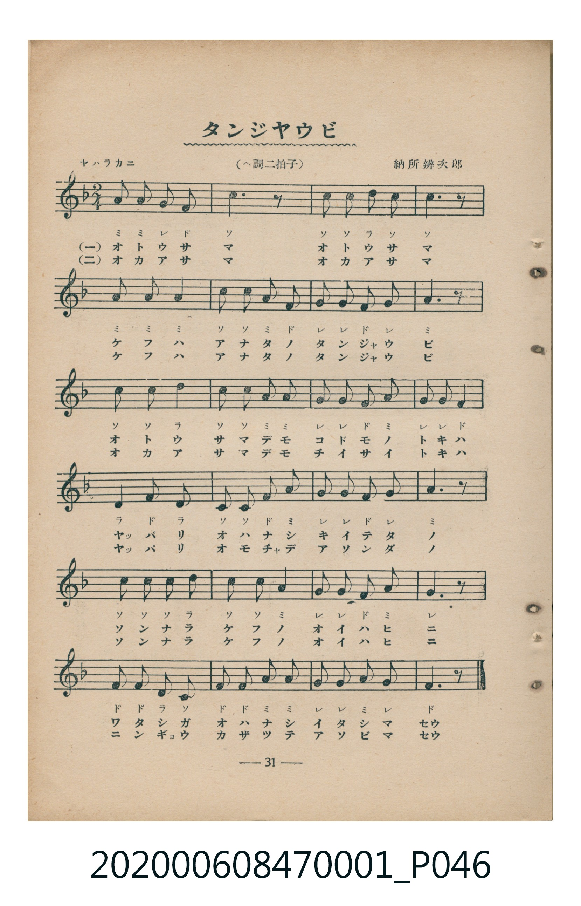
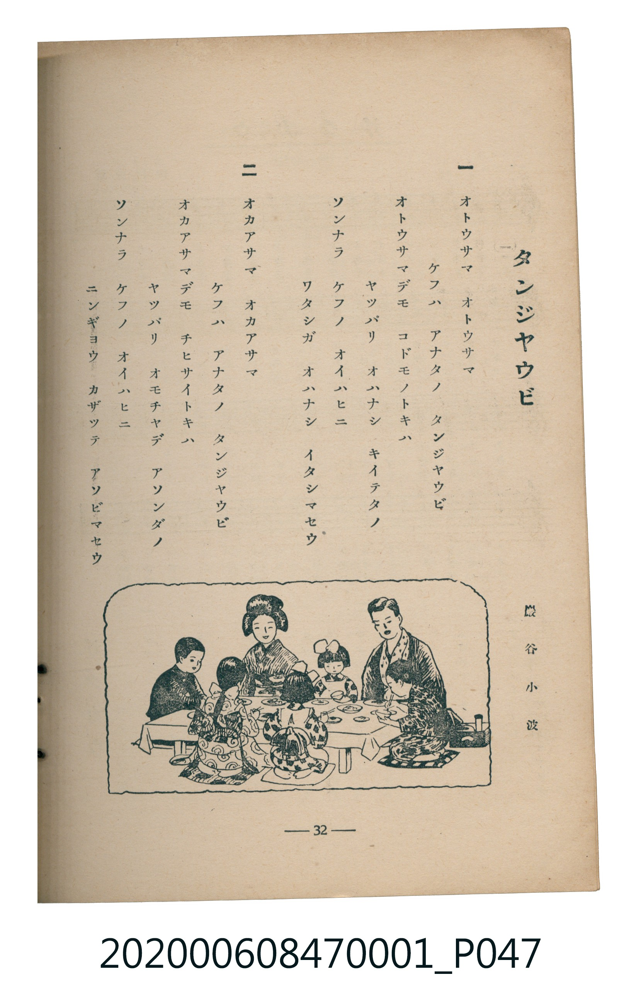

# タンジヤウビ

> Re:Shoka 使用 AI 協助辨識與重建樂譜，可能會有錯誤。歡迎回報。

<audio controls src="tanjobi.mp3"></audio>

- 詞：巖谷小波
- 曲：納所辨次郎
- 臺灣教育會公認《新定兒童唱歌》尋常科第一學年用（2020.006.0847.0001）

## 說明

・出處：臺灣教育會公認《新定兒童唱歌》尋常科第一學年用（2020.006.0847.0001）
・調性與拍號：調號 ?= F，拍號 <2/4>，速度 != 96

## 歌詞

```text
一
オトウサマ　オトウサマ
ケフハ　アナタノ　タンジヤウビ
オトウサマデモ　コドモノトキハ
ヤツパリ　オハナシ　キイテタノ
ソンナラ　ケフノ　オイハヒニ
ワタシガ　オハナシ　イタシマセウ

二
オカアサマ　オカアサマ
ケフハ　アナタノ　タンジヤウビ
オカアサマデモ　チヒサイトキハ
ヤツパリ　オモチヤデ　アソンダノ
ソンナラ　ケフノ　オイハヒニ
ニンギヨウ　カザッテ　アソビマセウ
```

## ABC

```abc
X:1
T:タンジヤウビ
C:曲：納所辨次郎
M:2/4
L:1/16
Q:1/4=96
K:F
V:V1 name="Piano" snm="Pia"
[V:V1]
A2 A2 G2 F2 | C6 z2 | c2 c2 d2 c2 | c6 z2 |
A3 A A4 | c2 c2 A2 F2 | G2 G2 F2 G2 | A6 z2 |
c3 c d4 | c2 c2 A2 A2 | G2 G2 F2 A2 | G2 G2 F4 |
d3 f d4 | c2 c2 F2 A2 | G2 G2 F2 G2 | A6 z2 |
c2 c2 c2 d2 | c2 c2 A4 | G2 G2 F2 A2 | G6 z2 |
F2 F2 D2 C2 | F2 F2 A2 A2 | G2 G2 A2 G2 | F6 z2 |
A2 A2 G2 F2 | C6 z2 | c2 c2 d2 c2 | c6 z2 |
A3 A A4 | c2 c2 A2 F2 | G2 G2 F2 G2 | A6 z2 |
c3 c d4 | c2 c2 A2 A2 | G2 G2 F2 A2 | G2 G2 F4 |
d3 f d4 | c2 c2 F2 A2 | G2 G2 F2 G2 | A6 z2 |
c2 c2 c2 d2 | c2 c2 A4 | G2 G2 F2 A2 | G6 z2 |
F2 F2 D2 C2 | F2 F2 A2 A2 | G2 G2 A2 G2 | F6 z2 |
```

## TMD 檔案連結

- [主旋律 TMD 檔案](tanjobi.tmd) [[在 TMD Studio 編輯](https://tmdlang.github.io/Tmd-TS/#tmd=s7IKdvYPcrWy4qpTUCpJTLdSSM7PyUlNLsnMz7MqzsjMK0nNjM_KTMmPL87Iz05Ugisry88pzU21Si9KTEmNN4w3MjAyiDcwMIs3sDAxBzIMDBFKi_NLi5JTrYqTM_Lzc-JLUitKkvLzsxHyBUX5Zal5iXlANQVFIBtTwIoQClLLMlNSQdKpKZkl-UWZiTlI7kgtKga7FWxJfElRYl5xclFmAcgDCFUlGalAxybn5-aW5mWWVCpxaWkpPG7a_7h58-OmHY-blzxuWva4ebKClhaXoq2CpRmXva2CG5eNkb6JHciIFyvnvd8z6-n2aS82bH-6of_Z5kVgk5_N3gQUfr6l91lnw4t9K56tWfiyuQ8s86J91_PGxc-mznzRtOnZnOanrWterOp93ND1bNqGp-tmPW2d9Hz10qdTNj5b2_O4ofvphu6nO3Y8Xz7x-Zo1T3Y0PF274-nOLc-nrHi_pwMUqnrAUNUDhSqQYWD4fk-nEheXvhYXUCXX46ZVj5s7QG5v2vq4ed7jhgY0EaCKjY-bpz5u7gfLLXrc3AX2dR-Yi-59DPOa2x83LwIr3fy4uRPEBuoEKVgLNJELpK-55XHzxMfNq2BW94Nt2A7mrn3cBFTQBrEQaPZekHVA6eaVYGmIwyAuWQVWCtQ86XFzN9Dg9SBNQGOa1mAzGOhcsCzQhU27ga7l4nqyqwfs-KbVIE8iBwaSCBmBgWwePDCaG0HuBAqC3IwvMIA2AJUCxduhFkKDAGgEieHRDXbcusfNK0COA6kAOmzb4-ZmUPgizJ6MCBItfS4u38TMPKuAzMS8fIcagxqFai4FBRtDMy07IF2jYKygC8ZGQGwIxDUKpvFACgYNIEJAEoTNoDREBEUN3DCQcRAaWSdIBGI8yCKYZSAapgvdLIgNpmA7Mc0CYVSzMEXAusBmQcwwjMNiGHathByGHCCoDoOYjt1hmGaB5EHYDBTm4IBHiGF6ExZPEDWoptVycenaKYCiWgGJVuYCAA)]
- [鋼琴伴奏 TMD 檔案](tanjobi_piano.tmd) [[在 TMD Studio 編輯](https://tmdlang.github.io/Tmd-TS/#tmd=s7IKdvYPcrWy4tLSUnjctP9x8-bHTTseNy953LTscfPk93s6HjdPedy06HFz35M9W54u7X-ye8b7PZ0KWlpcirYKlmZc9rYKblw2Rvomdlx1CkovVs57v2fW0-3TXmzY_nRD_7PNi5RAws9mbwIKP9_S-6yz4cW-Fc_WLHzZ3AeWedG-63nj4mdTZ75o2vRsTvPT1jUvVvU-buh6Nm3D03WznrZOer566dMpG5-t7Xnc0P10Q_fTHTueL5_4fM2aJzsanq7d8XTnludTVgBdaWRgZKBnYGCmZ2BhYg5kGBgCXanExeWbmJlnFZCZmJcf5OFQY1CjUM2loGBjaKZlB6RrFIwVdMHYCIgNgbhGwTQeSMGgAUQISIKwGZSGiKCogRsGMg5CI-sEiUCMB1kEswxEw3ShmwWxwRRsJ6ZZIIxqFqYIWBfYLIgZhnFYDMOulZDDkAME1WEQ07E7DNMskDwIm4HCHBzwCDFMb8LiCaIG1bRa5Jj2QYppC2hERxvGAhVCSBgPpBkuY4Ihg1MfnGcaD-ZCKJx6UUxG14uVC9EN1odfN_VsxtSLYjQxFgPjQNdOARQNCki0MhcA)]

## 分析

```text
================================================================================
📊 TMD Song Profile: [ タンジヤウビ ]
================================================================================
⏱  Duration:       1:00 (60.0s), 48 measures total
🎼 Key & Tempo:    首調基準 F, != 96.0 BPM, <2/4>
   - 分析範圍：      由實際發聲的音符與和弦推測調性；播放脈絡另行呈現
🎤 人聲音域:    C4 (MIDI 60) – F5 (MIDI 77) [跨度: 17 個半音 / 1.4 個八度, 難度: challenging]
   - 最低音:  C4 in [Main #1 @ m.2, 0:01]
   - 最高音: F5 in [Main #1 @ m.13, 0:15]
   - 適合: soprano, mezzo-soprano, contralto, tenor, baritone, bass
🏛  結構:      Main (30.0s) -> Main (30.0s)
⚡ 編曲密度:        Peak 1 軌道同時演奏
🗝  調性診斷：       C 調性不明確（純淨自然大調，未偵測到可信轉調）
   - 風格氣質:    純淨自然大調（陽光明朗、易唱易記，無明顯調外色彩）
   - 轉調歷程:    全曲維持單一推測調性（未偵測到可信轉調）
   - 核心骨幹音:  C, A, G, F, D
   - 調性數值:    C 調性不明確 [相關度: 0.78, 穩定度: Ambiguous, 自然音純度: 100.0%]
   - 候選調性 (K-S): C 大調 (0.78), F 大調 (0.75), A 小調 (0.72)
   - 五度圈歷程:   +0 -> +0
   - 各段落調性細節:
     • [Main #1]: C 調性不明確 (r: 0.78, 自然音純度: 100.0%)
     • [Main #2]: C 調性不明確 (r: 0.78, 自然音純度: 100.0%)

  [ 五度圈游移軌跡 ]
              [C ]*
         F            G  
      Bb               D  
      Eb               A  
         Ab           E  
            Db       B  
               F# 
     (* = active key center)

  [ 十二半音累積音高分佈 ]
     C  : ████████████████████████  25.6%
     C# :                            0.0%
     D  : █████████                  9.4%
     D# :                            0.0%
     E  :                            0.0%
     F  : █████████████████         18.3%
     F# :                            0.0%
     G  : ████████████████████      21.1%
     G# :                            0.0%
     A  : ████████████████████████  25.6%
     A# :                            0.0%
     B  :                            0.0%
--------------------------------------------------------------------------------
Assignment 軌道音域：
  - Piano         : C4 – F5 (17 個半音 / 1.4 個八度, 146 個音符)
================================================================================
```


## 原書掃描頁






