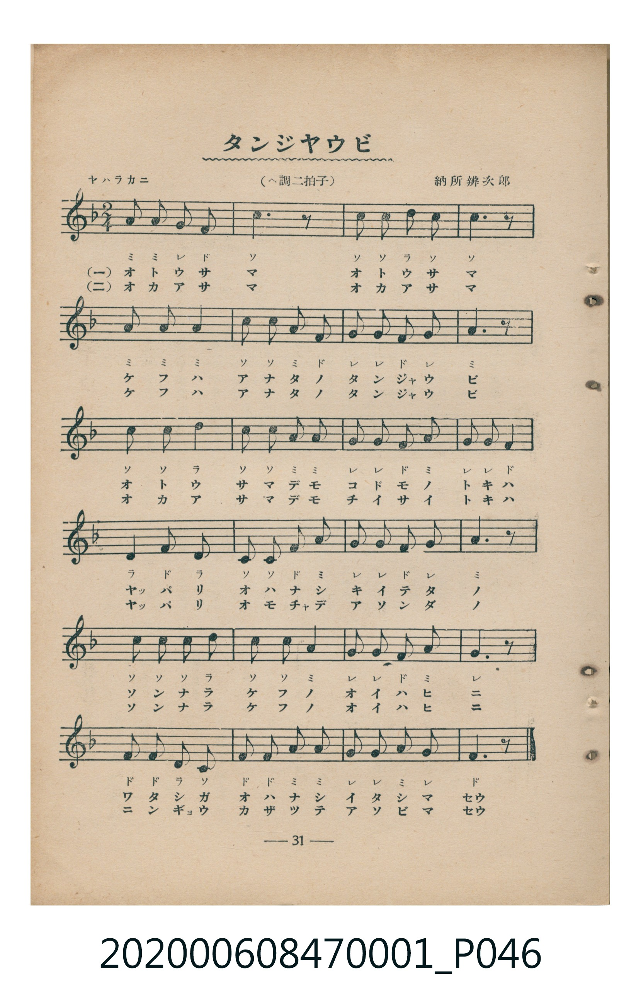
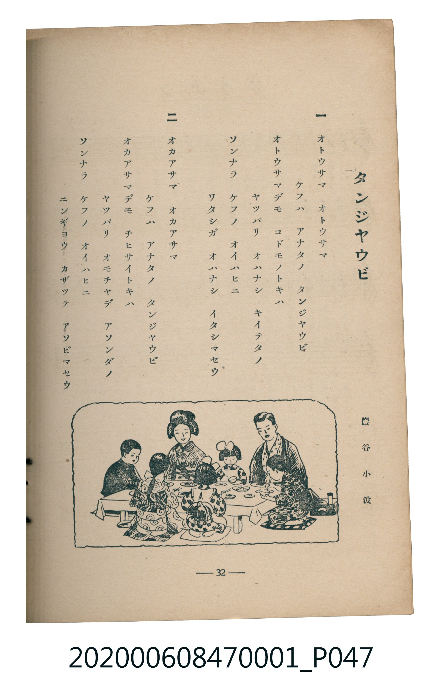

# タンジヤウビ（生日）

> Re:Shōka 使用 AI 協助辨識與重建樂譜，可能會有錯誤。歡迎回報。

- **鋼琴伴奏版**：<br><audio controls src="tanjobi.mp3"></audio>
- **NEUTRINO 歌聲合成版**：<br><audio controls src="tanjobi_neutrino.mp3"></audio>

- 詞：巖谷小波
- 曲：納所辨次郎
- 臺灣教育會公認《新定兒童唱歌》尋常科第一學年用（2020.006.0847.0001）

## 說明

曲目說明
中文解釋：描寫生日到來時，孩子祝福、慶祝與分享喜悅。


## 歌詞

```text
一
オトウサマ　オトウサマ
ケフハ　アナタノ　タンジヤウビ
オトウサマデモ　コドモノトキハ
ヤツパリ　オハナシ　キイテタノ
ソンナラ　ケフノ　オイハヒニ
ワタシガ　オハナシ　イタシマセウ

二
オカアサマ　オカアサマ
ケフハ　アナタノ　タンジヤウビ
オカアサマデモ　チヒサイトキハ
ヤツパリ　オモチヤデ　アソンダノ
ソンナラ　ケフノ　オイハヒニ
ニンギヨウ　カザッテ　アソビマセウ
```

## ABC

<div class="abc-score" data-abc-src="tanjobi.abc" aria-label="五線譜載入中"></div>

[下載 ABC 原始檔](tanjobi.abc)

## TMD 檔案連結

- [主旋律 TMD 檔案](tanjobi.tmd) [[在 TMD Studio 編輯](https://tmdlang.github.io/Tmd-TS/#tmd=s7IKdvYPcrWy4qpTUCpJTLdSSM7PyUlNLsnMz7MqzsjMK0nNjM_KTMmPL87Iz05Ugisry88pzU21Si9KTEmNN4w3MjAyiDcwMIs3sDAxBzIMDBFKi_NLi5JTrYqTM_Lzc-JLUitKkvLzsxHyBUX5Zal5iXlANQVFIBtTwIoQClLLMlNSQdKpKZkl-UWZiTlI7kgtKga7FWxJfElRYl5xclFmAcgDCFUlGalAxybn5-aW5mWWVCIkgKalZ-ZZ5aZmZmUiOU1LS-Fx0_7HzZsfN-143LzkcdOyx82T3-_peD5l_rPpS9_v6VTQ0uJStFWwNOOyt1Vw47Ix0jexAxn6YuW893tmPd0-7cWG7U839D_bvAhs17PZm4DCz7f0PutseLFvxbM1C18294FlXrTvet64-NnUmS-aNj2b0_y0dc2LVb2PG7qeTdvwdN2sp62Tnq9e-nTKxmdrex43dD_d0P10x47nyyc-X7PmyY6Gp2t3PN255fmUFUCXgSJADxgBeqAIADIMDIGuVOLS11IA2v189roXq1Y9m9HHpaCg8GTH2mfT2l8sX_yyvRvoqGf9_U_Xr4Z47GnHhif72p7NbHq_p-fp2pVP1054vnTu82X9jxsan7VuA7JfdLQ_7Wh7smv102lznjW1Pm5o4tLS5wLawgV0DtfjplWPmztAgdW09XHzvMcNDWgiQBUbHzdPfdwMNBEot-hxcxc4mPvAXPTwxjCvuf1x8yKw0s2PmztBbKBOkIK1QBO5QPqaWx43T3zcvApmdT_Yhu1g7trHTUAFbRALgWbvBVkHlG5eCZaGOAziklVgpUDNkx43dwMNXg_SBDSmaQ02g4HOBcsCXdi0G-haLq4nu3rAjm9aDfIkcmAgiZARGMjmwQOjuRHkTqAgyM34AgNoA1ApULwdaiE0CIBGkBge3WDHrXvcvALkOJAKoMO2PW5uBoUvwuzJiCABpRLfRGBOC8hMzMt3qDGoqQalRQUbQzMtOzCrRsFYQReMjYDYEIhrFEzjgRQMGkCEgCQIm0FpiAiKGrBxPoY1wCy8CsgHBgqIbFoGJreC9QAdhqQLZAuJqiF2GMF1Na0Gk4uIs4M41VxI4QIKGQiNHAggEUhIgcIMFm4gGqYLe7BsBIsCIxiI--GmQh3U3AV21n4wuw8qA-FtBssAE-VieBiBXD4ZT-jQ3CpoIEFSgSk4XWAGEgijBhKmCFgXWtqBpAeI9TCXg-ILElvAnAQmQX4ByYDd3NwJF4P7CZqm1oLF4KGAloYg6QISMgTtam4E8yaBdYFVNS3Baxc0mCDBYxiHJZywhwrBxAQqUJqhQTURiCFeQc5QIEfAono7VAbsPLCTgUUGmA2KdpBxoCDDkZgIWwUJdWApB0414CCDJ7amvWAxSCQ14LQNKT0hlzWo6QliK_b0hCvTIVsPDozmlVDngfIIKIfAUgyKn6CBBAlEUHyDnN2NO5BobA80eEBeBmEzkCi4mEaIYWY4WKkOUYMrIa0HOwOc_cHpBFjdIjsQazoCOxpZDzizgGRA1Q7uUAL7DFbKACuy5WAGtJSBFs_bwEpawCQojaKnJFBZRMC-Wi4uXTsFUMWnAKSVuQA)]
- [鋼琴伴奏 TMD 檔案](tanjobi_piano.tmd) [[在 TMD Studio 編輯](https://tmdlang.github.io/Tmd-TS/#tmd=s7IKdvYPcrWy4tLSUnjctP9x8-bHTTseNy953LTscfPk93s6HjdPedy06HFz35M9W54u7X-ye8b7PZ0KWlpcirYKlmZc9rYKblw2Rvomdlx1CkovVs57v2fW0-3TXmzY_nRD_7PNi5RAws9mbwIKP9_S-6yz4cW-Fc_WLHzZ3AeWedG-63nj4mdTZ75o2vRsTvPT1jUvVvU-buh6Nm3D03WznrZOer566dMpG5-t7Xnc0P10Q_fTHTueL5_4fM2aJzsanq7d8XTnludTVgBdaWRgZKBnYGCmZ2BhYg5kGBgCXanExeWbmJlnFZCZmJcf5OFQY1BTzaUABDaGZlp2YFaNgrGCLhgbAbEhENcomMYDKRg0gAgBSRA2g9IQERQ1YON8DGuAobgKyH_c3AEim5aBya1gPY-b5yHpAtlComqIHUZwXU2rweQi4uwgTjUXUriAQgZCIwcCSAQSUqAwg4UbiIbpwh4sG8Gij5unAnE_3FSog5q7wM7aD2b3QWUgvM1gGWCiXAwPI5DLJ-MJHZpbBQ0kSCowBacLzEACYdRAwhQB60JLO5D0ALEe5nJQfEFi63FzO5gE-QUkA3ZzcydcDO4naJpaCxaDhwJaGoKkC0jIELSruRHMmwTWBVbVtASvXdBgggSPYRyWcMIeKgQTE7CAam6GBtVEIIZ4BTlDgRwBi-rtUBmw88BOftzcBmaDoh1kHCjIcCQmwlZBQr0RmmrAQQZPbE17wWKQSGrAaRtSekIua1DTE8RW7OkJV6ZDth4cGM0roc4D5RFQDoGlGBQ_QQMJEoig-AY5uxt3INHYHmjwgLwMwmYgUXAxjRDDzHCwUh2iBldCWg92Bjj7g9PJ46Y1yA7Emo7AjkbWA84sIJndiFyLLSmBfAYrZdY9bl4OZkBLGWjxvA2spAVMgtIoekoClUUE7KtFrvd8kOs9C3i1F20YC1QLIWE8UODAZUwwZPDohPNM48FcCIVHN4rp6LqxcmH6wTrx66em7dh0oxhPjOXACNG1UwDFSbQPSBjGNgKzlbkA)]

## 分析

```text
================================================================================
📊 TMD Song Profile: [ タンジヤウビ（生日） ]
================================================================================
⏱  Duration:       0:30 (30.0s), 24 measures total
🎼 Key & Tempo:    首調基準 F, != 96.0 BPM, <2/4>
   - 分析範圍：      由實際發聲的音符與和弦推測調性；播放脈絡另行呈現
🎤 人聲音域:    C4 (MIDI 60) – F5 (MIDI 77) [跨度: 17 個半音 / 1.4 個八度, 難度: challenging]
   - 最低音:  C4 in [Main #1 @ m.2, 0:01]
   - 最高音: F5 in [Main #1 @ m.13, 0:15]
   - 適合: soprano, mezzo-soprano, contralto, tenor, baritone, bass
🏛  結構:      Main (30.0s)
⚡ 編曲密度:        Peak 1 軌道同時演奏
🗝  調性診斷：       C 調性不明確（純淨自然大調，未偵測到可信轉調）
   - 風格氣質:    純淨自然大調（陽光明朗、易唱易記，無明顯調外色彩）
   - 轉調歷程:    全曲維持單一推測調性（未偵測到可信轉調）
   - 核心骨幹音:  C, A, G, F, D
   - 調性數值:    C 調性不明確 [相關度: 0.78, 穩定度: Ambiguous, 自然音純度: 100.0%]
   - 候選調性 (K-S): C 大調 (0.78), F 大調 (0.75), A 小調 (0.72)
   - 五度圈歷程:   +0
   - 各段落調性細節:
     • [Main #1]: C 調性不明確 (r: 0.78, 自然音純度: 100.0%)

  [ 五度圈游移軌跡 ]
              [C ]*
         F            G  
      Bb               D  
      Eb               A  
         Ab           E  
            Db       B  
               F# 
     (* = active key center)

  [ 十二半音累積音高分佈 ]
     C  : ████████████████████████  25.6%
     C# :                            0.0%
     D  : █████████                  9.4%
     D# :                            0.0%
     E  :                            0.0%
     F  : █████████████████         18.3%
     F# :                            0.0%
     G  : ████████████████████      21.1%
     G# :                            0.0%
     A  : ████████████████████████  25.6%
     A# :                            0.0%
     B  :                            0.0%
--------------------------------------------------------------------------------
Assignment 軌道音域：
  - Piano         : C4 – F5 (17 個半音 / 1.4 個八度, 73 個音符)
================================================================================
```


## 原書掃描頁






