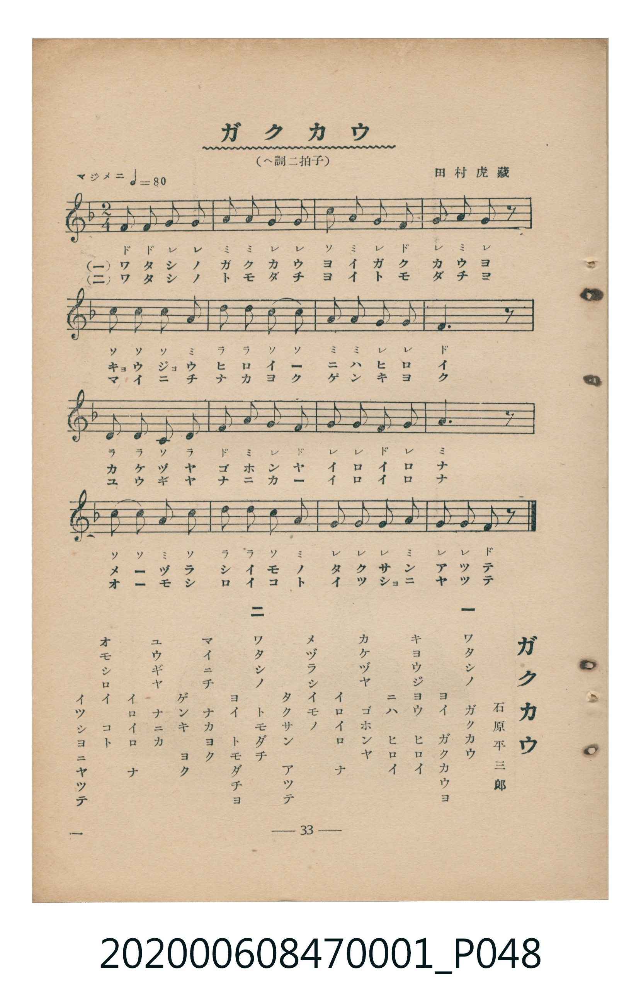

# ガクカウ（學校）

> Re:Shōka 使用 AI 協助辨識與重建樂譜，可能會有錯誤。歡迎回報。

- **鋼琴伴奏版**：<br><audio controls src="gakko.mp3"></audio>
- **NEUTRINO 歌聲合成版**：<br><audio controls src="gakko_neutrino.mp3"></audio>

- 詞：石原平三郎
- 曲：田村虎藏
- 臺灣教育會公認《新定兒童唱歌》尋常科第一學年用（2020.006.0847.0001）

## 說明

曲目說明
中文解釋：描寫孩子上學、學習與和同學一起生活的情景。


## 歌詞

```text
一
ワタシノ　ガクカウ
ヨイ　ガクカウヨ
キヨウジヨウ　ヒロイ
ニハ　ヒロイ
カケヅヤ　ゴホンヤ
イロイロ　ナ
メヅラシイモノ
タクサン　アツテ

二
ワタシノ　トモダチ
ヨイ　トモダチヨ
マイニチ　ナカヨク
ゲンキ　ヨク
ユウギヤ　ナニカ
イロイロ　ナ
オモシロイ　コト
イツシヨニヤツテ
```

## ABC

<div class="abc-score" data-abc-src="gakko.abc" aria-label="五線譜載入中"></div>

[下載 ABC 原始檔](gakko.abc)

## TMD 檔案連結

- [主旋律 TMD 檔案](gakko.tmd) [[在 TMD Studio 編輯](https://tmdlang.github.io/Tmd-TS/#tmd=s7IKdvYPcrWy4qpTUCpJTLdSSM7PyUlNLsnMz7MqzsjMK0nNjM_KTMmPL87Iz05Ugisry88pzU21Si9KTEmNN4w3MjAyiDcwMIs3sDAxBzIMDBFKi_NLi5JTrYqTM_Lzc-JLUitKkvLzsxHyBUX5Zal5iXlANQVFIBtTwIoQClLLMlNSQdKpKZkl-UWZiTlI7kgtKga7FWxJfElRYl5xclFmAcgDCFUlGalAx0JdkJOZloqQApqXnplnlZuamZWJxXH5RSUZ-UBfFmRUWmVkFoOsT07Mic9OzEMKDKjlBYnpqVYBBiYWSlxaWgqPm9Y8blr_uGn146Zl7_d0PF2749mChe_3dCpoaXEp2ipYGHDZ2yq4cdkY6ZvYgUx6sXLe-z2zns_f_LRv_tOdm5_s6HzZ3Ae249nsTSCZKRuezZ34Ymbfi-n9YOEX7bueNy5-NnXmi6ZNz-Y0P21d82JV7-OGrmfTNjxdN-tp66Tnq5c-nbLx2dqexw3dTzd0P92x4_nyic_XrHmyowHomqc7tzyfsgLoMlDc6QHjTg8Ud0CGgSHQlUpc-loKQIufz173YtWqZzP6uBQUFJ7sWPtsWvuL5YtftncDXfSsv__p-tVP1658unbCkx1dQDMfNzQCyef7J73oaH86qefphB4gF2jdi63bn0-Z_2zL7uezWp41tz6buf5xQxOXlj4X0BYuoDzX42ZgSO1_3LT9cXPf44YG5LADyq143LQETRQoyPW4aS1Ybtnjph1QBlBR86THzWuBGoD6uh8396MKgfRufNzc-rgZYuCWx82zHzdvBnKBcksgqkAkSFMX0ISFYLUrQQ4DSSwCOg-oEOhQoDO2gjSCDAGKtjxubuPierKrB8MnzR1gbUBGI5JPkETBPmmeBzYf6OBGiN0gl4JUrwdatwlkEdCvIAmIUDPQy0C0DuoNoHKg1qbVWP3QtApkFcg9YAmQg4H-7YCobQFLrADbDOYCvQGKFt9EYJ4IyEzMy3eoMaipBkW-go2Flh2YUaNgCIRGQFijYAyEEJYpmGUIZBmBWQYKNWDVPoY1CsBAAeaH_UC8HcjuA6oBxiUQg0RXA_EykEjzCiBrCVwGpAYiB5KBm2aE1bTmDiBeBMQNQNyIbBpUBiQCkYOZBvWKKRgaA1lmQAhiI3vKUEEXCFG8Akp0yyHuAiU7CBNk_CQgXgu2VBfM7wbifrg4SCdIBsk0sFfmQZ0JUg1xeBfE42APQIJhE5C3GWQzWBQksh5uEtQbZvEgZAomQc5GxAWIhsQUpldA4bsRaGgrEC8BG7wFyJoNsQ4qAnIcxFtQbwAdiOkNUGiA8DqYPpA3QJ4C2gEODrzmIMWFMTgGIHEBihWQB0AJCuYV1GS1EGgAxPkrwZYAEwTYAlBSgCQzUDIBJZetYE-BREByLUDchuqFplVgs4CyQFNAZkMd2wQKig64F4A6QVkGGO1A34GUQQWhxtVycenaKYCyjwKQVuYCAA)]
- [鋼琴伴奏 TMD 檔案](gakko_piano.tmd) [[在 TMD Studio 編輯](https://tmdlang.github.io/Tmd-TS/#tmd=s7IKdvYPcrWy4qpTUCpJTLdSyC8qychPL0osyKi0ysgsLskvykxOzInPTsxLVIIrKs4vLUpOjS9ITE-1CjAwsVDi0tJSeNy05nHT-sdNqx83LXu_p-Nx85THTYseN_c92bPl6dL-J7tnvN_TqaClxaVoq2BhwGVvq-DGZWOkb2IHMvXFynnv98x6Pn_z0775T3dufrKj82VzH9i-Z7M3gWSmbHg2d-KLmX0vpveDhV-073reuPjZ1JkvmjY9m9P8tHXNi1W9jxu6nk3b8HTdrKetk56vXvp0ysZna3seN3Q_3dD9dMeO58snPl-z5smOhqdrdzzdueX5lBVAVxoZGBnoGRiY6RlYmJgDGQaGQFcqcXH5JmbmWQVkJublB3k41BjUVHMpAIGNhZYdmFGjYAiERkBYo2AMhBCWKZhlCGQZgVkGCjVg1T6GNQqPm9cDQ2g_EG8HsvuAaoDhBcQg0dVAvAwk0rwCyFoClwGpgciBZOCmGWE1rbkDiBcBcQMQNyKbBpUBiUDkYKZBvWIKhsZAlhkQgtjInjJU0AVCFK80rX3cvBzirqYdMCbI-ElAvBZsqS6Y3w3E_XBxkE6QDJJpYK_MgzoTpBri8C6Ix8EegATDJiBvM8hmsChIZD3cJKg3zOJByBRMgpyNiAsQDYkpTK-Awncj0NBWIF4CNngLkDUbYh1UBOQ4iLeg3gA6ENMboNAA4XUwfSBvgDwFtAMcHHjNQYoLY3AMQOICFCsgD4ASFMwrqMlqIdAAiPNXgi0BJgiwBaCkAElmoGQCSi5bwZ4CiYDkWoC4DdULTavAZgFlgaaAzIY6tgkUFB1wLwB1Nm0HRzvQdyBlUEGocbXIuccHe-6JNowFWhVtGg-iCHIhDDAFcy9cEZgE8kxQeNjMQ8QXXDmYxGsfDu347EbXDeUDpaGho2unAAqgaB-QDhjbCMxW5gIA)]

## 分析

```text
================================================================================
📊 TMD Song Profile: [ ガクカウ（學校） ]
================================================================================
⏱  Duration:       0:24 (24.0s), 16 measures total
🎼 Key & Tempo:    首調基準 F, != 80.0 BPM, <2/4>
   - 分析範圍：      由實際發聲的音符與和弦推測調性；播放脈絡另行呈現
🎤 人聲音域:    C4 (MIDI 60) – D5 (MIDI 74) [跨度: 14 個半音 / 1.2 個八度, 難度: moderate]
   - 最低音:  C4 in [Main #1 @ m.9, 0:12]
   - 最高音: D5 in [Main #1 @ m.6, 0:07]
   - 適合: soprano, mezzo-soprano, contralto, tenor, baritone, bass
🏛  結構:      Main (24.0s)
⚡ 編曲密度:        Peak 1 軌道同時演奏
🗝  調性診斷：       C 大調（純淨自然大調，未偵測到可信轉調）
   - 風格氣質:    純淨自然大調（陽光明朗、易唱易記，無明顯調外色彩）
   - 轉調歷程:    全曲維持單一推測調性（未偵測到可信轉調）
   - 核心骨幹音:  G, A, C, F, D
   - 調性數值:    C 大調 [相關度: 0.73, 穩定度: Moderate, 自然音純度: 100.0%]
   - 候選調性 (K-S): C 大調 (0.73), F 大調 (0.63), G 大調 (0.60)
   - 五度圈歷程:   +0
   - 各段落調性細節:
     • [Main #1]: C 大調 (r: 0.73, 自然音純度: 100.0%)

  [ 五度圈游移軌跡 ]
              [C ]*
         F            G  
      Bb               D  
      Eb               A  
         Ab           E  
            Db       B  
               F# 
     (* = active key center)

  [ 十二半音累積音高分佈 ]
     C  : ███████████████           18.3%
     C# :                            0.0%
     D  : █████████                 11.7%
     D# :                            0.0%
     E  :                            0.0%
     F  : █████████████             16.7%
     F# :                            0.0%
     G  : ████████████████████████  30.0%
     G# :                            0.0%
     A  : ███████████████████       23.3%
     A# :                            0.0%
     B  :                            0.0%
--------------------------------------------------------------------------------
Assignment 軌道音域：
  - Piano         : C4 – D5 (14 個半音 / 1.2 個八度, 56 個音符)
================================================================================
```


## 原書掃描頁




