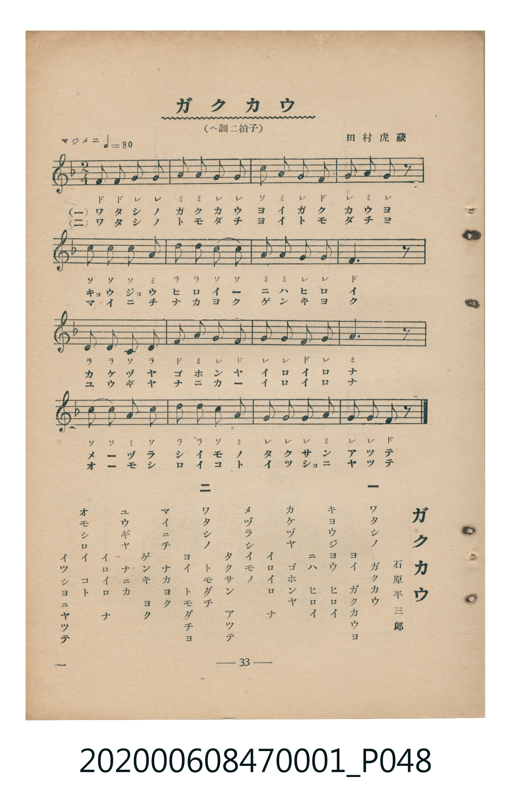

# ガクカウ

<audio controls src="gakko.mp3"></audio>

- 詞：石原平三郎
- 曲：田村虎藏
- 臺灣教育會公認《新定兒童唱歌》尋常科第一學年用（2020.006.0847.0001）

## 說明

・出處：臺灣教育會公認《新定兒童唱歌》尋常科第一學年用（2020.006.0847.0001）
・調性與拍號：調號 ?= F，拍號 <2/4>，速度 != 80

## 歌詞

```text
一
ワタシノ　ガクカウ
ヨイ　ガクカウヨ
キヨウジヨウ　ヒロイ
ニハ　ヒロイ
カケヅヤ　ゴホンヤ
イロイロ　ナ
メヅラシイモノ
タクサン　アツテ

二
ワタシノ　トモダチ
ヨイ　トモダチヨ
マイニチ　ナカヨク
ゲンキ　ヨク
ユウギヤ　ナニカ
イロイロ　ナ
オモシロイ　コト
イツシヨニヤツテ
```

## ABC

```abc
X:1
T:ガクカウ
C:曲：田村虎藏
M:2/4
L:1/16
Q:1/4=80
K:F
V:V1 name="Piano" snm="Pia"
[V:V1]
f2 f2 g2 g2 | a2 a2 g2 g2 | c2 a2 g2 f2 | g2 a2 g2 z2 |
c2 c2 c2 a2 | d2 d2 c2 c2 | a2 a2 g2 g2 | f6 z2 |
d2 d2 c2 d2 | f2 a2 g2 f2 | g2 g2 f2 g2 | a6 z2 |
c2 c2 a2 c2 | d2 d2 c2 a2 | g2 g2 g2 a2 | g2 g2 f2 z2 |
f2 f2 g2 g2 | a2 a2 g2 g2 | c2 a2 g2 f2 | g2 a2 g2 z2 |
c2 c2 c2 a2 | d2 d2 c2 c2 | a2 a2 g2 g2 | f6 z2 |
d2 d2 c2 d2 | f2 a2 g2 f2 | g2 g2 f2 g2 | a6 z2 |
c2 c2 a2 c2 | d2 d2 c2 a2 | g2 g2 g2 a2 | g2 g2 f2 z2 |
```

## TMD 檔案連結

- [主旋律 TMD 檔案](gakko.tmd)
- [鋼琴伴奏 TMD 檔案](gakko_piano.tmd)

## 分析

```text
================================================================================
📊 TMD Song Profile: [ ガクカウ ]
================================================================================
⏱  Duration:       0:48 (48.0s), 32 measures total
🎼 Key & Tempo:    首調基準 F, != 80.0 BPM, <2/4>
   - 分析範圍：      由實際發聲的音符與和弦推測調性；播放脈絡另行呈現
🎤 人聲音域:    F4 (MIDI 65) – F5 (MIDI 77) [跨度: 12 個半音 / 1.0 個八度, 難度: easy]
   - 最低音:  F4 in [Main #1 @ m.1, 0:00]
   - 最高音: F5 in [Main #1 @ m.10, 0:13]
   - 適合: soprano, mezzo-soprano, contralto, tenor, baritone, bass
🏛  結構:      Main (24.0s) -> Main (24.0s)
⚡ 編曲密度:        Peak 1 軌道同時演奏
🗝  調性診斷：       C 大調（純淨自然大調，未偵測到可信轉調）
   - 風格氣質:    純淨自然大調（陽光明朗、易唱易記，無明顯調外色彩）
   - 轉調歷程:    全曲維持單一推測調性（未偵測到可信轉調）
   - 核心骨幹音:  G, A, C, F, D
   - 調性數值:    C 大調 [相關度: 0.73, 穩定度: Moderate, 自然音純度: 100.0%]
   - 候選調性 (K-S): C 大調 (0.73), F 大調 (0.63), G 大調 (0.60)
   - 五度圈歷程:   +0 -> +0
   - 各段落調性細節:
     • [Main #1]: C 大調 (r: 0.73, 自然音純度: 100.0%)
     • [Main #2]: C 大調 (r: 0.73, 自然音純度: 100.0%)

  [ 五度圈游移軌跡 ]
              [C ]*
         F            G  
      Bb               D  
      Eb               A  
         Ab           E  
            Db       B  
               F# 
     (* = active key center)

  [ 十二半音累積音高分佈 ]
     C  : ███████████████           18.3%
     C# :                            0.0%
     D  : █████████                 11.7%
     D# :                            0.0%
     E  :                            0.0%
     F  : █████████████             16.7%
     F# :                            0.0%
     G  : ████████████████████████  30.0%
     G# :                            0.0%
     A  : ███████████████████       23.3%
     A# :                            0.0%
     B  :                            0.0%
--------------------------------------------------------------------------------
Assignment 軌道音域：
  - Piano         : F4 – F5 (12 個半音 / 1.0 個八度, 112 個音符)
================================================================================
```


## 原書掃描頁




