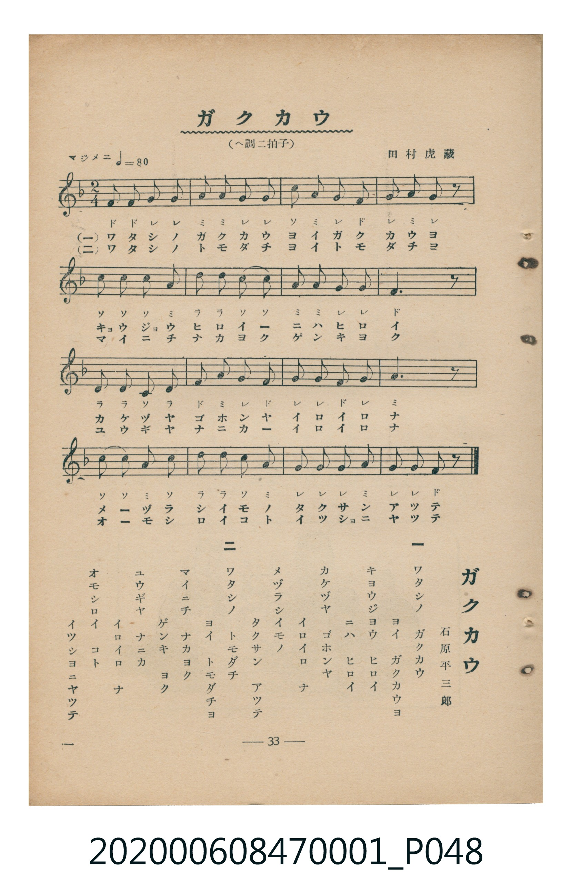

# ガクカウ（學校）

> Re:Shōka 使用 AI 協助辨識與重建樂譜，可能會有錯誤。歡迎回報。

- **鋼琴伴奏版**：<br><audio controls src="gakko.mp3"></audio>
- **NEUTRINO 歌聲合成版**：<br><audio controls src="gakko_neutrino.mp3"></audio>

- 詞：石原平三郎
- 曲：田村虎藏
- 臺灣教育會公認《新定兒童唱歌》尋常科第一學年用（2020.006.0847.0001）

## 說明

曲目說明
中文解釋：描寫孩子上學、學習與和同學一起生活的情景。


## 歌詞

```text
一
ワタシノ　ガクカウ
ヨイ　ガクカウヨ
キヨウジヨウ　ヒロイ
ニハ　ヒロイ
カケヅヤ　ゴホンヤ
イロイロ　ナ
メヅラシイモノ
タクサン　アツテ

二
ワタシノ　トモダチ
ヨイ　トモダチヨ
マイニチ　ナカヨク
ゲンキ　ヨク
ユウギヤ　ナニカ
イロイロ　ナ
オモシロイ　コト
イツシヨニヤツテ
```

## ABC

```abc
X:1
T:ガクカウ（學校）
C:曲：田村虎藏
M:2/4
L:1/16
Q:1/4=80
K:F
V:V1 name="Piano" snm="Pia"
[V:V1]
F2 F2 G2 G2 | A2 A2 G2 G2 | c2 A2 G2 F2 | G2 A2 G2 z2 |
w: 1.~ワ タ シ ノ | ガ ク カ ウ | ヨ イ ガ ク | カ ウ ヨ
w: 2.~ワ タ シ ノ | ト モ ダ チ | ヨ イ ト モ | ダ チ ヨ
c2 c2 c2 A2 | d2 d2 c2 c2 | A2 A2 G2 G2 | F6 z2 |
w: 1.~キョ ウ ジョ ウ | ヒ ロ イ _ | ニ ハ ヒ ロ | イ
w: 2.~マ イ ニ チ | ナ カ ヨ ク | ゲ ン キ ヨ | ク
D2 D2 C2 D2 | F2 A2 G2 F2 | G2 G2 F2 G2 | A6 z2 |
w: 1.~カ ケ ヅ ヤ | ゴ ホ ン ヤ | イ ロ イ ロ | ナ
w: 2.~ユ ウ ギ ヤ | ナ ニ カ _ | イ ロ イ ロ | ナ
c2 c2 A2 c2 | d2 d2 c2 A2 | G2 G2 G2 A2 | G2 G2 F2 z2 |
w: 1.~メ _ ヅ ラ | シ イ モ ノ | タ ク サ ン | ア ツ テ
w: 2.~オ _ モ シ | ロ イ コ ト | イ ツ ショ ニ | ヤ ツ テ
```

## TMD 檔案連結

- [主旋律 TMD 檔案](gakko.tmd) [[在 TMD Studio 編輯](https://tmdlang.github.io/Tmd-TS/#tmd=s7IKdvYPcrWy4qpTUCpJTLdSSM7PyUlNLsnMz7MqzsjMK0nNjM_KTMmPL87Iz05Ugisry88pzU21Si9KTEmNN4w3MjAyiDcwMIs3sDAxBzIMDBFKi_NLi5JTrYqTM_Lzc-JLUitKkvLzsxHyBUX5Zal5iXlANQVFIBtTwIoQClLLMlNSQdKpKZkl-UWZiTlI7kgtKga7FWxJfElRYl5xclFmAcgDCFUlGalAx0JdkJOZloqQApqXnplnlZuamZWJ5DgtLYXHTWseN61_3LT6cdOy93s6nq7d8WzBwvd7OhW0tLgUbRUsDLjsbRXcuGyM9E3sQMa9WDnv_Z5Zz-dvfto3_-nOzU92dL5s7gNb9Gz2JpDMlA3P5k58MbPvxfR-sPCL9l3PGxc_mzrzRdOmZ3Oan7auebGq93FD17NpG56um_W0ddLz1UufTtn4bG3P44bupxu6n-7Y8Xz5xOdr1jzZ0QB0zdOdW55PWQF0GSjw9YCBrwcKfCDDwBDoSiUufS0FoMXPZ697sWrVsxl9XAoKCk92rH02rf3F8sUv27uBLnrW3_90_eqna1c-XTvhyY4uoJmPGxqB5PP9k150tD-d1PN0Qg-QC7Tuxdbtz6fMf7Zl9_NZLc-aW5_NXP-4oYlLS58LaAsXUJ7rcTMwpPY_btr-uLnvcUMDctgB5VY8blqCJgoU5HrctBYst-xx0w4oA6ioedLj5rVADUB93Y-b-1GFQHo3Pm5ufdwMMXDL4-bZj5s3A7lAuSUQVSASpKkLaMJCsNqVIIeBJBYBnQdUCHQo0BlbQRpBhgBFWx43t3FxPdnVg-GT5g6wNiCjEcknSKJgnzTPA5sPdHAjxG6QS0Gq1wOt2wSyCOhXkAREqBnoZSBaB_UGUDlQa9NqrH5oWgWyCuQesATIwUD_dkDUtoAlVoBtBnOB3gBFi28iMFEHZCbm5TvUGNRUgyJfwcbQTMsOzKpRMFTQBWMjKK5RMAaSIIwQMUUSAamtAbNgIgYgEbBpPoY1CsBQA_KBAQcmt4PI5j6wHmCkg8Ug8qvB5DKITPMKMG8JmESoAulBqIOoQrLNCK9tzR1g3iIw2QAmGzFtQ1IFkkGoQ7YNGlSgYIBhkOdrFMyAJAjDRLEFHijAYBAtqECpfjnCf6C0j-CCnDMJ7JC1cOeCIEi8GyzeDyYRakAmwlSh2QYOqnlI3oaYAAuQLrAMOKihgQML_k1gsc1gMbA7wPIgGZAKVJugwWQWDwoVEGEKZ0GCATMNwXiIlIcrqCDpYCPYCa1gEuQRkMwWMG82wqFwGYhXEcEHDyawh3EFEyQuIOQ6ZPMgwQQJOrB7oNFBkj1oaQnkZUjKQU5LkNQFCyBYZkMNMvRstxBqDSx4VkIdB84UUGdBMgMsO0IyDSQDbYUHH0gGoq4FTLZhBlHTKrhdYJVgO0BuQAqCJkhUgLIXIojAJoLKKXAyB4ckSBuSJJJ1tVxcunYKoPJLAUgrcwEA)]
- [鋼琴伴奏 TMD 檔案](gakko_piano.tmd) [[在 TMD Studio 編輯](https://tmdlang.github.io/Tmd-TS/#tmd=s7IKdvYPcrWy4tLSUnjctOZx0_rHTasfNy17v6fjcfOUx02LHjf3Pdmz5enS_ie7Z7zf06mgpcWlaKtgYcBlb6vgxmVjpG9ix1WnoPRi5bz3e2Y9n7_5ad_8pzs3P9nR-bK5Twkk82z2JpDMlA3P5k58MbPvxfR-sPCL9l3PGxc_mzrzRdOmZ3Oan7auebGq93FD17NpG56um_W0ddLz1UufTtn4bG3P44bupxu6n-7Y8Xz5xOdr1jzZ0fB07Y6nO7c8n7IC6EojAyMDPQMDMz0DCxNzIMPAEOhKJS4u38TMPKuAzMS8_CAPhxqDmmouBSCwMTTTsgOzahQMFXTB2AiKaxSMgSQII0RMkURAamvALJiIAUgEbJqPYY3C4-b1QP7jpv1gcjuIbO4D6wEGLFgMIr8aTC6DyDSvAPOWgEmEKpAehDqIKiTbjPDa1twB5i0Ckw1gshHTNiRVIBmEOmTboEEFCgYYBnm-RsEMSIIwTBRb4IECDAbRgqpp7ePm5Qj_Ne1A5oKcMwnskLVw54IgSLwbLN4PJhFqQCbCVKHZBg6qeUjehpgAC5AusAw4qKGBAwv-TWCxzWAxsDvA8iAZkApUm6DBZBYPChUQYQpnQYIBMw3BeIiUhyuoIOlgI9gJrWAS5BGQzBYwbzbCoXAZiFcRwQcPJrCHcQUTJC4g5Dpk8yDBBAk6sHug0UGSPWhpCeRlSMpBTkuQ1AULIFhmQw0y9Gy3EGoNLHhWQh0HzhRQZ0EyAyw7QjINJANthQcfSAairgVMtmEGUdMquF1glWA7QG5ACoImSFSAshciiMAmNm2HJnNwSIK0IUkiWVeLXHz5IBdfFvDSK9owFqg22jQeRBHkQhhgygDqH7giMAnkmaDwsJkHch9cM0Q5mMRrHw7t-OxG1w3lA6VBBgBDR9dOARRA0T4gHTC2EZitzAUA)]

## 分析

```text
================================================================================
📊 TMD Song Profile: [ ガクカウ（學校） ]
================================================================================
⏱  Duration:       0:24 (24.0s), 16 measures total
🎼 Key & Tempo:    首調基準 F, != 80.0 BPM, <2/4>
   - 分析範圍：      由實際發聲的音符與和弦推測調性；播放脈絡另行呈現
🎤 人聲音域:    C4 (MIDI 60) – D5 (MIDI 74) [跨度: 14 個半音 / 1.2 個八度, 難度: moderate]
   - 最低音:  C4 in [Main #1 @ m.9, 0:12]
   - 最高音: D5 in [Main #1 @ m.6, 0:07]
   - 適合: soprano, mezzo-soprano, contralto, tenor, baritone, bass
🏛  結構:      Main (24.0s)
⚡ 編曲密度:        Peak 1 軌道同時演奏
🗝  調性診斷：       C 大調（純淨自然大調，未偵測到可信轉調）
   - 風格氣質:    純淨自然大調（陽光明朗、易唱易記，無明顯調外色彩）
   - 轉調歷程:    全曲維持單一推測調性（未偵測到可信轉調）
   - 核心骨幹音:  G, A, C, F, D
   - 調性數值:    C 大調 [相關度: 0.73, 穩定度: Moderate, 自然音純度: 100.0%]
   - 候選調性 (K-S): C 大調 (0.73), F 大調 (0.63), G 大調 (0.60)
   - 五度圈歷程:   +0
   - 各段落調性細節:
     • [Main #1]: C 大調 (r: 0.73, 自然音純度: 100.0%)

  [ 五度圈游移軌跡 ]
              [C ]*
         F            G  
      Bb               D  
      Eb               A  
         Ab           E  
            Db       B  
               F# 
     (* = active key center)

  [ 十二半音累積音高分佈 ]
     C  : ███████████████           18.3%
     C# :                            0.0%
     D  : █████████                 11.7%
     D# :                            0.0%
     E  :                            0.0%
     F  : █████████████             16.7%
     F# :                            0.0%
     G  : ████████████████████████  30.0%
     G# :                            0.0%
     A  : ███████████████████       23.3%
     A# :                            0.0%
     B  :                            0.0%
--------------------------------------------------------------------------------
Assignment 軌道音域：
  - Piano         : C4 – D5 (14 個半音 / 1.2 個八度, 56 個音符)
================================================================================
```


## 原書掃描頁




