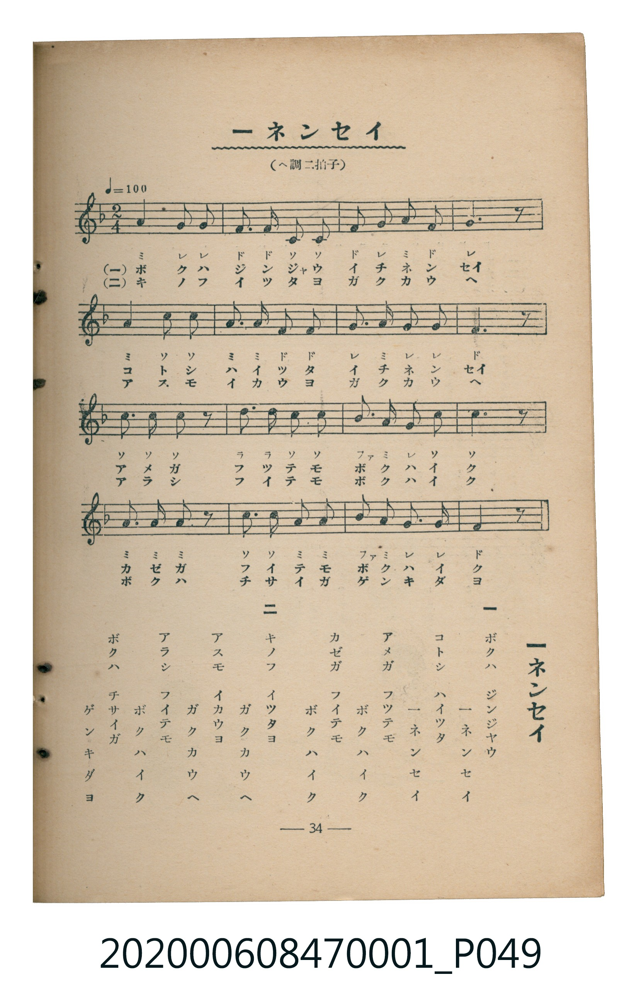

# 一ネンセイ（一年級生）

> Re:Shōka 使用 AI 協助辨識與重建樂譜，可能會有錯誤。歡迎回報。

- **鋼琴伴奏版**：<br><audio controls src="ichinensei.mp3"></audio>
- **NEUTRINO 歌聲合成版**：<br><audio controls src="ichinensei_neutrino.mp3"></audio>

- 臺灣教育會公認《新定兒童唱歌》尋常科第一學年用（2020.006.0847.0001）

## 說明

曲目說明
中文解釋：描寫剛成為一年級學生的孩子，帶著期待開始學校生活。


## 歌詞

```text
一
ボクハ　ジンジヤウ
一ネンセイ
コトシ　ハイツタ
一ネンセイ
アメガ　フツテモ
ボク　ハ　イ　ク
カゼガ　フイテモ
ボク　ハ　イ　ク

二
キノフ　イツタヨ
ガク　カ　ウ　ヘ
アスモ　イカウヨ
ガク　カ　ウ　ヘ
アラシ　フイテモ
ボク　ハ　イ　ク
ボクハ　チサイガ
ゲ　ン　キ　ダ　ヨ
```

## ABC

<div class="abc-score" data-abc-src="ichinensei.abc" aria-label="五線譜載入中"></div>

[下載 ABC 原始檔](ichinensei.abc)

## TMD 檔案連結

- [主旋律 TMD 檔案](ichinensei.tmd) [[在 TMD Studio 編輯](https://tmdlang.github.io/Tmd-TS/#tmd=s7IKdvYPcrWy4qpTUCpJTLdSSM7PyUlNLsnMz7MqzsjMK0nNjM_KTMmPL87Iz05Ugisry88pzU21Si9KTEmNN4w3MjAyiDcwMIs3sDAxBzIMDBFKi_NLi5JTrYqTM_Lzc-JLUitKkvLzsxHyBUX5Zal5iXlANQVFIBtTwIoQClLLMlNSQdKpKZkl-UWZiTlI7kgtKga7FWxJfElRYl5xclFmAcgDCFUlGalAx0JdkJOZloqQApqXnplnVZKYWZ6YF5-flpaZjGJBflFJRj7QmwUZlVYZmcUg-5MTc-KzE_OQQgNqe0FieqpVgIGJpRKXlpbCkx0Nj5t7Hzdvfty0-3HTkvd7OoAiT3dueb5l1vMp89_v6VTQ0uJStFUwNDDgsrdVcOOyMdI3sQOZ-aJ91_PGxc-mznzRtOnZnOanrWterOp93ND1bNqGp-tmPW2d9Hz10qdTNj5b2_O4ofvphu6nO3Y8Xz7x-Zo1IAvW7gDZMWUF0D5QrOgBY0UPFCtAhoEh0FYlLn0thWezNz2fve7FqlXPZvRxKSgA3br22bT2F8sXv2zvfr9n1rP-_qfrVz_tnP2sY8Lzpl1wdwMNBzr9-ayWp2tXPl074f2enqc7tr2YOP3ZnPlP97W-nNb9dHk3UM2zBQuByp5t2f24oYlLS58LaCMX0Ayux81zHjetf9zc_7ih4XHTDnDQAMklj5uWgeSRQ4vrcdPmx80dj5u2g9QCdTQtedzc8rhpPxaFix43L3zctAascCpIVXPb4-ZFMNsg2kEWLgGT64E6Vj9u2oPQATIavw6uJ7t6gNrWPm7uA2mASIGd87h5BVBiDVQb0GAQuQxsxAyw05p2Ak2G6gDZu4ygjuaVMF8T4zSUMG1ufNy0FWzTGqBRm8BCm8EK14LZDWByBThOfBOByT4gMzEv36HGoKYalAoUbAzNtOzArBoFYwVdIDQCQhCtCxQxBNOGCqbxQApMQMRAKkCqQewauHoQNACJgM3zMaxRADoVLAp0L5DdDzcXmAgg4s2bQezHzYvBipZBJZeApRrBZC9UGUQGFP_YbTMCSa-FmtoHxFORbIPoAcYfkL0fzFoBlVkDdR2IXI3siOYZGPagBJMpEMIsgIgYg4MDOUiMwTQIw4ISayA1gXwHclQHkL0d4WxogIGcD3I6iAVyPLKHGkkNoUVQI3cCtUDYKAYCwwASAqghBI1BYkMIFDIwDJZQMAMrMoOL1iiYIIUQRAQWnthCCORUYJ4HWw9yEMRUWCSDI7a5DcwCqcSW8CBeBJkFimx8wQPMjmD1oJhAswccE-Tbg5SAYBhiAcTrpnBRSPCAWJCEZEQgAUHiZQ-u4MHhbGi6R0pmBIIHQxfMHlBWBclshWVesCtApm0CqwUlTkTubADrAaUvVHtqubh07RRApZQCkFbmAgA)]
- [鋼琴伴奏 TMD 檔案](ichinensei_piano.tmd) [[在 TMD Studio 編輯](https://tmdlang.github.io/Tmd-TS/#tmd=s7IKdvYPcrWy4qpTUCpJTLdSyC8qychPL0osyKi0ysgsLskvykxOzInPTsxLVIIrKs4vLUpOjS9ITE-1CjAwsVTi0tJSeLKj4XFz7-PmzY-bdj9uWvJ-T8fj5imPmxY9bu57smfL06X9T3bPeL-nU0FLi0vRVsHQwIDL3lbBjcvGSN_EDmTyi_ZdzxsXP5s680XTpmdzmp-2rnmxqvdxQ9ezaRuerpv1tHXS89VLn07Z-Gxtz-OG7qcbup_u2PF8-cTna9YALX66dsfTnVueT1kBtNXIwMhAz8DATM_AwsQcyDAwBNqqxMXlm5iZZxWQmZiXH-ThUGNQU82lAAQ2hmZadmBWjYKxgi4QGgEhiNYFihiCaUMF03ggBSYgYiAVINUgdg1cPQgagETA5vkY1ig8bp4DFn3ctB7I7oeb-7hpB0S8eTOI_bh5MVjRMqjkErBUI5jshSqDyIBCFrttRiDptVBT-4B4KpJtED2Pm1uA7P1g1gqozBqo60DkamRHNM_AsAclmEyBEGYBRMQYHBzIQWIMpkEYFpRYA6kJ5DuQozqA7O0IZ0MDDOR8kNNBLJDjkT3USGoILYIauROoBcJGMRAYBpAQQA0haAwSG0KgkIFhsISCGViRGVy0RsEEKYQgIrDwxBZCIKc-bl4Ith7kIIipsEgGR2xzG5gFUokt4UG8CDILFNn4gudx80qwelBMoNkDjgny7UFKQDAMsQDidVO4KCR4QCxIQjIikIAg8bIHV_DgcDY03SMlMwLBg6ELZg8oq4JktsIyL9gVINM2gdWCEicidzaA9YDSF6o9tciFlA9yIWUBL6OiDWOBaqNN40EUnAsmMXgQRSDTIX4gSjma0dh1A8UUok1QdEN4RGtGtRq3ZmCY6NopgIIl2gckDGMbgdnKXAA)]

## 分析

```text
================================================================================
📊 TMD Song Profile: [ 一ネンセイ（一年級生） ]
================================================================================
⏱  Duration:       0:19 (19.2s), 16 measures total
🎼 Key & Tempo:    首調基準 F, != 100.0 BPM, <2/4>
   - 分析範圍：      由實際發聲的音符與和弦推測調性；播放脈絡另行呈現
🎤 人聲音域:    C4 (MIDI 60) – D5 (MIDI 74) [跨度: 14 個半音 / 1.2 個八度, 難度: moderate]
   - 最低音:  C4 in [Main #1 @ m.2, 0:01]
   - 最高音: D5 in [Main #1 @ m.10, 0:10]
   - 適合: soprano, mezzo-soprano, contralto, tenor, baritone, bass
🏛  結構:      Main (19.2s)
⚡ 編曲密度:        Peak 1 軌道同時演奏
🗝  調性診斷：       F 調性不明確（純淨自然大調，未偵測到可信轉調）
   - 風格氣質:    純淨自然大調（陽光明朗、易唱易記，無明顯調外色彩）
   - 轉調歷程:    全曲維持單一推測調性（未偵測到可信轉調）
   - 核心骨幹音:  C, G, A, F, A#
   - 調性數值:    F 調性不明確 [相關度: 0.80, 穩定度: Ambiguous, 自然音純度: 100.0%]
   - 候選調性 (K-S): F 大調 (0.80), C 大調 (0.79), A 小調 (0.65)
   - 五度圈歷程:   -1
   - 各段落調性細節:
     • [Main #1]: F 調性不明確 (r: 0.80, 自然音純度: 100.0%)

  [ 五度圈游移軌跡 ]
               C  
        [F ]*          G  
      Bb               D  
      Eb               A  
         Ab           E  
            Db       B  
               F# 
     (* = active key center)

  [ 十二半音累積音高分佈 ]
     C  : ████████████████████████  26.7%
     C# :                            0.0%
     D  : ███                        3.4%
     D# :                            0.0%
     E  :                            0.0%
     F  : ███████████████████       20.7%
     F# :                            0.0%
     G  : ████████████████████      22.4%
     G# :                            0.0%
     A  : ████████████████████      22.4%
     A# : ████                       4.3%
     B  :                            0.0%
--------------------------------------------------------------------------------
Assignment 軌道音域：
  - Piano         : C4 – D5 (14 個半音 / 1.2 個八度, 48 個音符)
================================================================================
```


## 原書掃描頁




