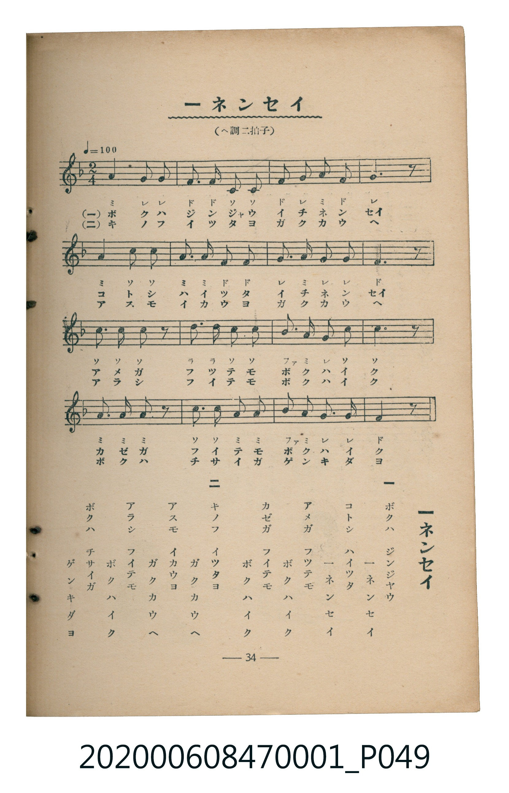

# 一ネンセイ

<audio controls src="ichinensei.mp3"></audio>

- 臺灣教育會公認《新定兒童唱歌》尋常科第一學年用（2020.006.0847.0001）

- note

・出處：臺灣教育會公認《新定兒童唱歌》尋常科第一學年用（2020.006.0847.0001）
・調性與拍號：調號 ?= F，拍號 <2/4>，速度 != 100

## 歌詞

```text
一
ボクハ　ジンジヤウ
一ネンセイ
コトシ　ハイツタ
一ネンセイ
アメガ　フツテモ
ボク　ハ　イ　ク
カゼガ　フイテモ
ボク　ハ　イ　ク

二
キノフ　イツタヨ
ガク　カ　ウ　ヘ
アスモ　イカウヨ
ガク　カ　ウ　ヘ
アラシ　フイテモ
ボク　ハ　イ　ク
ボクハ　チサイガ
ゲ　ン　キ　ダ　ヨ
```

## 原書掃描頁



## 調性分析

```text
================================================================================
📊 TMD Song Profile: [ 一ネンセイ ]
================================================================================
⏱  Duration:       0:38 (38.4s), 32 measures total
🎼 Key & Tempo:    首調基準 F, != 100.0 BPM, <2/4>
   - 分析範圍：      由實際發聲的音符與和弦推測調性；播放脈絡另行呈現
🎤 人聲音域:    C4 (MIDI 60) – D5 (MIDI 74) [跨度: 14 個半音 / 1.2 個八度, 難度: moderate]
   - 最低音:  C4 in [Main #1 @ m.2, 0:01]
   - 最高音: D5 in [Main #1 @ m.10, 0:10]
   - 適合: soprano, mezzo-soprano, contralto, tenor, baritone, bass
🏛  結構:      Main (19.2s) -> Main (19.2s)
⚡ 編曲密度:        Peak 1 軌道同時演奏
🗝  調性診斷：       F 調性不明確（純淨自然大調，未偵測到可信轉調）
   - 風格氣質:    純淨自然大調（陽光明朗、易唱易記，無明顯調外色彩）
   - 轉調歷程:    全曲維持單一推測調性（未偵測到可信轉調）
   - 核心骨幹音:  C, A, G, F, D
   - 調性數值:    F 調性不明確 [相關度: 0.80, 穩定度: Ambiguous, 自然音純度: 100.0%]
   - 候選調性 (K-S): F 大調 (0.80), C 大調 (0.78), A 小調 (0.68)
   - 五度圈歷程:   -1 -> -1
   - 各段落調性細節:
     • [Main #1]: F 調性不明確 (r: 0.80, 自然音純度: 100.0%)
     • [Main #2]: F 調性不明確 (r: 0.80, 自然音純度: 100.0%)

  [ 五度圈游移軌跡 ]
               C  
        [F ]*          G  
      Bb               D  
      Eb               A  
         Ab           E  
            Db       B  
               F# 
     (* = active key center)

  [ 十二半音累積音高分佈 ]
     C  : ████████████████████████  26.7%
     C# :                            0.0%
     D  : ███                        3.4%
     D# :                            0.0%
     E  :                            0.0%
     F  : ███████████████████       20.7%
     F# :                            0.0%
     G  : ███████████████████       21.6%
     G# :                            0.0%
     A  : ██████████████████████    24.1%
     A# : ███                        3.4%
     B  :                            0.0%
--------------------------------------------------------------------------------
Assignment 軌道音域：
  - Piano         : C4 – D5 (14 個半音 / 1.2 個八度, 96 個音符)
================================================================================
```

## ABC

```abc
X:1
T:一ネンセイ
C:TMD (Chen, Chih-Han / aguai)
M:2/4
L:1/16
Q:1/4=100
K:F

V:V1 name="Piano" snm="Pia"

[V:V1]
a3 g g4 | f2 f2 c2 c2 | f2 g2 a2 f2 | g6 z2 |
a3 c c4 | a2 a2 f2 f2 | g2 a2 g2 g2 | f6 z2 |
c2 c2 c2 z2 | d2 d2 c2 c2 | b2 a2 g2 c2 | c6 z2 |
a2 a2 a2 z2 | c3 c a2 a2 | b2 a2 g2 g2 | f6 z2 |
a3 g g4 | f2 f2 c2 c2 | f2 g2 a2 f2 | g6 z2 |
a3 c c4 | a2 a2 f2 f2 | g2 a2 g2 g2 | f6 z2 |
c2 c2 c2 z2 | d2 d2 c2 c2 | b2 a2 g2 c2 | c6 z2 |
a2 a2 a2 z2 | c3 c a2 a2 | b2 a2 g2 g2 | f6 z2 |
```

- [主旋律 TMD 檔案](ichinensei.tmd)
- [鋼琴伴奏 TMD 檔案](ichinensei_piano.tmd)
