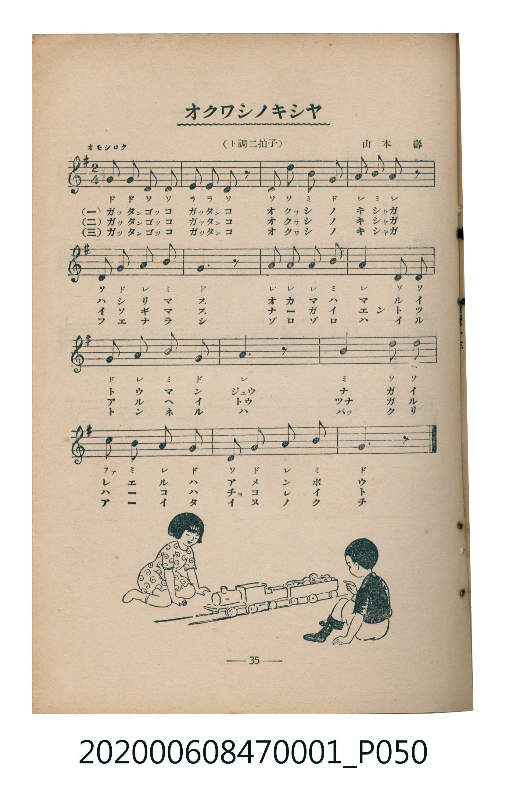

# オクワシノキシヤ（點心火車）

> Re:Shōka 使用 AI 協助辨識與重建樂譜，可能會有錯誤。歡迎[回報](https://github.com/TMDLang/reshoka/issues)。

- **鋼琴伴奏版**：<br><audio controls src="okashi_no_kisha.mp3"></audio>
- **NEUTRINO 歌聲合成版**：<br><audio controls src="okashi_no_kisha_neutrino.mp3"></audio>

- 曲：山本壽
- 臺灣教育會公認《新定兒童唱歌》尋常科第一學年用（2020.006.0847.0001）

## 說明

曲目說明
中文解釋：把火車想像成載滿糖果點心的列車，充滿童趣。


## 歌詞

```text
一
ガッタンゴッコ　ガッタンコ
オクワシシノ　キシャガ
走リマス　オカシノマエヲ
通リマス　ジュウ　ナッて
レエルのハ　アチョメレボウト

二
ガッタンゴッコ　ガッタンコ
オクワシシノ　キシャガ
イソギマス　ナガイトンネル
入リマス　トウ　ナッて
ヘーコラハ　イヨコレボイケ

三
ガッタンゴッコ　ガッタンコ
オクワシシノ　キシャガ
フェエマシ　ゾロゾロハラヲ
ヘルンル　ハ　ッパッて
クーリイタ　イノノクチ
```

## ABC

<div class="abc-score" data-abc-src="okashi_no_kisha.abc" aria-label="五線譜載入中"></div>

[下載 ABC 原始檔](okashi_no_kisha.abc)

## TMD 檔案連結

- [主旋律 TMD 檔案](okashi_no_kisha.tmd) [[在 TMD Studio 編輯](https://tmdlang.github.io/Tmd-TS/#tmd=s7IKdvYPcrWy4qpTUCpJTLdSSM7PyUlNLsnMz7MqzsjMK0nNjM_KTMmPL87Iz05Ugisry88pzU21Si9KTEmNN4w3MjAyiDcwMIs3sDAxBzIMDBFKi_NLi5JTrYqTM_Lzc-JLUitKkvLzsxHyBUX5Zal5iXlANQVFIBtTwIoQClLLMlNSQdKpKZkl-UWZiTlI7kgtKga7FWxJfElRYl5xclFmAcgDCFUlGalAx4IlC_KLkIwGmpaemWdVkpgJ9B_Ij-WJ8bmJmXk5iXkpyKpKMvKBXi3IqLTKyCwGuSE5MSc-OzEPKUSgLihITE-1CjAwNVDi0tJSeNy06nHT-sfN6x83bX_c3Pe4aS2YseT9no6Xu-c93d_8vHH1i91d7_d0KmhpcSnaKhgaGHDZ2yq4c9kY6ZvYgQx_NnvT-z2znm7c-GzOmqeL94ItfNG-63nj4mdTZ75o2vRsTvPT1jUvVvU-buh6Nm3D03WznrZOer566dMpG5-t7Xnc0P10Q_fTHTueL5_4fM2aJzsanq7d8XTnludTVgDdAIo2PWC06YGiDcgwMAS6RIlLX0sBaOvz2eterFr1bEYfl4KCwpMda59Na3-xfPHL9m6gc551dUFc_qx589Pm_mcdE17s6Xy2e__zzdOezZsD9dqslqcd08G-63na2gqSXb30xbbFjxuauLT0uYC2cAGdw_W4ac3j5ubHTfsfN29-3LQFzN78uKEBVXwzUB1SUEJCE6QIEqCLgaq5Xmzd8Lh51ePmeY-bdoLlgBpWQ5WCBFc8bt7E9bJhFqqiHY-blz5uWgZiN3eBbGxcxvW4eQ1Y-erHjeseN_eD1S163Nz4uHn54-aFINnmOSA9zR1cXE929VDRD4-bljxu2vu4CWgtzIVAVwGNAYo3d4CMae4FuovraetSFG8A5TD8MONx8x6QO5pXwvwANGMFWATiAaBVG4Ee2NFJTQ80T33ctBwcekC3bQdL73vcDFQBJoEOATlnE8R5q8EeWg12N9iFQLuaJ8I8ALJoD8iXIIfuh3kAGJfAfASUagSnIl9gbrUKyEzMy3eoMaipBqVVBRtDMy07MKtGwVBBF4xN42FEjYIZiAITYAEDsCCYCRRRMIbqqFEwApIgHogGKwKb6WNYA8zXoHABCkGCBswAhRqYAeJiVwIiIbYBAxJsHSQ0gdR2EKe5Dyq5FiwFClMwYw2qA4wG2gHGA-gAaLyCowsUTbBIgkQ1DELsAMnBMEQNiAWOZkRyQERqcz_EUrBDQK4DpmGoc3ZimA1xP7CEgauDOx7Mg_htBVh8E8IecNwtAcvtBZPrCNnT3AUPAajO5g6oDCg0wfY094JJkFuQoqh5KpIbwC4E-w1kz34s_tkHVgcJeAQbFi4Q_0Dsh9iDlMNgAYzIN6iGg-QguQuCaxRMoDpAasG6kKIB5D1gcQa2inA0QAtweFCAg6t5JdTpE-DikAAEBQZSVECjHOItgnaBS1mCFoGqCbCp4GyAFB1gf0EyAnKEIQUwsl3AYhKUeSBmToTbCJaCi28Ak-B0R0rOQApsSPqFBMMiMHsh1BZE6poDlgX5HDnoEAEK8xos88J1QlP6RtSAaFoPCScw2Q1XB5LZCrcTEkwgNTVctVxcunYKoKJeAUgrcwEA)]
- [鋼琴伴奏 TMD 檔案](okashi_no_kisha_piano.tmd) [[在 TMD Studio 編輯](https://tmdlang.github.io/Tmd-TS/#tmd=s7IKdvYPcrWy4qpTUCpJTLdSyC8qychPL0osyKi0ysgsLskvykxOzInPTsxLVIIrKs4vLUpOjS9ITE-1CjAwNVDi0tJSeNy06nHT-sfN6x83bX_c3Pe4aS2YseT9no7HzVMeNy0CCj7Zs-Xp0v4nu2e839OpoKXFpWirYGhgwGVvq-DOZWOkb2IHsuLZ7E3v98x6unHjszlrni7eC7b2Rfuu542Ln02d-aJp07M5zU9b17xY1fu4oevZtA1P18162jrp-eqlT6dsfLa253FD99MN3U937Hi-fOLzNWue7Gh4unbH051bnk9ZAXSJkYGRgZ6BgZmegYWJOZBhYAh0iRIXl29iZp5VQGZiXn6Qh0ONQU01lwIQ2BiaadmBWTUKhgq6YGwaDyNqFMxAFJgACxiABcFMoIiCMVRHjYIRkATxQDRYEdhMH8MaYKCtedzcDBR63LT_cfNmMGMLTATExa4EREJsA4Y62LrHTauBeDuI1dwHlVkLFgfGwWIwYw2q7UYDarvxQNkOjU5wLIFiBxY3kBiGQYgFIDkYhqgBscCxi0gFiLhs7odYCnYIyGmPm-dBnbMTw2yI40FOh6mDOx7Mg3hsBVh8E8IecKwtAcvtBZPrCNnT3AUPAajO5g6oDCgowfY094JJkFuQ4qd5KpIbwC4E-w1kz34s_tkHVgcJeAQbFi4Q_0Dsh9iDlLFgAYzILqiGg-QgmQqCaxRMoDpAasG6kKIB5L3HTcvAVhGOhh2Pm5dCVEOCAhxczSuhTp8AF4cEICgwkKICGuUQbxG0q7mDGIsaHzcvB5sKzgNI0QH2FyQXIEcYUgAj27USknMgZk6E2wiWgolDHQ5Od6TkDKTAhqRfSDAsArMXQm1BpK45YFmQz5GDDhGgMK_BMi9cJzSlb0QNiKb1kHACk91wdSCZrXA7IcEEUlPDVYtcwPsgF_AW8PI92jAWqBZCAnkmMJ4BppxpPJgLooCyMP1IomBVYNWg8MIih8rH7gKIJCQ2sToOTTdu-0H-17VTAAVBtA9IGMY2QmIbg9nKXAA)]

## 分析

```text
================================================================================
📊 TMD Song Profile: [ オクワシノキシヤ（點心火車） ]
================================================================================
⏱  Duration:       0:16 (16.8s), 14 measures total
🎼 Key & Tempo:    首調基準 G, != 100.0 BPM, <2/4>
   - 分析範圍：      由實際發聲的音符與和弦推測調性；播放脈絡另行呈現
🎤 人聲音域:    D4 (MIDI 62) – D5 (MIDI 74) [跨度: 12 個半音 / 1.0 個八度, 難度: easy]
   - 最低音:  D4 in [Main #1 @ m.1, 0:00]
   - 最高音: D5 in [Main #1 @ m.3, 0:02]
   - 適合: soprano, mezzo-soprano, contralto, tenor, baritone, bass
🏛  結構:      Main (16.8s)
⚡ 編曲密度:        Peak 1 軌道同時演奏
🗝  調性診斷：       G 大調（純淨自然大調，未偵測到可信轉調）
   - 風格氣質:    純淨自然大調（陽光明朗、易唱易記，無明顯調外色彩）
   - 轉調歷程:    全曲維持單一推測調性（未偵測到可信轉調）
   - 核心骨幹音:  G, A, D, B, E
   - 調性數值:    G 大調 [相關度: 0.79, 穩定度: Moderate, 自然音純度: 100.0%]
   - 候選調性 (K-S): G 大調 (0.79), D 大調 (0.75), B 小調 (0.50)
   - 五度圈歷程:   +1
   - 各段落調性細節:
     • [Main #1]: G 大調 (r: 0.79, 自然音純度: 100.0%)

  [ 五度圈游移軌跡 ]
               C  
         F           [G ]*
      Bb               D  
      Eb               A  
         Ab           E  
            Db       B  
               F# 
     (* = active key center)

  [ 十二半音累積音高分佈 ]
     C  : ██                         2.0%
     C# :                            0.0%
     D  : ███████████████████       21.6%
     D# :                            0.0%
     E  : ███                        3.9%
     F  :                            0.0%
     F# :                            0.0%
     G  : ████████████████████████  27.5%
     G# :                            0.0%
     A  : ████████████████████████  27.5%
     A# :                            0.0%
     B  : ███████████████           17.6%
--------------------------------------------------------------------------------
Assignment 軌道音域：
  - Piano         : D4 – D5 (12 個半音 / 1.0 個八度, 43 個音符)
================================================================================
```


## 原書掃描頁




