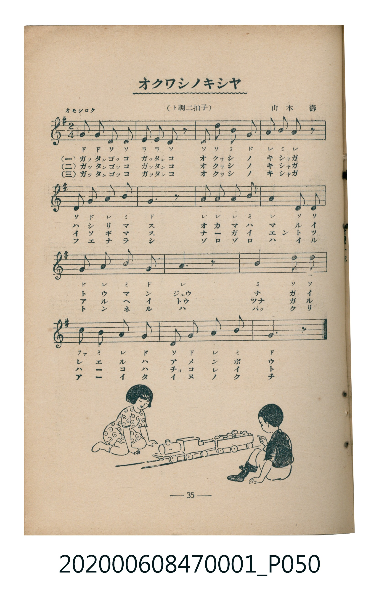

# オクワシノキシヤ

> Re:Shoka 使用 AI 辨識樂譜，可能會有錯誤。歡迎回報。

<audio controls src="okashi_no_kisha.mp3"></audio>

- 曲：山本壽
- 臺灣教育會公認《新定兒童唱歌》尋常科第一學年用（2020.006.0847.0001）

## 說明

・出處：臺灣教育會公認《新定兒童唱歌》尋常科第一學年用（2020.006.0847.0001）
・調性與拍號：調號 ?= G，拍號 <2/4>，速度 != 100

## 歌詞

```text
一
ガッタンゴッコ　ガッタンコ
オクワシシノ　キシャガ
走リマス　オカシノマエヲ
通リマス　ジュウ　ナッて
レエルのハ　アチョメレボウト

二
ガッタンゴッコ　ガッタンコ
オクワシシノ　キシャガ
イソギマス　ナガイトンネル
入リマス　トウ　ナッて
ヘーコラハ　イヨコレボイケ

三
ガッタンゴッコ　ガッタンコ
オクワシシノ　キシャガ
フェエマシ　ゾロゾロハラヲ
ヘルンル　ハ　ッパッて
クーリイタ　イノノクチ
```

## ABC

```abc
X:1
T:オクワシノキシヤ
C:曲：山本壽
M:2/4
L:1/16
Q:1/4=100
K:G
V:V1 name="Piano" snm="Pia"
[V:V1]
g2 g2 d2 d2 | e2 e2 d2 z2 | d3 d B2 G2 | A2 B2 A2 z2 |
D2 G2 A2 B2 | G6 z2 | A2 A2 A2 B2 | A4 D2 D2 |
G2 A2 B2 G2 | A4 z2 z2 | B4 d2 d2 | c2 B2 A2 G2 |
D2 G2 A2 B2 | G6 z2 | g2 g2 d2 d2 | e2 e2 d2 z2 |
d3 d B2 G2 | A2 B2 A2 z2 | D2 G2 A2 B2 | G6 z2 |
A2 A2 A2 B2 | A4 D2 D2 | G2 A2 B2 G2 | A4 z2 z2 |
B4 d2 d2 | c2 B2 A2 G2 | D2 G2 A2 B2 | G6 z2 |
g2 g2 d2 d2 | e2 e2 d2 z2 | d3 d B2 G2 | A2 B2 A2 z2 |
D2 G2 A2 B2 | G6 z2 | A2 A2 A2 B2 | A4 D2 D2 |
G2 A2 B2 G2 | A4 z2 z2 | B4 d2 d2 | c2 B2 A2 G2 |
D2 G2 A2 B2 | G6 z2 |
```

## TMD 檔案連結

- [主旋律 TMD 檔案](okashi_no_kisha.tmd) [[在 TMD Studio 編輯](https://tmdlang.github.io/Tmd-TS/#tmd=s7IKdvYPcrWy4qpTUCpJTLdSSM7PyUlNLsnMz7MqzsjMK0nNjM_KTMmPL87Iz05Ugisry88pzU21Si9KTEmNN4w3MjAyiDcwMIs3sDAxBzIMDBFKi_NLi5JTrYqTM_Lzc-JLUitKkvLzsxHyBUX5Zal5iXlANQVFIBtTwIoQClLLMlNSQdKpKZkl-UWZiTlI7kgtKga7FWxJfElRYl5xclFmAcgDCFUlGalAx4IlC_KLgEZraSk8blr1uGn94-b1j5u2P27ue9y0FsxYoqClxaVoq2BoYMBlb6vgzmVjpG9iBzLp2exN7_fMerpx47M5a54u3gs2_UX7rueNi59NnfmiadOzOc1PW9e8WNX7uKHr2bQNT9fNeto66fnqpU-nbHy2tudxQ_fTDd1Pd-x4vnzi8zVrnuxoeLp2x9OdW55PWfF-Twco_PSA4acHCj8gw8Dw_Z5OJS4ufS0uoEqux01rHjc3P27a_7h58-OmLWD25scNDajim4HqkPwE8RZIEcRni4GquV5s3fC4edXj5nmPm3aC5YAaVkOVggRXPG7exPWyYRaqoh2Pm5c-bloGYjd3gWxsXMb1uHkNWPnqx43rHjf3g9Utetzc-Lh5-ePmhSDZ5jkgPc0dXFxPdvVQ0Q-Pm5Y8btr7uAloLcyFQFcBjQGKN3eAjGnuBbqL62nrUhRvAOUw_DDjcfMekDuaV8L8ADRjBVgE4gGgVRuBHtjRSU0PNE993LQcHHpAt20HS-973AxUASaBDgE5ZxPEeavBHloNdjfYhUC7mifCPACyaA_IlyCH7od5ABiXwAQNlGrk0tLn4vJNzMyzCshMzMt3qDGoUajmUgACG0MzLTswq0bBME5BF0KYQnGNghmQBGEQzwAsAmKB-MYgxWARIyAJ4oFosBqoeabxUCUwBUArwJohEGIcSA6GIWpALLAVIO1gAmYgslkIq2FmQcwDyUEcCPOCCZLzwLpIcB5XLReXrp0CKOgUsNDKXFwA)]
- [鋼琴伴奏 TMD 檔案](okashi_no_kisha_piano.tmd) [[在 TMD Studio 編輯](https://tmdlang.github.io/Tmd-TS/#tmd=s7IKdvYPcrWy4tLSUnjctOpx0_rHzesfN21_3Nz3uGktmLHk_Z6Ox81THjctAgo-2bPl6dL-J7tnvN_TqaClxaVoq2BoYMBlb6vgzmVjpG9ix1WnoPRs9qb3e2Y93bjx2Zw1TxfvVQKJvWjf9bxx8bOpM180bXo2p_lp65oXq3ofN3Q9m7bh6bpZT1snPV-99OmUjc_W9jxu6H66ofvpjh3Pl098vmbNkx0NT9fueLpzy_MpK4AuMTIwMtAzMDDTM7AwMQcyDAyBLlHi4vJNzMyzCshMzMsP8nCoMahRqOZSAAIbQzMtOzCrRsEwTkEXQphCcY2CGZAEYRDPACwCYoH4xiDFYBEjIAnigWiwGqh5pvFQJTAFQCvAmiEQYhxIDoYhakAssBUg7WACZiCyWQirYWZBzAPJQRwI84IJkvPAukhwHlctcsj5oIScBTzgog1jgYohJJBnAuMZYMqZxoO5IAooC9OPJApWBVYNcgIWOVQ-dhdAJCEBgtVxaLpx2w8KAF07BVAYKGChlbm4AA)]

## 分析

```text
================================================================================
📊 TMD Song Profile: [ オクワシノキシヤ ]
================================================================================
⏱  Duration:       0:50 (50.4s), 42 measures total
🎼 Key & Tempo:    首調基準 G, != 100.0 BPM, <2/4>
   - 分析範圍：      由實際發聲的音符與和弦推測調性；播放脈絡另行呈現
🎤 人聲音域:    D4 (MIDI 62) – G5 (MIDI 79) [跨度: 17 個半音 / 1.4 個八度, 難度: challenging]
   - 最低音:  D4 in [Main #1 @ m.5, 0:04]
   - 最高音: G5 in [Main #1 @ m.1, 0:00]
   - 適合: soprano, mezzo-soprano, tenor, baritone
🏛  結構:      Main (16.8s) -> Main (16.8s) -> Main (16.8s)
⚡ 編曲密度:        Peak 1 軌道同時演奏
🗝  調性診斷：       G 大調（純淨自然大調，未偵測到可信轉調）
   - 風格氣質:    純淨自然大調（陽光明朗、易唱易記，無明顯調外色彩）
   - 轉調歷程:    全曲維持單一推測調性（未偵測到可信轉調）
   - 核心骨幹音:  G, A, D, B, E
   - 調性數值:    G 大調 [相關度: 0.81, 穩定度: Moderate, 自然音純度: 100.0%]
   - 候選調性 (K-S): G 大調 (0.81), D 大調 (0.75), B 小調 (0.52)
   - 五度圈歷程:   +1 -> +1 -> +1
   - 各段落調性細節:
     • [Main #1]: G 大調 (r: 0.81, 自然音純度: 100.0%)
     • [Main #2]: G 大調 (r: 0.81, 自然音純度: 100.0%)
     • [Main #3]: G 大調 (r: 0.81, 自然音純度: 100.0%)

  [ 五度圈游移軌跡 ]
               C  
         F           [G ]*
      Bb               D  
      Eb               A  
         Ab           E  
            Db       B  
               F# 
     (* = active key center)

  [ 十二半音累積音高分佈 ]
     C  : ██                         2.0%
     C# :                            0.0%
     D  : ███████████████████       22.0%
     D# :                            0.0%
     E  : ███                        4.0%
     F  :                            0.0%
     F# :                            0.0%
     G  : ████████████████████████  28.0%
     G# :                            0.0%
     A  : ██████████████████████    26.0%
     A# :                            0.0%
     B  : ███████████████           18.0%
--------------------------------------------------------------------------------
Assignment 軌道音域：
  - Piano         : D4 – G5 (17 個半音 / 1.4 個八度, 129 個音符)
================================================================================
```


## 原書掃描頁




