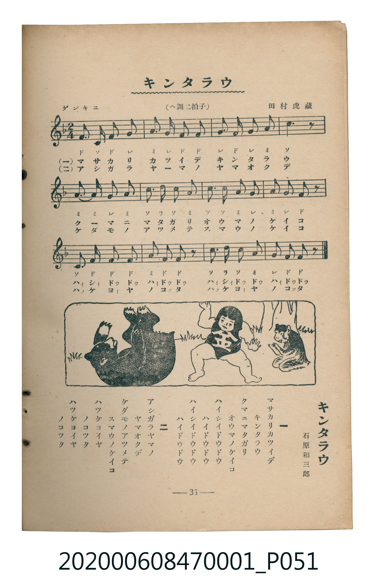

# キンタラウ

<audio controls src="kintaro.mp3"></audio>

- 詞：石原和三郎
- 曲：田村虎藏
- 臺灣教育會公認《新定兒童唱歌》尋常科第一學年用（2020.006.0847.0001）

## 說明

・出處：臺灣教育會公認《新定兒童唱歌》尋常科第一學年用（2020.006.0847.0001）
・調性與拍號：調號 ?= F，拍號 <2/4>，速度 != 108

## 歌詞

```text
一
マサカリカツイデ
キンタラウ
クマニマタガリ
オウマノケイコ
ハイシイドウドウ
ハイドウドウ
ハイシイドウドウ
ハイドウドウ

二
アシガラヤマノ
ヤマオクデ
ケダモノアツメテ
スマウノケイコ
ハツケヨイヤ
ノコツタ
ハツケヨイヤ
ノコツタ
```

## ABC

```abc
X:1
T:キンタラウ
C:曲：田村虎藏
M:2/4
L:1/16
Q:1/4=108
K:F
V:V1 name="Piano" snm="Pia"
[V:V1]
F2 C2 F2 G2 | A2 G2 F2 F2 | G2 F2 G2 A2 | c6 z2 |
A2 A2 G2 A2 | c2 d2 c2 A2 | c2 c2 A2 G2 | A2 G2 F2 z2 |
C2 F2 F2 F2 | A2 F2 F2 z2 | c2 d2 c2 A2 | G2 F2 F2 z2 |
F2 C2 F2 G2 | A2 G2 F2 F2 | G2 F2 G2 A2 | c6 z2 |
A2 A2 G2 A2 | c2 d2 c2 A2 | c2 c2 A2 G2 | A2 G2 F2 z2 |
C2 F2 F2 F2 | A2 F2 F2 z2 | c2 d2 c2 A2 | G2 F2 F2 z2 |
```

## TMD 檔案連結

- [主旋律 TMD 檔案](kintaro.tmd)
- [鋼琴伴奏 TMD 檔案](kintaro_piano.tmd)

## 分析

```text
================================================================================
📊 TMD Song Profile: [ キンタラウ ]
================================================================================
⏱  Duration:       0:26 (26.7s), 24 measures total
🎼 Key & Tempo:    首調基準 F, != 108.0 BPM, <2/4>
   - 分析範圍：      由實際發聲的音符與和弦推測調性；播放脈絡另行呈現
🎤 人聲音域:    C4 (MIDI 60) – D5 (MIDI 74) [跨度: 14 個半音 / 1.2 個八度, 難度: moderate]
   - 最低音:  C4 in [Main #1 @ m.1, 0:00]
   - 最高音: D5 in [Main #1 @ m.6, 0:05]
   - 適合: soprano, mezzo-soprano, contralto, tenor, baritone, bass
🏛  結構:      Main (13.3s) -> Main (13.3s)
⚡ 編曲密度:        Peak 1 軌道同時演奏
🗝  調性診斷：       F 大調（純淨自然大調，未偵測到可信轉調）
   - 風格氣質:    純淨自然大調（陽光明朗、易唱易記，無明顯調外色彩）
   - 轉調歷程:    全曲維持單一推測調性（未偵測到可信轉調）
   - 核心骨幹音:  F, C, A, G, D
   - 調性數值:    F 大調 [相關度: 0.87, 穩定度: High, 自然音純度: 100.0%]
   - 候選調性 (K-S): F 大調 (0.87), C 大調 (0.73), A 小調 (0.65)
   - 五度圈歷程:   -1 -> -1
   - 各段落調性細節:
     • [Main #1]: F 大調 (r: 0.87, 自然音純度: 100.0%)
     • [Main #2]: F 大調 (r: 0.87, 自然音純度: 100.0%)

  [ 五度圈游移軌跡 ]
               C  
        [F ]*          G  
      Bb               D  
      Eb               A  
         Ab           E  
            Db       B  
               F# 
     (* = active key center)

  [ 十二半音累積音高分佈 ]
     C  : ████████████████████      25.0%
     C# :                            0.0%
     D  : ████                       4.5%
     D# :                            0.0%
     E  :                            0.0%
     F  : ████████████████████████  29.5%
     F# :                            0.0%
     G  : ███████████████           18.2%
     G# :                            0.0%
     A  : ██████████████████        22.7%
     A# :                            0.0%
     B  :                            0.0%
--------------------------------------------------------------------------------
Assignment 軌道音域：
  - Piano         : C4 – D5 (14 個半音 / 1.2 個八度, 84 個音符)
================================================================================
```


## 原書掃描頁




