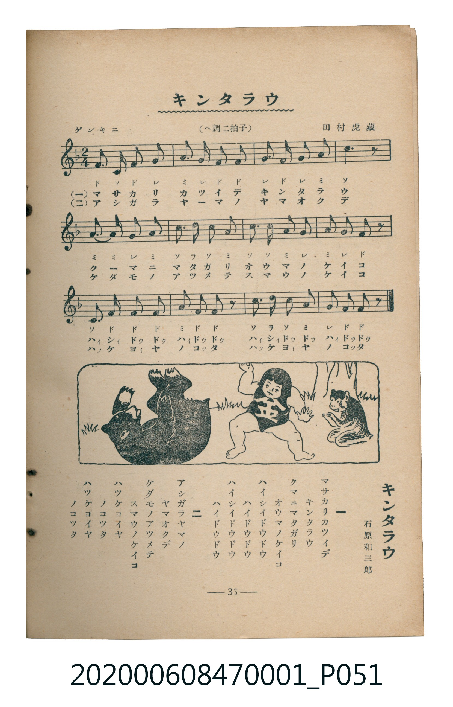

# キンタラウ（金太郎）

> Re:Shōka 使用 AI 協助辨識與重建樂譜，可能會有錯誤。歡迎回報。

- **鋼琴伴奏版**：<br><audio controls src="kintaro.mp3"></audio>
- **NEUTRINO 歌聲合成版**：<br><audio controls src="kintaro_neutrino.mp3"></audio>

- 詞：石原和三郎
- 曲：田村虎藏
- 臺灣教育會公認《新定兒童唱歌》尋常科第一學年用（2020.006.0847.0001）

## 說明

曲目說明
中文解釋：日本民間傳說中的大力少年，描寫他在山中和動物玩耍、鍛鍊成長。


## 歌詞

```text
一
マサカリカツイデ
キンタラウ
クマニマタガリ
オウマノケイコ
ハイシイドウドウ
ハイドウドウ
ハイシイドウドウ
ハイドウドウ

二
アシガラヤマノ
ヤマオクデ
ケダモノアツメテ
スマウノケイコ
ハツケヨイヤ
ノコツタ
ハツケヨイヤ
ノコツタ
```

## ABC

<div class="abc-score" data-abc-src="kintaro.abc" aria-label="五線譜載入中"></div>

[下載 ABC 原始檔](kintaro.abc)

## TMD 檔案連結

- [主旋律 TMD 檔案](kintaro.tmd) [[在 TMD Studio 編輯](https://tmdlang.github.io/Tmd-TS/#tmd=s7IKdvYPcrWy4qpTUCpJTLdSSM7PyUlNLsnMz7MqzsjMK0nNjM_KTMmPL87Iz05Ugisry88pzU21Si9KTEmNN4w3MjAyiDcwMIs3sDAxBzIMDBFKi_NLi5JTrYqTM_Lzc-JLUitKkvLzsxHyBUX5Zal5iXlANQVFIBtTwIoQClLLMlNSQdKpKZkl-UWZiTlI7kgtKga7FWxJfElRYl5xclFmAcgDCFUlGalAx6bl52Tn5BelIsSBhqVn5lnlpmZmZWJxWX5RSUY-0IsFGZVWGZnFILuTE3PisxPzkEICanNBYnqqVYCBKdDjWloKj5vWPm7e_Lhp_-PmlY-blr3f0_GyfeLTJateNve939OpoKXFpWirYGhgwWVvq-DGZWOkb2IHMvDFynnv98x6Pn_z0775Tyf1PNnRCdQAturZ7E0gmSkbns2d-GJm34vp_WDhF-27njcufjZ15oumTc_mND9tXfNiVe_jhq5n0zY8XTfraeuk56uXPp2y8dnanscN3U83dD_dseP58onP16x5sqPh6dodT3dueT5lBdB1oPjTA8afHij-gAwDQ6Azlbj0tRSAFj-fve7FqlXPZvRxKSgoPNmx9tm09hfLF79s7wa66Nn0pc_mrHm2YeLLaZOfNm0GqgMqeD6r5emS5U-7Zj_dMBFoxfs9Pc_6-5-uX_1k97Snc1Y83bgRqAbovafdU593rnzet_JFA9DNjS97Z7_s7XrWMeHl1O2PG5q4tPS5gA7gArqU63HzvMdNWx83rX7cvApMtjxuWvK4uZ0LLZyB_PUgtc3dYB37HzetAeoAigJ1LQNL9D1u2gjS27QZaGg_mLUdbFYnWAWIhElgESJKLdeTXT1AKxeBVQPtX_m4GagAZDdQNZgFcg7QnSDnb3zc3PC4eRHYYUCy5XHzwsfNbUCJnWCFQDPRXAzyOlDTCrCtS4BCQPnNYNH9BOVBIeqbCEzwAZmJefkONQY11aAoVbAxNNOyA7NqFAwVdIHQNB7MMALiGgVjsJARWASEa8DiIDaIBsnWKJiCRSDQACQCNs7HsEYB6A-wKDACgXg1iNW8CqwHwgPxW4DsJWBWO1RmLVRmM5C9H8xaCZVZht0mI5DcIqhN24F4DbKuZpDpEBNBrgGGCoo4SBQYK2C966EyIJeg2gMNIUhwGGN43gxMI4uYgnmIQASxQAGIFkBgK6GOaO6GOxIkA_I6yFFroIEGgiBxCBsUGGgeatoIFgcHZtNmLEEEkgepbwBiUHAhdEIDDxQZzQvBrDaozE6kQAIFPyHboAEFTESQZIJIOKBQgPHAasEhZQYOK1jYwUIJS0iBMxvU66CsCBQBZTmwk6AMJFWYkhArEQoghmBTSdgYRJiCcl0z1FUbgVxQ3gMrB5EgeVBogXMhSBUkUhEugQqCQ5J4rVy1XFy6dgqg3KwApJW5AA)]
- [鋼琴伴奏 TMD 檔案](kintaro_piano.tmd) [[在 TMD Studio 編輯](https://tmdlang.github.io/Tmd-TS/#tmd=s7IKdvYPcrWy4qpTUCpJTLdSyC8qychPL0osyKi0ysgsLskvykxOzInPTsxLVIIrKs4vLUpOjS9ITE-1CjAwNVTi0tJSeNy09nHz5sdN-x83r3zctOz9no7HzVMeNy163Nz3ZM-Wp0v7n-ye8X5Pp4KWFpeirYKhgQWXva2CG5eNkb6JHcjkFyvnvd8z6_n8zU_75j-d1PNkR-fL5j6wnc9mbwLJTNnwbO7EFzP7XkzvBwu_aN_1vHHxs6kzXzRtejan-Wnrmhereh83dD2btuHpullPWyc9X7306ZSNz9b2PG7ofrqh--mOHc-XT3y-Zs2THQ1P1-54unPL8ykrgM40MjAy0DMwMNMzsDAxBzIMDIHOVOLi8k3MzLMKyEzMyw_ycKgxqKnmUgACG0MzLTswq0bBUEEXCE3jwQwjIK5RMAYLGYFFQLgGLA5ig2iQbI2CKVgEAg1AImDjfAxrFB43zwOLPm7aCsSrQazmVWA9EB6I3wJkLwGz2qEya6Eym4Hs_WDWSqjMMuw2GYHkFkFt2g7Ea5B1NYNMh5gIcg0w_lDEQaKPm0Cuety0HioDcgmqPdAQggSHMYbnzcA0sogpmIcIRBALFIBoAQS2EuqI5m64I0EyIK-DHLUGGmggCBKHsEGBgeahpo1gcXBgNm3GEkQgeZD6BiAGBRdCJzTwQJHRvBDMaoPK7EQKJFDwE7INGlDARARJJoiEAwoFGA-sFkvYwUIJS0g190MsA8cxiPm4uRPmJCgDSRWmJMRK6hiDCFOgwuZmqHEbgdwVMH0gEiQPCi1g-EBUQSIV4RLytHLVImdmH-TMbAHPy9GGsUC1EBKDZxoP5kIomCzIdIjP4OpRFaAZhimJoR_DdqAKHG6Bagd6TddOAeS7aB-QChjbCMxW5gIA)]

## 分析

```text
================================================================================
📊 TMD Song Profile: [ キンタラウ（金太郎） ]
================================================================================
⏱  Duration:       0:13 (13.3s), 12 measures total
🎼 Key & Tempo:    首調基準 F, != 108.0 BPM, <2/4>
   - 分析範圍：      由實際發聲的音符與和弦推測調性；播放脈絡另行呈現
🎤 人聲音域:    C4 (MIDI 60) – D5 (MIDI 74) [跨度: 14 個半音 / 1.2 個八度, 難度: moderate]
   - 最低音:  C4 in [Main #1 @ m.1, 0:00]
   - 最高音: D5 in [Main #1 @ m.6, 0:05]
   - 適合: soprano, mezzo-soprano, contralto, tenor, baritone, bass
🏛  結構:      Main (13.3s)
⚡ 編曲密度:        Peak 1 軌道同時演奏
🗝  調性診斷：       F 大調（純淨自然大調，未偵測到可信轉調）
   - 風格氣質:    純淨自然大調（陽光明朗、易唱易記，無明顯調外色彩）
   - 轉調歷程:    全曲維持單一推測調性（未偵測到可信轉調）
   - 核心骨幹音:  F, C, A, G, D
   - 調性數值:    F 大調 [相關度: 0.85, 穩定度: Moderate, 自然音純度: 100.0%]
   - 候選調性 (K-S): F 大調 (0.85), C 大調 (0.74), A 小調 (0.67)
   - 五度圈歷程:   -1
   - 各段落調性細節:
     • [Main #1]: F 大調 (r: 0.85, 自然音純度: 100.0%)

  [ 五度圈游移軌跡 ]
               C  
        [F ]*          G  
      Bb               D  
      Eb               A  
         Ab           E  
            Db       B  
               F# 
     (* = active key center)

  [ 十二半音累積音高分佈 ]
     C  : ██████████████████████    26.1%
     C# :                            0.0%
     D  : ███                        3.4%
     D# :                            0.0%
     E  :                            0.0%
     F  : ████████████████████████  28.4%
     F# :                            0.0%
     G  : ███████████████           18.2%
     G# :                            0.0%
     A  : ████████████████████      23.9%
     A# :                            0.0%
     B  :                            0.0%
--------------------------------------------------------------------------------
Assignment 軌道音域：
  - Piano         : C4 – D5 (14 個半音 / 1.2 個八度, 42 個音符)
================================================================================
```


## 原書掃描頁




