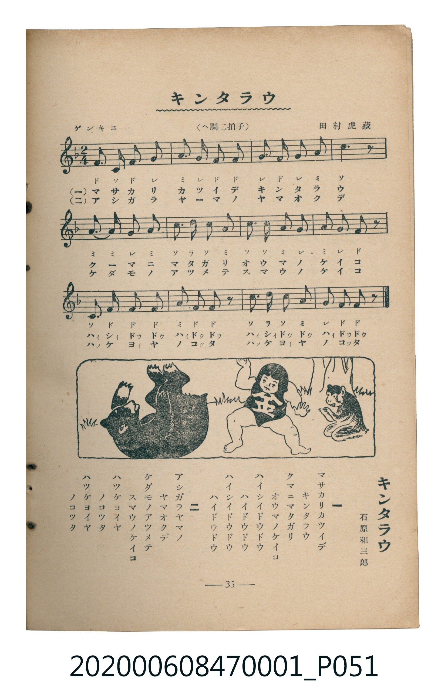

# キンタラウ（金太郎）

> Re:Shōka 使用 AI 協助辨識與重建樂譜，可能會有錯誤。歡迎回報。

- **NEUTRINO 歌聲合成版**：<br><audio controls src="kintaro_neutrino.mp3"></audio>
- **鋼琴伴奏版**：<br><audio controls src="kintaro.mp3"></audio>


- 詞：石原和三郎
- 曲：田村虎藏
- 臺灣教育會公認《新定兒童唱歌》尋常科第一學年用（2020.006.0847.0001）

## 說明

曲目說明
中文解釋：日本民間傳說中的大力少年，描寫他在山中和動物玩耍、鍛鍊成長。


## 歌詞

```text
一
マサカリカツイデ
キンタラウ
クマニマタガリ
オウマノケイコ
ハイシイドウドウ
ハイドウドウ
ハイシイドウドウ
ハイドウドウ

二
アシガラヤマノ
ヤマオクデ
ケダモノアツメテ
スマウノケイコ
ハツケヨイヤ
ノコツタ
ハツケヨイヤ
ノコツタ
```

## ABC

```abc
X:1
T:キンタラウ（金太郎）
C:曲：田村虎藏
M:2/4
L:1/16
Q:1/4=108
K:F
V:V1 name="Piano" snm="Pia"
[V:V1]
F3 C F2 G2 | A3 G F2 F2 | G3 F G2 A2 | c6 z2 |
w: 1.~マ サ カ リ | カ ツ イ デ | キ ン タ ラ | ウ
w: 2.~ア シ ガ ラ | ヤ _ マ ノ | ヤ マ オ ク | デ
A3 A G2 A2 | c3 d c2 A2 | c3 c A2 G2 | A2 G2 F2 z2 |
w: 1.~ク マ ニ マ | タ ガ リ _ | オ ウ マ ノ | ケ イ コ
w: 2.~ケ ダ モ ノ | ア ツ メ テ | ス マ ウ ノ | ケ イ コ
C3 F F2 F2 | A2 F2 F2 z2 | c2 d2 c2 A2 | G2 F2 F2 z2 |
w: 1.~ハイ シイ ドウ ドウ | ハイ ドウ ドウ | ハイ シイ ドウ ドウ | ハイ ドウ ドウ
w: 2.~ハッ ケ ヨイ ヤ | ノ コッ タ | ハッ ケ ヨイ ヤ | ノ コッ タ
```

## TMD 檔案連結

- [主旋律 TMD 檔案](kintaro.tmd) [[在 TMD Studio 編輯](https://tmdlang.github.io/Tmd-TS/#tmd=s7IKdvYPcrWy4qpTUCpJTLdSSM7PyUlNLsnMz7MqzsjMK0nNjM_KTMmPL87Iz05Ugisry88pzU21Si9KTEmNN4w3MjAyiDcwMIs3sDAxBzIMDBFKi_NLi5JTrYqTM_Lzc-JLUitKkvLzsxHyBUX5Zal5iXlANQVFIBtTwIoQClLLMlNSQdKpKZkl-UWZiTlI7kgtKga7FWxJfElRYl5xclFmAcgDCFUlGalAx6bl52Tn5BelIsSBhqVn5lnlpmZmZSK5TEtL4XHT2sfNmx837X_cvPJx07L3ezpetk98umTVy-a-93s6FbS0uBRtFQwNLLjsbRXcuGyM9E3sQKa-WDnv_Z5Zz-dvfto3_-mknic7OoEawPY9m70JJDNlw7O5E1_M7HsxvR8s_KJ91_PGxc-mznzRtOnZnOanrWterOp93ND1bNqGp-tmPW2d9Hz10qdTNj5b2_O4ofvphu6nO3Y8Xz7x-Zo1T3Y0PF274-nOLc-nrAC6DhQBesAI0ANFAJBhYAh0phKXvpYC0OLns9e9WLXq2Yw-LgUFhSc71j6b1v5i-eKX7d1AFz2bvvTZnDXPNkx8OW3y06bNQHVABc9ntTxdsvxp1-ynGyYCrXi_p-dZf__T9auf7J72dM6Kpxs3AtUAvfe0e-rzzpXP-1a-aAC6ufFl7-yXvV3POia8nLr9cUMTl5Y-F9ABXECXcj1unve4aevjptWPm1eByZbHTUseN7dzoYUzkL8epLa5G6xj_-OmNUAdQFGgrmVgib7HTRtBeps2Aw3tB7O2g83qBKsAkTAJLEJEqeV6sqsHaOUisGqg_SsfNwMVgOwGqgazQM4BuhPk_I2PmxseNy8COwxItjxuXvi4uQ0osROsEGgmmotBXgdqWgG2dQlQCCi_GSy6n6A8KER9E4EpNiAzMS_focagphoUpQo2hmZadmBWjYKhgi4QmsaDGUZAXKNgDBYyAouAcA1YHMQG0SDZGgVTsAgEGoBEwMb5GNYoAP0BFgVGIBCvBrGaV4H1QHggfguQvQTMaofKrIXKbAay94NZK6Eyy7DbZASSWwS1aTsQr0HW1QwyHWIiyDXAUEERB4kCYwWsdz1UBuQSVHugIQQJDmMMz5uBaWQRUzAPEYggFigA0QIIbCXUEc3dcEeCZEBeBzlqDTTQQBAkDmGDAgPNQ00bweLgwGzajCWIQPIg9Q1ADAouhE5o4IEio3khmNUGldmJFEig4CdkGzSggIkIkkwQCQcUCjAeWC04pMzAYQULO1goYQkpcGaDeh2UFYEioCwHdhKUgaQKUxJiJUIBxBBsKgkbgwhTUK5rhrpqI5ALyntg5SASJA8KLXAuBKmCRCrCJVBBcEgSr5WrlotL104BlJsVgLQyFwA)]
- [鋼琴伴奏 TMD 檔案](kintaro_piano.tmd) [[在 TMD Studio 編輯](https://tmdlang.github.io/Tmd-TS/#tmd=s7IKdvYPcrWy4tLSUnjctPZx8-bHTfsfN6983LTs_Z6Ox81THjctetzc92TPlqdL-5_snvF-T6eClhaXoq2CoYEFl72tghuXjZG-iR1XnYLSi5Xz3u-Z9Xz-5qd9859O6nmyo_Nlc58SSObZ7E0gmSkbns2d-GJm34vp_WDhF-27njcufjZ15oumTc_mND9tXfNiVe_jhq5n0zY8XTfraeuk56uXPp2y8dnanscN3U83dD_dseP58onP16x5sqPh6dodT3dueT5lBdCZRgZGBnoGBmZ6BhYm5kCGgSHQmUpcXL6JmXlWAZmJeflBHg41BjXVXApAYGNopmUHZtUoGCroAqFpPJhhBMQ1CsZgISOwCAjXgMVBbBANkq1RMAWLQKABSARsnI9hjcLj5nlg0cdNW4F4NYjVvAqsB8ID8VuA7CVgVjtUZi1UZjOQvR_MWgmVWYbdJiOQ3CKoTduBeA2yrmaQ6RATQa4Bxh-KOEj0cRPIVY-b1kNlQC5BtQcaQpDgMMbwvBmYRhYxBfMQgQhigQIQLYDAVkId0dwNdyRIBuR1kKPWQAMNBEHiEDYoMNA81LQRLA4OzKbNWIIIJA9S3wDEoOBC6IQGHigymheCWW1QmZ1IgQQKfkK2QQMKmIggyQSRcEChAOOB1WIJO1goYQmp5n6IZeA4BjEfN3fCnARlIKnClIRYSR1jEGEKVNjcDDVuI5C7AqYPRILkQaEFDB-IKkikIlxCnlauWuTM7IOcmS3geTnaMBaoFkJi8EzjwVwIBZMFmQ7xGVw9qgI0wzAlMfRj2A5UgcMtUO1Ar-naKYB8F-0DUgFjG4HZylwA)]

## 分析

```text
================================================================================
📊 TMD Song Profile: [ キンタラウ（金太郎） ]
================================================================================
⏱  Duration:       0:13 (13.3s), 12 measures total
🎼 Key & Tempo:    首調基準 F, != 108.0 BPM, <2/4>
   - 分析範圍：      由實際發聲的音符與和弦推測調性；播放脈絡另行呈現
🎤 人聲音域:    C4 (MIDI 60) – D5 (MIDI 74) [跨度: 14 個半音 / 1.2 個八度, 難度: moderate]
   - 最低音:  C4 in [Main #1 @ m.1, 0:00]
   - 最高音: D5 in [Main #1 @ m.6, 0:05]
   - 適合: soprano, mezzo-soprano, contralto, tenor, baritone, bass
🏛  結構:      Main (13.3s)
⚡ 編曲密度:        Peak 1 軌道同時演奏
🗝  調性診斷：       F 大調（純淨自然大調，未偵測到可信轉調）
   - 風格氣質:    純淨自然大調（陽光明朗、易唱易記，無明顯調外色彩）
   - 轉調歷程:    全曲維持單一推測調性（未偵測到可信轉調）
   - 核心骨幹音:  F, C, A, G, D
   - 調性數值:    F 大調 [相關度: 0.85, 穩定度: Moderate, 自然音純度: 100.0%]
   - 候選調性 (K-S): F 大調 (0.85), C 大調 (0.74), A 小調 (0.67)
   - 五度圈歷程:   -1
   - 各段落調性細節:
     • [Main #1]: F 大調 (r: 0.85, 自然音純度: 100.0%)

  [ 五度圈游移軌跡 ]
               C  
        [F ]*          G  
      Bb               D  
      Eb               A  
         Ab           E  
            Db       B  
               F# 
     (* = active key center)

  [ 十二半音累積音高分佈 ]
     C  : ██████████████████████    26.1%
     C# :                            0.0%
     D  : ███                        3.4%
     D# :                            0.0%
     E  :                            0.0%
     F  : ████████████████████████  28.4%
     F# :                            0.0%
     G  : ███████████████           18.2%
     G# :                            0.0%
     A  : ████████████████████      23.9%
     A# :                            0.0%
     B  :                            0.0%
--------------------------------------------------------------------------------
Assignment 軌道音域：
  - Piano         : C4 – D5 (14 個半音 / 1.2 個八度, 42 個音符)
================================================================================
```


## 原書掃描頁




