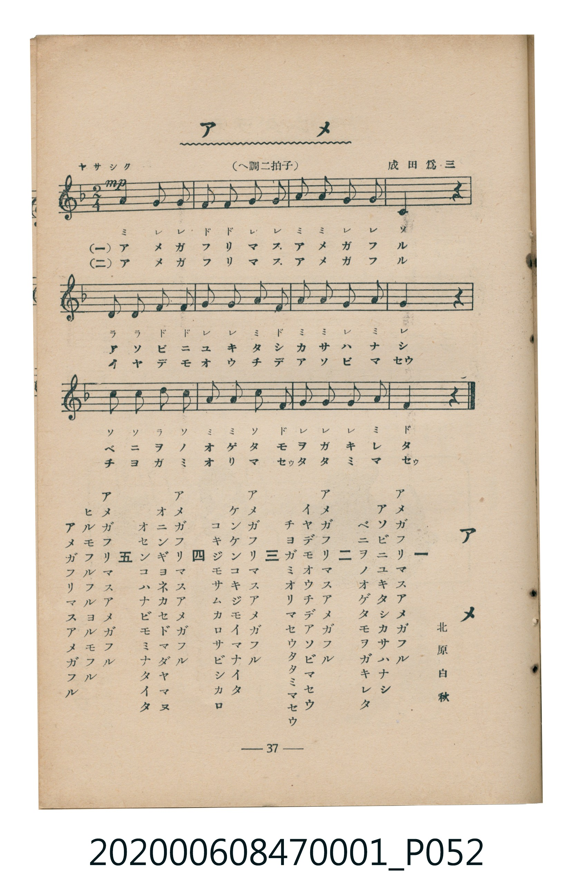

# アメ（雨）

> Re:Shōka 使用 AI 協助辨識與重建樂譜，可能會有錯誤。歡迎回報。

- **鋼琴伴奏版**：<br><audio controls src="ame.mp3"></audio>
- **NEUTRINO 歌聲合成版**：<br><audio controls src="ame_neutrino.mp3"></audio>

- 詞：北原白秋
- 曲：成田爲三
- 臺灣教育會公認《新定兒童唱歌》尋常科第一學年用（2020.006.0847.0001）

## 說明

曲目說明
中文解釋：描寫下雨時的聲音、景色，以及孩子在雨中的感受。


## 歌詞

```text
一
アメガフリマスアメガフル
アソビニユキタシカサハナシ
ベニヲノオゲタモヲガキレタ

二
アメガフリマスアメガフル
イヤデモオウチデアソビマセウ
チヨガミオリマセウタタミマセウ

三
アメガフリマスアメガフル
ケンケンコキジモイマナイタ
コキジモサムカロサビシカロ

四
アメガフリマスアメガフル
オニンギヨネカセドマダヤマヌ
オセンコハナビモミナタイタ

五
アメガフリマスアメガフル
ヒルモフルフルヨルモフル
アメガフリマスアメガフル
```

## ABC

<div class="abc-score" data-abc-src="ame.abc" aria-label="五線譜載入中"></div>

[下載 ABC 原始檔](ame.abc)

## TMD 檔案連結

- [主旋律 TMD 檔案](ame.tmd) [[在 TMD Studio 編輯](https://tmdlang.github.io/Tmd-TS/#tmd=s7IKdvYPcrWy4qpTUCpJTLdSSM7PyUlNLsnMz7MqzsjMK0nNjM_KTMmPL87Iz05Ugisry88pzU21Si9KTEmNN4w3MjAyiDcwMIs3sDAxBzIMDBFKi_NLi5JTrYqTM_Lzc-JLUitKkvLzsxHyBUX5Zal5iXlANQVFIBtTwIoQClLLMlNSQdKpKZkl-UWZiTlI7kgtKga7FWxJfElRYl5xclFmAcgDCFUlGalAx5anJgIZRQhhoFnpmXlWJYmZQN-BfFieGJ-bmJmXk5iXgqyqJCMf6NGCjEqrjMxikAuSE3PisxPzkMIDan9BYnqqVYCBqZESl5aWwuOmRY-bF77f0_Fy9or3ezoVtLS4FG0VLI247G0V3LhsjPRN7EAGvFg57_2eWU97pj_tm_985t7ny7vB5j6bvQko_KxjwvMpG553bHqyoxMs_KJ91_PGxc-mznzRtOnZnOanrWterOp93ND1bNqGp-tmPW2d9Hz10qdTNj5b2_O4ofvphu6nO3Y8Xz7x-Zo1T3Y0PF274-nOLc-nAF3TAYoyPWCU6YGiDMgwMAQ6UYlLX0sBaPHz2eterFr1bEYfl4KCwpMda59Na3-xfPHL9m6Qi_r7n65f_WRHN9BXz2Y2PZ_V8qJx08v5mx83ND6buf5FJ9DVPU92L33a3_V07cqnayc8nbMCqBJoCFDls5b5T_unP25o4tLS5wLaxQV0FBckmB43rXncPPVx86rHzfMeN-1EFVwNVtS093Hz5MfN3Y-blz1uWvu4af_jpu2Pm1Y_btr6uLn_cXMXkMv1uHkmWMWmx819j5tWPW7aBFLXDDQMyFgD0tYMJPdzcT3Z1UOszUseNwNRO8gUkInLHjc3grgIFwG17QaKAy0HSqwAa50PUgo1EiQHdi3QIfMRqoGe7yTWCRsfN2-GkUAE9PwOsHOA7poH9vkSkKdQ5YChsgAUPM1AESB7MjS0mtdycT2dPZtYm4ESwOAEmrsO5LXmXnCA737c3Am2uQEcNEAGKDCBYQOUALsQEh-gsAGaB_Qz0IVA_4MdCQz5KURa3jwJSIGNAPFhJNAVCEHiTAKlNl9gzrYKyEzMy3eoMaipBqVsBRsLLTswo0bBWEFXwQgIaxQMgRDCMgZCCMs0HihtAIQ1YOU-hjWg3A0UA1oDZK0BKgFaBcSrgHgeUGQnSASoAiYPkgWpWY1qjhGVzDGmkjkmVDLHlHJzoPFiFg9CoDipAceFMZgFiRljsBi2iAHmTKBhk4G4G2zsMqDIWiDeD8TbwVavBuKtQJl-IO4Ci2zHEjVLgLIg3A7Ei8CqgB5oAprW3AgWRbdtHlgElL2xxM9GoILNcBokAuKBnLUDbjzIMmD4AJ0EYoNE9mOJIVAodkNNA-bL5WA_9kJ9tRvI7gSLgAxqgPoA7LLmHsxoap4EDnaQAxCRAIksUGSA-CuwqECLJlMgNANiSNSYwqMLEkmGmJHUPBPqh01A3AcPWiAPFEmQ0ADJgdIGKIyawWkIPTRAkQQqdJdDE9F8iIvBAQRLauDYgOiFmD2fUERhRgsopSyAhG_zWrgIMMaBqQYkCnLGWuwRBY4PkIngKIemN0hqgXgS5BxQdIOchzXKoZkJllUgcUJaZqrl4tK1UwAVgQpAWpkLAA)]
- [鋼琴伴奏 TMD 檔案](ame_piano.tmd) [[在 TMD Studio 編輯](https://tmdlang.github.io/Tmd-TS/#tmd=s7IKdvYPcrWy4qpTUCpJTLdSyC8qychPL0osyKi0ysgsLskvykxOzInPTsxLVIIrKs4vLUpOjS9ITE-1CjAwNVLi0tJSeNy06HHzwvd7Oh43TwGz-57s2fJ0af-T3TPe7-lU0NLiUrRVsDTisrdVcOOyMdI3sQOZ92LlvPd7Zj3tmf60b_7zmXufL-8GW_Ns9iag8LOOCc-nbHjesenJjk6w8Iv2Xc8bFz-bOvNF06Znc5qftq55sar3cUPXs2kbnq6b9bR10vPVS59O2fhsbc_jhu6nG7qf7tjxfPnE52vWPNnR8HTtjqc7tzyfsgLoRCMDIwM9AwMzPQMLE3Mgw8AQ6EQlLi7fxMw8q4DMxLz8IA-HGoOaai4FILCx0LIDM2oUjBV0FYyAsEbBEAghLGMghLBM44HSBkBYA1buY1gDChWgGDBggKw1QCWPm6cC8SogngcU2QkSAaqAyYNkQWpWo5pjRCVzjKlkjgmVzDGl3BxovJjFgxAoTmrAcWEMZkFixhgshi1iHjftBRo2GYi7wcYuA4qsBeL9QLwdbPVqIN4KlOkH4i6wyHYsUbMEKAvC7UC8CKwK6IEmoGnNjWBRdNvmgUV2g5Rgxs9GoILNcBokAuKBnLUDbjzIMmD4AJ0EYoNE9mOJIVAodkNNW_e4eTnYj71QX-0GsjvBIiCDGqA-ALusuQczmpongYMd5ABEJEAiCxQZIP4KLCrQoskUCM2AGBI1pvDogkSSIWYkNc-E-mETEPfBgxbIA0USJDRAcqC0AQqjZnAaQg8NUCQ1N4JCAJKI5kNcDA4gWFIDxwZEL8Ts-YQiCjNaQCllASR8m9fCRYAxDkw1IFGQM9ZijyhwfIBMBEc5NL1BUgvEkyDngKIb5DysUQ7NTLCsAokT0jJTLXIJ6INcAprAS8Bow1iFaNP4WLxMmKOAPBOgIEgIyATJQ5lIykEUknqQjAlcDZJGVNOBTtW1UwC5NtoHKARnGyGxjZHYQCPhbFMwW5kLAA)]

## 分析

```text
================================================================================
📊 TMD Song Profile: [ アメ（雨） ]
================================================================================
⏱  Duration:       0:15 (15.7s), 12 measures total
🎼 Key & Tempo:    首調基準 F, != 92.0 BPM, <2/4>
   - 分析範圍：      由實際發聲的音符與和弦推測調性；播放脈絡另行呈現
🎤 人聲音域:    C4 (MIDI 60) – D5 (MIDI 74) [跨度: 14 個半音 / 1.2 個八度, 難度: moderate]
   - 最低音:  C4 in [Main #1 @ m.4, 0:03]
   - 最高音: D5 in [Main #1 @ m.9, 0:11]
   - 適合: soprano, mezzo-soprano, contralto, tenor, baritone, bass
🏛  結構:      Main (15.7s)
⚡ 編曲密度:        Peak 1 軌道同時演奏
🗝  調性診斷：       C 大調（純淨自然大調，未偵測到可信轉調）
   - 風格氣質:    純淨自然大調（陽光明朗、易唱易記，無明顯調外色彩）
   - 轉調歷程:    全曲維持單一推測調性（未偵測到可信轉調）
   - 核心骨幹音:  G, A, F, C, D
   - 調性數值:    C 大調 [相關度: 0.66, 穩定度: Moderate, 自然音純度: 100.0%]
   - 候選調性 (K-S): C 大調 (0.66), F 大調 (0.60), G 大調 (0.54)
   - 五度圈歷程:   +0
   - 各段落調性細節:
     • [Main #1]: C 大調 (r: 0.66, 自然音純度: 100.0%)

  [ 五度圈游移軌跡 ]
              [C ]*
         F            G  
      Bb               D  
      Eb               A  
         Ab           E  
            Db       B  
               F# 
     (* = active key center)

  [ 十二半音累積音高分佈 ]
     C  : ██████████                14.3%
     C# :                            0.0%
     D  : █████                      7.1%
     D# :                            0.0%
     E  :                            0.0%
     F  : ██████████████            19.0%
     F# :                            0.0%
     G  : ████████████████████████  33.3%
     G# :                            0.0%
     A  : ███████████████████       26.2%
     A# :                            0.0%
     B  :                            0.0%
--------------------------------------------------------------------------------
Assignment 軌道音域：
  - Piano         : C4 – D5 (14 個半音 / 1.2 個八度, 38 個音符)
================================================================================
```


## 原書掃描頁




