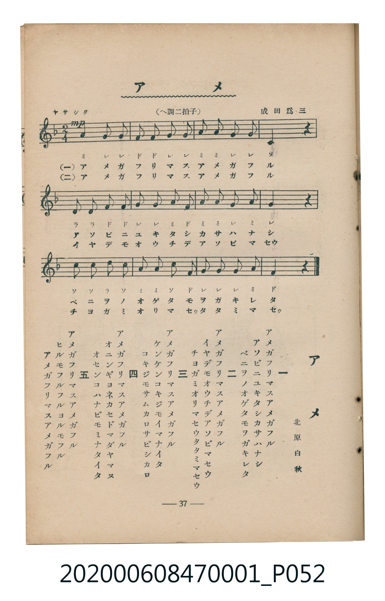

# アメ（雨）

> Re:Shōka 使用 AI 協助辨識與重建樂譜，可能會有錯誤。歡迎回報。

- **鋼琴伴奏版**：<br><audio controls src="ame.mp3"></audio>
- **NEUTRINO 歌聲合成版**：<br><audio controls src="ame_neutrino.mp3"></audio>

- 詞：北原白秋
- 曲：成田爲三
- 臺灣教育會公認《新定兒童唱歌》尋常科第一學年用（2020.006.0847.0001）

## 說明

曲目說明
中文解釋：描寫下雨時的聲音、景色，以及孩子在雨中的感受。


## 歌詞

```text
一
アメガフリマスアメガフル
アソビニユキタシカサハナシ
ベニヲノオゲタモヲガキレタ

二
アメガフリマスアメガフル
イヤデモオウチデアソビマセウ
チヨガミオリマセウタタミマセウ

三
アメガフリマスアメガフル
ケンケンコキジモイマナイタ
コキジモサムカロサビシカロ

四
アメガフリマスアメガフル
オニンギヨネカセドマダヤマヌ
オセンコハナビモミナタイタ

五
アメガフリマスアメガフル
ヒルモフルフルヨルモフル
アメガフリマスアメガフル
```

## ABC

<div class="abc-score" data-abc-src="ame.abc" aria-label="五線譜載入中"></div>

[下載 ABC 原始檔](ame.abc)

## TMD 檔案連結

- [主旋律 TMD 檔案](ame.tmd) [[在 TMD Studio 編輯](https://tmdlang.github.io/Tmd-TS/#tmd=s7IKdvYPcrWy4qpTUCpJTLdSSM7PyUlNLsnMz7MqzsjMK0nNjM_KTMmPL87Iz05Ugisry88pzU21Si9KTEmNN4w3MjAyiDcwMIs3sDAxBzIMDBFKi_NLi5JTrYqTM_Lzc-JLUitKkvLzsxHyBUX5Zal5iXlANQVFIBtTwIoQClLLMlNSQdKpKZkl-UWZiTlI7kgtKga7FWxJfElRYl5xclFmAcgDCFUlGalAx5anJgIZRQhhoFnpmXlWJYmZQN-BfFieGJ-bmJmXk5iXosSlpaXwuGnR4-aF7_d0vJy94v2eTgUtLS5FWwVLIy57WwU3LhsjfRM7kGEvVs57v2fW057pT_vmP5-59_nybrAdz2ZvAgo_65jwfMqG5x2bnuzoBAu_aN_1vHHxs6kzXzRtejan-Wnrmhereh83dD2btuHpullPWyc9X7306ZSNz9b2PG7ofrqh--mOHc-XT3y-Zs2THQ1P1-54unPL8ylA13SAwlwPGOZ6oDAHMgwMgU5U4tLXUgBa_Hz2uherVj2b0celoKDwZMfaZ9PaXyxf_LK9G-Si_v6n61c_2dEN9NWzmU3PZ7W8aNz0cv7mxw2Nz2auf9EJdHXPk91Ln_Z3PV278unaCU_nrACqBBoCVPmsZf7T_umPG5q4tPS5gHZxAR3FBQmmx01rHjdPfdy86nHzvMdNO1EFV4MVNe193Dz5cXP34-Zlj5vWPm7a_7hp--Om1Y-btj5u7n_c3AXkcj1unglWselxc9_jplWPmzaB1DUDDQMy1oC0NQPJ_VxcT3b1EGvzksfNQNQOMgVk4rLHzY0gLsJFQG27geJAy4ESK8Ba54OUQo0EyYFdC3TIfIRqoOc7iXXCxsfNm2EkEAE9vwPsHKC75oF9vgTkKVQ5YKgsAAVPM1AEyJ4MDa3mtVxcT2fPJtZmoAQwOIHmrgN5rbkXHOC7Hzd3gm1uAAcNkAEKTGDYACXALoTEByhsgOYB_Qx0IdD_YEcCQ34KkZY3TwJSYCNAfBgJdAVCkDiTQKnNF5g1rQIyE_PyHWoMaqpBKVvBxkLLDsyoUTBW0FUwAsIaBUMghLCMgRDCMo0HShsAYQ1YuY9hDSh3A8WA1gBZa4BKgFYB8SogngcU2QkSAaqAyYNkQWpWo5pjRCVzjKlkjgmVzDGl3BxovJjFgxAoTmrAcWEMZkFixhgshi1igDkTaNhkIO4GG7sMKLIWiPcD8Xaw1auBeCtQph-Iu8Ai27FEzRKgLAi3A_EisCqgB5qApjU3gkXRbZsHFgFlbyzxsxGoYDOcBomAeCBn7YAbD7IMGD5AJ4HYIJH9WGIIFIrdUNOA-XI52I-9UF_tBrI7wSIggxqgPgC7rLkHM5qaJ4GDHeQARCRAIgsUGSD-Ciwq0KLJFAjNgBgSNabw6IJEkiFmJDXPhPphExD3wYMWyANFEiQ0QHKgtAEKo2ZwGkIPDVAkgQrd5dBENB_iYnAAwZIaODYgeiFmzycUUZjRAkopCyDh27wWLgKMcWCqAYmCnLEWe0SB4wNkIjjKoekNklogngQ5BxTdIOdhjXJoZoJlFUickJaZarm4dO0UQEWgApBW5gIA)]
- [鋼琴伴奏 TMD 檔案](ame_piano.tmd) [[在 TMD Studio 編輯](https://tmdlang.github.io/Tmd-TS/#tmd=s7IKdvYPcrWy4tLSUnjctOhx88L3ezoeN08Bs_ue7NnydGn_k90z3u_pVNDS4lK0VbA04rK3VXDjsjHSN7HjqlNQerFy3vs9s572TH_aN__5zL3Pl3crgYSfzd4EFH7WMeH5lA3POzY92dEJFn7Rvut54-JnU2e-aNr0bE7z09Y1L1b1Pm7oejZtw9N1s562Tnq-eunTKRufre153ND9dEP30x07ni-f-HzNmic7Gp6u3fF055bnU1YAnWhkYGSgZ2BgpmdgYWIOZBgYAp2oxMXlm5iZZxWQmZiXH-ThUGNQU82lAAQ2Flp2YEaNgrGCroIRENYoGAIhhGUMhBCWaTxQ2gAIa8DKfQxrQKECFAMGDJC1BqjkcfNUIF4FxPOAIjtBIkAVMHmQLEjNalRzjKhkjjGVzDGhkjmmlJsDjRezeBACxUkNOC6MwSxIzBiDxbBFzOOmvUDDJgNxN9jYZUCRtUC8H4i3g61eDcRbgTL9QNwFFtmOJWqWAGVBuB2IF4FVAT3QBDStuREsim7bPLDIbpASzPjZCFSwGU6DREA8kLN2wI0HWQYMH6CTQGyQyH4sMQQKxW6oaeseNy8H-7EX6qvdQHYnWARkUAPUB2CXNfdgRlPzJHCwgxyAiARIZIEiA8RfgUUFWjSZAqEZEEOixhQeXZBIMsSMpOaZUD9sAuI-eNACeaBIgoQGSA6UNkBh1AxOQ-ihAYqk5kZQCEAS0XyIi8EBBEtq4NiA6IWYPZ9QRGFGCyilLICEb_NauAgwxoGpBiQKcsZa7BEFjg-QieAoh6Y3SGqBeBLkHFB0g5yHNcqhmQmWVSBxQlpmqkUuAX2QS0ATeAkYbRirEG0aH4uXCXMUkGcCFAQJAZkgeSgTSTmIQlIPkjGBq0HSiGo60Km6dgog10b7AIXgbCMktjESG2gknG0KZitzAQA)]

## 分析

```text
================================================================================
📊 TMD Song Profile: [ アメ（雨） ]
================================================================================
⏱  Duration:       0:15 (15.7s), 12 measures total
🎼 Key & Tempo:    首調基準 F, != 92.0 BPM, <2/4>
   - 分析範圍：      由實際發聲的音符與和弦推測調性；播放脈絡另行呈現
🎤 人聲音域:    C4 (MIDI 60) – D5 (MIDI 74) [跨度: 14 個半音 / 1.2 個八度, 難度: moderate]
   - 最低音:  C4 in [Main #1 @ m.4, 0:03]
   - 最高音: D5 in [Main #1 @ m.9, 0:11]
   - 適合: soprano, mezzo-soprano, contralto, tenor, baritone, bass
🏛  結構:      Main (15.7s)
⚡ 編曲密度:        Peak 1 軌道同時演奏
🗝  調性診斷：       C 大調（純淨自然大調，未偵測到可信轉調）
   - 風格氣質:    純淨自然大調（陽光明朗、易唱易記，無明顯調外色彩）
   - 轉調歷程:    全曲維持單一推測調性（未偵測到可信轉調）
   - 核心骨幹音:  G, A, F, C, D
   - 調性數值:    C 大調 [相關度: 0.66, 穩定度: Moderate, 自然音純度: 100.0%]
   - 候選調性 (K-S): C 大調 (0.66), F 大調 (0.60), G 大調 (0.54)
   - 五度圈歷程:   +0
   - 各段落調性細節:
     • [Main #1]: C 大調 (r: 0.66, 自然音純度: 100.0%)

  [ 五度圈游移軌跡 ]
              [C ]*
         F            G  
      Bb               D  
      Eb               A  
         Ab           E  
            Db       B  
               F# 
     (* = active key center)

  [ 十二半音累積音高分佈 ]
     C  : ██████████                14.3%
     C# :                            0.0%
     D  : █████                      7.1%
     D# :                            0.0%
     E  :                            0.0%
     F  : ██████████████            19.0%
     F# :                            0.0%
     G  : ████████████████████████  33.3%
     G# :                            0.0%
     A  : ███████████████████       26.2%
     A# :                            0.0%
     B  :                            0.0%
--------------------------------------------------------------------------------
Assignment 軌道音域：
  - Piano         : C4 – D5 (14 個半音 / 1.2 個八度, 38 個音符)
================================================================================
```


## 原書掃描頁




