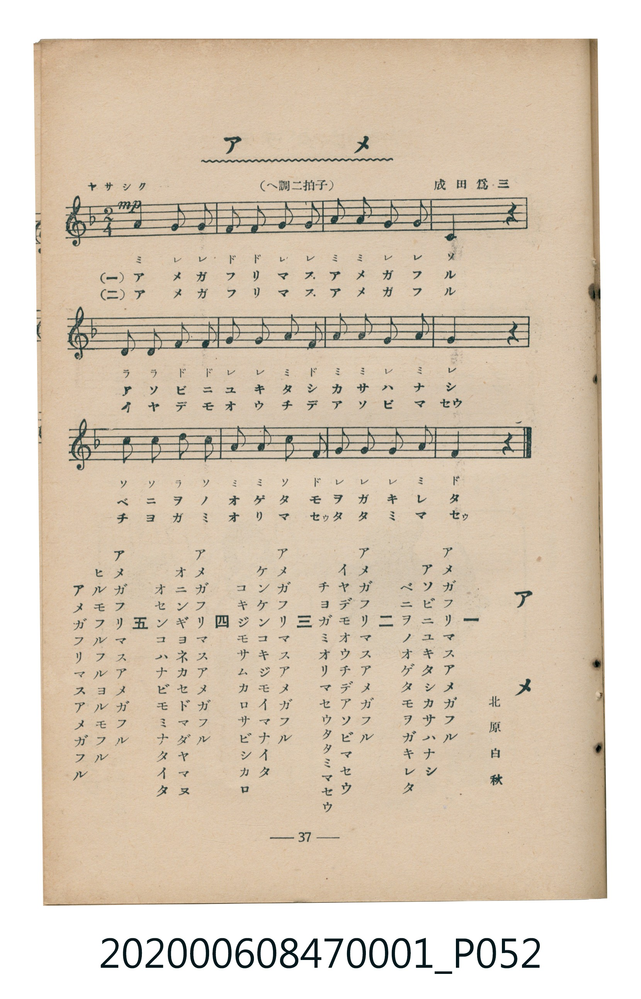

# アメ（雨）

> Re:Shoka 使用 AI 協助辨識與重建樂譜，可能會有錯誤。歡迎回報。

<audio controls src="ame.mp3"></audio>

- 詞：北原白秋
- 曲：成田爲三
- 臺灣教育會公認《新定兒童唱歌》尋常科第一學年用（2020.006.0847.0001）

## 說明

曲目說明
中文解釋：描寫下雨時的聲音、景色，以及孩子在雨中的感受。

## 跨冊／重複收錄參照

> 同名異曲（各冊收錄之不同詞曲版本）

- **[同名異曲]** 楊金土手抄《唱歌帖》第 3 冊・I（2020.006.0843）：[**〈雨〉**](../../../shokacho/vol_03/p036_ame/index.md)（`F` / `2/4` — [原始 TMD](../../../shokacho/vol_03/p036_ame/ame.tmd)）
- **[同名異曲]** 楊金土手抄《唱歌帖》第 7 冊・VII（2020.006.0843）：[**〈雨（雨）〉**](../../../shokacho/vol_07/p229a_ame/index.md)（`A` / `2/4` — [原始 TMD](../../../shokacho/vol_07/p229a_ame/ame.tmd)）
- 總表：[跨冊重複與同名歌曲總索引](../../../duplicate_songs.md)

## 歌詞

```text
一
アメガフリマスアメガフル
アソビニユキタシカサハナシ
ベニヲノオゲタモヲガキレタ

二
アメガフリマスアメガフル
イヤデモオウチデアソビマセウ
チヨガミオリマセウタタミマセウ

三
アメガフリマスアメガフル
ケンケンコキジモイマナイタ
コキジモサムカロサビシカロ

四
アメガフリマスアメガフル
オニンギヨネカセドマダヤマヌ
オセンコハナビモミナタイタ

五
アメガフリマスアメガフル
ヒルモフルフルヨルモフル
アメガフリマスアメガフル
```

## ABC

```abc
X:1
T:アメ（雨）
C:曲：成田爲三
M:2/4
L:1/16
Q:1/4=92
K:F
V:V1 name="Piano" snm="Pia"
[V:V1]
A4 G2 G2 | F2 F2 G2 G2 | A2 A2 G2 G2 | C4 z2 z2 |
D2 D2 F2 F2 | G2 G2 A2 F2 | A2 A2 G2 A2 | G4 z2 z2 |
c2 c2 d2 c2 | A2 A2 c2 F2 | G2 G2 G2 A2 | F4 z2 z2 |
```

## TMD 檔案連結

- [主旋律 TMD 檔案](ame.tmd) [[在 TMD Studio 編輯](https://tmdlang.github.io/Tmd-TS/#tmd=s7IKdvYPcrWy4qpTUCpJTLdSSM7PyUlNLsnMz7MqzsjMK0nNjM_KTMmPL87Iz05Ugisry88pzU21Si9KTEmNN4w3MjAyiDcwMIs3sDAxBzIMDBFKi_NLi5JTrYqTM_Lzc-JLUitKkvLzsxHyBUX5Zal5iXlANQVFIBtTwIoQClLLMlNSQdKpKZkl-UWZiTlI7kgtKga7FWxJfElRYl5xclFmAcgDCFUlGalAx5anJgIZRUpcWloKj5sWPW5e-H5Px8vZK97v6VTQ0uJStFWwNOKyt1Vw47Ix0jexA-l-sXLe-z2znvZMf9o3__nMvc-Xd4MNfTZ7E1D4WceE51M2PO_Y9GRHJ1j4Rfuu542Ln02d-aJp07M5zU9b17xY1fu4oevZtA1P18162jrp-eqlT6dsfLa253FD99MN3U937Hi-fOLzNWue7Gh4unbH051bnk8BuqYDFJp6wNDUA4UmkGFgCHSiEpe-lgLQ4uez171YterZjD4uBQWFJzvWPpvW_mL54pft3SAX9fc_Xb_6yY5uoK-ezWx6PqvlReOml_M3P25ofDZz_YtOoKt7nuxe-rS_6-nalU_XTng6ZwVQJdAQoMpnLfOf9k9_3NDEpaXPBbSLC-goLkgwPW5a87h56uPmVY-b5z1u2okquBqsqGnv4-bJj5u7Hzcve9y09nHT_sdN2x83rX7ctPVxc__j5i4gl-tx80ywik2Pm_seN6163LQJpK4ZaBiQsQakrRlI7ufierKrh1iblzxuBqJ2kCkgE5c9bm4EcREuAmrbDRQHWg6UWAHWOh-kFGokSA7sWqBD5iNUAz3fSawTNj5u3gwjgQjo-R1g5wDdNQ_s8yUgT6HKAUNlASh4moEiQPZkaGg1r-Xiejp7NrE2AyWAwQk0dx3Ia8294ADf_bi5E2xzAzhogAxQYALDBigBdiEkPkBhAzQP6GegC4H-BzsSGPJTiLS8eRKQAhsB4sNIoCsQgsSZBEptvomZeVYBmYl5-Q41BjUK1aCkrWBjaKZlB2bVKBgr6IKhERTXKBgCSRBGiIDUgDBCxDQeqs0AimugxpmBJMAEzJgauDaQERARZANBNEQNNvNMgWwQNoPSCL0gHqr5CNNA4qim1XJx6dopgEJDAUgrc3EBAA)]
- [鋼琴伴奏 TMD 檔案](ame_piano.tmd) [[在 TMD Studio 編輯](https://tmdlang.github.io/Tmd-TS/#tmd=s7IKdvYPcrWy4tLSUnjctOhx88L3ezoeN08Bs_ue7NnydGn_k90z3u_pVNDS4lK0VbA04rK3VXDjsjHSN7HjqlNQerFy3vs9s572TH_aN__5zL3Pl3crgYSfzd4EFH7WMeH5lA3POzY92dEJFn7Rvut54-JnU2e-aNr0bE7z09Y1L1b1Pm7oejZtw9N1s562Tnq-eunTKRufre153ND9dEP30x07ni-f-HzNmic7Gp6u3fF055bnU1YAnWhkYGSgZ2BgpmdgYWIOZBgYAp2oxMXlm5iZZxWQmZiXH-ThUGNQo1DNpQAENoZmWnZgVo2CsYIuGBpBcY2CIZAEYYQISA0II0RM46HaDKC4BmqcGUgCTMCMqYFrAxkBEUE2EERD1GAzzxTIBmEzKI3QC-Khmo8wDSSOalotcmD4oASGBTwsog1jgYqjTeNBFHFcZLdGm4ClIBJALkQlnIumHcJA0Q9RYYKiHs0wbLYD_aZrpwDyngIRtDIXFwA)]

## 分析

```text
================================================================================
📊 TMD Song Profile: [ アメ（雨） ]
================================================================================
⏱  Duration:       0:15 (15.7s), 12 measures total
🎼 Key & Tempo:    首調基準 F, != 92.0 BPM, <2/4>
   - 分析範圍：      由實際發聲的音符與和弦推測調性；播放脈絡另行呈現
🎤 人聲音域:    C4 (MIDI 60) – D5 (MIDI 74) [跨度: 14 個半音 / 1.2 個八度, 難度: moderate]
   - 最低音:  C4 in [Main #1 @ m.4, 0:03]
   - 最高音: D5 in [Main #1 @ m.9, 0:11]
   - 適合: soprano, mezzo-soprano, contralto, tenor, baritone, bass
🏛  結構:      Main (15.7s)
⚡ 編曲密度:        Peak 1 軌道同時演奏
🗝  調性診斷：       C 大調（純淨自然大調，未偵測到可信轉調）
   - 風格氣質:    純淨自然大調（陽光明朗、易唱易記，無明顯調外色彩）
   - 轉調歷程:    全曲維持單一推測調性（未偵測到可信轉調）
   - 核心骨幹音:  G, A, F, C, D
   - 調性數值:    C 大調 [相關度: 0.66, 穩定度: Moderate, 自然音純度: 100.0%]
   - 候選調性 (K-S): C 大調 (0.66), F 大調 (0.60), G 大調 (0.54)
   - 五度圈歷程:   +0
   - 各段落調性細節:
     • [Main #1]: C 大調 (r: 0.66, 自然音純度: 100.0%)

  [ 五度圈游移軌跡 ]
              [C ]*
         F            G  
      Bb               D  
      Eb               A  
         Ab           E  
            Db       B  
               F# 
     (* = active key center)

  [ 十二半音累積音高分佈 ]
     C  : ██████████                14.3%
     C# :                            0.0%
     D  : █████                      7.1%
     D# :                            0.0%
     E  :                            0.0%
     F  : ██████████████            19.0%
     F# :                            0.0%
     G  : ████████████████████████  33.3%
     G# :                            0.0%
     A  : ███████████████████       26.2%
     A# :                            0.0%
     B  :                            0.0%
--------------------------------------------------------------------------------
Assignment 軌道音域：
  - Piano         : C4 – D5 (14 個半音 / 1.2 個八度, 38 個音符)
================================================================================
```


## 原書掃描頁




