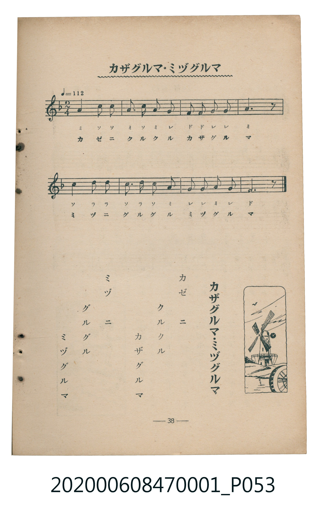

# カザグルマ・ミヅグルマ（風車與水車）

> Re:Shōka 使用 AI 協助辨識與重建樂譜，可能會有錯誤。歡迎回報。

- **鋼琴伴奏版**：<br><audio controls src="kazaguruma_mizuguruma.mp3"></audio>
- **NEUTRINO 歌聲合成版**：<br><audio controls src="kazaguruma_mizuguruma_neutrino.mp3"></audio>

- 臺灣教育會公認《新定兒童唱歌》尋常科第一學年用（2020.006.0847.0001）

## 說明

曲目說明
中文解釋：描寫風力與水力讓車輪轉動的自然景象。


## 歌詞

```text
カゼニ
クルクル
カザグルマ
ミヅニ
グルグル
ミヅグルマ
```

## ABC

<div class="abc-score" data-abc-src="kazaguruma_mizuguruma.abc" aria-label="五線譜載入中"></div>

[下載 ABC 原始檔](kazaguruma_mizuguruma.abc)

## TMD 檔案連結

- [主旋律 TMD 檔案](kazaguruma_mizuguruma.tmd) [[在 TMD Studio 編輯](https://tmdlang.github.io/Tmd-TS/#tmd=s7IKdvYPcrWy4qpTUCpJTLdSSM7PyUlNLsnMz7MqzsjMK0nNjM_KTMmPL87Iz05Ugisry88pzU21Si9KTEmNN4w3MjAyiDcwMIs3sDAxBzIMDBFKi_NLi5JTrYqTM_Lzc-JLUitKkvLzsxHyBUX5Zal5iXlANQVFIBtTwIoQClLLMlNSQdKpKZkl-UWZiTlI7kgtKga7FWxJfElRYl5xclFmAcgDCFUlGalAx5YnlqQWIQSBJqVn5lmVJGaWJ-bF56elZSajGJ1fVJKRD_RgQUalVUZmMcjm5MSc-OzEPKRwgNpbkJieahVgYGqsxKWlpfC4afXjpm2PmzY8bl79uHne4-bdj5vnP25uhYu839PxctGKF7u7XnS0P9uwBch4v6dTQUuLS9FWwdDQiMveVsGNy8ZI38QOZNGL9l3PGxc_mzrzRdOmZ3Oan7auebGq93FD17NpG56um_W0ddLz1UufTtn4bG3P44bupxu6n-7Y8Xz5xOdr1jzZ0fB07Y6nO7c8n7ICaCUokvSAkaQHiiQgw8AQaKsSl76WwrPZm57PXvdi1apnM_q4FBQUnuxY-2xa-4vli1-2d7_fM-tZf__T9auBLn7aNRviYhBj3WSQB_aserG382n31OezWl60r3resu3ZzPUvNi583NDEpaXPBTScCxwaex43dwNZ60H-B5MQYUQgcUGDCKwMLAYmYcJwZSBDfROB8RaQmZiX71BjUFMNcrGCjaGZlh2YVaNgrKALhqZQDBMxBdNGYBFDIAnCIB5EBKYLBA1AImDTfGpA0QkVBvoDRDZ3gzUAPQIRbV4NZYNYEBkQDfQemNyALNM8D8MaqKtBLgVBMyiGiZiBaZDrauCuRfUHdlc3z4e5urkVxdUg98Bcjeo2kA6oaoKuruXi0rVTAEWFApBW5gIA)]
- [鋼琴伴奏 TMD 檔案](kazaguruma_mizuguruma_piano.tmd) [[在 TMD Studio 編輯](https://tmdlang.github.io/Tmd-TS/#tmd=s7IKdvYPcrWy4qpTUCpJTLdSyC8qychPL0osyKi0ysgsLskvykxOzInPTsxLVIIrKs4vLUpOjS9ITE-1CjAwNVbi0tJSeNy0-nHTtsdNGx43r37cPO9x8-7HzfMfN7fCRd7v6XjcPOVx06LHzX1P9mx5urT_ye4Z7_d0KmhpcSnaKhgaGnHZ2yq4cdkY6ZvYgex60b7reePiZ1Nnvmja9GxO89PWNS9W9T5u6Ho2bcPTdbOetk56vnrp0ykbn63tedzQ_XRD99MdO54vn_h8zZonOxqert3xdOeW51NWAG01MjAy0DMwMNMzsDAxBzIMDIG2KnFx-SZm5lkFZCbm5Qd5ONQY1FRzKQCBjaGZlh2YVaNgrKALhqZQDBMxBdNGYBFDIAnCIB5EBKYLBA1AImDTfGpAQQQVfty0B0Q2d4M1PG5aDxFtXg1lg1gQGRANDFcwuQFZpnkehjVQV4NcCoJmUAwTMQPTINfVwF2L6g_srm6eD3N1cyuKq0Hugbka1W0gHVDVBF1dixwTPsgxYQGPiGjDWKBaCAnnmcbj4YJMh3gBrsAERTnMLIg2rLqBLtO1UwA5DmwQGluZCwA)]

## 分析

```text
================================================================================
📊 TMD Song Profile: [ カザグルマ・ミヅグルマ（風車與水車） ]
================================================================================
⏱  Duration:       0:08 (8.6s), 8 measures total
🎼 Key & Tempo:    首調基準 F, != 112.0 BPM, <2/4>
   - 分析範圍：      由實際發聲的音符與和弦推測調性；播放脈絡另行呈現
🎤 人聲音域:    F4 (MIDI 65) – D5 (MIDI 74) [跨度: 9 個半音 / 0.8 個八度, 難度: easy]
   - 最低音:  F4 in [Main #1 @ m.3, 0:02]
   - 最高音: D5 in [Main #1 @ m.5, 0:04]
   - 適合: soprano, mezzo-soprano, contralto, tenor, baritone, bass
🏛  結構:      Main (8.6s)
⚡ 編曲密度:        Peak 1 軌道同時演奏
🗝  調性診斷：       A 小調（純淨自然小調，未偵測到可信轉調）
   - 風格氣質:    純淨自然小調（陰鬱抒情、旋律集中，無明顯調外色彩）
   - 轉調歷程:    全曲維持單一推測調性（未偵測到可信轉調）
   - 核心骨幹音:  A, C, G, F, D
   - 調性數值:    A 小調 [相關度: 0.77, 穩定度: Moderate, 自然音純度: 100.0%]
   - 候選調性 (K-S): A 小調 (0.77), F 大調 (0.70), C 大調 (0.70)
   - 五度圈歷程:   +3
   - 各段落調性細節:
     • [Main #1]: A 小調 (r: 0.77, 自然音純度: 100.0%)

  [ 五度圈游移軌跡 ]
               C  
         F            G  
      Bb               D  
      Eb              [A ]*
         Ab           E  
            Db       B  
               F# 
     (* = active key center)

  [ 十二半音累積音高分佈 ]
     C  : ██████████████████        23.3%
     C# :                            0.0%
     D  : ██████                     8.3%
     D# :                            0.0%
     E  :                            0.0%
     F  : █████████████             16.7%
     F# :                            0.0%
     G  : ███████████████           20.0%
     G# :                            0.0%
     A  : ████████████████████████  31.7%
     A# :                            0.0%
     B  :                            0.0%
--------------------------------------------------------------------------------
Assignment 軌道音域：
  - Piano         : F4 – D5 (9 個半音 / 0.8 個八度, 24 個音符)
================================================================================
```


## 原書掃描頁




