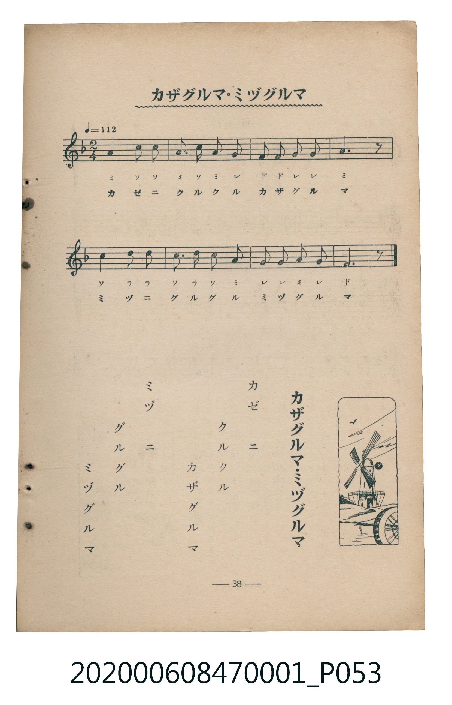

# カザグルマ・ミヅグルマ

<audio controls src="kazaguruma_mizuguruma.mp3"></audio>

- 臺灣教育會公認《新定兒童唱歌》尋常科第一學年用（2020.006.0847.0001）

## 說明

・出處：臺灣教育會公認《新定兒童唱歌》尋常科第一學年用（2020.006.0847.0001）
・調性與拍號：調號 ?= F，拍號 <2/4>，速度 != 112

## 歌詞

```text
カゼニ
クルクル
カザグルマ
ミヅニ
グルグル
ミヅグルマ
```

## ABC

```abc
X:1
T:カザグルマ・ミヅグルマ
C:TMD (Chen, Chih-Han / aguai)
M:2/4
L:1/16
Q:1/4=112
K:F
V:V1 name="Piano" snm="Pia"
[V:V1]
a4 c2 c2 | a3 c a2 g2 | f2 f2 g2 g2 | a6 z2 |
c4 d2 d2 | c3 d c2 a2 | g2 g2 a2 g2 | f6 z2 |
```

## TMD 檔案連結

- [主旋律 TMD 檔案](kazaguruma_mizuguruma.tmd)
- [鋼琴伴奏 TMD 檔案](kazaguruma_mizuguruma_piano.tmd)

## 分析

```text
================================================================================
📊 TMD Song Profile: [ カザグルマ・ミヅグルマ ]
================================================================================
⏱  Duration:       0:08 (8.6s), 8 measures total
🎼 Key & Tempo:    首調基準 F, != 112.0 BPM, <2/4>
   - 分析範圍：      由實際發聲的音符與和弦推測調性；播放脈絡另行呈現
🎤 人聲音域:    F4 (MIDI 65) – D5 (MIDI 74) [跨度: 9 個半音 / 0.8 個八度, 難度: easy]
   - 最低音:  F4 in [Main #1 @ m.3, 0:02]
   - 最高音: D5 in [Main #1 @ m.5, 0:04]
   - 適合: soprano, mezzo-soprano, contralto, tenor, baritone, bass
🏛  結構:      Main (8.6s)
⚡ 編曲密度:        Peak 1 軌道同時演奏
🗝  調性診斷：       A 小調（純淨自然小調，未偵測到可信轉調）
   - 風格氣質:    純淨自然小調（陰鬱抒情、旋律集中，無明顯調外色彩）
   - 轉調歷程:    全曲維持單一推測調性（未偵測到可信轉調）
   - 核心骨幹音:  A, C, G, F, D
   - 調性數值:    A 小調 [相關度: 0.77, 穩定度: Moderate, 自然音純度: 100.0%]
   - 候選調性 (K-S): A 小調 (0.77), F 大調 (0.70), C 大調 (0.70)
   - 五度圈歷程:   +3
   - 各段落調性細節:
     • [Main #1]: A 小調 (r: 0.77, 自然音純度: 100.0%)

  [ 五度圈游移軌跡 ]
               C  
         F            G  
      Bb               D  
      Eb              [A ]*
         Ab           E  
            Db       B  
               F# 
     (* = active key center)

  [ 十二半音累積音高分佈 ]
     C  : ██████████████████        23.3%
     C# :                            0.0%
     D  : ██████                     8.3%
     D# :                            0.0%
     E  :                            0.0%
     F  : █████████████             16.7%
     F# :                            0.0%
     G  : ███████████████           20.0%
     G# :                            0.0%
     A  : ████████████████████████  31.7%
     A# :                            0.0%
     B  :                            0.0%
--------------------------------------------------------------------------------
Assignment 軌道音域：
  - Piano         : F4 – D5 (9 個半音 / 0.8 個八度, 24 個音符)
================================================================================
```


## 原書掃描頁




