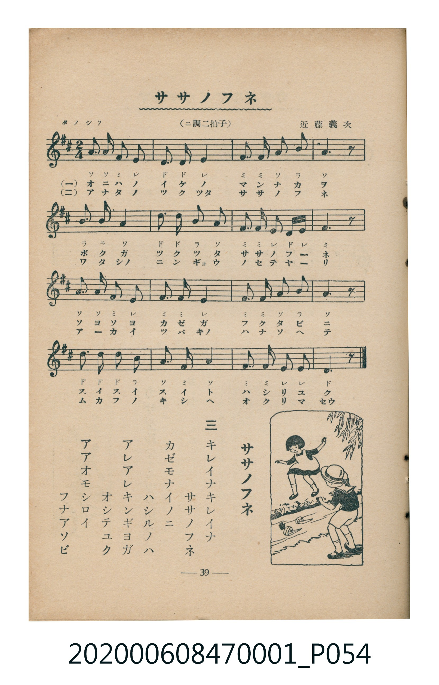

# ササノフネ

<audio controls src="sasa_no_fune.mp3"></audio>

- 曲：近藤義次
- 臺灣教育會公認《新定兒童唱歌》尋常科第一學年用（2020.006.0847.0001）

## 說明

・出處：臺灣教育會公認《新定兒童唱歌》尋常科第一學年用（2020.006.0847.0001）
・調性與拍號：調號 ?= D，拍號 <2/4>，速度 != 100

## 歌詞

```text
一
オニハノ　イケノ　マサナノ　カフネ
ボクタガ　ツクツタ　ササノフネ
ソヨソヨ　カゼガ　フク　タビ　ニ
スイスイ　ススム　ハオモシロイ

二
アナタノ　フネト　ワタシノ　フネト
ツヅイテ　ナランデ　タノシサウ
アーヨイ　カゼヨ　ハヤク　フケ
ドンドン　ススメ　ササノフネ

三
キレイナキレイナ　ササノフネ
カゼモナイノニ　ハシルノハ
アレアレキンギヨガ　オシテユク
アアオモシロイ　フナアソビ
```

## 原書掃描頁



## 分析

```text
================================================================================
📊 TMD Song Profile: [ ササノフネ ]
================================================================================
⏱  Duration:       0:57 (57.6s), 48 measures total
🎼 Key & Tempo:    首調基準 D, != 100.0 BPM, <2/4>
   - 分析範圍：      由實際發聲的音符與和弦推測調性；播放脈絡另行呈現
🎤 人聲音域:    D4 (MIDI 62) – D5 (MIDI 74) [跨度: 12 個半音 / 1.0 個八度, 難度: easy]
   - 最低音:  D4 in [Main #1 @ m.2, 0:01]
   - 最高音: D5 in [Main #1 @ m.6, 0:06]
   - 適合: soprano, mezzo-soprano, contralto, tenor, baritone, bass
🏛  結構:      Main (19.2s) -> Main (19.2s) -> Main (19.2s)
⚡ 編曲密度:        Peak 1 軌道同時演奏
🗝  調性診斷：       A 大調（純淨自然大調，未偵測到可信轉調）
   - 風格氣質:    純淨自然大調（陽光明朗、易唱易記，無明顯調外色彩）
   - 轉調歷程:    全曲維持單一推測調性（未偵測到可信轉調）
   - 核心骨幹音:  A, F#, E, D, B
   - 調性數值:    A 大調 [相關度: 0.84, 穩定度: Moderate, 自然音純度: 100.0%]
   - 候選調性 (K-S): A 大調 (0.84), D 大調 (0.77), F# 小調 (0.68)
   - 五度圈歷程:   +3 -> +3 -> +3
   - 各段落調性細節:
     • [Main #1]: A 大調 (r: 0.84, 自然音純度: 100.0%)
     • [Main #2]: A 大調 (r: 0.84, 自然音純度: 100.0%)
     • [Main #3]: A 大調 (r: 0.84, 自然音純度: 100.0%)

  [ 五度圈游移軌跡 ]
               C  
         F            G  
      Bb               D  
      Eb              [A ]*
         Ab           E  
            Db       B  
               F# 
     (* = active key center)

  [ 十二半音累積音高分佈 ]
     C  :                            0.0%
     C# :                            0.0%
     D  : ██████████████            18.3%
     D# :                            0.0%
     E  : ████████████████          20.0%
     F  :                            0.0%
     F# : ████████████████          20.8%
     G  :                            0.0%
     G# :                            0.0%
     A  : ████████████████████████  30.8%
     A# :                            0.0%
     B  : ████████                  10.0%
--------------------------------------------------------------------------------
Assignment 軌道音域：
  - Piano         : D4 – D5 (12 個半音 / 1.0 個八度, 144 個音符)
================================================================================
```

## ABC

```abc
X:1
T:ササノフネ
C:曲：近藤義次
M:2/4
L:1/16
Q:1/4=100
K:D
V:V1 name="Piano" snm="Pia"
[V:V1]
a3 a f2 e2 | d3 d e4 | f3 f a2 b2 | a6 z2 |
b3 b a4 | d3 d b2 a2 | f3 f e2 d2 | e6 z2 |
a3 a f2 e2 | f3 f e4 | f3 f a2 b2 | a6 z2 |
d2 d2 d2 b2 | a3 f a4 | f3 f e2 e2 | d6 z2 |
a3 a f2 e2 | d3 d e4 | f3 f a2 b2 | a6 z2 |
b3 b a4 | d3 d b2 a2 | f3 f e2 d2 | e6 z2 |
a3 a f2 e2 | f3 f e4 | f3 f a2 b2 | a6 z2 |
d2 d2 d2 b2 | a3 f a4 | f3 f e2 e2 | d6 z2 |
a3 a f2 e2 | d3 d e4 | f3 f a2 b2 | a6 z2 |
b3 b a4 | d3 d b2 a2 | f3 f e2 d2 | e6 z2 |
a3 a f2 e2 | f3 f e4 | f3 f a2 b2 | a6 z2 |
d2 d2 d2 b2 | a3 f a4 | f3 f e2 e2 | d6 z2 |
```

- [主旋律 TMD 檔案](sasa_no_fune.tmd)
- [鋼琴伴奏 TMD 檔案](sasa_no_fune_piano.tmd)
