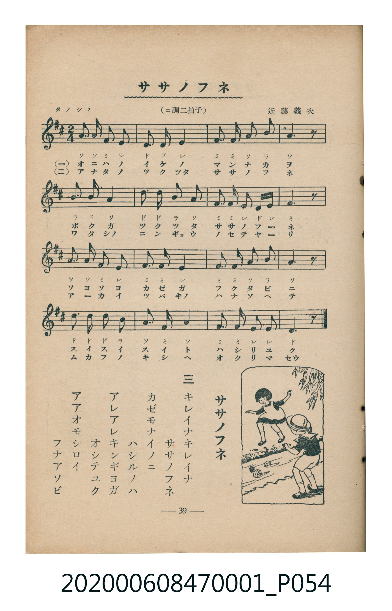

# ササノフネ（竹葉船）

> Re:Shōka 使用 AI 協助辨識與重建樂譜，可能會有錯誤。歡迎回報。

<audio controls src="sasa_no_fune.mp3"></audio>

- 曲：近藤義次
- 臺灣教育會公認《新定兒童唱歌》尋常科第一學年用（2020.006.0847.0001）

## 說明

曲目說明
中文解釋：孩子把竹葉折成小船，想像它順水漂流。

## 歌詞

```text
一
オニハノ　イケノ　マサナノ　カフネ
ボクタガ　ツクツタ　ササノフネ
ソヨソヨ　カゼガ　フク　タビ　ニ
スイスイ　ススム　ハオモシロイ

二
アナタノ　フネト　ワタシノ　フネト
ツヅイテ　ナランデ　タノシサウ
アーヨイ　カゼヨ　ハヤク　フケ
ドンドン　ススメ　ササノフネ

三
キレイナキレイナ　ササノフネ
カゼモナイノニ　ハシルノハ
アレアレキンギヨガ　オシテユク
アアオモシロイ　フナアソビ
```

## ABC

```abc
X:1
T:ササノフネ（竹葉船）
C:曲：近藤義次
M:2/4
L:1/16
Q:1/4=100
K:D
V:V1 name="Piano" snm="Pia"
[V:V1]
A3 A F2 E2 | D3 D E4 | F3 F A2 B2 | A6 z2 |
w: 1.~オ ニ ハ ノ | イ ケ ノ | マ ン ナ カ | ヲ
w: 2.~ア ナ タ ノ | ツ ク ツタ | サ サ ノ フ | ネ
w: 3.~キ レ イ ナ | キ レ イ | ナ サ サ ノ | フ
B3 B A4 | d3 d B2 A2 | F3 F E2 D E | E6 z2 |
w: 1.~ボ ク ガ | ツ ク ツタ _ | サ サ ノ フ _ | ネ
w: 2.~ワ タ シ | ニ ン ギョウ _ | ノ セ テ ヤ _ | リ
w: 3.~ネ カ ゼ | モ ナ イ ノ | ニ ハ シ ル ノ | ハ
A3 A F2 E2 | F3 F E4 | F3 F A2 B2 | A6 z2 |
w: 1.~ソ ヨ ソ ヨ | カ ゼ ガ | フ ク タ ビ | ニ
w: 2.~ア ー カ イ | ツ バ キ | ハ ナ ソ ヘ | テ
w: 3.~ア レ ア レ | キ ン ギョ | オ シ テ ユ | ク
d3 d d2 B2 | A3 F A4 | F3 F E2 E2 | D6 z2 |
w: 1.~ス イ ス イ | ス ス ム | ハ オ モ シ | ロイ
w: 2.~ド イ カ ノ | ス ス イ | マ リ ユ ク | セウ
w: 3.~ア ア オ モ | シ ロ イ | フ ナ ア ソ | ビ
```

## TMD 檔案連結

- [主旋律 TMD 檔案](sasa_no_fune.tmd) [[在 TMD Studio 編輯](https://tmdlang.github.io/Tmd-TS/#tmd=s7IKdvYPcrWy4qpTUCpJTLdSSM7PyUlNLsnMz7MqzsjMK0nNjM_KTMmPL87Iz05Ugisry88pzU21Si9KTEmNN4w3MjAyiDcwMIs3sDAxBzIMDBFKi_NLi5JTrYqTM_Lzc-JLUitKkvLzsxHyBUX5Zal5iXlANQVFIBtTwIoQClLLMlNSQdKpKZkl-UWZiTlI7kgtKga7FWxJfElRYl5xclFmAcgDCFUlGalAx4IlC_KLgEZraSk8btoKQs19j5unPm7ufb-n4_nqnS8mdr7o2Pl-T6eClhaXoq2CoYEBl72tgguXjZG-iR3IvGezN73fM-vF_okvpi95vm_lszULwda8aN_1vHHxs6kzXzRtejan-Wnrmhereh83dD2btuHpullPWyc9X7306ZSNz9b2PG7ofrqh--mOHc-XT3y-Zs2THQ1P1-54unPL8ykrgG4ABaQeMCD1QAEJZBgYAh2jxKWvpQC0-PnsdS9WrXo2o49LQUHhyY61z6a1v1i--GV7N9BFT9eufLp2wrOuLogvnnXNeNYx4emGfrB3ep41b37a3P90XfPLBW3PNmx5tqfp2dbGxw1NXFr6XEDDuYCu4HrctOpxc_fj5n5QmDQ0PG5a8rhpI5TdPA8cVl0wqdWQQON63DzncdP6x037HzetAatrAXFB5H6wOpQgBtqw93HzCigJMaZpD0znVJBOkOD-x82TwSLdQA07wc4AkyA5IGPn4-YFYOl-sIMXPW7a_rh5LVABF9eTXT1ALYtA7gSZAnE5yObHzR1gNsSlQPUoUkBftDxubgXZ0dwGlgD6c-Xj5s2Pm9thLuoDaQN5ZxnEhj1gj0AcBfYFxEegwAO6F-wRkI82As3uBJsEJhFeWIgleICx0Ak0fe3j5jVgtwB9gcTGFpwQmyEeBioCSnTDggboSWAkAUX6IQ4GGgMhgUZufty0Dux-cMgDQxGkuu1x8zKgy8GqQQglbGHBBbQHKAiMv8nglOObmJlnFZCZmJfvUGNQUw1Klgo2hmZadmBWjYKpgi4QmioYA0kjIK5RMASLGIJ5IFgDltMFkiC1ZmARiC4INACJgE3zMawB5tlVYFGgP4G4H8zqA-sBuhEi07QRKgYxHZhyoTo2A3EXWMVqqMwm7PYYgUxbBNXVBWTvR7anuQVqz3oQGyIJtappK1RqK1Q5MMigmnqxW2UM0rUWatUaqCcgzsQmA_MSSB5qD9hOhONA9qHaA40JUMiCwhcWtsCYiAMzgBRIDiSOiAtQ7IDiqAYeT1jionkOIiSa1iA5j5ohBIqM5vVQXfuBeDuKf7uhIQSMXFCSXg7Mn0gOgSSDx027gew2sDpQKIJkIMkIa3xAXQJKJsDchWQacpKAxBO6K_rh7gPqBcqC5ECJFGuMYOYN5NCHWEpa3tgLdcYKKBvEggQ7KMWDvLQHLaYgyQUSg5BUPhnFS1ijA543QKaBTIYEB1LMN0-AJ16IOCQQIEEHcdkMqAwoWnBEBNweUPIHsUEs1IwBi3awI2CS0CICGBOwWAelCZAMJB1hiQtEXgCzkIMaEvio0QGKIOTiDHt07IS6YwmUDQ8muMxOoNsWYAYT0AeQ1AZJTSAZUBmM3SpwBulEsgocI_BSEckqlCIEViqCrAIFDyRwQDp2I_IQnkgB0pCQhrgUJANyK4i_Fs0qaCIDRz7EV6AkAJIBJTZUe2q5uHTtFEDVigKQVuYCAA)]
- [鋼琴伴奏 TMD 檔案](sasa_no_fune_piano.tmd) [[在 TMD Studio 編輯](https://tmdlang.github.io/Tmd-TS/#tmd=s7IKdvYPcrWy4tLSUnjctBWEmvseN0993Nz7fk_H4-Ypj5sWAUWe7NnydGn_k90z3u_pVNDS4lK0VTA0MOCyt1Vw4bIx0jex46pTUHo2e9P7PbNe7J_4YvqS5_tWPluzUAkk_KJ91_PGxc-mznzRtOnZnOanrWterOp93ND1bNqGp-tmPW2d9Hz10qdTNj5b2_O4ofvphu6nO3Y8Xz7x-Zo1T3Y0PF274-nOLc-nrAA6xsjAyEDPwMBMz8DCxBzIMDAEOkaJi8s3MTPPKiAzMS8_yMOhxqCmmksBCGwMzbTswKwaBVMFXSA0VTAGkkZAXKNgCBYxBPNAsAYspwskQWrNwCIQXRBoABIBm-ZjWAMMqFVg0cfN3UDcD2b1gfU8bloCkWnaCBWDmP64eR5Ux2Yg7gKrWA2V2YTdHiOQaYugurqA7P3I9jS3QO1ZD2JDJKFWNW2FSm2FKgdGJ1RTL3arjEG61kKtWgP1BMSZ2GRgXgLJQ-0B24lwHMg-VHugMQEKWVD4wsIWGBNxYAaQAsmBxBFxAYodUBzVwOMJS1w0z0GERNMaJOdRM4RAkdG8HqprPxBvR_FvNzSEgJHbtO5x8_LHTcuQHAJJBo-bdgPZbWB1oFAEyUCSEdb4gLoElEweN-1BMg05SUDiCd0V_XD3AfUCZUFyoESKNUYw8wZy6EMsJS1v7IU6YwWUDWJBgh2U4kFe2oMWU5DkAolBSCqfjOIlrNEBzxsg00AmQ4IDKeabJ8ATL0QcEgiQoIO4bAZUBhQtOCICbg8o-YPYIBZqxoBFO9gRMEloEQGMCVisg9IESAaSjrDEBSIvgFnIQQ0JfNToAEUQcnGGPTp2Qt2xBMqGBxNcZifQbQswgwnoA0hqg6QmkMxaRAGAJUaaO5GsAscIvFREsgqlCIGViiCrQMEDCRyQjt2IPIQnUoA0JKQhLgXJgNwK4q9FswqayMCRD_EVKAmAZECJDdWeWuRaxQe5VrGAVyrRhrFAtdGm8SAKF9cEmQcyHeIHoAhYBiKOXTXCKAgDRTdldmOzDdUlqEZBNAMDRddOARQu0T4gYRjbCIltDGYrcwEA)]

## 分析

```text
================================================================================
📊 TMD Song Profile: [ ササノフネ（竹葉船） ]
================================================================================
⏱  Duration:       0:19 (19.2s), 16 measures total
🎼 Key & Tempo:    首調基準 D, != 100.0 BPM, <2/4>
   - 分析範圍：      由實際發聲的音符與和弦推測調性；播放脈絡另行呈現
🎤 人聲音域:    D4 (MIDI 62) – D5 (MIDI 74) [跨度: 12 個半音 / 1.0 個八度, 難度: easy]
   - 最低音:  D4 in [Main #1 @ m.2, 0:01]
   - 最高音: D5 in [Main #1 @ m.6, 0:06]
   - 適合: soprano, mezzo-soprano, contralto, tenor, baritone, bass
🏛  結構:      Main (19.2s)
⚡ 編曲密度:        Peak 1 軌道同時演奏
🗝  調性診斷：       A 大調（純淨自然大調，未偵測到可信轉調）
   - 風格氣質:    純淨自然大調（陽光明朗、易唱易記，無明顯調外色彩）
   - 轉調歷程:    全曲維持單一推測調性（未偵測到可信轉調）
   - 核心骨幹音:  A, E, F#, D, B
   - 調性數值:    A 大調 [相關度: 0.85, 穩定度: Moderate, 自然音純度: 100.0%]
   - 候選調性 (K-S): A 大調 (0.85), D 大調 (0.76), F# 小調 (0.68)
   - 五度圈歷程:   +3
   - 各段落調性細節:
     • [Main #1]: A 大調 (r: 0.85, 自然音純度: 100.0%)

  [ 五度圈游移軌跡 ]
               C  
         F            G  
      Bb               D  
      Eb              [A ]*
         Ab           E  
            Db       B  
               F# 
     (* = active key center)

  [ 十二半音累積音高分佈 ]
     C  :                            0.0%
     C# :                            0.0%
     D  : ██████████████            17.5%
     D# :                            0.0%
     E  : ████████████████          20.8%
     F  :                            0.0%
     F# : ████████████████          20.8%
     G  :                            0.0%
     G# :                            0.0%
     A  : ████████████████████████  30.8%
     A# :                            0.0%
     B  : ████████                  10.0%
--------------------------------------------------------------------------------
Assignment 軌道音域：
  - Piano         : D4 – D5 (12 個半音 / 1.0 個八度, 49 個音符)
================================================================================
```


## 原書掃描頁




