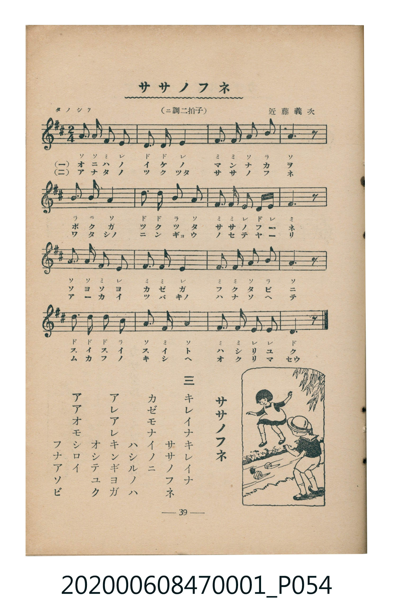

# ササノフネ（竹葉船）

> Re:Shōka 使用 AI 協助辨識與重建樂譜，可能會有錯誤。歡迎[回報](https://github.com/TMDLang/reshoka/issues)。

- **鋼琴伴奏版**：<br><audio controls src="sasa_no_fune.mp3"></audio>
- **NEUTRINO 歌聲合成版**：<br><audio controls src="sasa_no_fune_neutrino.mp3"></audio>

- 曲：近藤義次
- 臺灣教育會公認《新定兒童唱歌》尋常科第一學年用（2020.006.0847.0001）

## 說明

曲目說明
中文解釋：孩子把竹葉折成小船，想像它順水漂流。


## 歌詞

```text
一
オニハノ　イケノ　マサナノ　カフネ
ボクタガ　ツクツタ　ササノフネ
ソヨソヨ　カゼガ　フク　タビ　ニ
スイスイ　ススム　ハオモシロイ

二
アナタノ　フネト　ワタシノ　フネト
ツヅイテ　ナランデ　タノシサウ
アーヨイ　カゼヨ　ハヤク　フケ
ドンドン　ススメ　ササノフネ

三
キレイナキレイナ　ササノフネ
カゼモナイノニ　ハシルノハ
アレアレキンギヨガ　オシテユク
アアオモシロイ　フナアソビ
```

## ABC

<div class="abc-score" data-abc-src="sasa_no_fune.abc" aria-label="五線譜載入中"></div>

[下載 ABC 原始檔](sasa_no_fune.abc)

## TMD 檔案連結

- [主旋律 TMD 檔案](sasa_no_fune.tmd) [[在 TMD Studio 編輯](https://tmdlang.github.io/Tmd-TS/#tmd=s7IKdvYPcrWy4qpTUCpJTLdSSM7PyUlNLsnMz7MqzsjMK0nNjM_KTMmPL87Iz05Ugisry88pzU21Si9KTEmNN4w3MjAyiDcwMIs3sDAxBzIMDBFKi_NLi5JTrYqTM_Lzc-JLUitKkvLzsxHyBUX5Zal5iXlANQVFIBtTwIoQClLLMlNSQdKpKZkl-UWZiTlI7kgtKga7FWxJfElRYl5xclFmAcgDCFUlGalAx4IlC_KLkIwGmpaemWdVkpgJ9B_Ij-WJ8bmJmXk5iXkpyKpKMvKBXi3IqLTKyCwGuSE5MSc-OzEPKUSgLihITE-1CjAwNVHi0tJSeNy0FYSa-x43T33c3Pt-T8fz1TtfTOx80bHz_Z5OBS0tLkVbBUMDAy57WwUXLhsjfRM7kIHPZm96v2fWi_0TX0xf8nzfymdrFoLtedG-63nj4mdTZ75o2vRsTvPT1jUvVvU-buh6Nm3D03WznrZOer566dMpG5-t7Xnc0P10Q_fTHTueL5_4fM2aJzsanq7d8XTnludTVgDdAIotPWBs6YFiC8gwMAQ6RolLX0sBaPHz2eterFr1bEYfl4KCwpMda59Na3-xfPHL9m6gi56uXfl07YRnXV0QXzzrmvGsY8LTDf1g7_Q8a978tLn_6brmlwvanm3Y8mxP07OtjY8bmri09LmAhnMBXcH1uGnV4-bux839oDBpaHjctORx00You3keOKy6YFKrIYHG9bh5zuOm9Y-b9j9uWgNW1wLigsj9YHUoQQy0Ye_j5hVQEmJM0x6YzqkgnSDB_Y-bJ4NFuoEadoKdASZBckDGzsfNC8DS_WAHL3rctP1x81qgAi6uJ7t6gFoWgdwJMgXicpDNj5s7wGyIS4HqUaSAvmh53NwKsqO5DSwB9OfKx82bHze3w1zUB9IG8s4yiA17wB6BOArsC4iPQIEHdC_YIyAfbQSa3Qk2CUwivLAQS_AAY6ETaPrax81rwG4B-gKJjS04ITZDPAxUBJTohgUN0JPASAKK9EMcDDQGQgKN3Py4aR3Y_eCQB4YiSHXb4-ZlQJeDVYMQStjCggtoD1AQGH-TwSnHF5gfrQIyE_PyHWoMaqpByVLBxtBMyw7MqlEwVdAFQlMFYyBpBMQ1CoZgEUMwDwRrwHK6QBKk1gwsAtEFgQYgEbBpPoY1wDy7CiwK9CcQ94NZfWA9QDdCZJo2QsUgpgNTLlTHZiDuAqtYDZXZhN0eI5Bpi6C6uoDs_cj2NLdA7VkPYkMkoVY1bYVKbYUqBwYZVFMvdquMQbrWQq1aA_UExJnYZGBeAslD7QHbiXAcyD5Ue6AxAQpZUPjCwhYYE3FgBpACyYHEEXEBih1QHNXA4wlLXDTPQYRE0xok51EzhECR0bweqms_EG9H8W83NISAkQtK0suB-RPJIZBk8LhpN5DdBlYHCkWQDCQZYY0PqEtAyQSYu5BMQ04SkHhCd0U_3H1AvUBZkBwokWKNEcy8gRz6EEtJyxt7oc5YAWWDWJBgB6V4kJf2oMUUJLlAYhCSyiejeAlrdMDzBsg0kMmQ4ECK-eYJ8MQLEYcEAiToIC6bAZUBRQuOiIDbA0r-IDaIhZoxYNEOdgRMElpEAGMCFuugNAGSgaQjLHGByAtgFnJQQwIfNTpAEYRcnGGPjp1QdyyBsuHBBJfZCXTbAsxgAvoAktogqQkkAyqDsVsFziCdSFaBYwReKiJZhVKEwEpFkFWg4IEEDkjHbkQewhMpQBoS0hCXgmRAbgXx16JZBU1k4MiH-AqUBEAyoMSGak8tF5eunQKoWlEA0spcAA)]
- [鋼琴伴奏 TMD 檔案](sasa_no_fune_piano.tmd) [[在 TMD Studio 編輯](https://tmdlang.github.io/Tmd-TS/#tmd=s7IKdvYPcrWy4qpTUCpJTLdSyC8qychPL0osyKi0ysgsLskvykxOzInPTsxLVIIrKs4vLUpOjS9ITE-1CjAwNVHi0tJSeNy0FYSa-x43T33c3Pt-T8fj5imPmxYBRZ7s2fJ0af-T3TPe7-lU0NLiUrRVMDQw4LK3VXDhsjHSN7EDmfxs9qb3e2a92D_xxfQlz_etfLZmIdjCF-27njcufjZ15oumTc_mND9tXfNiVe_jhq5n0zY8XTfraeuk56uXPp2y8dnanscN3U83dD_dseP58onP16x5sqPh6dodT3dueT5lBdAxRgZGBnoGBmZ6BhYm5kCGgSHQMUpcXL6JmXlWAZmJeflBHg41BjXVXApAYGNopmUHZtUomCroAqGpgjGQNALiGgVDsIghmAeCNWA5XSAJUmsGFoHogkADkAjYNB_DGmBArQKLPm7uBuJ-MKsPrOdx0xKITNNGqBjE9MfN86A6NgNxF1jFaqjMJuz2GIFMWwTV1QVk70e2p7kFas96EBsiCbWqaStUaitUOTA6oZp6sVtlDNK1FmrVGqgnIM7EJgPzEkgeag_YToTjQPah2gONCVDIgsIXFrbAmIgDM4AUSA4kjogLUOyA4qgGHk9Y4qJ5DiIkmtYgOY-aIQSKjOb1UF37gXg7in-7oSEEjNymdY-blz9uWobkEEgyeNy0G8huA6sDhSJIBpKMsMYH1CWgZPK4aQ-SachJAhJP6K7oh7sPqBcoC5IDJVKsMYKZN5BDH2IpaXljL9QZK6BsEAsS7KAUD_LSHrSYgiQXSAxCUvlkFC9hjQ543gCZBjIZEhxIMd88AZ54IeKQQIAEHcRlM6AyoGjBERFwe0DJH8QGsVAzBizawY6ASUKLCGBMwGIdlCZAMpB0hCUuEHkBzEIOakjgo0YHKIKQizPs0bET6o4lUDY8mOAyO4FuW4AZTEAfQFIbJDWBZNYiCgAsMdLciWQVOEbgpSKSVShFCKxUBFkFCh5I4IB07EbkITyRAqQhIQ1xKUgG5FYQfy2aVdBEBo58iK9ASQAkA0psqPbUItcqPsi1igW8Uok2jAWqjTaNB1G4uCbIPJDpED8ARcAyEHHsqhFGQRgouimzG5ttqC5BNQqiGRgounYKoHCJ9gEJw9hGSGxjMFuZCwA)]

## 分析

```text
================================================================================
📊 TMD Song Profile: [ ササノフネ（竹葉船） ]
================================================================================
⏱  Duration:       0:19 (19.2s), 16 measures total
🎼 Key & Tempo:    首調基準 D, != 100.0 BPM, <2/4>
   - 分析範圍：      由實際發聲的音符與和弦推測調性；播放脈絡另行呈現
🎤 人聲音域:    D4 (MIDI 62) – D5 (MIDI 74) [跨度: 12 個半音 / 1.0 個八度, 難度: easy]
   - 最低音:  D4 in [Main #1 @ m.2, 0:01]
   - 最高音: D5 in [Main #1 @ m.6, 0:06]
   - 適合: soprano, mezzo-soprano, contralto, tenor, baritone, bass
🏛  結構:      Main (19.2s)
⚡ 編曲密度:        Peak 1 軌道同時演奏
🗝  調性診斷：       A 大調（純淨自然大調，未偵測到可信轉調）
   - 風格氣質:    純淨自然大調（陽光明朗、易唱易記，無明顯調外色彩）
   - 轉調歷程:    全曲維持單一推測調性（未偵測到可信轉調）
   - 核心骨幹音:  A, E, F#, D, B
   - 調性數值:    A 大調 [相關度: 0.85, 穩定度: Moderate, 自然音純度: 100.0%]
   - 候選調性 (K-S): A 大調 (0.85), D 大調 (0.76), F# 小調 (0.68)
   - 五度圈歷程:   +3
   - 各段落調性細節:
     • [Main #1]: A 大調 (r: 0.85, 自然音純度: 100.0%)

  [ 五度圈游移軌跡 ]
               C  
         F            G  
      Bb               D  
      Eb              [A ]*
         Ab           E  
            Db       B  
               F# 
     (* = active key center)

  [ 十二半音累積音高分佈 ]
     C  :                            0.0%
     C# :                            0.0%
     D  : ██████████████            17.5%
     D# :                            0.0%
     E  : ████████████████          20.8%
     F  :                            0.0%
     F# : ████████████████          20.8%
     G  :                            0.0%
     G# :                            0.0%
     A  : ████████████████████████  30.8%
     A# :                            0.0%
     B  : ████████                  10.0%
--------------------------------------------------------------------------------
Assignment 軌道音域：
  - Piano         : D4 – D5 (12 個半音 / 1.0 個八度, 49 個音符)
================================================================================
```


## 原書掃描頁




