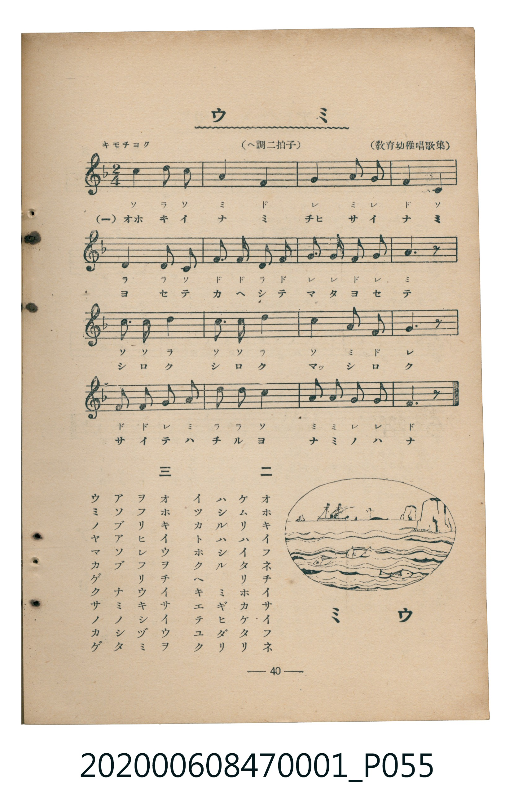

# ウミ

<audio controls src="umi.mp3"></audio>

- 教育幼稚唱歌集
- 臺灣教育會公認《新定兒童唱歌》尋常科第一學年用（2020.006.0847.0001）

- note

・出處：教育幼稚唱歌集
・出處：臺灣教育會公認《新定兒童唱歌》尋常科第一學年用（2020.006.0847.0001）
・調性與拍號：調號 ?= F，拍號 <2/4>，速度 != 96

## 歌詞

```text
一
オホキイ　ナミ　チヒサイ　ナミ
ヨセテ　カヘシテ　マタヨセテ
シロク　シロク　マツシロク
サイテハ　チルヨ　ナミノハナ

二
オホキイフネ　チイサイフネ
ケムリハイタリ　ホカケタリ
ハシルハシル　ミギヒダリ
イツカトホクヘ　キエテユク

三
オホキイウヲ　チイサイウヲ
ヲフリヒレフリ　ウキシヅミ
アソブアソブ　ナミノシタ
ウミノヤマカゲ　クサノカゲ
```

## 原書掃描頁



## 調性分析

```text
================================================================================
📊 TMD Song Profile: [ ウミ ]
================================================================================
⏱  Duration:       1:00 (60.0s), 48 measures total
🎼 Key & Tempo:    首調基準 F, != 96.0 BPM, <2/4>
   - 分析範圍：      由實際發聲的音符與和弦推測調性；播放脈絡另行呈現
🎤 人聲音域:    C4 (MIDI 60) – D5 (MIDI 74) [跨度: 14 個半音 / 1.2 個八度, 難度: moderate]
   - 最低音:  C4 in [Main #1 @ m.4, 0:04]
   - 最高音: D5 in [Main #1 @ m.1, 0:00]
   - 適合: soprano, mezzo-soprano, contralto, tenor, baritone, bass
🏛  結構:      Main (20.0s) -> Main (20.0s) -> Main (20.0s)
⚡ 編曲密度:        Peak 1 軌道同時演奏
🗝  調性診斷：       F 大調（純淨自然大調，未偵測到可信轉調）
   - 風格氣質:    純淨自然大調（陽光明朗、易唱易記，無明顯調外色彩）
   - 轉調歷程:    全曲維持單一推測調性（未偵測到可信轉調）
   - 核心骨幹音:  C, F, G, D, A
   - 調性數值:    F 大調 [相關度: 0.81, 穩定度: Moderate, 自然音純度: 100.0%]
   - 候選調性 (K-S): F 大調 (0.81), C 大調 (0.77), D 小調 (0.65)
   - 五度圈歷程:   -1 -> -1 -> -1
   - 各段落調性細節:
     • [Main #1]: F 大調 (r: 0.81, 自然音純度: 100.0%)
     • [Main #2]: F 大調 (r: 0.81, 自然音純度: 100.0%)
     • [Main #3]: F 大調 (r: 0.81, 自然音純度: 100.0%)

  [ 五度圈游移軌跡 ]
               C  
        [F ]*          G  
      Bb               D  
      Eb               A  
         Ab           E  
            Db       B  
               F# 
     (* = active key center)

  [ 十二半音累積音高分佈 ]
     C  : ████████████████████████  23.0%
     C# :                            0.0%
     D  : ███████████████████       18.0%
     D# :                            0.0%
     E  :                            0.0%
     F  : ████████████████████████  23.0%
     F# :                            0.0%
     G  : █████████████████████     19.7%
     G# :                            0.0%
     A  : █████████████████         16.4%
     A# :                            0.0%
     B  :                            0.0%
--------------------------------------------------------------------------------
Assignment 軌道音域：
  - Piano         : C4 – D5 (14 個半音 / 1.2 個八度, 132 個音符)
================================================================================
```

## ABC

```abc
X:1
T:ウミ
C:TMD (Chen, Chih-Han / aguai)
M:2/4
L:1/16
Q:1/4=96
K:F

V:V1 name="Piano" snm="Pia"

[V:V1]
c4 d2 c2 | a4 f4 | g4 a2 g2 | f4 c4 |
d4 d2 c2 | f2 f2 d2 f2 | g2 g2 f2 g2 | a6 z2 |
c2 c2 d4 | c2 c2 d4 | c4 a2 f2 | g6 z2 |
f2 f2 g2 a2 | d2 d2 c4 | a2 a2 g2 g2 | f6 z2 |
c4 d2 c2 | a4 f4 | g4 a2 g2 | f4 c4 |
d4 d2 c2 | f2 f2 d2 f2 | g2 g2 f2 g2 | a6 z2 |
c2 c2 d4 | c2 c2 d4 | c4 a2 f2 | g6 z2 |
f2 f2 g2 a2 | d2 d2 c4 | a2 a2 g2 g2 | f6 z2 |
c4 d2 c2 | a4 f4 | g4 a2 g2 | f4 c4 |
d4 d2 c2 | f2 f2 d2 f2 | g2 g2 f2 g2 | a6 z2 |
c2 c2 d4 | c2 c2 d4 | c4 a2 f2 | g6 z2 |
f2 f2 g2 a2 | d2 d2 c4 | a2 a2 g2 g2 | f6 z2 |
```

- [主旋律 TMD 檔案](umi.tmd)
- [鋼琴伴奏 TMD 檔案](umi_piano.tmd)
